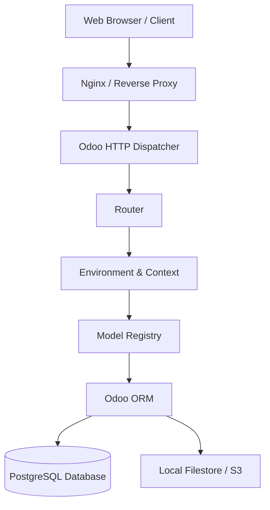

# Track 1: Odoo Technical Lead
## Chapter 1: Odoo Core Architecture & ORM Internals

### 1. High-Level Engine Architecture
The Odoo engine operates on a three-tier architecture model: presentation (client), logic (application server), and data (database). 



#### Threaded vs Prefork vs Gevent

Odoo can run in different multiprocessing modes to serve web requests, depending on the scale and configuration.
- **Threaded Mode:** By default, Odoo runs as a multithreaded application. This is useful for development but isn't suitable for production because Python's Global Interpreter Lock (GIL) limits true parallelism.
- **Prefork Mode (Multiprocessing):** In production, Odoo must be run in prefork mode. A master process spawns multiple worker processes. Each worker handles requests independently, bypassing the GIL limit.
- **Gevent (longpolling):** For real-time features like chat, live chat, or IoT notifications, Odoo uses a separate gevent-based event loop. This allows handling thousands of concurrent idle connections without blocking the main worker pool.

#### Configuring Workers and Memory

For a production environment, you must calculate the optimal number of workers to prevent the server from becoming overwhelmed.
- **Worker formula:** `Workers = (2 × CPU_cores) + 1`
- **RAM formula:** `Total RAM required = Workers × 1.5 GB` 

**Real-world Scenario:**
Consider a manufacturing company with 500 concurrent users. They deploy Odoo on a dedicated server with 16 CPU cores.
- Workers = (2 * 16) + 1 = 33 workers.
- We might allocate 32 regular workers, 1 dedicated cron worker, and configure a separate port for longpolling.

**Production `odoo.conf` Example:**
```ini
[options]
workers = 4
max_cron_threads = 2
db_host = localhost
db_port = 5432
limit_memory_hard = 2684354560
limit_memory_soft = 2147483648
limit_time_cpu = 60
limit_time_real = 120
```

> 📺 **Video:** Odoo Experience Advanced Deployment https://www.youtube.com/@Odoo
> 📖 **Docs:** https://www.odoo.com/documentation/17.0/administration/install/deploy.html
> 💡 **Interview Tip:** Workers formula question is ALWAYS asked

### 2. The Core Primitives: cr, uid, context, env

At the heart of every method in Odoo lies the Environment (`self.env`), which encapsulates four critical primitives.

| Primitive | Description |
| :--- | :--- |
| **cr** | The `psycopg2` database cursor. Handles raw SQL execution. |
| **uid** | The user ID integer. Determines permissions and record rules. |
| **context** | A `frozendict` containing parameters like language (`lang`) or active models. |
| **cache** | An in-memory cache mechanism (dict of `record -> field -> value`). |

#### Database Transactions and `cr.commit()`

**NEVER call `cr.commit()` manually.** 
Calling `cr.commit()` explicitly inside business logic breaks test isolation (unit tests rely on rolling back transactions to maintain a clean state). It also violates ACID properties, as partial transactions might be committed if an error occurs later.

#### The Identity Map Pattern

Odoo's ORM implements an Identity Map pattern within the `env.cache`. If you request a record already loaded within the current transaction, the ORM returns the existing in-memory object.

```python
class SaleOrder(models.Model):
    _inherit = 'sale.order'
    
    def demonstrate_identity_map(self):
        # First browse — triggers SQL: SELECT * FROM sale_order WHERE id = 1
        order_a = self.env['sale.order'].browse(1)
        _ = order_a.name  # Triggers prefetch batch
        
        # Second browse — NO SQL! Returns same cached record
        order_b = self.env['sale.order'].browse(1)
        assert order_a is order_b  # SAME Python object!
```

#### Modifying the Environment

- `with_context(**kwargs)`: Returns a new Environment with an updated context dictionary.
- `sudo()`: Returns a new Environment with `uid` set to `SUPERUSER_ID=2`, bypassing all ACL checks.

**Real-world Scenario:**
A classic N+1 performance problem occurs from iterating without prefetching, forcing the ORM to query the database individually.

> 📖 **Docs:** https://www.odoo.com/documentation/17.0/developer/reference/backend/orm.html
> 💡 **Interview Tip:** Common trap — calling cr.commit() inside a wizard action

### 3. ORM Internals: search(), browse(), prefetch

- **`search()`**: Builds a SQL domain into a WHERE clause via `expression.py` and returns matching IDs.
- **`browse()`**: Creates a RecordSet WITHOUT querying the DB immediately.

#### Prefetch mechanism
Prefetch mechanism: `_prefetch_ids`, batch loading up to 1000 IDs.

**N+1 example and fix:**
```python
# ❌ N+1: 1 query for partners list + N queries for each name
for partner in self.env['res.partner'].search([]):  
    print(partner.name)  # Each triggers prefetch group

# ✅ Prefetch already batches it! But to force:
partners = self.env['res.partner'].search([], limit=1000)
names = partners.mapped('name')  # Single SQL: SELECT name FROM res_partner WHERE id IN (...)
```

- **`read_group()`**: For aggregations: SELECT + GROUP BY
- **`_sql_constraints` vs Python `@api.constrains`**: SQL constraints are faster, evaluated at PostgreSQL level. Python constrains allow complex logic.

> 📖 **Source:** https://github.com/odoo/odoo/blob/17.0/odoo/models.py

### 4. Model Inheritance Patterns

- **`_inherit`**: Classical inheritance (extend existing model, same table).
- **`_inherits`**: Delegation inheritance (new table, delegate to parent via FK).
- **Abstract models**: `_abstract = True` (no table, shared mixins).

**Concrete example:** mail.thread mixin adds chatter to any model.
```python
class ProjectTask(models.Model):
    _inherit = 'project.task'  # Extends: adds field to existing table
    
    custom_field = fields.Char('Custom Field')
    
    @api.constrains('custom_field')
    def _check_custom_field(self):
        for task in self:
            if len(task.custom_field or '') > 100:
                raise ValidationError('Too long!')
```

- **Module loading order**: `__manifest__.py` depends list determines the load order.

> 📺 **Video:** Odoo Module Development Tutorial https://www.youtube.com/@Odoo
> 📖 **Docs:** https://www.odoo.com/documentation/17.0/developer/tutorials/server_framework_101.html
> 💡 **Interview Tip:** _inherit vs _inherits difference is a classic interview question
