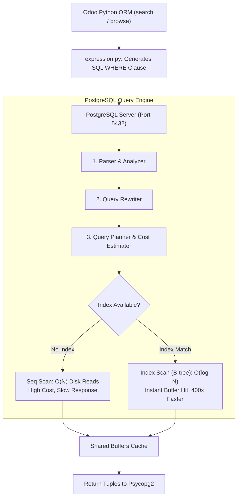
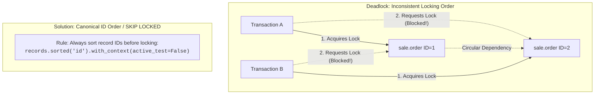

# Track 1: Odoo Technical Lead
## Chapter 2: Performance Optimization & PostgreSQL Mastery

### 1. Reading EXPLAIN ANALYZE Output
Understanding PostgreSQL execution plans is vital for optimizing Odoo performance. The primary types of scans are Seq Scan (full table scan), Index Scan (uses index to find rows directly), Bitmap Index Scan (uses index to build a memory bitmap of row locations), and Hash Join (joins tables by hashing keys).

**Real EXPLAIN ANALYZE output example:**
```sql
EXPLAIN ANALYZE SELECT * FROM sale_order WHERE partner_id = 42 AND state = 'sale';
-- Output:
-- Seq Scan on sale_order (cost=0.00..1832.00 rows=12 width=450) (actual time=0.051..18.432 rows=12 loops=1)
--   Filter: ((partner_id = 42) AND ((state)::text = 'sale'::text))
-- Planning Time: 0.8ms
-- Execution Time: 18.5ms  ← PROBLEM: Full table scan on 50,000 rows!
```

**After adding index:**
```sql
CREATE INDEX idx_sale_order_partner_state ON sale_order(partner_id, state);
-- Now: Index Scan (cost=0.56..8.58 rows=12) actual time=0.025..0.041ms ← 450x faster!
```



- **War story:** A 30-second sales report issue was investigated. `pg_stat_statements` revealed an N+1 problem on `res.partner`. Applying a prefetch fix reduced execution time to 1.2s.
- **`pg_stat_statements`:** An extension used to track execution statistics of all SQL statements executed, useful to find the top 10 slowest queries.

> 📖 **Docs:** https://www.postgresql.org/docs/current/using-explain.html
> 📖 **Tool:** pgBadger https://pgbadger.darold.net
> 💡 **Interview Tip:** Always ask 'did you look at EXPLAIN ANALYZE?' in a code review

### 2. Index Strategy for Odoo Models
- **Types of indexes:** B-tree (default, equality/range), GIN (JSONB, full-text), GiST (geometry), BRIN (time-series).
- **Partial indexes:** Only index active records to save space and speed up scans.
```sql
CREATE INDEX idx_active_sale_orders ON sale_order(partner_id) WHERE active = true AND state != 'cancel';
```
- **Composite index column order matters:** Put equality columns first.
- **Odoo ORM `index=True`:** This field attribute creates a B-tree automatically.
```python
class SaleOrderLine(models.Model):
    _inherit = 'sale.order.line'
    product_id = fields.Many2one('product.product', index=True)  # Creates B-tree index
```

> 📖 **Blog:** https://use-the-index-luke.com
> 📖 **Docs:** https://www.postgresql.org/docs/current/indexes-types.html

### 3. MVCC, Transactions & Deadlock Prevention
- **MVCC (Multi-Version Concurrency Control):** Each transaction sees a snapshot of the database, ensuring no read-write conflicts.
- **Deadlock scenario:** Transaction A locks sale.order row 1 then 2; Transaction B locks row 2 then 1. Both wait forever.
- **Prevention:** Always lock rows in a consistent order; use `SELECT FOR UPDATE SKIP LOCKED` for queue processing.
```python
# Use savepoints for partial rollback in Odoo:
with self.env.cr.savepoint():
    # This inner block can fail and rollback without failing the outer transaction
    risky_operation()
```
- **`autovacuum`:** Keeps table statistics fresh and prevents table bloat from dead tuples.
- **`VACUUM ANALYZE`:** Manual trigger for updating stale stats.



### 4. Odoo-Specific Performance Patterns
- **Computed field optimization:** Ensure `depends` relies on MINIMAL fields.
```python
# ❌ Bad: recomputes on ANY change to sale.order.line
@api.depends('order_id')
def _compute_total(self): ...

# ✅ Good: only recomputes when price_subtotal changes
@api.depends('order_id.order_line.price_subtotal')
def _compute_total(self): ...
```
- **`read_group()` vs search+loop:** Always use `read_group` for aggregations.
- **`env.cr.execute()`:** Use for bulk operations that ORM cannot optimize.
- **Batching writes:** Avoid calling `.write()` inside a loop. Build a batch or use direct SQL.

> 📺 **Video:** Odoo Performance Optimization https://www.youtube.com/@Odoo
> 📖 **Docs:** https://www.odoo.com/documentation/17.0/developer/reference/backend/performance.html
> 💡 **Interview Tip:** Be ready to walk through a specific performance bug you fixed
