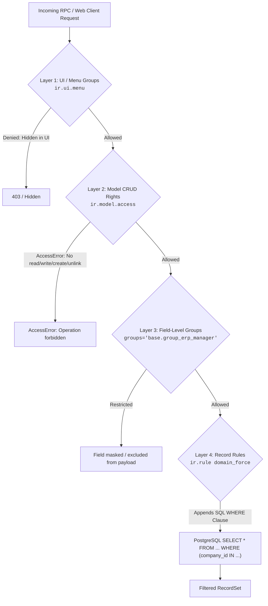
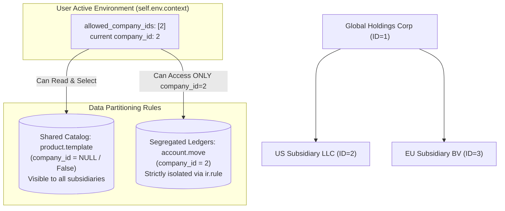

# Track 1: Odoo Technical Lead
## Chapter 3: Security Architecture & Multi-Company Design

> 🧭 **Navigation**: [⬅️ Previous: 02: Performance & PostgreSQL](02-performance-and-database.md) | [🏠 Odoo Technical Lead Track Index](README.md) | [➡️ Next: 04: OWL 2 & Frontend](04-owl-and-qweb-frontend.md)

---

### 1. Access Control Layers
Odoo enforces security across multiple levels:
- **Layer 1: Menu items** (using the `ir.ui.menu` groups attribute).
- **Layer 2: Model access rights** (using `ir.model.access` CSV definitions).
- **Layer 3: Field access** (using the field groups attribute).
- **Layer 4: Record rules** (`ir.rule` domain filters to limit specific records).

**CSV format example (`ir.model.access.csv`):**
```csv
id,name,model_id:id,group_id:id,perm_read,perm_write,perm_create,perm_unlink
access_sale_order_user,sale.order user,model_sale_order,base.group_user,1,0,0,0
access_sale_order_manager,sale.order manager,model_sale_order,base.group_system,1,1,1,1
```

- **Programmatic check:** You can manually verify access via `self.env['sale.order'].check_access_rights('write')`.
- **Real-world:** A SOC2 audit finding occurred when the payslip model was missing a read restriction for non-HR users, emphasizing the need for comprehensive `ir.model.access` controls.



> 📖 **Docs:** https://www.odoo.com/documentation/17.0/developer/reference/backend/security.html
> 💡 **Interview Tip:** Know the AND/OR logic between global rules vs group rules.

### 2. Record Rules Deep Dive
- **Global rules:** Apply to ALL users (AND with group rules).
- **Group rules:** Apply to specific group members (OR between same-group rules).
- **Combining:** (Global Rule 1 AND Global Rule 2) AND (Group Rule A OR Group Rule B).

**Multi-company record rule example:**
```xml
<!-- XML record rule: user can only see their own company's orders -->
<record model='ir.rule' id='sale_order_company_rule'>
    <field name='name'>Sales Orders: Multi-Company</field>
    <field name='model_id' ref='model_sale_order'/>
    <field name='domain_force'>['|',('company_id','=',False),('company_id','in',company_ids)]</field>
</record>
```

- **Common bypass:** Using `sudo()` correctly without over-granting is vital.
- **Pen test finding:** A cross-company invoice was visible because a record rule used `company_id = user.company_id` (single active company) instead of `company_ids` (allowed set of companies), meaning switching company contexts allowed viewing unauthorized data.

> 💡 **Interview Tip:** `company_ids` (allowed companies in context) vs `company_id` (current active company).

### 3. Multi-Company Architecture
- The `company_id` field must exist on every transactional model.
- `allowed_company_ids` in context is a list of active company IDs the user has enabled.
- **Inter-company rules:** Can auto-create a vendor bill when company A creates a PO to company B.
- **Shared vs segregated master data:**
  - Shared: Products (`product.template`, `product.product`) — no `company_id`.
  - Segregated: Accounts, Journals, Pricelists — `company_id` required.

```python
# Switching company context:
with self.env['res.company']._company_context(company_id):
    # Operations here run under company_id
    self.env['account.move'].create({...})
```
- **Real-world:** A 5-subsidiary manufacturing group uses a shared product catalog (no company_id), but separate GL accounts per entity.



### 4. API Authentication & Security
- **`res.users.apikeys` (Odoo 16+):** Uses SHA-256 hashed API keys for external access.
- **JSON-RPC authentication flow:** First call authenticate, then call methods with the session cookie.
- **OAuth2 / SAML SSO integration:** Often done via OCA modules.

```python
import requests
# Authenticate via API key
response = requests.post('https://yourinstance.odoo.com/web/dataset/call_kw', json={
    'jsonrpc': '2.0', 'method': 'call', 'id': 1,
    'params': {
        'model': 'sale.order', 'method': 'search_read',
        'args': [[['state', '=', 'sale']]], 'kwargs': {'fields': ['name', 'amount_total']}
    }
}, headers={'Authorization': 'Bearer YOUR_API_KEY'})
```

---

> 🧭 **Navigation**: [⬅️ Previous: 02: Performance & PostgreSQL](02-performance-and-database.md) | [🏠 Odoo Technical Lead Track Index](README.md) | [➡️ Next: 04: OWL 2 & Frontend](04-owl-and-qweb-frontend.md)
