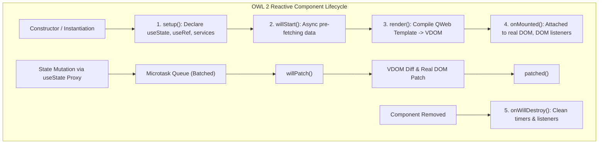
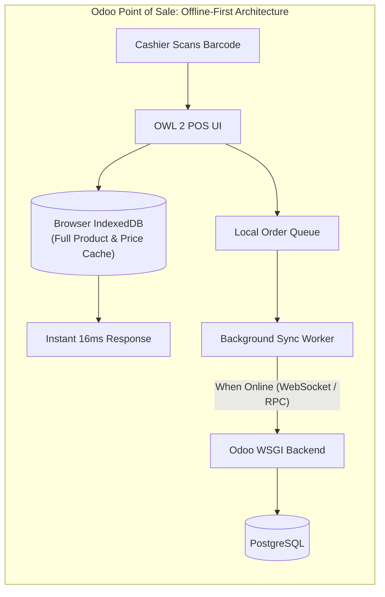

# Track 1: Odoo Technical Lead
## Chapter 4: OWL 2 Framework, QWeb Templates & Frontend Architecture

### 1. OWL 2 Component Architecture
- **Reactive component framework:** Odoo Web Library (OWL) 2 is Odoo's custom frontend framework.
- **Component = Class + Template:** Components are ES6 classes linked to QWeb templates via a static `template` property.
- **Props:** Parent passes data down (immutable in child).
- **State:** Internal reactive state with `useState` hook.

**Complete component example:**
```javascript
import { Component, useState, onMounted } from '@odoo/owl';
import { registry } from '@web/core/registry';

export class SalesKPIDashboard extends Component {
    static template = 'my_module.SalesKPIDashboard';
    static props = { resModel: String, domain: Array };
    
    setup() {
        this.state = useState({ totalRevenue: 0, orderCount: 0, loading: true });
        onMounted(() => this._loadKPIs());
    }
    
    async _loadKPIs() {
        const result = await this.env.services.orm.readGroup(
            this.props.resModel, this.props.domain,
            ['amount_total:sum'], [], { lazy: false }
        );
        this.state.totalRevenue = result[0]?.amount_total || 0;
        this.state.loading = false;
    }
}
registry.category('actions').add('sales_kpi_dashboard', SalesKPIDashboard);
```
- **Lifecycle:** `setup()` → `willStart()` → `mounted()` → `willUpdateProps()` → `willDestroy()`.



- **Real-world:** A POS offline-first with IndexedDB implementation achieved a 10x loading optimization (products loaded from IndexedDB cache instead of server call on every POS session open).



> 📺 **Video:** Odoo OWL Framework https://www.youtube.com/@Odoo
> 📖 **Docs:** https://github.com/odoo/owl/blob/master/doc/reference/README.md
> 💡 **Interview Tip:** Explain the difference between `useState` and `useStore`.

### 2. QWeb Templates & Inheritance
- Core directives: `t-if` (conditional), `t-foreach` (looping), `t-esc` (escaped output), `t-raw` (unescaped output), `t-field` (widget-aware formatting).

**Template inheritance with xpath:**
```xml
<template id='my_module.sale_order_form' inherit_id='sale.view_order_form'>
    <xpath expr="//field[@name='partner_id']" position='after'>
        <field name='custom_field' widget='char'/>
    </xpath>
</template>
```
- **Server-side QWeb:** Used for PDF reports via `ir.actions.report`.
- **JavaScript QWeb:** Used for client-side templates in OWL components.

### 3. Services, Store & Client Actions
- **Services:** Global instances for capabilities like ORM, notifications, router. E.g., `useService('orm')` for server calls, `useService('notification')` for toasts.
- **Client Actions:** Client-side routing allows navigating between components via action manager.
- **Store:** The `useStore` hook is for accessing Odoo's global state (user, company, etc.) across components.
