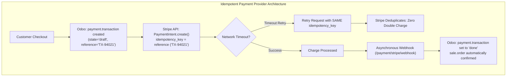
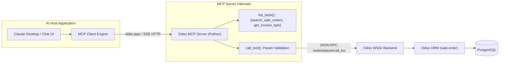

# Track 1: Odoo Technical Lead
## Chapter 5: APIs, External Integrations & Model Context Protocol

> 🧭 **Navigation**: [⬅️ Previous: 04: OWL 2 & Frontend](04-owl-and-qweb-frontend.md) | [🏠 Odoo Technical Lead Track Index](README.md) | [➡️ Next: 06: Migrations & DevOps](06-migrations-and-devops.md)

---

### 1. JSON-RPC API Deep Dive
- **Endpoint:** `POST /web/dataset/call_kw` is the central gateway for JSON-RPC in Odoo.
- **Auth:** Requires either a session cookie (from `POST /web/session/authenticate`) OR an `api_key` Bearer token (available in Odoo 16+).

**Complete Python client:**
```python
import requests
import json

class OdooClient:
    def __init__(self, url, db, username, password):
        self.url = url
        self.session = requests.Session()
        # Authenticate
        resp = self.session.post(f'{url}/web/session/authenticate', json={
            'jsonrpc': '2.0', 'method': 'call', 'id': 1,
            'params': {'db': db, 'login': username, 'password': password}
        })
        self.uid = resp.json()['result']['uid']
    
    def call(self, model, method, args=None, kwargs=None):
        resp = self.session.post(f'{self.url}/web/dataset/call_kw', json={
            'jsonrpc': '2.0', 'method': 'call', 'id': 1,
            'params': {'model': model, 'method': method,
                       'args': args or [], 'kwargs': kwargs or {}}
        })
        return resp.json()['result']

# Usage
client = OdooClient('https://myodoo.com', 'mydb', 'admin', 'admin')
orders = client.call('sale.order', 'search_read',
    [[['state', '=', 'sale']]], {'fields': ['name', 'amount_total'], 'limit': 10})
```

**Java client (HttpClient):**
```java
import java.net.http.*;
import java.net.URI;

public class OdooJsonRpcClient {
    private final HttpClient client = HttpClient.newHttpClient();
    private final String baseUrl;
    
    public String callKw(String model, String method, String argsJson) throws Exception {
        String body = String.format(
            "{\"jsonrpc\":\"2.0\",\"method\":\"call\",\"id\":1," +
            "\"params\":{\"model\":\"%s\",\"method\":\"%s\",\"args\":%s,\"kwargs\":{}}}",
            model, method, argsJson);
        HttpRequest request = HttpRequest.newBuilder()
            .uri(URI.create(baseUrl + "/web/dataset/call_kw"))
            .POST(HttpRequest.BodyPublishers.ofString(body))
            .header("Content-Type", "application/json")
            .build();
        return client.send(request, HttpResponse.BodyHandlers.ofString()).body();
    }
}
```

> 📖 **Docs:** https://www.odoo.com/documentation/17.0/developer/reference/external_api.html

### 2. Payment Provider Integration
- **Inheritance pattern:** Inherit `payment.provider` for configuration + `payment.transaction` for execution logic.
- **Idempotency key pattern:** Ensure API calls don't create duplicate charges on retries.

```python
class PaymentProviderStripe(models.Model):
    _inherit = 'payment.provider'
    
    stripe_secret_key = fields.Char('Stripe Secret Key', required_if_provider='stripe')
    
    def _get_supported_currencies(self):
        supported = super()._get_supported_currencies()
        return supported.filtered(lambda c: c.name in ['USD', 'EUR', 'GBP'])

class PaymentTransactionStripe(models.Model):
    _inherit = 'payment.transaction'
    
    def _stripe_make_request(self, endpoint, payload):
        """Make idempotent Stripe API call with our transaction reference as key."""
        import stripe
        stripe.api_key = self.provider_id.stripe_secret_key
        # Idempotency key prevents duplicate charges on retry
        return stripe.PaymentIntent.create(
            **payload,
            idempotency_key=self.reference  # tx reference = unique idempotency key
        )
```

- **War story:** Payment provider inheritance collision — two modules both inheriting `_stripe_make_request` caused one override to shadow the other; fixed with `super()` chain debugging.



### 3. Model Context Protocol (MCP) for Odoo
- **Architecture:** Claude/GPT (Host) → MCP Client → Odoo MCP Server
- **Complete Python MCP server exposing Odoo data:**

```python
from mcp.server import Server
from mcp.types import Tool, TextContent
import asyncio

app = Server('odoo-mcp-server')

@app.list_tools()
async def list_tools():
    return [
        Tool(name='search_sale_orders',
             description='Search Odoo sale orders by state or partner',
             inputSchema={
                 'type': 'object',
                 'properties': {
                     'state': {'type': 'string', 'enum': ['draft','sale','done','cancel']},
                     'limit': {'type': 'integer', 'default': 10}
                 }
             })
    ]

@app.call_tool()
async def call_tool(name, arguments):
    if name == 'search_sale_orders':
        # Call Odoo JSON-RPC
        orders = odoo_client.call('sale.order', 'search_read',
            [[['state', '=', arguments['state']]]],
            {'fields': ['name', 'partner_id', 'amount_total'],
             'limit': arguments.get('limit', 10)})
        return [TextContent(type='text', text=str(orders))]

if __name__ == '__main__':
    asyncio.run(app.run())
```

- **Real-world:** Claude Desktop + Odoo MCP server allows natural language ERP queries: 'Show me all overdue invoices from last month'.



> 📖 **Docs:** https://modelcontextprotocol.io
> 💡 **Interview Tip:** MCP is the hottest topic in 2025 for AI+ERP integration.

---

> 🧭 **Navigation**: [⬅️ Previous: 04: OWL 2 & Frontend](04-owl-and-qweb-frontend.md) | [🏠 Odoo Technical Lead Track Index](README.md) | [➡️ Next: 06: Migrations & DevOps](06-migrations-and-devops.md)
