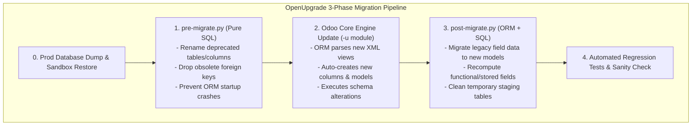
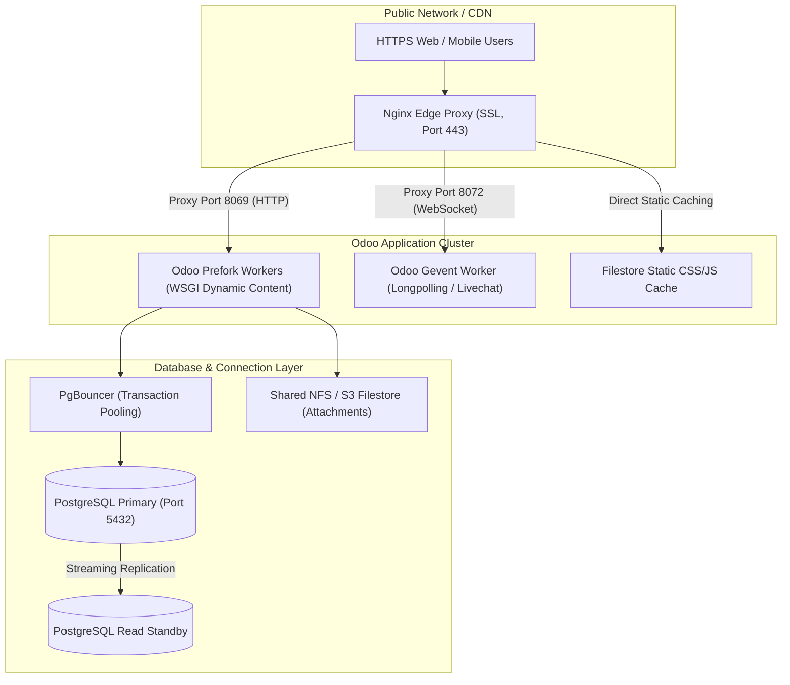

# Track 1: Odoo Technical Lead
## Chapter 6: Version Migrations, DevOps & CI/CD

### 1. OpenUpgrade Version Migrations
- **Script structure:** `pre_migrate()` (runs before ORM loads), `migrate()` (during), `post_migrate()` (after).

```python
# migrations/17.0.1.0.0/pre-migrate.py
def migrate(cr, version):
    # Rename column BEFORE ORM runs (ORM will look for new name)
    cr.execute("ALTER TABLE sale_order RENAME COLUMN old_field TO new_field;")
    cr.execute("UPDATE sale_order SET new_field = 'default_value' WHERE new_field IS NULL;")
```

- **Common issues:** Renamed models, merged fields, changed column types, resequenced modules.
- **War story:** v14→v18 migration of an 80-module custom Odoo deployment — took 6 months, using a staged approach, with database rehearsal 5 times before go-live.



> 📖 **Tool:** https://github.com/OCA/OpenUpgrade

### 2. Docker & Production Deployment

```dockerfile
# Dockerfile for Odoo 17 Production
FROM odoo:17.0
COPY ./addons /mnt/extra-addons
COPY ./odoo.conf /etc/odoo/odoo.conf
EXPOSE 8069 8072
CMD ["odoo", "--config=/etc/odoo/odoo.conf"]
```

```yaml
# docker-compose.yml
version: '3.8'
services:
  db:
    image: postgres:15
    environment:
      POSTGRES_DB: odoo
      POSTGRES_USER: odoo
      POSTGRES_PASSWORD: odoo
  odoo:
    image: odoo:17.0
    depends_on: [db]
    ports: ['8069:8069']
    volumes:
      - ./addons:/mnt/extra-addons
  nginx:
    image: nginx:alpine
    ports: ['80:80', '443:443']
```

- **Odoo.sh:** Uses a standard branch-based deployment pattern: Development branches → Staging (testing with prod data copy) → Production promotion workflow.



### 3. CI/CD & Automated Testing

```yaml
# .github/workflows/odoo-test.yml
name: Odoo Module Tests
on: [pull_request]
jobs:
  test:
    runs-on: ubuntu-latest
    services:
      postgres:
        image: postgres:15
        env:
          POSTGRES_PASSWORD: odoo
    steps:
      - uses: actions/checkout@v3
      - run: pip install odoo
      - run: python -m pytest --odoo-database=test_db --addons-path=./addons
```

```python
# Example Odoo test case
from odoo.tests import tagged, TransactionCase

@tagged('post_install', '-at_install')
class TestSaleOrderWorkflow(TransactionCase):
    def setUp(self):
        super().setUp()
        self.partner = self.env.ref('base.res_partner_1')
        self.product = self.env.ref('product.product_product_4')
    
    def test_sale_order_confirm(self):
        order = self.env['sale.order'].create({
            'partner_id': self.partner.id,
            'order_line': [(0, 0, {'product_id': self.product.id, 'product_uom_qty': 5})]
        })
        order.action_confirm()
        self.assertEqual(order.state, 'sale')
```

> 📖 **Docs:** https://www.odoo.com/documentation/17.0/developer/reference/backend/testing.html
