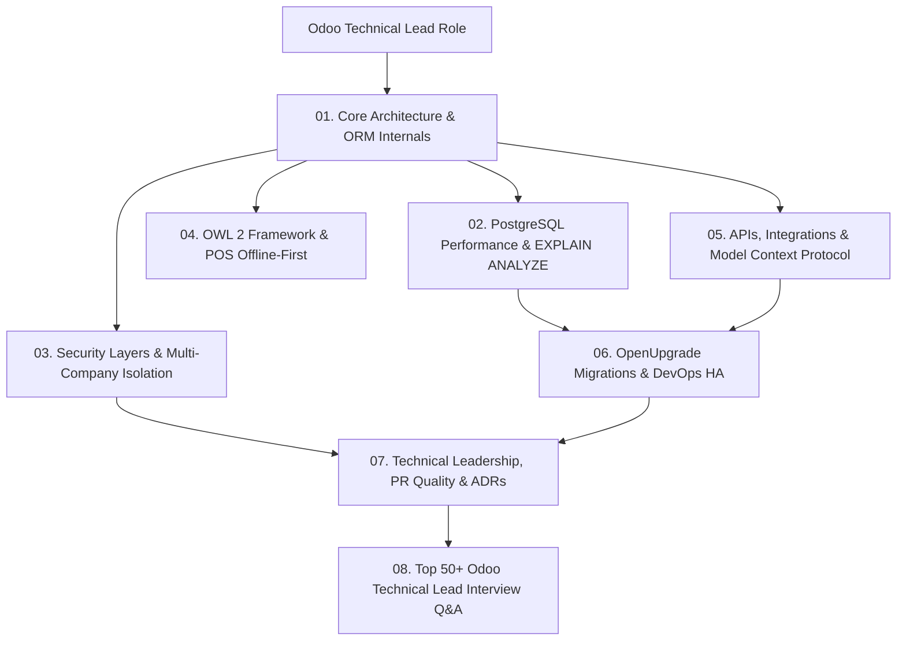

# ⚙️ Track 5: Odoo Technical Lead & ERP Architect
## Master Curriculum Roadmap & Architecture Blueprint

Welcome to the **Odoo Technical Lead Track**. Designed for Senior Odoo Developers, Technical Leads, and Enterprise Architects (7+ years experience) preparing for high-level technical interviews. Focuses strictly on core engine internals, ORM optimization, database tuning, security architecture, OWL 2, external integrations, and technical leadership.

---

## 🗺️ Visual Track Roadmap

---

## 📚 Sequential Learning Syllabus

| # | Chapter / Guide | Core Architectural Topics | Real-World Context |
|---|---|---|---|
| **01** | [**Architecture & Internals**](./01-architecture-and-internals.md) | WSGI Engine, Prefork worker sizing formula `(2*cores)+1`, Environment, ORM search/browse mechanics, Prefetching & Identity Map | Enterprise 500-user deployments |
| **02** | [**Performance & Database**](./02-performance-and-database.md) | PostgreSQL `EXPLAIN ANALYZE`, Index strategies (B-Tree, GIN, Partial), `pg_stat_statements`, MVCC & Deadlock elimination, N+1 query fixes | 30s to 1.2s query optimization war story |
| **03** | [**Security & Multi-Company**](./03-security-and-multi-company.md) | 4-tier security pipeline (`ir.ui.menu`, `ir.model.access`, field groups, `ir.rule`), Global vs Group rule evaluation, Multi-company context isolation | SOC2 compliance, pen-testing findings |
| **04** | [**OWL 2 & Frontend**](./04-owl-and-qweb-frontend.md) | OWL 2 reactive component lifecycle, `useState`, virtual DOM diffing, QWeb template inheritance via XPath, POS offline-first with IndexedDB | 10x POS initial load acceleration |
| **05** | [**APIs, Integrations & MCP**](./05-apis-integrations-and-mcp.md) | JSON-RPC `/web/dataset/call_kw`, REST APIs, Idempotent payment provider architecture (Stripe), Model Context Protocol (MCP) server | Claude AI + Odoo natural language ERP |
| **06** | [**Migrations & DevOps**](./06-migrations-and-devops.md) | OpenUpgrade 3-phase pipeline (`pre-migrate`, ORM update, `post-migrate`), Docker multi-container compose, PgBouncer, Nginx SSL reverse proxy | v14 to v18 80-module migration |
| **07** | [**Technical Leadership**](./07-technical-leadership.md) | 10-point code review checklist, Architecture Decision Records (ADRs), Fibonacci story point estimation, 5-Whys root cause post-mortems | POS Black Friday outage post-mortem |
| **08** | [**Top 50+ Odoo Interview Q&A**](./08-top-50-interview-questions.md) | 50+ exhaustive Senior/Lead questions covering Python ORM, SQL locks, security edge cases, and architectural scenarios | Lead & Architect interview questions |

---

## 🧭 Navigation
- ⬅️ **Previous Track**: [Track 4: Techno-Functional Lead](../Techno-Functional%20Lead/README.md)
- 🏠 **Root Index**: [Master Interview Guide](../README.md)
- ➡️ **Next Track**: [500 Master Questions Bank](../500-master-questions-bank/README.md)
