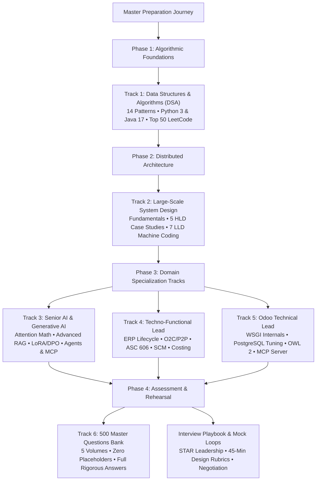
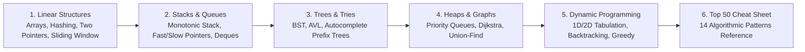
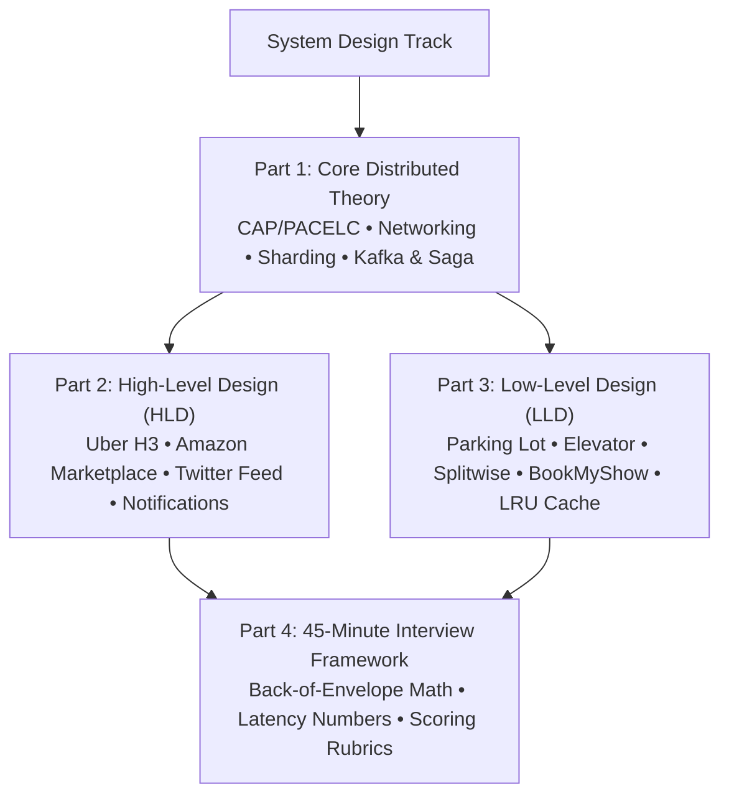
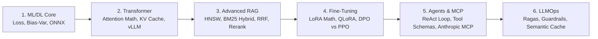
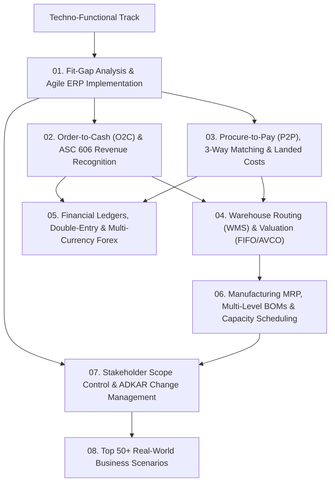
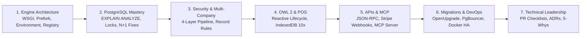
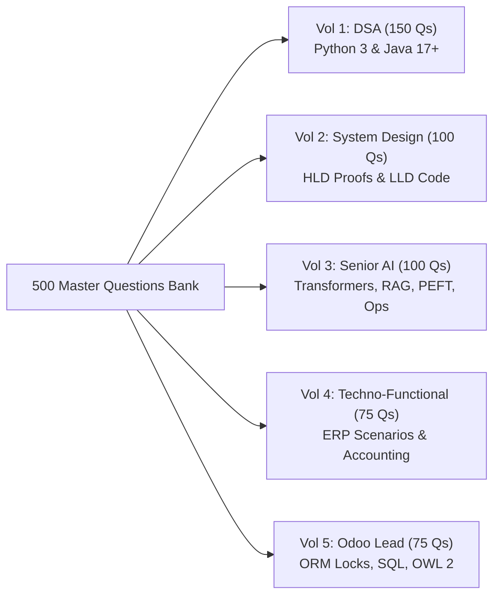
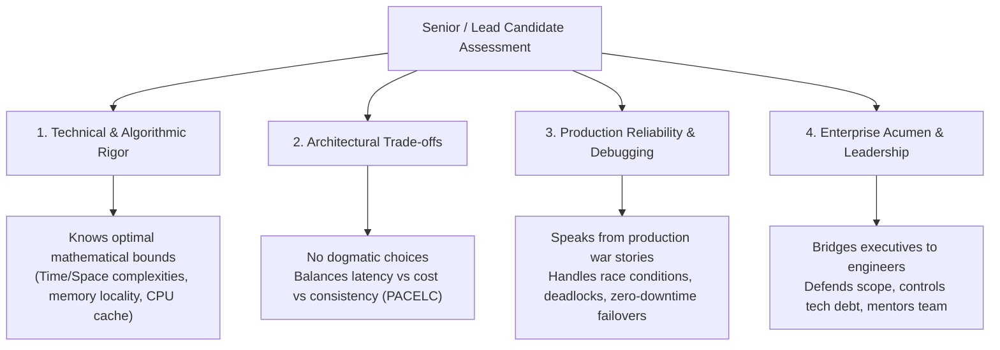

# 🚀 Complete Senior Technical, Leadership & Algorithmic Interview Preparation Guide
### Odoo Technical Lead • Techno-Functional Lead • Senior AI Engineer • Distributed System Design (HLD & LLD) • DSA (Python & Java)

Welcome to the **Master Interview Preparation Guide** — a world-class resource matching the quality of MIT OpenCourseWare, NeetCode, Grokking the System Design Interview, Andrej Karpathy's Neural Networks series, and Kleppmann's DDIA.

Every chapter has:
- 📖 **Deep theory with definitions** — explained simply with intuition first
- 🏭 **Real-world industry examples** — Netflix, Uber, Google, Discord, Stripe, Airbnb
- 💻 **Dual Python 3 + Java 17 code** — complete, runnable, production-grade with test cases
- 🎥 **Video references** — MIT, Stanford, Andrej Karpathy, NeetCode, William Fiset, ByteByteGo
- 📚 **Blog & documentation links** — Original research papers, engineering blogs, official docs
- 💡 **Interview tips** — Exactly what interviewers test at each stage
- 🧭 **Complete Pagination** — Sequential Previous / Index / Next navigation on every chapter

> **🗺️ Master Topic Map**: [MASTER-GUIDE.md](./MASTER-GUIDE.md) — Topic-to-resource matrix with 30-day study plan  
> **🎥 All Video Links**: [video-references-and-masterclasses.md](./video-references-and-masterclasses.md) — 80+ curated university & industry courses  
> **❓ All 500 Q&A**: [500-master-questions-bank/](./500-master-questions-bank/README.md) — 500 complete answered interview questions  
> **💼 FAANG Playbook**: [product-company-interview-playbook.md](./product-company-interview-playbook.md) — Interview loops, STAR behavioral & negotiation

---

## 🗺️ Master Career & Curriculum Roadmap



---

## 🧭 Folder-by-Folder Roadmaps

### 🧩 1. [Data Structures & Algorithms Track](./dsa/README.md)
> **Folder**: [`dsa/`](./dsa/) • [**Open DSA Track Roadmap & Syllabus ➔**](./dsa/README.md)



* **Core Highlights**: Dual reference implementations in **Python 3** and **Java 17+**, memory diagrams, mathematical proofs ($O(N)$ heapify, sliding window convergence), and LeetCode problem mappings.
* **Top Chapters**: [01 Arrays & Hashing](./dsa/01-arrays-and-hashing.md) • [02 Two Pointers & Sliding Window](./dsa/02-two-pointers-and-sliding-window.md) • [06 Trees & Tries](./dsa/06-trees-and-tries.md) • [09 Dynamic Programming](./dsa/09-dynamic-programming.md) • [11 Top 50 LeetCode Patterns](./dsa/11-top-50-dsa-interview-problems.md).

---

### 🏗️ 2. [Distributed System Design Track (HLD & LLD)](./system%20design/README.md)
> **Folder**: [`system design/`](./system%20design/) • [**Open System Design Track Roadmap & Syllabus ➔**](./system%20design/README.md)



* **Core Highlights**: Full coverage of high-scale enterprise systems (Uber H3 spatial indexing, Kafka transaction logs, Redis Redlock, Saga pattern) and production-grade object-oriented machine coding in Python and Java.
* **Top Case Studies**: [Uber / Lyft Ride Sharing](./system%20design/hld/02-ride-sharing-uber-lyft.md) • [Amazon E-Commerce](./system%20design/hld/03-ecommerce-marketplace-amazon.md) • [Twitter News Feed](./system%20design/hld/05-twitter-news-feed-system.md) • [Splitwise LLD](./system%20design/lld/05-splitwise-expense-sharing.md) • [BookMyShow LLD](./system%20design/lld/06-movie-ticket-booking-bookmyshow.md).

---

### 🤖 3. [Senior AI & Generative AI Systems Track](./Senior%20AI%20Role/README.md)
> **Folder**: [`Senior AI Role/`](./Senior%20AI%20Role/) • [**Open Senior AI Track Roadmap & Syllabus ➔**](./Senior%20AI%20Role/README.md)



* **Core Highlights**: Complete mathematical derivations (Attention scaling, LoRA $B \times A$, DPO loss), runnable production Python pipelines, Model Context Protocol (MCP) host/client/server architecture, and Ragas evaluation.
* **Top Chapters**: [02 Transformer & LLM Core](./Senior%20AI%20Role/02-transformer-and-llm-core.md) • [04 Production RAG & Vector Search](./Senior%20AI%20Role/04-rag-and-vector-databases.md) • [05 Fine-Tuning & PEFT](./Senior%20AI%20Role/05-fine-tuning-and-peft.md) • [06 AI Agents & MCP](./Senior%20AI%20Role/06-ai-agents-and-mcp.md) • [08 Top 50 AI Interview Q&A](./Senior%20AI%20Role/08-top-50-ai-interview-questions.md).

---

### 💼 4. [Techno-Functional Lead & Enterprise Architecture Track](./Techno-Functional%20Lead/README.md)
> **Folder**: [`Techno-Functional Lead/`](./Techno-Functional%20Lead/) • [**Open Techno-Functional Track Roadmap & Syllabus ➔**](./Techno-Functional%20Lead/README.md)



* **Core Highlights**: Bridges technical architecture with CFO/COO-level enterprise governance. Detailed double-entry accounting ledgers, ASC 606 5-step revenue recognition, landed cost allocations, and real business dispute resolution.
* **Top Chapters**: [01 Role & Methodology](./Techno-Functional%20Lead/01-role-and-methodology.md) • [02 Order-to-Cash & ASC 606](./Techno-Functional%20Lead/02-order-to-cash-and-crm.md) • [05 Accounting & Ledgers](./Techno-Functional%20Lead/05-accounting-and-financial-ledgers.md) • [08 Top 50 Scenario Q&A](./Techno-Functional%20Lead/08-top-50-techno-functional-questions.md).

---

### ⚙️ 5. [Odoo Technical Lead & PostgreSQL Engineering Track](./Odoo%20Technical%20Lead/README.md)
> **Folder**: [`Odoo Technical Lead/`](./Odoo%20Technical%20Lead/) • [**Open Odoo Technical Lead Roadmap & Syllabus ➔**](./Odoo%20Technical%20Lead/README.md)



* **Core Highlights**: Tailored for Senior/Lead architects with 7+ years of experience. Deep dive into ORM caching & prefetching, PostgreSQL row locking (`SKIP LOCKED`), OWL 2 reactive components, and Model Context Protocol (MCP) ERP integration.
* **Top Chapters**: [01 Architecture & Internals](./Odoo%20Technical%20Lead/01-architecture-and-internals.md) • [02 Performance & Database](./Odoo%20Technical%20Lead/02-performance-and-database.md) • [03 Security & Multi-Company](./Odoo%20Technical%20Lead/03-security-and-multi-company.md) • [05 APIs & MCP](./Odoo%20Technical%20Lead/05-apis-integrations-and-mcp.md) • [08 Top 50 Odoo Q&A](./Odoo%20Technical%20Lead/08-top-50-interview-questions.md).

---

### 🌟 6. [500 Master Questions Bank Suite](./500-master-questions-bank/README.md)
> **Folder**: [`500-master-questions-bank/`](./500-master-questions-bank/) • [**Open 500 Questions Bank Master Index ➔**](./500-master-questions-bank/README.md)



| Volume | Focus Domain | Questions | Implementation Standard |
|---|---|:---:|---|
| **[Volume 1](./500-master-questions-bank/01-dsa-150-questions.md)** | DSA & 14 Algorithmic Patterns | **150** | Dual Python 3 & Java 17+ code with complexities |
| **[Volume 2](./500-master-questions-bank/02-system-design-100-questions.md)** | System Design (HLD & LLD) | **100** | CAP/PACELC proofs, Uber H3, LRU cache code |
| **[Volume 3](./500-master-questions-bank/03-senior-ai-100-questions.md)** | Senior AI & Generative AI Systems | **100** | Attention math, KV cache calculation, QLoRA |
| **[Volume 4](./500-master-questions-bank/04-techno-functional-75-questions.md)** | Techno-Functional Lead & ERP | **75** | ASC 606 revenue recognition, 3-way matching |
| **[Volume 5](./500-master-questions-bank/05-odoo-technical-lead-75-questions.md)** | Odoo Technical Lead & PostgreSQL | **75** | Prefork worker sizing, N+1 fixes, MCP server |
| **Total** | **All 5 Engineering Domains** | **500** | **100% Complete Answers • Zero Placeholders** |

---

## 📋 Comprehensive Directory Index

```
interview-material/
│
├── README.md                                # Master Curriculum & Roadmap Hub (You are here)
├── MASTER-GUIDE.md                          # Topic-by-Topic Learning Matrix & 30-Day Plan
├── product-company-interview-playbook.md    # FAANG Hiring Playbook, Behavioral STAR & Negotiation
├── video-references-and-masterclasses.md    # Curated Video Masterclasses (MIT, Stanford, Karpathy)
│
├── 📁 500-master-questions-bank/            # 500 Questions Bank Suite (5 Volumes)
│   ├── README.md                            # Questions Bank Master Index & Syllabus
│   ├── 01-dsa-150-questions.md              # Vol 1: 150 DSA Questions (Python 3 & Java 17)
│   ├── 02-system-design-100-questions.md    # Vol 2: 100 System Design Questions (HLD & LLD)
│   ├── 03-senior-ai-100-questions.md        # Vol 3: 100 Senior AI Systems Questions
│   ├── 04-techno-functional-75-questions.md # Vol 4: 75 Techno-Functional ERP Questions
│   └── 05-odoo-technical-lead-75-questions.md # Vol 5: 75 Odoo Technical Lead & SQL Questions
│
├── 📁 dsa/                                  # Track 1: Data Structures & Algorithms
│   ├── README.md                            # 14 Algorithmic Patterns & Big-O Matrix
│   ├── 01-arrays-and-hashing.md             # Arrays, Hashing, Two Sum, Group Anagrams
│   ├── 02-two-pointers-and-sliding-window.md# 3Sum, Trapping Rain Water, Min Window Substring
│   ├── 03-linked-lists.md                   # Floyd's Cycle, In-Place Reversals, LRU Pointer Manipulation
│   ├── 04-stacks-and-queues.md              # Monotonic Stack, Largest Rectangle, Sliding Window Max
│   ├── 05-binary-search.md                  # Rotated Array Search, Binary Search on Solution Space
│   ├── 06-trees-and-tries.md                # Tree Traversals, LCA, Diameter, Autocomplete Trie
│   ├── 07-heaps-and-priority-queues.md      # Array Heap Math, O(N) Heapify, Streaming Median
│   ├── 08-graphs-and-union-find.md          # Topological Sort, Dijkstra, Union-Find (DSU)
│   ├── 09-dynamic-programming.md            # 1D/2D DP, Coin Change, O(N log N) LIS, Edit Distance
│   ├── 10-backtracking-and-greedy.md        # State-Space Trees, Combination Sum, N-Queens
│   ├── 11-top-50-dsa-interview-problems.md  # Top 50 LeetCode Problems & Pattern Decision Flowchart
│   ├── solutions-pack-1-arrays-strings-sliding-window.md # Python & Java Solutions Pack 1
│   ├── solutions-pack-2-trees-graphs-heaps.md            # Python & Java Solutions Pack 2
│   └── solutions-pack-3-dp-and-backtracking.md           # Python & Java Solutions Pack 3
│
├── 📁 system design/                        # Track 2: Large-Scale Distributed System Design
│   ├── README.md                            # System Design Track Roadmap & Syllabus
│   ├── 01-system-design-fundamentals.md     # Scalability, CAP/PACELC, ACID vs BASE, Consistency
│   ├── 02-networking-and-proxies.md         # HTTP/2/3, WebSockets, gRPC, L4/L7 Load Balancers
│   ├── 03-databases-and-caching.md          # Sharding, Consistent Hashing, Redis Caching Strategies
│   ├── 04-distributed-patterns.md           # Kafka, Saga Orchestration, Outbox Pattern, Redlock
│   ├── 05-classic-case-studies.md           # TinyURL, WhatsApp Chat, Flash Sale E-Commerce
│   ├── 06-ai-system-design.md               # Enterprise RAG Platform, Real-Time RecSys, LLM Gateway
│   ├── 07-interview-framework-and-rubrics.md# 45-Minute Interview Formula & Estimation Cheat Sheets
│   ├── 📁 hld/                              # High-Level Design Case Studies
│   │   ├── 01-hld-framework-and-components.md # 6-Step HLD Framework & Component Topologies
│   │   ├── 02-ride-sharing-uber-lyft.md     # Uber/Lyft: 250k writes/sec GPS & Uber H3 Hexagons
│   │   ├── 03-ecommerce-marketplace-amazon.md# Amazon: CDC Search Sync & Saga Checkout
│   │   ├── 04-scalable-notification-system.md# Multi-Channel Push/SMS/Email & Deduplication
│   │   └── 05-twitter-news-feed-system.md   # Twitter News Feed: Fanout-on-write vs read
│   └── 📁 lld/                              # Low-Level Design & Machine Coding (Python & Java)
│       ├── 01-lld-principles-and-design-patterns.md # SOLID Principles & GoF Design Patterns
│       ├── 02-parking-lot-system.md         # Thread-Safe Multi-Floor Parking Lot
│       ├── 03-elevator-system.md            # Multi-Car Elevator with LOOK Algorithm
│       ├── 04-lru-cache-and-rate-limiter.md # LRU Cache with TTL & Token Bucket Rate Limiter
│       ├── 05-splitwise-expense-sharing.md  # Splitwise with Min-Cash-Flow Debt Simplification
│       ├── 06-movie-ticket-booking-bookmyshow.md # BookMyShow with Concurrent Seat Locking & TTL
│       └── 07-in-memory-key-value-store.md  # Transactional KV Store with Nested Transactions
│
├── 📁 Senior AI Role/                       # Track 3: Senior AI & Generative AI Systems
│   ├── README.md                            # Senior AI Track Roadmap & Syllabus
│   ├── 01-ml-dl-foundations.md              # Bias-Variance, Loss Functions, Prophet, ONNX Runtime
│   ├── 02-transformer-and-llm-core.md       # Attention Math, KV Cache Sizing, RoPE, Quantization, vLLM
│   ├── 03-prompting-and-structured-io.md    # CoT, Tree of Thoughts, FSM Logit Masking, Injection
│   ├── 04-rag-and-vector-databases.md       # Modular RAG, HNSW vs IVFFlat, pgvector, Hybrid RRF
│   ├── 05-fine-tuning-and-peft.md           # Full FT vs LoRA vs QLoRA, LoRA Math, DPO vs PPO
│   ├── 06-ai-agents-and-mcp.md              # ReAct Agent Loop, Tool Calling, Anthropic MCP Standard
│   ├── 07-llmops-evals-and-guardrails.md    # Ragas Metrics, LangSmith Tracing, NeMo Guardrails
│   ├── 08-top-50-ai-interview-questions.md  # 50+ Hard-Hitting Senior AI Interview Questions
│   └── practical-code-implementations.md    # Runnable Python Pipelines (RAG, Agent, QLoRA)
│
├── 📁 Techno-Functional Lead/               # Track 4: Techno-Functional Lead & Solution Architecture
│   ├── README.md                            # Techno-Functional Track Roadmap & Syllabus
│   ├── 01-role-and-methodology.md           # Fit-Gap Analysis, BRD to TSD, CRP, Agile ERP Lifecycle
│   ├── 02-order-to-cash-and-crm.md          # O2C Lifecycle, Credit Limits, ASC 606 / IFRS 15
│   ├── 03-procure-to-pay-and-vendor.md      # P2P Lifecycle, 3-Way Matching, Approval Tiers, Landed Costs
│   ├── 04-inventory-warehouse-and-costing.md# Multi-Step Routing, Dropshipping, FIFO/AVCO Costing
│   ├── 05-accounting-and-financial-ledgers.md# Chart of Accounts, Double-Entry, Forex, Year-End Closing
│   ├── 06-manufacturing-mrp-and-scm.md      # Multi-Level BOMs, Work Centers, OEE, MPS, Lead Times
│   ├── 07-stakeholder-and-scope-management.md# Scope Baselining, CCB Change Control, ADKAR Change Mgmt
│   └── 08-top-50-techno-functional-questions.md # 50+ Real-World Enterprise Business Scenarios
│
└── 📁 Odoo Technical Lead/                  # Track 5: Odoo Technical Lead & PostgreSQL Mastery
    ├── README.md                            # Odoo Technical Lead Track Roadmap & Syllabus
    ├── 01-architecture-and-internals.md     # WSGI Engine, Prefork Worker Sizing, ORM Prefetching
    ├── 02-performance-and-database.md       # PostgreSQL EXPLAIN ANALYZE, B-Tree/GIN, Deadlock Fixes
    ├── 03-security-and-multi-company.md     # 4-Tier Security, ir.rule, Multi-Company Context Isolation
    ├── 04-owl-and-qweb-frontend.md          # OWL 2 Component Lifecycle, Reactivity, POS IndexedDB
    ├── 05-apis-integrations-and-mcp.md      # JSON-RPC, Stripe Idempotency, Odoo MCP Server
    ├── 06-migrations-and-devops.md          # OpenUpgrade 3-Phase Pipeline, Docker HA, PgBouncer
    ├── 07-technical-leadership.md           # 10-Point PR Checklist, ADRs, Fibonacci Story Points, 5-Whys
    └── 08-top-50-interview-questions.md     # 50+ Senior & Lead Odoo Architectural Questions
```

---

## 🎯 30-Day Master Study Strategy

| Week | Target Focus Domain | Primary Documents to Study | Practice Milestone |
|:---:|---|---|---|
| **Week 1** | **DSA Algorithmic Patterns** | [`dsa/README.md`](./dsa/README.md) & Chapters 01 to 05 | Two Pointers, Monotonic Stack, Sliding Window, Binary Search |
| **Week 2** | **Hierarchical DSA & DP** | Chapters 06 to 11 & Solutions Packs 1-3 | Trees, Tries, Dijkstra, Union-Find, Dynamic Programming |
| **Week 3** | **System Design (HLD & LLD)** | [`system design/README.md`](./system%20design/README.md) & HLD/LLD cases | Distributed Foundations, Uber H3, Splitwise, BookMyShow |
| **Week 4** | **Specialization & Question Bank** | Senior AI / Odoo Lead / Techno-Functional tracks | Study corresponding 500 Q&A Volume & run mock interviews |

---

## 💡 The Senior / Lead Candidate Evaluation Mindset


