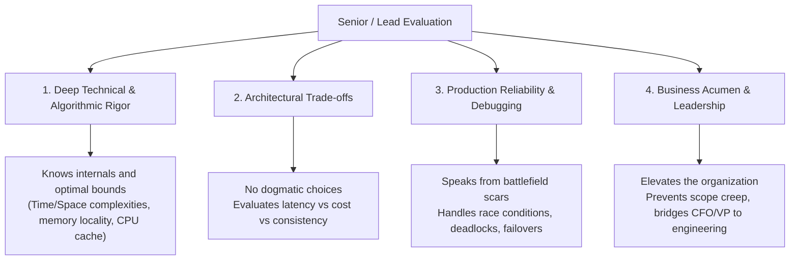

# 🚀 Complete Senior Technical, Leadership & Algorithmic Interview Preparation Guide
### Odoo Technical Lead • Techno-Functional Lead • Senior AI Engineer • Distributed System Design (HLD & LLD) • DSA (Python & Java)

Welcome to the **Master Interview Preparation Guide** — a world-class resource matching the quality of MIT OpenCourseWare, NeetCode, Grokking the System Design Interview, Andrej Karpathy's Neural Networks series, and Kleppmann's DDIA.

Every chapter has:
- 📖 **Deep theory with definitions** — explained simply with intuition first
- 🏭 **Real-world industry examples** — Netflix, Uber, Google, Discord, Stripe, Airbnb
- 💻 **Dual Python 3 + Java 17 code** — complete, runnable, production-grade
- 🎥 **Video references** — MIT, Stanford, Andrej Karpathy, NeetCode, William Fiset, ByteByteGo
- 📚 **Blog & documentation links** — Original papers, engineering blogs, official docs
- 💡 **Interview tips** — Exactly what interviewers test at each stage

> **🗺️ Start Here**: [MASTER-GUIDE.md](./MASTER-GUIDE.md) — Complete topic-level learning map with all resource links
> **🎥 All Video Links**: [video-references-and-masterclasses.md](./video-references-and-masterclasses.md)
> **❓ All 500 Q&A**: [500-master-questions-bank/](./500-master-questions-bank/README.md)


---

## 🧭 Repository Structure & Curriculum

```
interview-material/
├── README.md                                # Master Curriculum & Study Guide (You are here)
│
├── product-company-interview-playbook.md    # FAANG & PBC Hiring Playbook, STAR Leadership & Interview Loops
├── video-references-and-masterclasses.md    # Authoritative University & Industry Video References
│
├── 500-master-questions-bank/               # Complete 500 Master Questions Bank (5 Volumes)
│   ├── README.md                            # Master Questions Index & Domain Syllabus
│   ├── 01-dsa-150-questions.md              # Volume 1: 150 DSA & 14 Algorithmic Patterns (Python & Java)
│   ├── 02-system-design-100-questions.md    # Volume 2: 100 System Design (HLD & LLD) Questions
│   ├── 03-senior-ai-100-questions.md        # Volume 3: 100 Senior AI & Generative AI Systems Questions
│   ├── 04-techno-functional-75-questions.md # Volume 4: 75 Techno-Functional Lead & ERP Architecture Questions
│   └── 05-odoo-technical-lead-75-questions.md # Volume 5: 75 Odoo Technical Lead & PostgreSQL Questions
│
├── Odoo Technical Lead/                     # Track 1: Odoo Technical Lead & ERP Architect
│   ├── 01-architecture-and-internals.md     # Core engine, WSGI, ORM internals, cache & prefetching
│   ├── 02-performance-and-database.md       # SQL profiling, N+1 fixes, indexes, 10x POS optimization
│   ├── 03-security-and-multi-company.md     # ir.rule, ir.model.access, multi-company data isolation
│   ├── 04-owl-and-qweb-frontend.md          # OWL framework, reactivity, hooks, QWeb & PDF reporting
│   ├── 05-apis-integrations-and-mcp.md      # REST/JSON-RPC, payment gateways, Model Context Protocol (MCP)
│   ├── 06-migrations-and-devops.md          # v12-v19 migrations, Docker, Odoo.sh, Nginx, PostgreSQL tuning
│   ├── 07-technical-leadership.md           # Estimations, code review checklist, incident post-mortems
│   └── 08-top-50-interview-questions.md     # 50+ Senior & Lead interview questions with ideal answers
│
├── Techno-Functional Lead/                  # Track 2: Techno-Functional Lead & Solution Architect
│   ├── 01-role-and-methodology.md           # Fit-Gap analysis, BRD to TSD, CRP, Agile/Waterfall ERP lifecycle
│   ├── 02-order-to-cash-and-crm.md          # O2C lifecycle, price lists, credit limits, ASC 606 revenue recognition
│   ├── 03-procure-to-pay-and-vendor.md      # P2P lifecycle, 3-way matching, approval tiers, landed costs
│   ├── 04-inventory-warehouse-and-costing.md# Multi-step routing, dropship, cross-dock, FIFO/AVCO, perpetual valuation
│   ├── 05-accounting-and-financial-ledgers.md# Chart of Accounts, double-entry, Forex revaluation, fiscal year-end
│   ├── 06-manufacturing-mrp-and-scm.md      # Multi-level BOMs, Work Centers, OEE, MPS, lead time scheduling
│   ├── 07-stakeholder-and-scope-management.md# Scope baseline, CCB change requests, ADKAR adoption, Go/No-Go criteria
│   └── 08-top-50-techno-functional-questions.md # 50+ Real-world business scenarios & answers
│
├── Senior AI Role/                          # Track 3: Senior AI / Generative AI Engineer
│   ├── practical-code-implementations.md    # Complete Runnable Python Code: Production RAG, Agent Loop, QLoRA
│   ├── 01-ml-dl-foundations.md              # ML/DL foundations, regularization, Prophet/ARIMA forecasting
│   ├── 02-transformer-and-llm-core.md       # Attention math, KV cache, vLLM, RoPE, quantization (AWQ/GGUF)
│   ├── 03-prompting-and-structured-io.md    # CoT, ReAct, JSON schema enforcement, constrained decoding
│   ├── 04-rag-and-vector-databases.md       # Naive to Advanced RAG, chunking, pgvector, HNSW, hybrid search
│   ├── 05-fine-tuning-and-peft.md           # LoRA, QLoRA, SFT, DPO vs PPO, decision framework
│   ├── 06-ai-agents-and-mcp.md              # Agent loops, tool calling, Model Context Protocol, vision ONNX
│   ├── 07-llmops-evals-and-guardrails.md    # Ragas, LLM-as-judge, NeMo Guardrails, latency & cost optimization
│   └── 08-top-50-ai-interview-questions.md  # 50+ Hard-hitting Senior AI interview questions with solutions
│
├── system design/                           # Track 4: Large-Scale Distributed System Design
│   ├── 01-system-design-fundamentals.md     # Scalability, CAP/PACELC, ACID vs BASE, consistency models
│   ├── 02-networking-and-proxies.md         # L4/L7 load balancers, HTTP/2/3, WebSockets, gRPC, API gateways
│   ├── 03-databases-and-caching.md          # Sharding, consistent hashing, replication, Redis caching patterns
│   ├── 04-distributed-patterns.md           # Kafka vs RabbitMQ, Saga pattern, Outbox, Redlock, rate limiting
│   ├── 05-classic-case-studies.md           # TinyURL, Chat system, E-commerce flash sale, Task queue
│   ├── 06-ai-system-design.md               # Enterprise RAG platform at scale, Real-time RecSys, LLM Gateway
│   ├── 07-interview-framework-and-rubrics.md# 45-min interview formula, estimation math, cheat sheets
│   │
│   ├── hld/                                 # High-Level Design (HLD) Case Studies
│   │   ├── 01-hld-framework-and-components.md # 6-step HLD framework & component topology
│   │   ├── 02-ride-sharing-uber-lyft.md     # Uber/Lyft: 250k writes/sec GPS ingestion & Uber H3 indexing
│   │   ├── 03-ecommerce-marketplace-amazon.md# Amazon: CDC search sync & Saga checkout orchestrator
│   │   ├── 04-scalable-notification-system.md# Multi-channel push/SMS/email platform & deduplication
│   │   └── 05-twitter-news-feed-system.md   # Twitter News Feed: Fanout-on-write vs Fanout-on-read & celebrities
│   │
│   └── lld/                                 # Low-Level Design (LLD) & Object-Oriented Machine Coding
│       ├── 01-lld-principles-and-design-patterns.md # SOLID principles & GoF design patterns in Python
│       ├── 02-parking-lot-system.md         # Thread-safe Multi-floor Parking Lot design
│       ├── 03-elevator-system.md            # Multi-car Elevator with LOOK algorithm & state machine
│       ├── 04-lru-cache-and-rate-limiter.md # Thread-safe LRU Cache with TTL & Token Bucket rate limiter
│       ├── 05-splitwise-expense-sharing.md  # Splitwise Expense Sharing with Min-Cash-Flow debt simplification
│       ├── 06-movie-ticket-booking-bookmyshow.md # BookMyShow with thread-safe seat locking & 10-min TTL
│       └── 07-in-memory-key-value-store.md  # Transactional KV Store with nested BEGIN, COMMIT, ROLLBACK
│
└── dsa/                                     # Track 5: Data Structures & Algorithms (Python & Java)
    ├── README.md                            # Master 14 Algorithmic Patterns & Big-O Reference Matrix
    ├── solutions-pack-1-arrays-strings-sliding-window.md # Complete Python & Java: Product Except Self, Min Window
    ├── solutions-pack-2-trees-graphs-heaps.md # Complete Python & Java: Word Ladder, Alien Dict, Tree Serialization
    ├── solutions-pack-3-dp-and-backtracking.md # Complete Python & Java: Word Break, Decode Ways, Regex Matching
    ├── 01-arrays-and-hashing.md             # Array memory, hash collisions, Two Sum, Group Anagrams
    ├── 02-two-pointers-and-sliding-window.md# 3Sum, Trapping Rain Water, Min Window Substring
    ├── 03-linked-lists.md                   # Floyd's cycle math, in-place reversal, Reorder List
    ├── 04-stacks-and-queues.md              # Monotonic Stack, Largest Rectangle, Sliding Window Max
    ├── 05-binary-search.md                  # Search in Rotated Array, BS on Solution Space (Koko Bananas)
    ├── 06-trees-and-tries.md                # Tree traversals, LCA, Max Path Sum, Prefix Tree (Trie)
    ├── 07-heaps-and-priority-queues.md      # Heap array math, O(N) heapify, Two-Heaps Streaming Median
    ├── 08-graphs-and-union-find.md          # Topological Sort (Kahn's), Dijkstra, Union-Find (DSU)
    ├── 09-dynamic-programming.md            # 1D/2D DP, Coin Change, O(N log N) LIS, Edit Distance
    ├── 10-backtracking-and-greedy.md        # State-space trees, Combination Sum, N-Queens, Jump Game
    └── 11-top-50-dsa-interview-problems.md  # Top 50 LeetCode Problem Matrix & Cheatsheet
```

---

## 🎯 How to Use This Repository

### 1. 30-Day Complete Mastery Plan (Comprehensive Prep)
- **Week 1: Algorithmic Foundations (DSA)**:
  - Work through `dsa/01` to `dsa/05` in both Python and Java. Implement Two Pointers, Monotonic Stacks, and Binary Search.
- **Week 2: Hierarchies, Graphs & DP (DSA)**:
  - Finish `dsa/06` to `dsa/11`. Master Trees, Tries, Dijkstra, Union-Find, and Dynamic Programming.
- **Week 3: Primary Specialized Domain**:
  - For Engineering Leads: Track 1 (**Odoo Technical Lead**) or Track 3 (**Senior AI**).
  - For Solution Architects / Functional Leads: Track 2 (**Techno-Functional Lead**).
- **Week 4: System Design (HLD & LLD)**:
  - Master System Design theory (`system design/01-07`), review HLD case studies (`hld/`), and practice LLD machine coding (`lld/`). Review the 45-minute interview framework and latency cheat sheets.

### 2. 7-Day Sprint Plan (Quick Refresher Before an Interview)
- **Day 1**: System Design Fundamentals & L4/L7 Networking (`system design/01`, `02`).
- **Day 2**: High-Level Design (Uber/Lyft H3 & Amazon Saga) (`system design/hld/02`, `03`).
- **Day 3**: Low-Level Design & Design Patterns (`system design/lld/01`, `02`).
- **Day 4**: DSA Top Patterns (Two Pointers, Monotonic Stacks, Fast/Slow, Two Heaps) (`dsa/11-top-50-dsa-interview-problems.md`).
- **Day 5**: AI Foundations & Production RAG / Vector Databases (`Senior AI Role/01`, `04`).
- **Day 6**: Odoo ORM Internals & 10x POS Optimization (`Odoo Technical Lead/01`, `02`).
- **Day 7**: Techno-Functional Fit-Gap & Accounting Ledgers (`Techno-Functional Lead/01`, `05`).

---

## 💡 The Senior / Lead Candidate Evaluation Mindset



---

## 🌟 500 Master Questions Bank

For intensive question-and-answer preparation across all domains, explore the [500-master-questions-bank/](file:///D:/Projects/interview-material/500-master-questions-bank/README.md) suite:

1. **[Volume 1: DSA & 14 Algorithmic Patterns (150 Questions)](file:///D:/Projects/interview-material/500-master-questions-bank/01-dsa-150-questions.md)**: Dual Python 3 & Java 17+ implementations across Two Pointers, Monotonic Stacks, Sliding Window, Two Heaps, Graphs, and DP.
2. **[Volume 2: System Design (HLD & LLD) (100 Questions)](file:///D:/Projects/interview-material/500-master-questions-bank/02-system-design-100-questions.md)**: CAP/PACELC proofs, consistent hashing, QUIC HTTP/3, Uber H3 spatial indexing, Flash Sale concurrency, LRU cache, and transactional key-value stores.
3. **[Volume 3: Senior AI & Generative AI Systems (100 Questions)](file:///D:/Projects/interview-material/500-master-questions-bank/03-senior-ai-100-questions.md)**: Attention math, KV cache calculation, PagedAttention vLLM, HNSW vector search, Hybrid RRF, QLoRA, and Model Context Protocol (MCP).
4. **[Volume 4: Techno-Functional Lead & ERP Architecture (75 Questions)](file:///D:/Projects/interview-material/500-master-questions-bank/04-techno-functional-75-questions.md)**: Fit-Gap matrix, O2C, P2P 3-way matching, FIFO/AVCO costing, Landed Costs, ASC 606 revenue recognition, and ADKAR change management.
5. **[Volume 5: Odoo Technical Lead & PostgreSQL Systems (75 Questions)](file:///D:/Projects/interview-material/500-master-questions-bank/05-odoo-technical-lead-75-questions.md)**: WSGI worker limits, ORM cache invalidation graph, prefetching, PostgreSQL row-level locks (`SKIP LOCKED`), OWL 2 hooks, and zero-downtime migrations.

---

## 🎥 Authoritative Video Masterclasses & Courses

Refer to [video-references-and-masterclasses.md](file:///D:/Projects/interview-material/video-references-and-masterclasses.md) for curated, high-impact university and industry video resources:
- **DSA**: MIT 6.006 (Prof. Erik Demaine & Srini Devadas), Stanford CS106B.
- **Distributed Systems**: MIT 6.824 (Prof. Robert Morris), Martin Kleppmann (*Designing Data-Intensive Applications* author lectures).
- **Generative AI & LLMs**: Andrej Karpathy (*Neural Networks: Zero to Hero*), Stanford CS25 (Transformers United).
- **ERP & Architecture**: Odoo Experience Keynotes (Fabien Pinckaers & Odoo R&D Directors).

