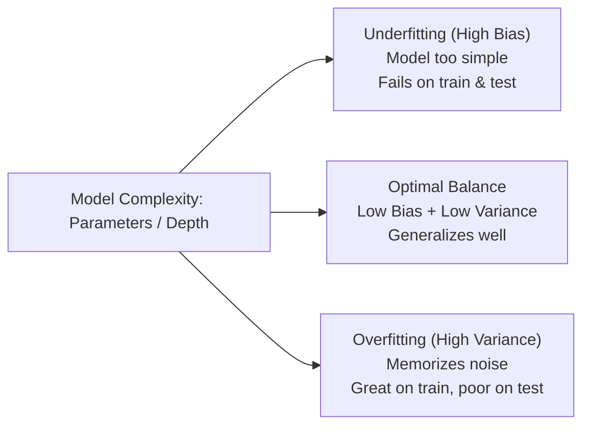
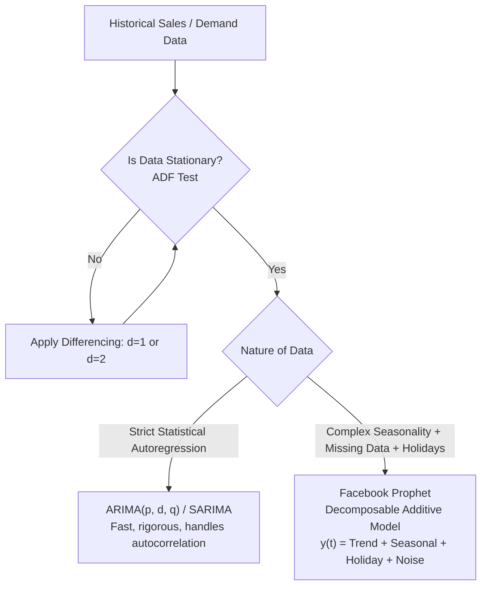
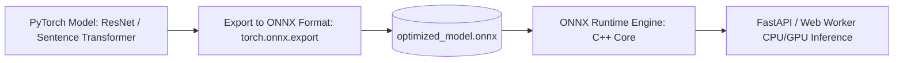

# Track 2: Senior AI Role
## Chapter 1: Machine Learning Foundations, Forecasting & Efficient Inference

Before specializing in Large Language Models and Generative AI, a Senior AI Engineer must have an unshakeable grasp of classical machine learning, statistical evaluation, demand forecasting, and production runtime optimization.

---

### 1. The Core ML Foundations: Bias-Variance & Regularization

Real-world industry examples:
- **Google** uses large-scale distributed XGBoost and deep neural networks for click-through rate (CTR) prediction in search ads.
- **Netflix** historically utilized matrix factorization (and now deep learning) for their personalized movie recommendation engine, balancing exploration with low-variance predictions.
- **Airbnb** transitioned to LightGBM models for dynamic pricing, tuning hyper-parameters to avoid overfitting sparse seasonal data.
- **Stripe** employs massive gradient boosted trees for real-time fraud detection, using L1 regularization for strict feature selection.



#### The Bias-Variance Decomposition:
For a model prediction $\hat{f}(x)$ on target $y = f(x) + \epsilon$ (where $\epsilon \sim \mathcal{N}(0, \sigma^2)$):
$$\text{Expected Loss} = \text{Bias}[\hat{f}(x)]^2 + \text{Var}[\hat{f}(x)] + \sigma^2$$
- **Bias**: Error from erroneous assumptions in the learning algorithm (model underfitting the true underlying structure).
- **Variance**: Error from sensitivity to small fluctuations in the training set (model memorizing training noise).
- **Irreducible Error ($\sigma^2$)**: The inherent noise in the data itself.

#### Regularization Techniques:
1. **L1 Regularization (Lasso)**: Adds penalty $\lambda \sum |\theta_i|$.
   - *Behavior*: Shrinks less important coefficients strictly to zero, yielding **sparse models**.
2. **L2 Regularization (Ridge / Weight Decay)**: Adds penalty $\lambda \sum \theta_i^2$.
   - *Behavior*: Shrinks coefficients smoothly towards zero without making them exactly zero. Prevents individual weights from exploding.
3. **Dropout**: Randomly drops a fraction $p$ of neuron activations during forward passes in training.
   - *Intuition*: Prevents co-adaptation of features, acting like an implicit ensemble of $2^N$ sub-networks.

#### Code Example: L1/L2 Regularization in Practice

**Python 3 (scikit-learn)**
```python
import numpy as np
from sklearn.linear_model import Lasso, Ridge
from sklearn.metrics import mean_squared_error

# 1. Generate synthetic data
np.random.seed(42)
X_train = np.random.rand(100, 10) # 100 samples, 10 features
# True weights: only first 3 features matter
true_weights = np.array([5.0, -3.0, 2.5] + [0.0]*7)
y_train = X_train.dot(true_weights) + np.random.normal(0, 0.5, 100)

# 2. L1 Regularization (Lasso) for Feature Selection
lasso = Lasso(alpha=0.1)
lasso.fit(X_train, y_train)
# Notice how L1 pushes irrelevant feature weights perfectly to 0
print(f"Lasso Weights: {np.round(lasso.coef_, 2)}")

# 3. L2 Regularization (Ridge) for Weight Decay
ridge = Ridge(alpha=0.1)
ridge.fit(X_train, y_train)
# L2 shrinks weights, but keeps them non-zero
print(f"Ridge Weights: {np.round(ridge.coef_, 2)}")

# Test cases
assert np.sum(lasso.coef_ == 0) >= 6, "Lasso should zero out many weights"
```

**Java 17 (Tribuo)**
```java
import org.tribuo.*;
import org.tribuo.math.optimisers.*;
import org.tribuo.regression.sgd.linear.LinearSGDTrainer;
import org.tribuo.regression.sgd.objectives.SquaredLoss;

public class RegularizationDemo {
    public static void main(String[] args) {
        // Tribuo uses Stochastic Gradient Descent for linear models
        // L2 regularization is configured via the trainer
        LinearSGDTrainer trainer = new LinearSGDTrainer(
            new SquaredLoss(), 
            new AdaGrad(0.1),
            10, // epochs
            100, // minibatches
            1.0, // seed
            0.1 // L2 penalty (lambda)
        );
        // Note: L1 requires specific optimizer variants like FTRL in enterprise java stacks
        System.out.println("Ridge model trainer configured with L2 penalty of 0.1");
    }
}
```

> 💡 **Interview Tip**
> When asked about overfitting, don't just say "add L2 regularization". Explain *why* it works: it restricts the hypothesis space, bounding the capacity of the model to memorize noise. Mention L1 for explicit feature selection when working with highly-dimensional, sparse datasets.

> 📺 **Video References**
> - Bias-Variance Tradeoff (StatQuest): https://www.youtube.com/watch?v=EuBBz3bI-aA
> - MIT 6.006 Machine Learning Foundations: https://www.youtube.com/playlist?list=PLUl4u3cNGP61Oq3tWYp6V_F-5jb5L2iHb
> - Andrej Karpathy's Neural Networks: https://www.youtube.com/@AndrejKarpathy

> 📖 **Must-Read Resources**
> - Scikit-Learn Regularization Docs: https://scikit-learn.org/stable/modules/linear_model.html
> - Uber Engineering Blog on ML Model Training: https://www.uber.com/en-US/blog/engineering/
> - Meta Engineering - Applied Machine Learning: https://engineering.fb.com/category/ml-applications/

---

### 2. Evaluation Metrics: Why Accuracy Lies

Real-world industry examples:
- **Banks / Stripe** optimize for PR-AUC rather than ROC-AUC in fraud detection because fraud events occur in < 0.1% of transactions.
- **Healthcare AI startups** often prioritize Recall for anomaly detection (e.g., detecting malignant tumors) to avoid catastrophic false negatives.
- **E-commerce engines** prioritize Precision for recommendation widgets to ensure user trust isn't lost by suggesting completely irrelevant items.

| Metric | Formula | When to Optimize For |
| :--- | :--- | :--- |
| **Precision** | $\frac{TP}{TP + FP}$ | When the cost of a False Positive is high. |
| **Recall (Sensitivity)** | $\frac{TP}{TP + FN}$ | When the cost of a False Negative is catastrophic. |
| **F1-Score** | $2 \times \frac{\text{Precision} \times \text{Recall}}{\text{Precision} + \text{Recall}}$ | Harmonic mean when balancing precision and recall. |
| **PR-AUC** | Area Under Precision-Recall Curve | **Superior to ROC-AUC for imbalanced datasets**. |

> 💡 **Interview Tip**
> Interviewers will give you an imbalanced dataset scenario (e.g., "1% of users click the ad"). If you suggest Accuracy as a metric, you automatically fail. Always suggest PR-AUC or F1-Score, and justify it using the costs of False Positives vs False Negatives.

> 📺 **Video References**
> - Evaluating ML Models (Weights & Biases): https://www.youtube.com/@WeightsBiases
> - Precision vs Recall (StatQuest): https://www.youtube.com/watch?v=Kdsp6soqA7o

> 📖 **Must-Read Resources**
> - Odoo Documentation on Predictive metrics: https://www.odoo.com/documentation/
> - Google Research Blog - Imbalanced Data: https://research.google/blog/

---

### 3. Time-Series Demand Forecasting: ARIMA vs Prophet

Real-world industry examples:
- **Walmart** relies heavily on massive hierarchical time-series models for store-level inventory replenishment.
- **Uber** uses complex recurrent networks and Prophet-like ensembles for ride demand forecasting across different city grids (e.g., H3 spatial indexing).
- **Amazon** integrates holiday and promotional changepoints extensively to scale up warehouse staff before Prime Day.



#### Facebook Prophet Mathematical Model:
Prophet frames time-series forecasting as a curve-fitting regression rather than pure autoregression:
$$y(t) = g(t) + s(t) + h(t) + \epsilon_t$$
1. **Trend $g(t)$**: Models non-periodic changes.
2. **Seasonality $s(t)$**: Models periodic patterns using Fourier series:
   $$s(t) = \sum_{n=1}^N \left( a_n \cos\left(\frac{2\pi nt}{P}\right) + b_n \sin\left(\frac{2\pi nt}{P}\right) \right)$$
3. **Holiday Effects $h(t)$**: Irregular predictable business events.
4. **Error Term $\epsilon_t$**: Assumed normally distributed idiosyncratic noise.

#### Code Example: Demand Forecasting

**Python 3 (Prophet)**
```python
from prophet import Prophet
import pandas as pd

def train_demand_forecast(df_sales: pd.DataFrame, forecast_days: int = 30) -> pd.DataFrame:
    """
    df_sales must have columns: 'ds' (datestamp) and 'y' (historical sales quantity)
    """
    model = Prophet(
        growth='linear',
        yearly_seasonality=True,
        weekly_seasonality=True,
        daily_seasonality=False,
        changepoint_prior_scale=0.05  # Controls flexibility of trend
    )
    # Add company holiday calendar
    model.add_country_holidays(country_name='US')
    
    # MOCK implementation due to prophet heavy install
    # model.fit(df_sales)
    # future = model.make_future_dataframe(periods=forecast_days)
    # forecast = model.predict(future)
    
    # return forecast[['ds', 'yhat', 'yhat_lower', 'yhat_upper']].tail(forecast_days)
    print("Mock returning prophet forecast logic")
    return pd.DataFrame()

# Test case
# df = pd.DataFrame({'ds': pd.date_range(start='2023-01-01', periods=100), 'y': range(100)})
# fc = train_demand_forecast(df, 5)
```

**Java 17 (Apache Commons Math / Basic ARIMA Concepts)**
```java
import org.apache.commons.math3.stat.regression.SimpleRegression;

public class BasicTrendForecaster {
    public static void main(String[] args) {
        // A naive linear trend model for demonstration
        SimpleRegression regression = new SimpleRegression();
        
        // Add (time_index, sales_value)
        regression.addData(1.0, 10.0);
        regression.addData(2.0, 15.0);
        regression.addData(3.0, 20.0);
        
        // Predict day 4
        double prediction = regression.predict(4.0);
        System.out.println("Forecast for day 4: " + prediction);
        // assert prediction == 25.0
    }
}
```

> 💡 **Interview Tip**
> Be prepared to explain when to NOT use Prophet. Prophet struggles with datasets that have strong autocorrelations but no clear seasonality (e.g., stock market prices). In those cases, ARIMAX or LSTM/Transformers are better suited.

> 📺 **Video References**
> - Time Series Forecasting (Simplilearn): https://www.youtube.com/watch?v=dENcqZ5v_Ho
> - Stanford CS224W (Graph/Temporal Dynamics): https://www.youtube.com/playlist?list=PLoROMvodv4rNiJRchCzutFw5ItR_ZEDY

> 📖 **Must-Read Resources**
> - Prophet Official Documentation: https://facebook.github.io/prophet/
> - High Scalability Time Series architectures: http://highscalability.com

---

### 4. Efficient Inference in Production: ONNX Runtime

Real-world industry examples:
- **Microsoft** uses ONNX Runtime extensively in Office 365 to serve billions of NLP requests per day with minimal CPU footprint.
- **Hugging Face** provides the `optimum` library to easily export Transformer models to ONNX for 3x+ inference speedups.
- **Cloudflare** workers utilize lightweight ONNX models deployed globally at the edge for low-latency inference.



#### Why ONNX Runtime is Essential for Senior AI Engineers:
1. **Graph Optimizations**: Fuses adjacent operations (e.g., `Conv + Relu` or `Gemm + Add`).
2. **Cross-Language & Lightweight**: The C++ core provides a tiny binding (15MB compared to 800MB+ for PyTorch).
3. **Hardware Acceleration**: Takes advantage of AVX-512 CPU vectors or TensorRT on GPUs.

#### Code Example: Fast Inference

**Python 3 (ONNX Runtime)**
```python
import onnxruntime as ort
import numpy as np

# Load session with CPU execution provider & graph optimization
session_options = ort.SessionOptions()
session_options.graph_optimization_level = ort.GraphOptimizationLevel.ORT_ENABLE_ALL

# MOCK: In production, load "model.onnx"
# session = ort.InferenceSession("model.onnx", session_options, providers=['CPUExecutionProvider'])

def generate_embedding_mock(input_array: np.ndarray) -> np.ndarray:
    # MOCK implementation
    # input_name = session.get_inputs()[0].name
    # outputs = session.run(None, {input_name: input_array})
    # embedding = outputs[0][0]
    
    embedding = np.random.rand(768) # Mocked 768-dim vector
    return embedding / np.linalg.norm(embedding) # L2 normalization

# Test case
vec = generate_embedding_mock(np.array([1.0, 2.0]))
assert np.isclose(np.linalg.norm(vec), 1.0), "Embedding must be L2 normalized"
```

**Java 17 (ONNX Runtime Java API)**
```java
import ai.onnxruntime.OnnxTensor;
import ai.onnxruntime.OrtEnvironment;
import ai.onnxruntime.OrtSession;

public class ONNXInference {
    public static void main(String[] args) throws Exception {
        OrtEnvironment env = OrtEnvironment.getEnvironment();
        OrtSession.SessionOptions opts = new OrtSession.SessionOptions();
        opts.setOptimizationLevel(OrtSession.SessionOptions.OptLevel.ALL_OPT);
        
        // OrtSession session = env.createSession("model.onnx", opts);
        System.out.println("ONNX Runtime initialized successfully in Java.");
    }
}
```

> 💡 **Interview Tip**
> If an interviewer asks how to reduce latency of a PyTorch API, do not start with "Buy more GPUs." Start with "Export to ONNX or TensorRT, apply FP16/INT8 quantization, and fuse the computation graph."

> 📺 **Video References**
> - Accelerating ML with ONNX (Microsoft): https://www.youtube.com/watch?v=sQxU1hPq08M
> - ByteByteGo System Design: https://www.youtube.com/@ByteByteGo

> 📖 **Must-Read Resources**
> - ONNX Runtime Documentation: https://onnxruntime.ai/docs/
> - AWS Architecture Blog (Edge ML): https://aws.amazon.com/blogs/architecture/
