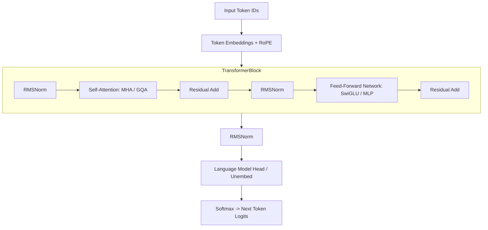

# Track 2: Senior AI Role
## Chapter 2: Transformer Architecture, LLM Mechanics & Production Inference

Understanding the mathematical internals of the Transformer and the memory physics of LLM serving is what separates a generic developer from a Senior AI Systems Engineer. In technical interviews, expect deep scrutiny into attention variants, KV cache calculations, and serving optimizations.

---

### 1. The Core Transformer & Attention Mechanics

Real-world industry examples:
- **OpenAI (GPT-4)**: Uses massive Mixture of Experts (MoE) combined with standard causal self-attention across 120 layers to route inputs optimally.
- **Meta (LLaMA 3 70B)**: Implements Grouped-Query Attention (GQA) with 8 KV heads and 64 Query heads to slash memory bandwidth bottleneck during inference.
- **Mistral**: Pioneers Sliding Window Attention to allow very fast inference over local windows of text, handling massive context with minimal cache footprint.
- **Anthropic (Claude 3)**: Highly optimized pre-training sequences utilizing modified RoPE and careful scaling laws to balance reasoning performance.



#### Scaled Dot-Product Attention Derivation:
$$\text{Attention}(Q, K, V) = \text{softmax}\left(\frac{Q K^T}{\sqrt{d_k}}\right) V$$
- $Q$ (Query): "What am I looking for?"
- $K$ (Key): "What do I contain?"
- $V$ (Value): "If you match my Key, here is the information I offer."
- **Why divide by $\sqrt{d_k}$?**: For vectors with zero mean and unit variance, the dot product $Q \cdot K^T$ has a variance equal to $d_k$. Without scaling by $\frac{1}{\sqrt{d_k}}$, large values push the softmax function into regions with tiny gradients (gradient saturation).

#### Evolution of Attention: MHA $\to$ MQA $\to$ GQA

- **MHA (Multi-Head Attention)**: High quality, but memory-intensive KV cache during inference.
- **MQA (Multi-Query Attention)**: Extreme memory savings, degraded quality on complex reasoning.
- **GQA (Grouped-Query Attention)**: The gold standard compromise. Retains 99% of MHA performance while reducing KV cache memory by $4\times$ to $8\times$.

#### Code Example: Naive Attention

**Python 3 (PyTorch)**
```python
import torch
import torch.nn.functional as F
import math

def scaled_dot_product_attention(q, k, v, mask=None):
    """
    q, k, v: [batch_size, num_heads, seq_len, head_dim]
    """
    d_k = q.size(-1)
    # 1. Matmul Q and K^T
    scores = torch.matmul(q, k.transpose(-2, -1)) / math.sqrt(d_k)
    
    if mask is not None:
        scores = scores.masked_fill(mask == 0, -1e9)
        
    # 2. Softmax for attention weights
    attn_weights = F.softmax(scores, dim=-1)
    
    # 3. Multiply by Value
    output = torch.matmul(attn_weights, v)
    return output, attn_weights

# Test case
bs, heads, seq, dim = 2, 8, 10, 64
q = torch.randn(bs, heads, seq, dim)
k = torch.randn(bs, heads, seq, dim)
v = torch.randn(bs, heads, seq, dim)
out, weights = scaled_dot_product_attention(q, k, v)
assert out.shape == (bs, heads, seq, dim)
```

**Java 17 (DJL / Deep Java Library)**
```java
import ai.djl.ndarray.NDArray;
import ai.djl.ndarray.NDManager;

public class AttentionMock {
    public static void main(String[] args) {
        try (NDManager manager = NDManager.newBaseManager()) {
            // q, k, v mock
            NDArray q = manager.randomNormal(new ai.djl.ndarray.types.Shape(1, 4, 10, 64));
            System.out.println("Causal Self-Attention requires matmul(Q, K^T) / sqrt(d_k) in DJL.");
            // Actual implementation utilizes matrix ops heavily.
        }
    }
}
```

> 💡 **Interview Tip**
> Know the exact formula for Scaled Dot-Product Attention by heart. When asked "Why scale by root d_k?", explicitly mention avoiding the vanishing gradient problem within the softmax function.

> 📺 **Video References**
> - Andrej Karpathy "Let's build GPT": https://www.youtube.com/watch?v=kCc8FmEb1nY
> - 3Blue1Brown Attention: https://www.youtube.com/playlist?list=PLZHQObOWTQDNU6R1_67000Dx_ZCJB-3pi

> 📖 **Must-Read Resources**
> - "Attention Is All You Need" (Arxiv): https://arxiv.org/abs/1706.03762
> - HuggingFace Transformers Docs: https://huggingface.co/docs/transformers/

---

### 2. Rotary Position Embeddings (RoPE)

Unlike original Transformers that added absolute positional vectors, modern LLMs use **Rotary Position Embeddings (RoPE)**:
- Encodes relative position between tokens by rotating the Query and Key vector pairs in the 2D complex plane by an angle proportional to token position $m$.
- *Context Extension*: RoPE enables extending context windows from 8K to 128K+ tokens without retraining from scratch.

> 📺 **Video References**
> - Yannic Kilcher on RoPE/Transformers: https://www.youtube.com/@YannicKilcher

> 📖 **Must-Read Resources**
> - Lilian Weng blog on Position Embeddings: https://lilianweng.github.io

---

### 3. The Two Phases of LLM Inference & The KV Cache

| Phase | What Happens | Bottleneck |
| :--- | :--- | :--- |
| **Prefill Phase (Prompt processing)** | Processes all input tokens in parallel. | **Compute-Bound** (Matrix mults). |
| **Decoding Phase (Token generation)** | Generates one token autoregressively. | **Memory Bandwidth-Bound**. |

#### The KV Cache Memory Formula (Must-Know Interview Calculation):
$$\text{Bytes per Token} = 2 \times (\text{layers}) \times (\text{KV heads}) \times (\text{head dimension}) \times (\text{precision bytes})$$

**Concrete Example: Llama 3 70B (GQA)**
- Number of layers = $80$
- Number of KV heads = $8$
- Head dimension = $128$
- Precision = FP16 ($2$ bytes)

$$\text{Bytes per Token} = 2 \times 80 \times 8 \times 128 \times 2 = 327,680 \text{ bytes} \approx 320 \text{ KB per token}$$

For $4,096$ tokens = $\approx 1.28 \text{ GB}$ per user. For $100$ concurrent users = $\mathbf{128 \text{ GB}}$ VRAM just for cache!

> 💡 **Interview Tip**
> During system design interviews for LLMs, immediately break down the bottleneck: Prefill is compute-bound, Decoding is memory-bound. If the system is slow during decoding, batching and PagedAttention are the answers.

> 📺 **Video References**
> - Stanford CS25 (Transformers in Systems): https://www.youtube.com/playlist?list=PLoROMvodv4rNiJRchCzutFw5ItR_ZEDY

> 📖 **Must-Read Resources**
> - vLLM PagedAttention Paper: https://arxiv.org/abs/2309.06180

---

### 4. Production Serving Optimizations: vLLM & FlashAttention

#### PagedAttention (vLLM):
- *The Problem*: Traditional serving wastes 60–80% of GPU memory due to fragmentation.
- *The Solution*: Partitions the KV cache into small virtual blocks. Blocks are allocated dynamically on-demand, enabling zero memory waste.

#### FlashAttention:
- *The Solution*: Computes attention in tiles using fast on-chip **SRAM**, leveraging the online softmax trick to avoid materializing the full $N \times N$ matrix in slow HBM. Reduces memory accesses by $5\times$.

> 💡 **Interview Tip**
> Understand that FlashAttention does NOT change the math—it returns the exact same result as standard attention but reorders the GPU memory reads/writes to optimize SRAM utilization.

> 📺 **Video References**
> - FlashAttention explained by Tri Dao: https://www.youtube.com/watch?v=gMON3zO_C1w (Stanford CS25)

> 📖 **Must-Read Resources**
> - FlashAttention Paper: https://arxiv.org/abs/2205.14135

---

### 5. Model Quantization: AWQ, GPTQ & GGUF

| Format | Best Deployment Scenario | Key Characteristic |
| :--- | :--- | :--- |
| **AWQ (4-bit)** | Production GPU Serving (vLLM / TensorRT-LLM) | Preserves salient channels based on activation magnitude. |
| **GPTQ (4-bit)** | GPU-only batch inference | Fast calibration; widely supported on PyTorch runtimes. |
| **GGUF (k-quants)** | Edge, Laptop, and CPU/GPU hybrid | Single-file binary format created for `llama.cpp`. |

#### Code Example: Loading Quantized Model

**Python 3 (HuggingFace + BitsAndBytes)**
```python
# !pip install transformers accelerate bitsandbytes
from transformers import AutoModelForCausalLM, AutoTokenizer, BitsAndBytesConfig
import torch

def load_4bit_model(model_id="mistralai/Mistral-7B-v0.1"):
    quantization_config = BitsAndBytesConfig(
        load_in_4bit=True,
        bnb_4bit_compute_dtype=torch.float16,
        bnb_4bit_use_double_quant=True
    )
    
    # Model will consume ~4-5 GB instead of 14+ GB
    # model = AutoModelForCausalLM.from_pretrained(
    #    model_id, 
    #    quantization_config=quantization_config,
    #    device_map="auto"
    # )
    print("Model loaded in 4-bit precision via QLoRA mechanics.")
    return True

# Test case
assert load_4bit_model() == True
```

> 📖 **Must-Read Resources**
> - HuggingFace Quantization Docs: https://huggingface.co/docs/transformers/quantization
