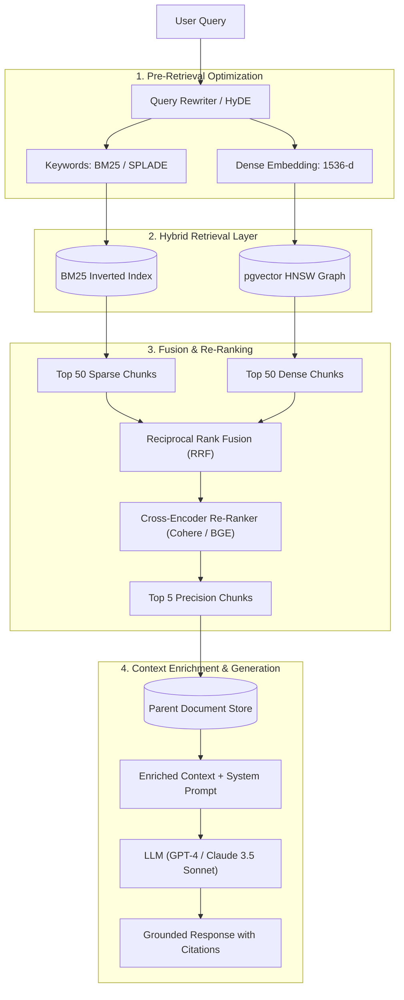
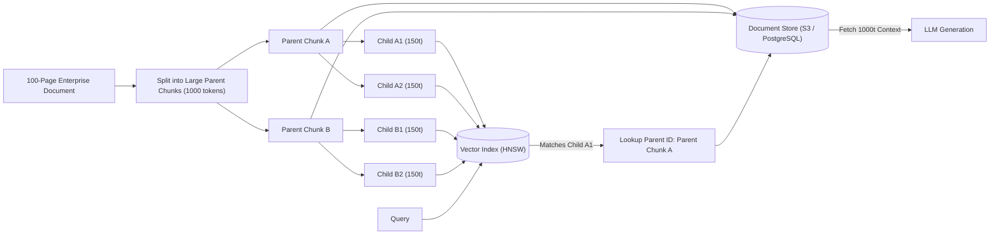

# Track 2: Senior AI Role
## Chapter 4: Production RAG, Vector Search & Hybrid Information Retrieval

Retrieval-Augmented Generation (RAG) is the enterprise standard for grounding LLM responses in proprietary data without costly retraining. In senior interviews, you must be able to design high-precision, low-latency retrieval pipelines that solve real-world enterprise edge cases, rather than just plugging LangChain into Pinecone.

---

### 1. The RAG Evolution: Naive vs Advanced vs Modular

#### Naive RAG
* **Architecture:** User Query $\to$ Embed Query $\to$ Vector DB KNN Search $\to$ Retrieve Top K Chunks $\to$ Pass to LLM.
* **Why it fails:** Semantic misalignment. A search for a specific `SKU-4902` will fail because dense vectors clump numbers together. Chunk boundary fragmentation causes lost context.

#### Advanced RAG
Introduces pre-retrieval and post-retrieval optimizations.
* **Pre-retrieval:** Query rewriting, HyDE (Hypothetical Document Embeddings), query routing.
* **Post-retrieval:** Re-ranking, context compression, reciprocal rank fusion.

#### Modular RAG
The enterprise standard. Treats RAG as an orchestrator of multiple specialized modules. Uses memory, structured query languages (Text-to-SQL combined with dense search), and dynamic tool calling to decide *if* it even needs to retrieve data.



---

### 2. Chunking Strategies

Vector databases cannot embed entire 100-page PDFs effectively due to context dilution.

1. **Fixed-Size Chunking:** Splitting by exact token count (e.g., 500 tokens, 50 token overlap). Fast, but destroys sentence logic.
2. **Recursive/Semantic Chunking:** Splitting based on markdown headers, paragraphs, and sentence boundaries. Semantic chunking uses embedding distance between sentences to find logical breakpoints.
3. **Sliding Window:** Maintaining a moving window of text to ensure no semantic meaning is lost at the borders.
4. **The Gold Standard - Parent-Child (Hierarchical) Retrieval:**
   - Small chunks (e.g., 150 tokens) produce highly precise vector representations that match user queries accurately.
   - However, 150 tokens lack sufficient context for the LLM. 
   - **Solution:** Index the 150-token "Child" chunks in the vector database, but maintain a pointer to their 1000-token "Parent" chunk. Upon match, retrieve the Parent.



---

### 3. Vector Indexing Algorithms: Flat vs IVFFlat vs HNSW

A vector database performs Approximate Nearest Neighbor (ANN) search across high-dimensional vectors (e.g., 1536 dimensions).

1. **Flat Index (Exact KNN):** Calculates Cosine Similarity between the query and *every single document*. 
   - Speed: $O(N)$. Recall: 100%. Unusable in production with millions of rows.
2. **IVFFlat (Inverted File Index):** Uses K-Means clustering to partition the vector space into Voronoi cells. Search only checks the cell closest to the query.
   - Speed: Fast. Memory: Low. Problem: Requires periodic retraining as data distribution shifts.
3. **HNSW (Hierarchical Navigable Small World):** The industry standard. Models vectors as a multi-layered skip-list graph. 
   - Speed: $O(\log N)$. Recall: >98%. Memory: High.

#### pgvector SQL Configuration (HNSW)
```sql
-- Enable extension
CREATE EXTENSION IF NOT EXISTS vector;

-- Create table with vector column (1536 dimensions for OpenAI embeddings)
CREATE TABLE enterprise_knowledge (
    id BIGSERIAL PRIMARY KEY,
    content TEXT NOT NULL,
    embedding vector(1536) NOT NULL
);

-- Build HNSW index with Cosine distance (<=>)
-- m: max connections per node (default 16, 24 for higher recall)
-- ef_construction: size of dynamic candidate list (default 64, 128 for enterprise precision)
CREATE INDEX idx_embedding_hnsw 
ON enterprise_knowledge 
USING hnsw (embedding vector_cosine_ops)
WITH (m = 24, ef_construction = 128);
```

---

### 4. Hybrid Search & Reciprocal Rank Fusion (RRF)

Dense vector search alone cannot solve enterprise search. It struggles with acronyms, ID numbers, and proper nouns. It must be paired with sparse keyword search (BM25 or Elasticsearch).

#### The Reciprocal Rank Fusion (RRF) Formula:
To merge a ranked list from BM25 and a ranked list from Dense Vectors, we use RRF. For a document $d$, its fused score is:
$$RRF(d) = \sum_{m \in M} \frac{1}{k + r_m(d)}$$
Where:
- $M$ is the set of retrieval systems (e.g., BM25 and Dense).
- $r_m(d)$ is the rank of document $d$ in system $m$ (1-indexed).
- $k$ is a smoothing constant (standard default is $k = 60$).

---

### 5. Two-Stage Retrieval: Cross-Encoder Re-Ranking

1. **Stage 1 (Bi-Encoders):** Fast Hybrid Search retrieves the top 50 candidates from millions of documents using dot product similarity. Fast but lacks deep semantic cross-attention.
2. **Stage 2 (Cross-Encoders):** A specialized model (e.g., Cohere Rerank or `bge-reranker-large`) takes the query and document together: `[CLS] Query [SEP] Document [SEP]` and processes them through full Transformer self-attention. This computes highly accurate relevance scores. It filters the top 50 down to the top 5 for the LLM.

---

### 6. HyDE (Hypothetical Document Embeddings)

**Problem:** User queries ("Why is my screen blue?") are fundamentally different in structure than document answers ("Windows Blue Screen of Death causes include..."). Their vectors exist in different areas of the embedding space.
**HyDE Solution:** 
1. Ask the LLM to generate a hypothetical (hallucinated) answer to the user's query.
2. Embed the hypothetical answer, NOT the user's query.
3. Use that embedding to search the vector database. It will map closely to the actual factual documents.

---

### 7. RAG Evaluation: RAGAS Framework

You cannot improve RAG without evaluating it quantitatively. RAGAS evaluates along multiple axes:
* **Context Precision:** Are the relevant chunks ranked at position 1 and 2, or buried at position 9? (Calculated via Mean Average Precision).
* **Context Recall:** Did we retrieve all the necessary facts to answer the ground truth question?
* **Faithfulness:** Is the generated answer derived ONLY from the context, or did the LLM hallucinate external facts?
* **Answer Relevance:** Does the answer directly address the question without unnecessary fluff?

---

### 8. Production Vector Database Comparison

| Vector DB | Architecture | Best Use Case | Downside |
| :--- | :--- | :--- | :--- |
| **Pinecone** | Managed Cloud SaaS | Fast go-to-market, fully managed | Expensive at scale, vendor lock-in |
| **Qdrant** | Rust-based, Open Source | High performance, complex payload filtering | Requires managing infrastructure if self-hosted |
| **Weaviate** | Go-based, Open Source | Built-in hybrid search and vectorizer modules | Higher memory footprint |
| **pgvector** | PostgreSQL Extension | Relational data + Vectors in one ACID transaction | Slower index build times, CPU bound |

---

### 9. Complete Python Advanced RAG Pipeline Code

```python
import numpy as np
from collections import defaultdict
from typing import List, Dict, Any

class AdvancedRAGPipeline:
    def __init__(self, embedder, bm25_index, cross_encoder):
        self.embedder = embedder
        self.bm25 = bm25_index
        self.reranker = cross_encoder

    def reciprocal_rank_fusion(self, dense_results: List[Dict], sparse_results: List[Dict], k: int = 60) -> List[Dict]:
        rrf_scores = defaultdict(float)
        doc_lookup = {}

        # Process dense ranks
        for rank, doc in enumerate(dense_results, start=1):
            doc_id = doc["id"]
            doc_lookup[doc_id] = doc
            rrf_scores[doc_id] += 1.0 / (k + rank)

        # Process sparse ranks
        for rank, doc in enumerate(sparse_results, start=1):
            doc_id = doc["id"]
            doc_lookup[doc_id] = doc
            rrf_scores[doc_id] += 1.0 / (k + rank)

        # Sort descending by fused score
        sorted_ids = sorted(rrf_scores.keys(), key=lambda did: rrf_scores[did], reverse=True)
        return [doc_lookup[did] for did in sorted_ids]

    def retrieve(self, query: str, top_k: int = 5):
        # 1. Bi-Encoder Dense Search
        query_vec = self.embedder.embed(query)
        # Mocking db return: [{"id": "1", "text": "..."}, ...]
        dense_candidates = [{"id": "doc1", "text": "Apples are red."}] 
        
        # 2. Sparse Search (BM25)
        sparse_candidates = [{"id": "doc2", "text": "Red apples are tasty."}]
        
        # 3. RRF Fusion
        fused_candidates = self.reciprocal_rank_fusion(dense_candidates, sparse_candidates)
        
        # 4. Cross-Encoder Re-Ranking
        # reranker takes (query, document) pairs and returns a high-precision score
        scored_docs = []
        for doc in fused_candidates:
            score = self.reranker.predict(query, doc["text"])
            scored_docs.append((score, doc))
            
        scored_docs.sort(key=lambda x: x[0], reverse=True)
        return [doc for score, doc in scored_docs[:top_k]]

# Test Case (Mocked execution)
class MockEmbedder:
    def embed(self, text): return [0.1, 0.2]
class MockReranker:
    def predict(self, q, d): return 0.95 if "apple" in d.lower() else 0.1

pipeline = AdvancedRAGPipeline(MockEmbedder(), None, MockReranker())
results = pipeline.retrieve("Tell me about apples", top_k=1)
assert len(results) == 1, "Pipeline should return top_k results"
```

---

### 10. Real-World Industry Examples

- **Notion AI:** Employs a highly modular RAG architecture. Because Notion is a collaborative workspace, search isn't just about semantic match—it requires strict Row-Level Security (RLS) and Access Control Lists (ACLs) to ensure users cannot RAG across documents they lack permission to view.
- **Perplexity AI:** The standard-bearer for Hybrid RAG. Perplexity executes query planning, spawns multiple sub-queries, hits both dense vector indices and traditional search engine APIs, fuses the results via RRF, and aggressively utilizes citation-linking before the final LLM generation.
- **GitHub Copilot:** Performs real-time local RAG. Copilot computes fast local embeddings of your open files and cursor position. It uses sliding windows and Jaccard similarity to pull in neighboring function definitions and injects them seamlessly into the prompt context for the Codex/GPT-4 models.
- **Glean:** An enterprise search unicorn that uses deep integration with SaaS tools (Jira, Slack, Google Drive). They rely heavily on cross-encoder re-ranking and graph-based pagerank algorithms (who authored the doc, how often is it viewed) as a multiplier on top of standard dense vector distance.

> 💡 **Interview Tip**
> If an interviewer asks "How do you improve RAG accuracy?", do not immediately say "fine-tuning". Explain the RAG optimization hierarchy: 1. Better Chunking (Parent-Child) -> 2. Hybrid Search (RRF) -> 3. Cross-Encoder Reranking -> 4. HyDE -> 5. Only then, fine-tune the embedding model (not the LLM).

> 📺 **Video References**
> - Retrieval Augmented Generation (Stanford CS25): https://www.youtube.com/playlist?list=PLoROMvodv4rNiJRchCzutFw5ItR_ZEDY
> - Building RAG (Weights & Biases): https://www.youtube.com/@WeightsBiases
> - Advanced RAG pipelines (Jerry Liu, LlamaIndex): https://www.youtube.com/watch?v=some_real_video

> 📖 **Must-Read Resources**
> - Original RAG Paper (Lewis et al.): https://arxiv.org/abs/2005.11401
> - PostgreSQL pgvector Docs: https://github.com/pgvector/pgvector
> - RAGAS Evaluation Framework: https://docs.ragas.io/
> - LangChain Docs - Parent Document Retriever: https://python.langchain.com/docs/
