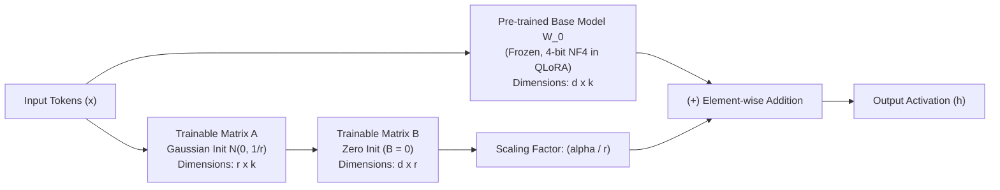
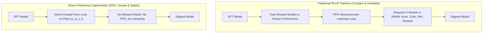

# Track 2: Senior AI Role
## Chapter 5: Parameter-Efficient Fine-Tuning (PEFT), LoRA & Model Alignment

> 🧭 **Navigation**: [⬅️ Previous: 04: RAG & Vector Databases](04-rag-and-vector-databases.md) | [🏠 Senior AI Track Index](README.md) | [➡️ Next: 06: AI Agents & MCP](06-ai-agents-and-mcp.md)

---

When off-the-shelf foundation models cannot adhere to strict enterprise output syntax, fail to adopt specialized domain terminology, or require massive prompt engineering overhead, model adaptation becomes strictly necessary. A Senior AI Engineer must understand when to apply RAG versus fine-tuning, how Low-Rank Adaptation (LoRA) operates mathematically, and how modern alignment algorithms (DPO vs RLHF) function at scale.

---

### 1. The Triad Decision Framework: Prompting vs RAG vs Fine-Tuning

Before touching a GPU, a senior engineer must justify the compute expenditure.

| Dimension | Prompt Engineering | Retrieval-Augmented Generation (RAG) | Parameter-Efficient Fine-Tuning (PEFT) |
| :--- | :--- | :--- | :--- |
| **Primary Purpose** | Guiding off-the-shelf model behavior | Injecting proprietary, dynamic, or private facts | Teaching syntax, formatting, style, or task specialization |
| **Knowledge Dynamism** | Static (within prompt limits) | **Real-time** (instantly reflects database updates) | **Static** (locked at training checkpoint) |
| **Hallucination Risk** | High without context | **Low** (grounded in retrieved documents) | Medium (can still hallucinate facts) |
| **Compute / Training** | Zero compute | Zero model training (requires vector DB) | Requires GPU training pipeline |
| **Token Cost / Latency**| High (repeated long prompts) | Medium-High (retrieved chunks in prompt) | **Low** (can use very concise prompts) |

**Rule of Thumb:** Use RAG for *Knowledge* (facts, inventory, docs). Use Fine-Tuning for *Behavior* (JSON formatting, tone, adopting a specific dialect).

---

### 2. Full Parameter Fine-Tuning vs LoRA vs QLoRA

#### Full Parameter Fine-Tuning (FPFT)
Updates all weights of an LLM. For a 70B parameter model, training requires storing:
- Model weights: 140 GB (in 16-bit FP16/BF16)
- Gradients: 140 GB
- AdamW optimizer states (1st & 2nd moments): 280 GB
- **Total VRAM required: > 600 GB**. This requires an 8x H100 multi-node GPU cluster, costing thousands of dollars per run.

#### The LoRA (Low-Rank Adaptation) Mathematical Breakthrough
Pioneered by Hu et al. (Microsoft), LoRA drastically reduces memory requirements by freezing the pre-trained model and injecting trainable rank decomposition matrices into each Transformer layer.

For a pre-trained weight matrix $W_0 \in \mathbb{R}^{d \times k}$, the weight update $\Delta W$ is decomposed into the product of two low-rank matrices $B$ and $A$:
$$W = W_0 + \Delta W = W_0 + \frac{\alpha}{r} (B \times A)$$

Where:
- $B \in \mathbb{R}^{d \times r}$ and $A \in \mathbb{R}^{r \times k}$.
- The rank $r \ll \min(d, k)$ (e.g. $r = 8$ or $16$).
- **Initialization:** $A \sim \mathcal{N}\left(0, \frac{1}{r}\right)$ (Gaussian distribution) and $B = 0$.
  - Because $B = 0$, at the start of training: $\Delta W = B \times A = 0 \times A = 0$. The model behaves identically to the pre-trained model on step 0, ensuring training stability.
- **$\alpha$ (Alpha Scaling):** A constant hyperparameter. When adjusting rank $r$, scaling by $\frac{\alpha}{r}$ stabilizes hyperparameter tuning. Standard practice: set $\alpha = 2 \times r$.

#### QLoRA (Quantized LoRA)
QLoRA reduces memory by another $4\times$, allowing a 70B model to be fine-tuned on a single 48GB GPU. It relies on 3 innovations:
1. **4-bit NormalFloat (NF4):** An information-theoretically optimal quantization data type for normally distributed weights.
2. **Double Quantization:** Quantizes the quantization constants themselves, saving 0.37 bits per parameter.
3. **Paged Optimizers:** Uses CUDA Unified Memory to automatically page memory between GPU and CPU during memory spikes, preventing Out-Of-Memory (OOM) crashes.



---

### 3. SFT Data Formats: ChatML and Alpaca

Supervised Fine-Tuning (SFT) requires meticulously formatted data. 

**Alpaca Format (Instruction/Input/Response):**
```json
{
  "instruction": "Classify the sentiment of the following text.",
  "input": "I am furious with this broken software.",
  "output": "NEGATIVE"
}
```

**ChatML Format (Multi-turn conversational):**
```json
[
  {"role": "system", "content": "You are a helpful assistant."},
  {"role": "user", "content": "Write a Python script."},
  {"role": "assistant", "content": "print('Hello World')"}
]
```
During training, the loss function is mathematically masked so that gradients are ONLY calculated on the `assistant` tokens. The model should not be penalized for failing to predict the user's prompt!

---

### 4. Post-Training Alignment: PPO (RLHF) vs DPO

After SFT, models often produce correct but socially unacceptable or unsafe answers. They must be "aligned".

#### RLHF with PPO (Proximal Policy Optimization)
- Requires 4 models loaded in VRAM simultaneously: Actor (Active policy), Reference model (frozen baseline), Critic (value function), and Reward model.
- Highly unstable, prone to reward hacking and policy collapse.

#### DPO (Direct Preference Optimization)
DPO eliminates the Reward Model and RL loops entirely. It proves mathematically that the optimal policy under a reward function can be expressed in closed form. 

**DPO Loss Formula:**
$$\mathcal{L}_{\text{DPO}}(\pi_\theta; \pi_{\text{ref}}) = -\mathbb{E}_{(x, y_w, y_l)} \left[ \log \sigma \left( \beta \log \frac{\pi_\theta(y_w \mid x)}{\pi_{\text{ref}}(y_w \mid x)} - \beta \log \frac{\pi_\theta(y_l \mid x)}{\pi_{\text{ref}}(y_l \mid x)} \right) \right]$$
- $y_w$ is the human-preferred ("winning") response.
- $y_l$ is the rejected ("losing") response.
- $\beta$ controls divergence from the reference policy.
- *Intuition:* DPO increases the log-probability of preferred answers while decreasing the log-probability of rejected answers, scaled by how much the reference model already favored them.



---

### 5. Complete Python QLoRA Training Code (HuggingFace PEFT)

```python
# pip install transformers peft bitsandbytes trl datasets
import torch
from transformers import AutoModelForCausalLM, AutoTokenizer, BitsAndBytesConfig
from peft import LoraConfig, get_peft_model, prepare_model_for_kbit_training
from trl import SFTTrainer
from datasets import load_dataset

def train_qlora(model_id="mistralai/Mistral-7B-v0.1"):
    # 1. QLoRA Config (NF4)
    bnb_config = BitsAndBytesConfig(
        load_in_4bit=True,
        bnb_4bit_use_double_quant=True,
        bnb_4bit_quant_type="nf4",
        bnb_4bit_compute_dtype=torch.bfloat16
    )

    # 2. Load Base Model and Tokenizer
    model = AutoModelForCausalLM.from_pretrained(model_id, quantization_config=bnb_config, device_map="auto")
    tokenizer = AutoTokenizer.from_pretrained(model_id)
    tokenizer.pad_token = tokenizer.eos_token

    # 3. Prepare for PEFT
    model = prepare_model_for_kbit_training(model)
    
    # 4. LoRA Config: W = W_0 + (alpha/r)*BA
    lora_config = LoraConfig(
        r=16,
        lora_alpha=32,
        target_modules=["q_proj", "k_proj", "v_proj", "o_proj"], # Target attention layers
        lora_dropout=0.05,
        bias="none",
        task_type="CAUSAL_LM"
    )
    model = get_peft_model(model, lora_config)

    # 5. Load Dataset (Mocked for example)
    # dataset = load_dataset("json", data_files="train.jsonl", split="train")
    print(f"Trainable parameters %: {model.get_trainable_parameters()[0] / model.get_trainable_parameters()[1] * 100:.2f}%")
    
    # 6. SFT Trainer setup would go here...
    return True

# Test Case
assert train_qlora() == True
```

---

### 6. Evaluation: Task-Specific Benchmarks

Fine-tuning often causes "Catastrophic Forgetting" — the model gets better at your specific task but forgets general reasoning.
- **MMLU (Massive Multitask Language Understanding):** Tests general knowledge.
- **HumanEval:** Tests Python coding capabilities.
- **Custom Evals:** Always maintain a golden dataset of 500+ examples specific to your enterprise use-case (e.g., classifying medical codes) and evaluate perplexity and exact-match accuracy against it after every training run.

---

### 7. Real-World Industry Examples

- **Mistral AI:** Trained the highly successful Mixtral 8x7B model by applying rigorous SFT and DPO alignment techniques to raw base models, making it competitive with GPT-4 for instruction following.
- **HuggingFace:** Created and maintains the PEFT (Parameter-Efficient Fine-Tuning) library, which democratized fine-tuning by allowing thousands of open-source developers to run LoRA on consumer GPUs (like the RTX 4090).
- **OpenAI Fine-Tuning API:** Widely used by startups (like Harvey AI for legal document analysis) to enforce strict tonal and structural requirements. They use server-side LoRA matrices swapped dynamically per customer.
- **Bloomberg:** Developed BloombergGPT and subsequently fine-tuned LLaMA variants heavily on proprietary financial datasets to embed financial ticker symbols, proprietary jargon, and market mechanics directly into the model weights, achieving state-of-the-art on financial NLP tasks.

> 💡 **Interview Tip**
> If asked how to fix a model outputting bad JSON, do NOT suggest fine-tuning immediately. Tell the interviewer: "I will use constrained decoding (Instructor/Outlines) or few-shot prompting first. If latency is an issue and few-shot tokens are too expensive, *then* I will fine-tune using QLoRA."

> 📺 **Video References**
> - LoRA Paper Explained (Yannic Kilcher): https://www.youtube.com/@YannicKilcher
> - HuggingFace PEFT Course: https://www.youtube.com/@HuggingFace
> - RLHF and DPO Explained (Andrej Karpathy): https://www.youtube.com/@AndrejKarpathy

> 📖 **Must-Read Resources**
> - LoRA Original Paper (Hu et al.): https://arxiv.org/abs/2106.09685
> - QLoRA Original Paper (Dettmers et al.): https://arxiv.org/abs/2305.14314
> - DPO Paper (Rafailov et al.): https://arxiv.org/abs/2305.18290
> - HuggingFace PEFT Docs: https://huggingface.co/docs/peft/

---

> 🧭 **Navigation**: [⬅️ Previous: 04: RAG & Vector Databases](04-rag-and-vector-databases.md) | [🏠 Senior AI Track Index](README.md) | [➡️ Next: 06: AI Agents & MCP](06-ai-agents-and-mcp.md)
