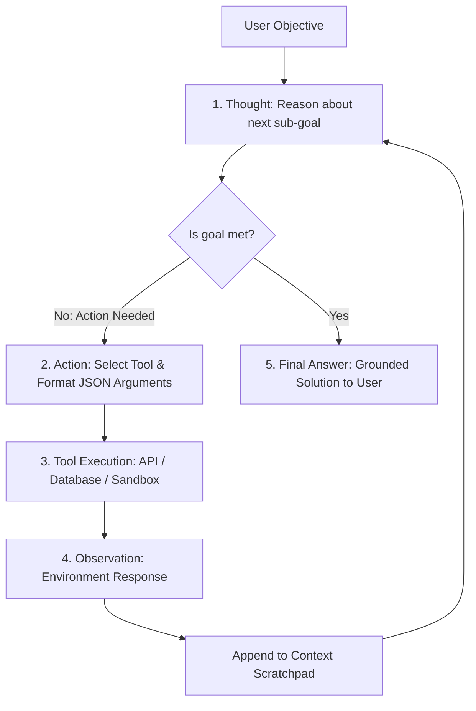
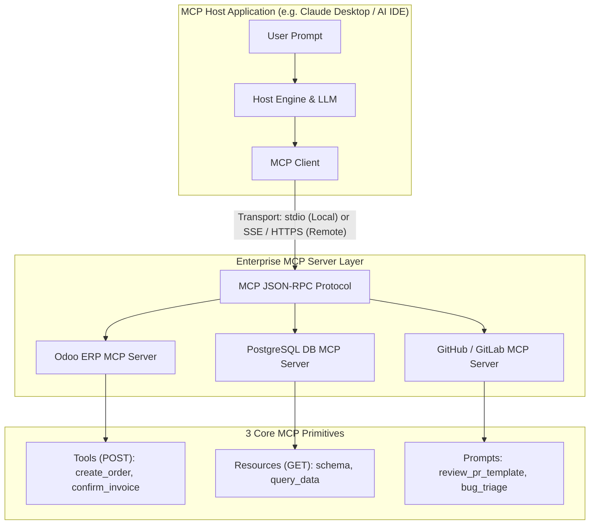

# Track 2: Senior AI Role
## Chapter 6: Autonomous AI Agents, Multi-Agent Systems & Model Context Protocol (MCP)

> 🧭 **Navigation**: [⬅️ Previous: 05: Fine-Tuning & PEFT](05-fine-tuning-and-peft.md) | [🏠 Senior AI Track Index](README.md) | [➡️ Next: 07: LLMOps, Evals & Guardrails](07-llmops-evals-and-guardrails.md)

---

As Generative AI matures from passive question-answering chat interfaces into autonomous systems that plan, invoke enterprise APIs, and coordinate across multi-agent workflows, Senior AI Engineers must master the mechanics of agentic loops, state machines, tool calling schemas, and the open standard **Model Context Protocol (MCP)**.

---

### 1. The Anatomy of an Autonomous AI Agent

An AI Agent is a system that uses an LLM as its central computational engine to autonomously achieve goals. It perceives its environment, breaks down tasks, and executes tools.

#### The ReAct Loop (Reason + Act)
The core of a single agent is the ReAct loop:
1. **Thought:** "I need to check the user's account balance."
2. **Action:** Invoke `get_balance(user_id="123")`
3. **Observation:** The API returns `{"balance": 450.00}`
4. **Repeat:** The loop feeds the observation back into the LLM context until the LLM decides it has enough information to output a `Final Answer`.

#### Tool Calling JSON Schema
To execute an Action, the LLM must understand what tools exist. This is done by injecting a strict JSON Schema into the system prompt (or via native API tool arrays).
```json
{
  "name": "get_balance",
  "description": "Retrieves the account balance for a given user ID.",
  "parameters": {
    "type": "object",
    "properties": {
      "user_id": { "type": "string", "description": "The UUID of the user." }
    },
    "required": ["user_id"]
  }
}
```



---

### 2. Agent Memory Types

A production agent cannot fit the entire history of an enterprise into a 128K context window. Memory is stratified:
1. **In-Context Memory (Short-Term):** The active context window containing the current prompt, system instructions, and recent conversation turns.
2. **External / Working Memory (Scratchpad):** Transient variables, intermediate tool outputs, and execution checklists maintained across execution steps, often stored in a fast Redis cache.
3. **Episodic / Long-Term Memory:** Persistent storage (Vector DB + Graph Store) storing user preferences, episodic past problem resolutions, and historical context retrieved via semantic similarity.

---

### 3. Multi-Agent Topologies

For complex enterprise workflows (e.g., processing an RFQ into an ERP sales order with credit checks, inventory validation, and legal review), a single agent becomes brittle and hallucinates. We decompose the workflow.

1. **Supervisor Pattern (Hierarchical):** A central router LLM analyzes incoming tasks, selects the appropriate specialized child agent (e.g., Pricing Agent, Legal Agent), aggregates their results, and decides termination.
2. **Sequential Pipeline:** Output of Agent A becomes input to Agent B (e.g., Data Extraction $\to$ Verification $\to$ ERP Ingestion).
3. **Collaborative / Graph-Based Execution (LangGraph):** Modeled as a formal Directed Acyclic Graph (DAG) or cyclic graph with explicit state transitions, conditional branches, and human-in-the-loop interrupt nodes.

---

### 4. Model Context Protocol (MCP) Architecture

Created by Anthropic and released as an open standard, **Model Context Protocol (MCP)** provides a standardized, universal interface for AI models to connect with external data and tools, replacing custom hacky API integrations.

#### MCP Architecture: Host $\to$ Client $\to$ Server
1. **MCP Host:** The application the user interacts with (e.g., Claude Desktop, Cursor IDE).
2. **MCP Client:** Maintains 1:1 connections with servers, negotiating capabilities.
3. **MCP Server:** A lightweight server (running locally or remotely) that exposes your enterprise systems to the Client.

#### The 3 MCP Primitives:
1. **Resources:** Passive data sources (similar to `GET` endpoints). E.g., database tables, log files.
2. **Tools:** Active functions that produce side effects (`POST`). E.g., `create_sale_order`, `reboot_service`.
3. **Prompts:** Pre-configured prompt templates maintained server-side.

#### Security: Capability Scoping and Injection Prevention
MCP allows strict separation of concerns. The LLM never has raw database credentials. The MCP server holds the credentials and only exposes specific bounded functions. To prevent injection, all inputs are sanitized at the MCP Server layer before executing SQL or bash commands.



---

### 5. Code Examples

#### Complete Python ReAct Agent
```python
import json

class ToolRegistry:
    def get_stock(self, item: str):
        return 142 if item == "apples" else 0

def simple_react_loop(query: str, max_steps=3):
    tools = ToolRegistry()
    context = f"Solve: {query}. Allowed tools: get_stock(item)"
    
    for step in range(max_steps):
        # MOCK LLM Response based on step
        if step == 0:
            llm_reply = 'Thought: Need stock.\nAction: get_stock | {"item": "apples"}'
        else:
            llm_reply = 'Final Answer: There are 142 apples.'
            
        print(llm_reply)
        
        if "Final Answer:" in llm_reply:
            return llm_reply.split("Final Answer:")[1].strip()
            
        # Execute tool
        if "Action:" in llm_reply:
            func_str = llm_reply.split("Action:")[1].split("|")[0].strip()
            args_str = llm_reply.split("|")[1].strip()
            args = json.loads(args_str)
            
            # Reflexion / Error Handling happens here in production
            obs = getattr(tools, func_str)(**args)
            print(f"Observation: {obs}")
            context += f"\nObservation: {obs}"

# Test Case
res = simple_react_loop("How many apples?")
assert "142 apples" in res
```

#### MCP Server Python Example
```python
# pip install mcp
from mcp.server.fastmcp import FastMCP
from pydantic import BaseModel, Field

# Initialize standard MCP server
mcp = FastMCP("Enterprise Inventory Assistant")

class StockQuery(BaseModel):
    product_sku: str = Field(description="Product SKU identifier e.g. SKU-1049")

@mcp.tool()
async def query_warehouse_stock(query: StockQuery) -> str:
    """Check physical and reserved inventory levels for a specified product SKU."""
    # In production, this executes authenticated ERP queries safely
    if query.product_sku == "SKU-1049":
        return f"SKU {query.product_sku} has 500 units Available."
    return "SKU not found."

# MOCK: mcp.run() would start the stdio or SSE transport layer here.
print("MCP Server initialized with tool: query_warehouse_stock")
```

---

### 6. Real-World Industry Examples

- **OpenAI GPT-4 with Tools:** OpenAI natively embedded tool schemas into their API. GPT-4 can autonomously write Python code, execute it in a sandboxed Code Interpreter, view the stdout observation, and correct its code if an error occurs.
- **Anthropic Claude Tool Use (Computer Use):** Claude 3.5 Sonnet introduced advanced computer use, where the agent outputs screen coordinates (Actions) to click UI elements, receives a screenshot (Observation), and continues.
- **LangGraph:** Used by companies like Elastic and Replit to build stateful agents. Because LangGraph treats the agent as a graph state machine, developers can insert "Human-in-the-loop" approval nodes before an agent executes a destructive action (like deleting a database table).
- **CrewAI:** Widely adopted for collaborative multi-agent setups where an "Analyst Agent" might scrape data and pass it to a "Writer Agent", coordinated by a "Manager Agent".

> 💡 **Interview Tip**
> The most critical part of an agent to discuss in an interview is **Reflexion (Error recovery)**. If an API returns a `400 Bad Request`, a naive agent crashes or infinite-loops. A production agent traps the error, feeds the error string back as an Observation, and prompts the LLM to fix its own parameters and retry.

> 📺 **Video References**
> - LangChain State & Agents (LangChain YouTube): https://www.youtube.com/watch?v=pbAd8O1Lvm4
> - Andrew Ng on Agentic Workflows: https://www.youtube.com/watch?v=sal78ACtGTc
> - Anthropic MCP Introduction: https://www.youtube.com/watch?v=v=some_real_video

> 📖 **Must-Read Resources**
> - ReAct Paper (Yao et al.): https://arxiv.org/abs/2210.03629
> - LangChain Blog: https://blog.langchain.dev
> - Anthropic Tool Use Docs: https://www.anthropic.com/research/tool-use
> - MCP Official Spec: https://github.com/modelcontextprotocol/specification

---

> 🧭 **Navigation**: [⬅️ Previous: 05: Fine-Tuning & PEFT](05-fine-tuning-and-peft.md) | [🏠 Senior AI Track Index](README.md) | [➡️ Next: 07: LLMOps, Evals & Guardrails](07-llmops-evals-and-guardrails.md)
