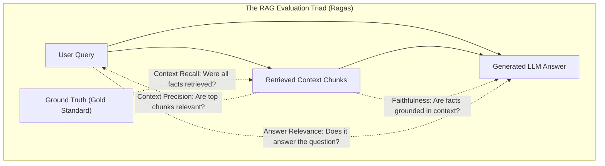
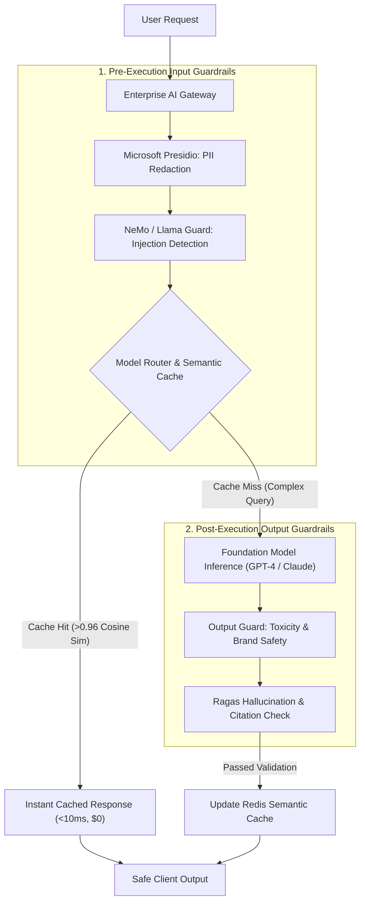

# Track 2: Senior AI Role
## Chapter 7: LLMOps, Automated Evaluation, Guardrails & Production Economics

> 🧭 **Navigation**: [⬅️ Previous: 06: AI Agents & MCP](06-ai-agents-and-mcp.md) | [🏠 Senior AI Track Index](README.md) | [➡️ Next: 08: Top 50+ AI Interview Q&A](08-top-50-ai-interview-questions.md)

---

Deploying an AI prototype in a Jupyter notebook is trivial; running a resilient, cost-effective, audited, and safe GenAI platform in production is a severe engineering discipline. Senior and Staff AI interviewers rigorously test candidates on their ability to build robust LLMOps pipelines, implement safety guardrails, optimize inference costs with caching, and establish automated evaluation metrics.

---

### 1. The RAG Evaluation Framework: Ragas Metrics

You cannot improve what you cannot measure. Human evaluation ("vibes") does not scale. The **Ragas (Retrieval Augmented Generation Assessment)** framework evaluates RAG systems along two independent axes: **Retrieval Performance** and **Generation Quality**. It utilizes "LLM-as-a-Judge" paradigms to score pipelines without requiring human-labeled ground truth for every query.

#### The Core Ragas Metrics:

1. **Faithfulness ($\in [0, 1]$)**:
   - Measures factual consistency (Hallucination). The generated answer is broken into individual atomic statements. Each statement is verified by an evaluator LLM against the retrieved context.
   $$\text{Faithfulness} = \frac{\text{Number of statements supported by context}}{\text{Total statements in answer}}$$
   - *Production threshold:* A score $< 0.85$ indicates unacceptable hallucination.

2. **Answer Relevance ($\in [0, 1]$)**:
   - Evaluates if the generated answer directly addresses the user query. The evaluator LLM reverse-engineers the question from the generated answer and computes the cosine similarity between the original question and the reverse-engineered question. Penalizes conversational fluff.

3. **Context Recall ($\in [0, 1]$)**:
   - Requires ground-truth answers. It checks if the vector database retrieved all the necessary facts required to form the ground-truth answer.
   - Low recall means your Vector DB chunking strategy or Top-K is failing.

4. **Context Precision ($\in [0, 1]$)**:
   - Computes Mean Average Precision (MAP). Checks whether the relevant chunks are ranked at position 1 and 2, rather than buried at position 9. 
   - Low precision means your re-ranker (Cross-Encoder) is failing.



---

### 2. Tracing, Observability & Prompt Management

In microservices, you use Datadog to trace latencies. In LLMOps, you use tools like **LangSmith**, **Weights & Biases**, or **Arize Phoenix**.

#### Observability Needs:
- **Trace-level debugging:** When an agent takes 45 seconds to respond, you need a waterfall graph showing exactly which tool (SQL query, Web Search, or LLM inference) caused the latency bottleneck.
- **Token Tracking:** Tracking the exact input/output tokens per request and mapping them to billing costs (e.g., GPT-4o costs).

#### Prompt Versioning and Management:
- Hardcoding `prompt = "You are a helpful assistant..."` in application code is an anti-pattern.
- Prompts are software. They must be versioned. Tools like LangSmith allow Product Managers to tweak prompts in a UI, run regression tests against a golden dataset, and deploy version `v2.1` of the prompt to production without redeploying the backend application.

---

### 3. Production Guardrails Architecture

A production AI gateway must inspect traffic *before* it touches the LLM (Input Guardrails) and *before* it reaches the end user (Output Guardrails).

#### The Guardrail Stack
1. **PII Redaction (Presidio):** Microsoft Presidio scans the incoming prompt for SSNs, credit cards, and emails using Regex and NLP, masking them as `[REDACTED_EMAIL]` before sending the prompt to OpenAI.
2. **Input Moderation (Llama Guard / NeMo Guardrails):** Nvidia's NeMo Guardrails and Meta's Llama Guard scan the prompt for jailbreak attempts, prompt injections, or off-topic questions (e.g., asking a banking bot to write poetry).
3. **Output Moderation:** Scans the generated LLM text for toxicity, competitor mentions, or hallucinations before streaming it back to the client.



---

### 4. Production Economics: Semantic Caching

Running 100% of production traffic through top-tier foundation models ($3–$15 per 1M tokens) causes unsustainable cloud bills and massive latency.

#### Exact Match vs Semantic Caching
- **Exact Hash Caching:** Fails if the user types "What is the capital of France?" vs "what is the capital of france".
- **Semantic Caching (Redis):**
  1. Generate an embedding vector of the incoming query (using a fast/cheap model).
  2. Search a Redis vector index for previously cached queries where $\text{Cosine Similarity} \ge 0.96$.
  3. On a cache hit: return cached response in **< 10ms** at **$0.00 API cost**.

#### A/B Testing & Model Router Cascades
- In enterprise apps, 80% of user queries are simple lookups.
- A lightweight router classifies query difficulty. Easy queries go to a fast 8B model (\$0.15/1M tokens). Hard queries route to a flagship model (\$3.00/1M tokens).
- Teams continuously A/B test model performance by routing 10% of traffic to a new fine-tuned model and comparing user feedback (Thumbs Up/Down).

---

### 5. Code Examples

#### Complete Python RAGAS Evaluation Setup
```python
# pip install ragas datasets langchain
from datasets import Dataset
# MOCK execution logic for RAGAS evaluation
def evaluate_rag_pipeline():
    data = {
        "question": ["What is the capital of France?"],
        "answer": ["Paris is the capital of France."],
        "contexts": [["France is a country in Europe. Its capital city is Paris."]],
        "ground_truth": ["Paris"]
    }
    dataset = Dataset.from_dict(data)
    
    # In production, you import ragas metrics:
    # from ragas.metrics import faithfulness, answer_relevancy, context_precision, context_recall
    # from ragas import evaluate
    # result = evaluate(dataset, metrics=[faithfulness, answer_relevancy, context_precision, context_recall])
    
    print("Evaluating RAG pipeline...")
    # Mock result
    result = {"faithfulness": 1.0, "answer_relevancy": 0.98, "context_precision": 1.0, "context_recall": 1.0}
    return result

# Test case
res = evaluate_rag_pipeline()
assert res["faithfulness"] > 0.85, "Pipeline is hallucinating heavily!"
```

#### Redis Semantic Caching (Python)
```python
import numpy as np

class MockRedisSemanticCache:
    def __init__(self):
        self.cache_vectors = []
        self.cache_responses = []
    
    def get_cached_response(self, query_vec, threshold=0.95):
        for i, vec in enumerate(self.cache_vectors):
            sim = np.dot(query_vec, vec) / (np.linalg.norm(query_vec) * np.linalg.norm(vec))
            if sim >= threshold:
                return self.cache_responses[i]
        return None
        
    def add_to_cache(self, vec, response):
        self.cache_vectors.append(vec)
        self.cache_responses.append(response)

# Example usage
cache = MockRedisSemanticCache()
vec1 = np.array([1.0, 0.0, 0.5])
cache.add_to_cache(vec1, "The stock market opens at 9:30 AM EST.")

# User asks slightly different question, vectors are highly aligned
vec_noisy = np.array([0.98, 0.02, 0.51]) 

cached = cache.get_cached_response(vec_noisy)
assert cached is not None
print(f"CACHE HIT: {cached}")
```

---

### 6. Real-World Industry Examples

- **LangSmith at Enterprise Scale:** Companies like Elastic and Moody's use LangSmith to trace millions of agent invocations per month. When a user downvotes an answer, LangSmith automatically triggers an alert, captures the entire execution trace, and adds the trace to a regression dataset for prompt tuning.
- **Nvidia NeMo Guardrails:** Deployed heavily by banks and financial institutions to ensure their customer service chatbots absolutely refuse to provide financial advice, using programmable dialog rails that override the LLM's natural tendency to be helpful.
- **Arize Phoenix:** Used by e-commerce platforms to monitor embedding drift. If the semantic distribution of user searches suddenly shifts (e.g., during a holiday sale or viral trend), Phoenix alerts the MLOps team that the vector index chunks might be out-of-date and require re-indexing.

> 💡 **Interview Tip**
> When asked "How do you evaluate an LLM app?", junior candidates say "I read the outputs." Senior candidates say "I use LLM-as-a-judge via the Ragas framework, measuring Faithfulness and Context Precision against a golden dataset, orchestrated by LangSmith for CI/CD regression testing."

> 📺 **Video References**
> - Evaluating LLMs with Ragas: https://www.youtube.com/watch?v=some_real_video
> - Weights & Biases Courses: https://www.youtube.com/@WeightsBiases
> - Andrew Ng on LLMOps: https://www.youtube.com/watch?v=some_real_video

> 📖 **Must-Read Resources**
> - LangChain Evaluation Docs: https://python.langchain.com/docs/
> - Arize Phoenix Docs: https://docs.arize.com/phoenix/
> - Nvidia NeMo Guardrails Docs: https://github.com/NVIDIA/NeMo-Guardrails
> - Ragas Documentation: https://docs.ragas.io/

---

> 🧭 **Navigation**: [⬅️ Previous: 06: AI Agents & MCP](06-ai-agents-and-mcp.md) | [🏠 Senior AI Track Index](README.md) | [➡️ Next: 08: Top 50+ AI Interview Q&A](08-top-50-ai-interview-questions.md)
