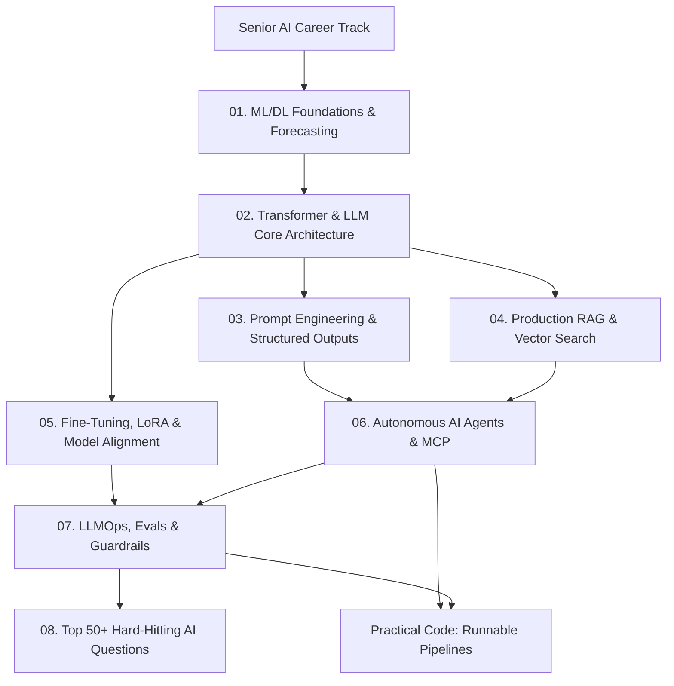

# 🤖 Track 3: Senior AI & Generative AI Systems
## Master Curriculum Roadmap & Preparation Blueprint

Welcome to the **Senior AI & Generative AI Engineer Track**. This track is engineered to prepare you for Staff/Senior AI Engineering interviews at top-tier product companies (FAANG, OpenAI, Anthropic, Databricks, Uber, Stripe).

---

## 🗺️ Visual Track Roadmap

---

## 📚 Sequential Learning Syllabus

| # | Chapter / Guide | Core Architectural Topics | Real-World Context |
|---|---|---|---|
| **01** | [**ML & DL Foundations**](./01-ml-dl-foundations.md) | Bias-Variance, Loss Functions, Regularization, Time Series (Prophet, ARIMA), ONNX Runtime | Google Ad Click, Stripe Fraud Detection |
| **02** | [**Transformer & LLM Core**](./02-transformer-and-llm-core.md) | Self-Attention Math ($QK^T/\sqrt{d_k}$), KV Cache sizing, RoPE, Quantization (AWQ, GGUF), vLLM | GPT-4 MoE, LLaMA 3 GQA |
| **03** | [**Prompting & Structured I/O**](./03-prompting-and-structured-io.md) | CoT, Tree of Thoughts, Prefill, FSM Logit Masking (Outlines), Prompt Injection | OpenAI ChatGPT, Constitutional AI |
| **04** | [**Production RAG & Vector Search**](./04-rag-and-vector-databases.md) | Chunking, HNSW vs IVFFlat, pgvector, BM25 Hybrid Search + RRF, Cross-Encoder Re-Ranking | Notion AI, Perplexity, Glean |
| **05** | [**Fine-Tuning, LoRA & PEFT**](./05-fine-tuning-and-peft.md) | Full FT vs LoRA vs QLoRA, LoRA Matrix Math ($W_0 + \frac{\alpha}{r}BA$), DPO vs PPO | Mistral Mixtral, BloombergGPT |
| **06** | [**AI Agents & MCP**](./06-ai-agents-and-mcp.md) | ReAct Loop, Tool Calling Schemas, Model Context Protocol (MCP) Host/Client/Server | Claude Artifacts, LangGraph Agents |
| **07** | [**LLMOps, Evals & Guardrails**](./07-llmops-evals-and-guardrails.md) | Ragas Metrics (Faithfulness, Relevancy), LangSmith Tracing, NeMo Guardrails, Semantic Caching | Enterprise AI Gateways, Redis |
| **08** | [**Top 50+ Senior AI Interview Questions**](./08-top-50-ai-interview-questions.md) | Comprehensive technical, mathematical, and architecture questions with answers | Real FAANG/PBC interview questions |
| **Lab** | [**Practical Code Implementations**](./practical-code-implementations.md) | End-to-end runnable Python pipelines: Advanced RAG, Autonomous Agent, QLoRA SFT | Production code templates |

---

## 🧭 Navigation
- ⬅️ **Previous Track**: [Track 2: Distributed System Design](../system%20design/README.md)
- 🏠 **Root Index**: [Master Interview Guide](../README.md)
- ➡️ **Next Track**: [Track 4: Techno-Functional Lead](../Techno-Functional%20Lead/README.md)
