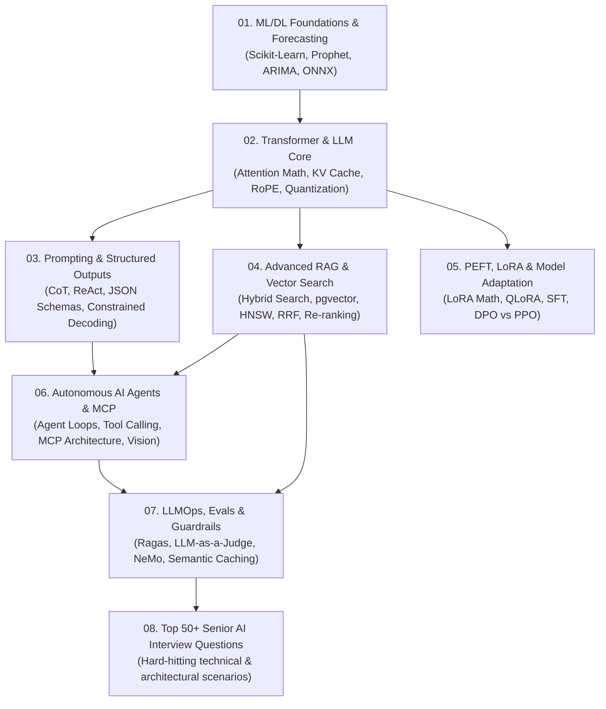

# 🧠 Senior AI & GenAI Engineer: Master Roadmap & Syllabus

Welcome to the **Senior AI Role Preparation Track**. This track is engineered to take you from core machine learning foundations to production-grade Generative AI, Large Language Model architectures, advanced RAG, autonomous AI agents, and enterprise LLMOps.

---

## 🗺️ Master Curriculum Overview

---

## 📚 Detailed Chapter Index

1. **[01-ml-dl-foundations.md](file:///D:/Projects/interview-material/Senior%20AI%20Role/01-ml-dl-foundations.md)**
   - Supervised vs Unsupervised learning core principles
   - Bias-Variance Trade-off, Loss Functions, Regularization (L1/L2, Dropout)
   - Time Series Demand Forecasting: ARIMA, SARIMA, Facebook Prophet (Changepoints, Seasonality)
   - Light inference runtimes: ONNX Runtime vs heavy PyTorch runtimes

2. **[02-transformer-and-llm-core.md](file:///D:/Projects/interview-material/Senior%20AI%20Role/02-transformer-and-llm-core.md)**
   - Transformer Architecture from scratch: Scaled Dot-Product Attention, Multi-Head Attention, Pre-LN vs Post-LN
   - Mathematical derivation of Query, Key, Value matrices
   - Rotary Position Embeddings (RoPE) and Long Context mechanics
   - LLM Inference engine: Autoregressive decoding, KV Cache memory calculation, PagedAttention, vLLM
   - Model Quantization: FP16, INT8, INT4, AWQ, GPTQ, GGUF

3. **[03-prompting-and-structured-io.md](file:///D:/Projects/interview-material/Senior%20AI%20Role/03-prompting-and-structured-io.md)**
   - Prompt Engineering Paradigms: Zero-Shot, Few-Shot, Chain-of-Thought (CoT), ReAct framework
   - Structured Output Generation: Function Calling, JSON Schema validation, Pydantic
   - Constrained Decoding: Logit-bias masking, CFG (Context-Free Grammars), Outlines & Guidance

4. **[04-rag-and-vector-databases.md](file:///D:/Projects/interview-material/Senior%20AI%20Role/04-rag-and-vector-databases.md)**
   - Naive RAG vs Advanced RAG vs Modular RAG
   - Chunking Strategies: Fixed-token, Recursive, Semantic chunking, Document-structure chunking
   - Vector Indexing & Algorithms: Flat, IVFFlat, HNSW (Hierarchical Navigable Small World)
   - PostgreSQL pgvector vs Dedicated Vector Databases (Qdrant, Pinecone, Milvus)
   - Hybrid Search: Dense Vector + BM25 Sparse Search combined with Reciprocal Rank Fusion (RRF)
   - Re-ranking with Cross-Encoders (Cohere, BGE-Reranker)
   - Advanced Query Transformations: HyDE (Hypothetical Document Embeddings), Multi-Query, Parent-Document retrieval

5. **[05-fine-tuning-and-peft.md](file:///D:/Projects/interview-material/Senior%20AI%20Role/05-fine-tuning-and-peft.md)**
   - The Triad Decision Matrix: Prompt Engineering vs RAG vs Fine-Tuning
   - Parameter-Efficient Fine-Tuning (PEFT) and LoRA (Low-Rank Adaptation)
   - Mathematical mechanics of LoRA ($W + \Delta W = W + B \times A$)
   - QLoRA: 4-bit NormalFloat (NF4), Double Quantization, Paged Optimizers
   - Post-Training Alignment: Supervised Fine-Tuning (SFT), RLHF, Direct Preference Optimization (DPO)

6. **[06-ai-agents-and-mcp.md](file:///D:/Projects/interview-material/Senior%20AI%20Role/06-ai-agents-and-mcp.md)**
   - Autonomous AI Agents: Planning, Memory (Short-term, Working, Long-term), Tool Execution
   - Multi-Agent Patterns: Supervisor, Hierarchical Teams, Swarms
   - Model Context Protocol (MCP): In-depth protocol specification, stdio vs SSE transports, tool calling security
   - Visual AI in Enterprise: ONNX Runtime, ResNet50/CLIP embeddings for semantic product image search

7. **[07-llmops-evals-and-guardrails.md](file:///D:/Projects/interview-material/Senior%20AI%20Role/07-llmops-evals-and-guardrails.md)**
   - Automated LLM Evaluation: The Ragas Framework (Faithfulness, Answer Relevance, Context Precision, Context Recall)
   - LLM-as-a-Judge: Multi-model evaluation, grading rubrics, bias mitigation
   - Guardrails & Security: NeMo Guardrails, Llama Guard, PII redaction, Jailbreak & Prompt Injection defenses
   - Production Serving: Semantic Caching with Redis, Model Cascades / Multi-provider routing, TTFT vs TPS latency optimization

8. **[08-top-50-ai-interview-questions.md](file:///D:/Projects/interview-material/Senior%20AI%20Role/08-top-50-ai-interview-questions.md)**
   - 50+ Senior & Staff AI Engineer interview questions covering architecture, math, edge cases, and real-world system design.
