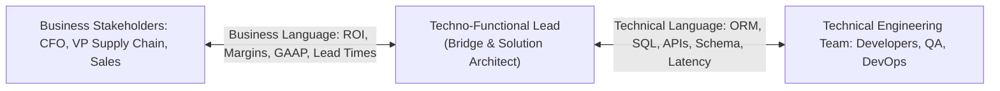
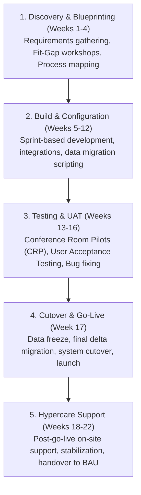
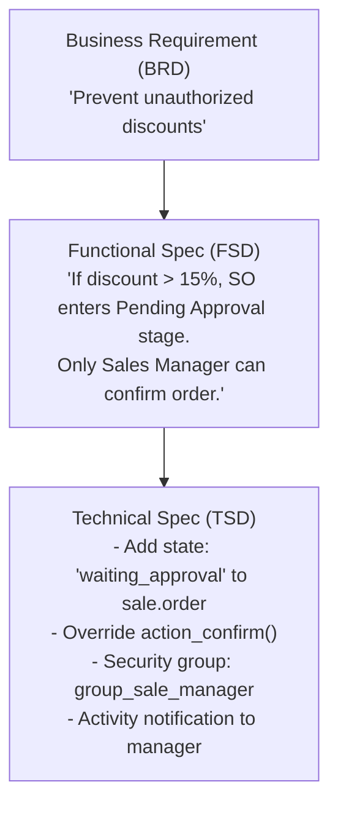

# Track 4: Techno-Functional Lead
## Chapter 1: The Techno-Functional Role, Fit-Gap Analysis & ERP Implementation Methodology

> 🧭 **Navigation**: ⇤ First Chapter | [🏠 Techno-Functional Track Index](README.md) | [➡️ Next: 02: Order-to-Cash & CRM](02-order-to-cash-and-crm.md)

---

A **Techno-Functional Lead** is the essential bridge between the executive boardroom and the engineering trenches. You must speak the language of Chief Financial Officers, Operations Directors, and Supply Chain Managers, while translating business processes into precise data architectures, workflows, and developer specifications.

---

### 1. What Defines a Techno-Functional Lead?



#### Core Competencies:
1. **Domain Depth**: Understanding core enterprise processes: Order-to-Cash (O2C), Procure-to-Pay (P2P), Record-to-Report (R2R), and Plan-to-Produce (P2P/MRP).
2. **Solution Architecture**: Knowing when an Out-of-the-Box (OOTB) configuration satisfies a requirement vs when custom code is genuinely warranted.
3. **Change Leadership**: Navigating business user resistance, scope creep, and steering committee approvals.

**Real-World Industry Examples:**
- **Nike's ERP Implementation:** Nike successfully leveraged techno-functional experts to bridge their business need for global supply chain visibility with the SAP technical architecture, ensuring real-time inventory tracking.
- **Amazon Business:** Amazon uses techno-functional leaders to translate B2B procurement behaviors into the technical microservices that power features like multi-user requisition approvals.

> 💡 **Interview Tip**
> Interviewers look for candidates who don't just write code or only read business manuals. You must demonstrate how you pushed back on a business stakeholder to prevent unnecessary custom code by suggesting a standard ERP workaround.

> 📺 **Video References**
> - What is an ERP Implementation? | SAP YouTube: https://www.youtube.com/@SAP
> - The Role of Solution Architects | Odoo Functional YouTube: https://www.youtube.com/@Odoo

> 📖 **Must-Read Resources**
> - Odoo Functional Documentation: https://www.odoo.com/documentation/17.0/applications/inventory_and_mrp.html
> - High Scalability: http://highscalability.com

---

### 2. The Enterprise Fit-Gap Analysis Framework

During the initial discovery phase, every client requirement must be evaluated and categorized into the **4-Quadrant Fit-Gap Matrix**:

```mermaid
quadrantChart
    title Fit-Gap Analysis Matrix
    x-axis Low Technical Effort --> High Technical Effort
    y-axis Low Business Value --> High Business Value
    quadrant-1 High ROI Customization
    quadrant-2 Standard OOTB Configuration
    quadrant-3 Deprioritize / Reject
    quadrant-4 Process Change (Change Management)
```

| Classification | Definition | Recommended Action |
| :--- | :--- | :--- |
| **1. Standard Fit (OOTB)** | Handled completely by standard ERP functionality out-of-the-box. | **Configure**: Zero custom code. Enable settings, configure parameters. |
| **2. Configurable Fit** | Achievable using standard configuration, automated actions, or standard views. | **Low-Code Config**: Modify views, automated server actions, or report templates. |
| **3. Process Change (Best Practice)** | The client's legacy habit differs from standard ERP best practices without adding unique competitive value. | **Change Management**: Coach the client to adjust their internal business process to adopt industry-standard workflow. |
| **4. Custom Development (Gap)** | Unique competitive advantage or regulatory requirement impossible in standard ERP. | **Build Custom Module**: Author formal Functional Specification Document (FSD) and Technical Specification Document (TSD). |

**Real-World Industry Examples:**
- **Walmart's EDI Automation:** Walmart determined that vendor communication was a "High ROI Customization" gap and invested heavily in custom EDI integrations for supply chain automation, differentiating them from competitors.
- **Hershey's 1999 ERP Failure:** Hershey's failed go-live in 1999 was partly due to poor fit-gap analysis and attempting to cram processes into a system without proper change management or testing, leading to $100M in unfulfilled orders.

> 💡 **Interview Tip**
> Be prepared to walk through a specific time you performed a Fit-Gap analysis. Highlight how you categorized a "Gap" and justified the technical effort to the steering committee based on its ROI.

> 📺 **Video References**
> - ERP Fit-Gap Analysis Best Practices | APICS CSCP Certification Videos
> - Systems Engineering Design | MIT OpenCourseWare: https://ocw.mit.edu/courses/15-763j-manufacturing-systems-analysis-spring-2004/

> 📖 **Must-Read Resources**
> - AWS Architecture Blog - Migration Strategies: https://aws.amazon.com/blogs/architecture/
> - Martin Fowler - Enterprise Architecture: https://martinfowler.com

---

### 3. The 5-Stage ERP Implementation Life Cycle

Enterprise ERP delivery requires structured governance to avoid budget overruns and missed go-live dates.




#### The Conference Room Pilot (CRP) Strategy:
- **CRP 1 (Proof of Concept)**: Walk through core standard flows (Create customer $\to$ SO $\to$ Delivery $\to$ Invoice) using standard ERP with raw client sample data. Validates business blueprint.
- **CRP 2 (Integrated System Test)**: Full end-to-end testing with custom modules and third-party integrations (Payment gateways, shipping carriers, tax engines).
- **UAT (User Acceptance Testing)**: Real end-users execute day-to-day transactions under real-world pressure. Mandatory sign-off milestone before Go-Live approval.

**Real-World Industry Examples:**
- **Target Canada ERP Rollout:** Target's massive supply chain failure in Canada was largely attributed to skipping vital UAT and CRP phases, resulting in empty shelves due to unverified master data.
- **Spotify's ERP Migration:** Spotify successfully implemented their global financial ERP by relying on intense UAT and phased rollouts to ensure royalty accounting accuracy.

> 💡 **Interview Tip**
> Know the difference between CRP and UAT. CRP is for validating system design and processes with core team members. UAT is testing by actual business users to confirm the system works in day-to-day scenarios.

> 📺 **Video References**
> - Agile ERP Implementations | NeetCode: https://www.youtube.com/@NeetCode
> - Cloud ERP Strategies | Gaurav Sen: https://www.youtube.com/@GauravSensei

> 📖 **Must-Read Resources**
> - APICS Dictionary: https://www.ascm.org
> - Meta Engineering Blog - Large Scale Migrations: https://engineering.fb.com

---

### 4. Translating Business Requirements into Technical Specifications

A common pitfall is giving developers vague business requests. A Techno-Functional Lead translates this into an unambiguous specification.




#### Sample Functional Specification Snippet:
- **Business Objective**: Protect gross margins by enforcing multi-level discount approvals.
- **Trigger**: When a Sales Order line has `discount > 15.0%`.
- **System Behavior**:
  1. Set Sales Order `state` to `'waiting_approval'`.
  2. Disable the "Confirm Order" button for the standard Salesperson role.

#### Code Examples (Discount Validation)

**Python 3 (e.g., Odoo ORM Style)**
```python
class SaleOrder(models.Model):
    _inherit = 'sale.order'

    def action_confirm(self):
        """
        Validate sales order discount before confirming.
        If any line has > 15% discount, require manager approval.
        """
        for order in self:
            for line in order.order_line:
                if line.discount > 15.0:
                    # Check if user has manager privileges
                    if not self.env.user.has_group('sales.group_sale_manager'):
                        # Set to waiting approval state instead of confirming
                        order.write({'state': 'waiting_approval'})
                        return False # Halt standard confirmation
        # Proceed with standard confirmation if valid
        return super(SaleOrder, self).action_confirm()

# Test Case Snippet:
# User without manager group tries to confirm SO with 20% discount.
# Expected output: SO state changes to 'waiting_approval', action_confirm returns False.
```

**Java 17 (e.g., Spring Boot Enterprise Service)**
```java
@Service
public class SalesOrderService {

    @Autowired
    private SecurityService securityService;

    @Autowired
    private SalesOrderRepository orderRepository;

    /**
     * Confirms the sales order. Enforces discount approval rules.
     */
    @Transactional
    public SalesOrder confirmOrder(Long orderId) {
        SalesOrder order = orderRepository.findById(orderId)
            .orElseThrow(() -> new EntityNotFoundException("Order not found"));

        boolean requiresApproval = order.getLines().stream()
            .anyMatch(line -> line.getDiscountPercentage() > 15.0);

        if (requiresApproval) {
            if (!securityService.currentUserHasRole("ROLE_SALES_MANAGER")) {
                order.setStatus(OrderStatus.WAITING_APPROVAL);
                orderRepository.save(order);
                // Return or throw custom exception to notify UI
                throw new ApprovalRequiredException("Discount exceeds 15%. Manager approval required.");
            }
        }
        
        order.setStatus(OrderStatus.CONFIRMED);
        return orderRepository.save(order);
    }
}

// Test Case Snippet:
// SalesOrder order = new SalesOrder(List.of(new OrderLine(20.0))); // 20% discount
// assertThrows(ApprovalRequiredException.class, () -> salesOrderService.confirmOrder(order.getId()));
```

**Real-World Industry Examples:**
- **Salesforce + Stripe:** When configuring Salesforce CPQ (Configure, Price, Quote), techno-functional leads write strict technical specs for how custom apex triggers validate discounts before sending the payload to Stripe for billing.
- **SAP S/4HANA O2C Configuration:** Translating a business rule into ABAP specifications for custom pricing routines (VOFM) based on customer hierarchy.

> 💡 **Interview Tip**
> Always demonstrate that you think of edge cases in your technical specs. What happens if the line item is returned? What happens if the manager rejects the discount?

> 📺 **Video References**
> - Software Architecture Principles | ByteByteGo: https://www.youtube.com/@ByteByteGo
> - Object Oriented Design | MIT 6.006: https://www.youtube.com/playlist?list=PLUl4u3cNGP61Oq3tWYp6V_F-5jb5L2iHb

> 📖 **Must-Read Resources**
> - Uber Engineering Blog - Domain Driven Design: https://www.uber.com/en-US/blog/engineering/
> - Python Documentation: https://docs.python.org/3/

---

> 🧭 **Navigation**: ⇤ First Chapter | [🏠 Techno-Functional Track Index](README.md) | [➡️ Next: 02: Order-to-Cash & CRM](02-order-to-cash-and-crm.md)
