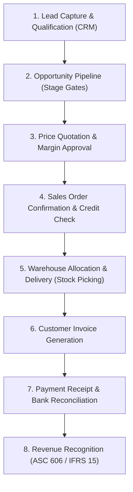
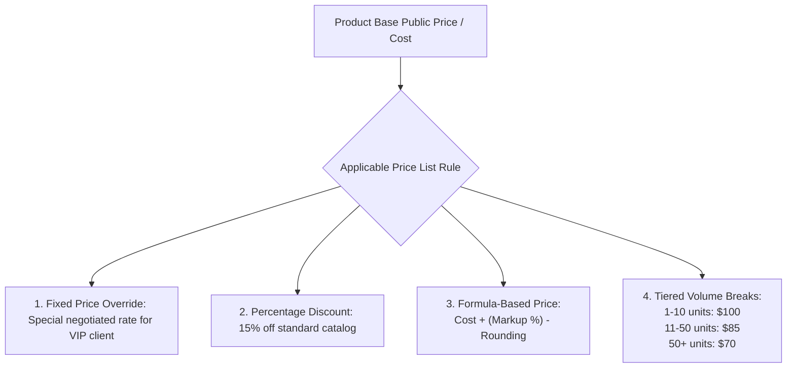
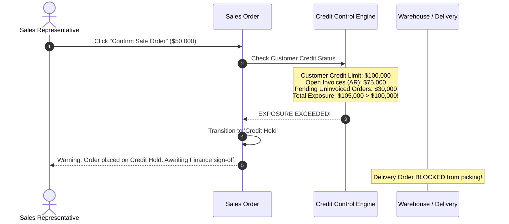

# Track 4: Techno-Functional Lead
## Chapter 2: Order-to-Cash (O2C) & Enterprise CRM Mastery

The **Order-to-Cash (O2C)** process is the financial lifeblood of any commercial organization. A Techno-Functional Lead must design an uninterrupted chain from initial marketing inquiry to final cash receipt and revenue recognition.

---

### 1. The End-to-End Order-to-Cash (O2C) Value Stream

**Real-World Industry Examples:**
- **Amazon's 1-Click Checkout:** Amazon's highly optimized O2C flow bypasses manual quotation, instantly confirming the order, allocating warehouse stock, and charging the card, minimizing friction.
- **SAP S/4HANA O2C:** Real SAP implementations tightly couple the SD (Sales & Distribution) module with FI (Financial Accounting) to automate the flow from Sales Order creation to Accounts Receivable.
- **Salesforce + Stripe:** Subscription businesses integrate Salesforce CRM opportunities directly with Stripe to automate recurring O2C cycles without manual invoicing.

> 💡 **Interview Tip**
> When asked about O2C, emphasize the integration points. It's not just about sales; it's about how the sales order triggers warehouse logistics (Delivery) and financial records (Invoicing).

> 📺 **Video References**
> - Supply Chain & O2C | MIT OpenCourseWare: https://ocw.mit.edu/courses/15-763j-manufacturing-systems-analysis-spring-2004/
> - SAP S/4HANA Order to Cash Process | SAP YouTube: https://www.youtube.com/@SAP

> 📖 **Must-Read Resources**
> - APICS Dictionary: https://www.ascm.org
> - Salesforce Architecture: https://architect.salesforce.com/

---

### 2. CRM & Sales Pipeline Architecture

- **Lead vs Opportunity**: A **Lead** is an unverified contact or raw inquiry. Once qualified via frameworks like **BANT** (Budget, Authority, Need, Timeline), it converts into an **Opportunity** (with an estimated deal value, probability percentage, and expected closing date) while generating or linking a `res.partner` account.
- **Automated Routing**: Enterprise leads are routed to sales teams using automated assignment rules based on geography or product expertise.

**Real-World Industry Examples:**
- **HubSpot CRM Lead Scoring:** HubSpot uses machine learning to automatically score leads based on website interactions before converting them to Sales Opportunities.
- **Uber Freight:** Uber's CRM pipeline routes shipper leads to specialized sales teams based on shipping lanes and volume, optimizing conversion rates.

> 💡 **Interview Tip**
> Understand the data model transition. A Lead is often just text fields (name, email), while an Opportunity links to relational database records like Customers, Contacts, and Products.

> 📺 **Video References**
> - CRM Best Practices | Odoo Functional YouTube: https://www.youtube.com/@Odoo
> - System Design Interview CRM | ByteByteGo: https://www.youtube.com/@ByteByteGo

> 📖 **Must-Read Resources**
> - Odoo CRM Documentation: https://www.odoo.com/documentation/17.0/applications/sales/crm.html
> - Intercom Engineering Blog: https://www.intercom.com/blog/engineering/

---

### 3. Pricing Engines & Multi-Tier Price Lists

Enterprise B2B pricing is rarely a single static price. Techno-Functional Leads configure hierarchical pricing strategies:

**Real-World Industry Examples:**
- **AWS Cloud Pricing:** AWS utilizes incredibly complex tiered volume breaks and formula-based pricing where cost decreases dynamically as compute volume increases.
- **B2B Wholesale (Sysco):** Sysco configures dynamic formula-based price lists tied to global commodity costs, ensuring margins are protected when raw material costs fluctuate.

> 💡 **Interview Tip**
> Explain how pricing rule engines work sequentially. They evaluate from most specific (Customer X gets product Y for $10) to least specific (Global 5% off catalog), stopping at the first match.

> 📺 **Video References**
> - Dynamic Pricing Algorithms | Stanford CS25: https://www.youtube.com/playlist?list=PLoROMvodv4rNiJRchCzutFw5ItR_ZEDY

> 📖 **Must-Read Resources**
> - Netflix Tech Blog (Pricing Architecture): https://netflixtechblog.com
> - Uber Engineering (Dynamic Pricing): https://www.uber.com/en-US/blog/engineering/

---

### 4. Credit Control & Credit Limit Enforcements

Allowing sales teams to close orders with delinquent accounts creates massive bad-debt liabilities.

**Real-World Industry Examples:**
- **Caterpillar Dealerships:** When B2B clients purchase heavy machinery, strict credit holds automatically prevent shipment if the client's AR balance plus the new order exceeds their credit limit insured by underwriters.
- **Oracle ERP Cloud:** Uses sophisticated credit scoring models taking into account payment history and external D&B scores to dynamically adjust credit limits.

> 💡 **Interview Tip**
> Mention that "Total Exposure" must include *both* Open Invoices (AR) and Uninvoiced Sales Orders. Many junior consultants forget to count confirmed but unbilled orders in the credit exposure.

> 📺 **Video References**
> - Accounting & Finance for Tech Leads | Martin Kleppmann Cambridge: https://www.youtube.com/playlist?list=PLeKd45zvjcDFUEv_ohr_HdUFe97RIt8b

> 📖 **Must-Read Resources**
> - PostgreSQL Docs (Transactional integrity for ledgers): https://www.postgresql.org/docs/
> - Stripe Engineering Blog: https://stripe.com/blog/engineering

---

### 5. Invoicing Policy: Ordered vs Delivered Quantities

| Dimension | Invoicing Based on Ordered Quantities | Invoicing Based on Delivered Quantities |
| :--- | :--- | :--- |
| **Mechanics** | Invoices can be generated immediately upon Sales Order confirmation, regardless of stock delivery. | Invoices can only be created for quantities that have been physically validated in outgoing shipments. |
| **Best Used For** | Service businesses, prepayment terms, digital products, subscription software. | Physical goods, retail distribution, manufacturing, B2B wholesale. |
| **Accounting Risk** | Risk of billing customers for items that later go out-of-stock, requiring credit notes. | Clean alignment with GAAP revenue recognition; customer only billed for goods received. |

**Real-World Industry Examples:**
- **Spotify subscriptions:** Bills on ordered quantities (recurring service upfront).
- **Dell Computers:** Bills on delivered quantities. The credit card is authorized at order confirmation, but only captured/invoiced when the laptop physically ships from the facility.

> 💡 **Interview Tip**
> Frame the invoicing policy as a legal and accounting decision, not just a software setting. It dictates when liability transfers and revenue can be recognized.

> 📺 **Video References**
> - Billing Architectures | System Design | Gaurav Sen: https://www.youtube.com/@GauravSensei

> 📖 **Must-Read Resources**
> - Square/Block Engineering Blog: https://developer.squareup.com/blog/

---

### 6. Revenue Recognition (ASC 606 & IFRS 15 Compliance)

Under international accounting standards, revenue cannot be recognized simply because cash was received or an invoice was printed. Revenue must follow the **5-Step Model**:

1. Identify the contract with a customer.
2. Identify the distinct **Performance Obligations** (e.g. Software License + 1-year Support).
3. Determine the transaction price ($120,000).
4. Allocate transaction price across obligations ($100k License, $20k Support).
5. **Recognize revenue when (or as) the performance obligation is satisfied**:
   - Software License $\to$ Recognized immediately upon delivery.
   - 1-Year Support $\to$ Booked to **Deferred Revenue (Liability)** and recognized ratably at $1,666.67/month over 12 months.

**Worked Accounting Journal Entry:**
*Scenario: Customer pays $12,000 upfront on Jan 1 for a 12-month SaaS subscription.*
**Jan 1 (Invoice & Payment Receipt):**
- Debit: Bank Account $12,000
- Credit: Deferred Revenue (Liability) $12,000

**Jan 31 (Month 1 Recognition):**
- Debit: Deferred Revenue (Liability) $1,000
- Credit: SaaS Revenue (P&L) $1,000

**Real-World Industry Examples:**
- **Tesla's ASC 606 RevRec:** When you buy a Tesla with "Full Self-Driving", Tesla recognizes the hardware revenue immediately upon delivery, but defers a portion of the software revenue to a liability account, only recognizing it as over-the-air updates satisfy the performance obligation.
- **Airbnb:** Airbnb collects guest payment at booking, but holds it as deferred revenue. They only recognize the revenue and disburse host funds 24 hours after check-in, aligning with GAAP.

> 💡 **Interview Tip**
> Use the phrase "Deferred Revenue is a liability because we owe the customer a service." This shows deep financial literacy expected of a Techno-Functional Lead.

> 📺 **Video References**
> - ASC 606 Revenue Recognition | AICPA Webinars: https://www.youtube.com/@AICPA
> - Financial Accounting | MIT OpenCourseWare: https://ocw.mit.edu/courses/15-511-financial-accounting-summer-2004/

> 📖 **Must-Read Resources**
> - FASB ASC 606: https://www.fasb.org
> - Deloitte IFRS insights: https://www.iasplus.com
> - PWC Revenue recognition guide: https://viewpoint.pwc.com/
