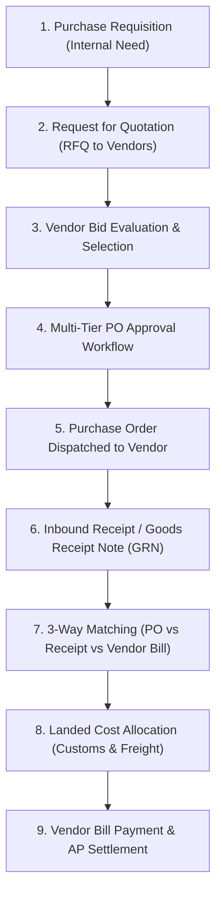
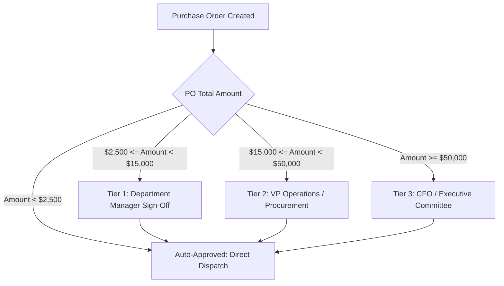
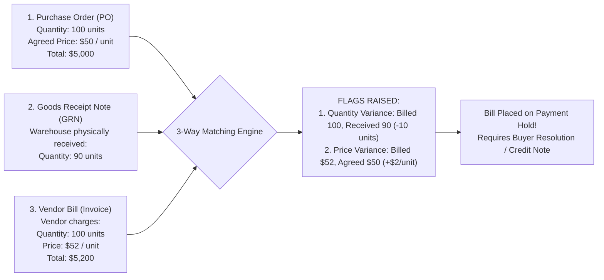
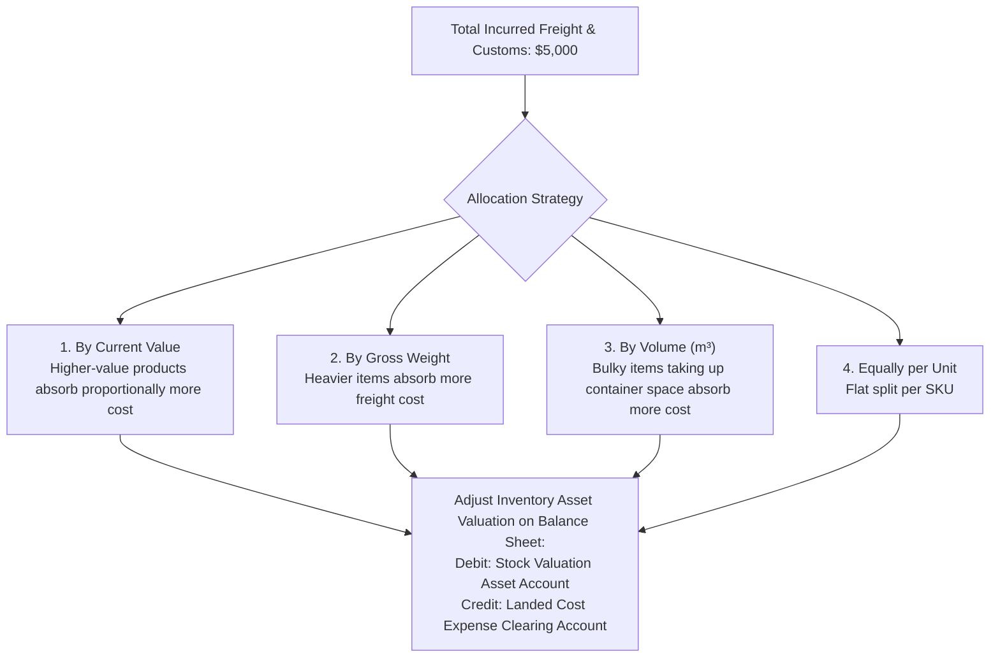

# Track 4: Techno-Functional Lead
## Chapter 3: Procure-to-Pay (P2P) & Vendor Supply Management

> 🧭 **Navigation**: [⬅️ Previous: 02: Order-to-Cash & CRM](02-order-to-cash-and-crm.md) | [🏠 Techno-Functional Track Index](README.md) | [➡️ Next: 04: Inventory & Costing](04-inventory-warehouse-and-costing.md)

---

The **Procure-to-Pay (P2P)** lifecycle governs how an enterprise spends capital, manages vendor relationships, enforces procurement internal controls, and accounts for inbound logistics.

---

### 1. The Complete Procure-to-Pay (P2P) Lifecycle




**Real-World Industry Examples:**
- **Apple's Foxconn Procurement:** Apple uses complex P2P systems to issue Purchase Orders for millions of iPhone components to Foxconn, triggering massive downstream logistics and strict GRN validations.
- **Amazon Business Procurement:** Enterprises use Amazon Business to decentralize the "Purchase Requisition" step to employees while maintaining centralized "PO Approval Workflow" controls in their ERP (like Coupa or SAP Ariba).

> 💡 **Interview Tip**
> Differentiate clearly between a Purchase Requisition (internal request for budget/need) and a Purchase Order (external legal contract sent to a vendor).

> 📺 **Video References**
> - SAP S/4HANA Procure to Pay | SAP YouTube: https://www.youtube.com/@SAP
> - Supply Chain Procurement | APICS CSCP Certification Videos

> 📖 **Must-Read Resources**
> - Odoo Purchase Documentation: https://www.odoo.com/documentation/17.0/applications/inventory_and_mrp/purchase.html
> - AWS Architecture - Enterprise Integrations: https://aws.amazon.com/blogs/architecture/

---

### 2. Approval Hierarchies & Internal Controls

Uncontrolled purchasing exposes an enterprise to embezzlement, duplicate purchases, and budget overruns. Techno-Functional Leads design matrix-based approval hierarchies:



**Code Example (Multi-Tier Approval Logic)**

**Python 3 (ERP Framework Style)**
```python
class PurchaseOrder(models.Model):
    _name = 'purchase.order'
    
    amount_total = fields.Float("Total Amount")
    state = fields.Selection([
        ('draft', 'RFQ'),
        ('to_approve', 'To Approve'),
        ('purchase', 'Purchase Order')
    ])
    
    def button_confirm(self):
        """Implement PO approval thresholds."""
        for order in self:
            if order.amount_total >= 50000.0:
                if not self.env.user.has_group('finance.group_cfo'):
                    order.write({'state': 'to_approve'})
                    return False
            elif order.amount_total >= 15000.0:
                if not self.env.user.has_group('management.group_vp'):
                    order.write({'state': 'to_approve'})
                    return False
            # If under 2500 or user has sufficient privileges
            order.write({'state': 'purchase'})
        return True
```

**Real-World Industry Examples:**
- **Corporate Spend Management (Ramp/Brex):** Startups use modern spend management platforms integrated into their ERP to automate these matrix approvals dynamically based on the employee's department and budget limits.

> 💡 **Interview Tip**
> Highlight the auditing aspect. Approvals must leave an immutable audit trail in the ERP chatter/logs to satisfy Sarbanes-Oxley (SOX) compliance requirements.

> 📺 **Video References**
> - Access Controls and Security | MIT 6.824: https://www.youtube.com/playlist?list=PLrw6a1wE39_tb2fErI4-WkMbsvGQk9_UB

> 📖 **Must-Read Resources**
> - Martin Fowler Blog - Workflow Patterns: https://martinfowler.com
> - Uber Engineering - Architecture of Financial Systems: https://www.uber.com/en-US/blog/engineering/

---

### 3. The 3-Way Matching Mechanism

The fundamental control mechanism in Accounts Payable (AP) is **3-Way Matching**, ensuring the company pays only for goods legitimately ordered and physically received.




**Real-World Industry Examples:**
- **Walmart's EDI Automation:** Walmart processes millions of vendor invoices automatically via EDI. Their ERP drops any invoice into an exception queue if the 3-way match fails by even a fraction of a cent.
- **Toyota Manufacturing:** Uses strict 3-way matching. If parts arrive damaged and are rejected during the GRN phase, the vendor bill is automatically short-paid or placed on hold pending a credit memo.

#### Accounting for Variances: Purchase Price Variance (PPV)
When an enterprise uses **Standard Costing**, price variances between standard cost and actual vendor purchase price flow into a dedicated **Purchase Price Variance (PPV)** P&L account:
$$\text{PPV} = (\text{Actual Purchase Price} - \text{Standard Cost}) \times \text{Received Quantity}$$

**Worked Accounting Journal Entry:**
*Scenario: Standard cost is $50. We received 90 units, but Vendor billed us at $52. (Ignoring the 10 missing units for simplicity).*
- Debit: Inventory Asset (90 units @ $50 Std Cost) = $4,500
- Debit: Purchase Price Variance (PPV) Expense (90 units @ $2 variance) = $180
- Credit: Accounts Payable = $4,680

> 💡 **Interview Tip**
> Explain how system tolerances work. Many ERPs allow a 3-way match tolerance (e.g., auto-approve variances under $5 or 1%) to prevent AP clerks from wasting hours resolving penny differences.

> 📺 **Video References**
> - AP Automation and 3-Way Match | Odoo Functional YouTube: https://www.youtube.com/@Odoo

> 📖 **Must-Read Resources**
> - IFRS Foundation: https://www.ifrs.org

---

### 4. Landed Costs Allocation: True Product Valuation

When importing goods from overseas, the raw invoice price from the vendor does not represent the true cost of inventory. Incurred costs include:
- **Ocean / Air Freight**
- **Customs Import Duties & Port Tariffs**
- **Marine Cargo Insurance**
- **Drayage & Local Warehousing Transport**



**Worked Accounting Journal Entry (Landed Cost Capitalization):**
*Scenario: $500 Freight bill received for a shipment of Laptops.*
**1. Post Freight Bill from Carrier:**
- Debit: Landed Cost Expense Clearing $500
- Credit: Accounts Payable (Carrier) $500

**2. Allocate Landed Cost to Inventory:**
- Debit: Inventory Asset (Laptops) $500
- Credit: Landed Cost Expense Clearing $500
*(Result: The clearing account nets to zero, and the $500 freight is now capitalized on the balance sheet inside the inventory value).*

**Real-World Industry Examples:**
- **Zara Fast Fashion:** Zara relies on highly accurate landed cost engines to calculate the true margin of air-freighting fashion items globally versus ocean freight.
- **Electronics Importers:** Companies importing heavy TVs vs small microchips in the same shipping container must use "By Volume" or "By Weight" landed cost allocation, as flat splitting would improperly inflate the microchip inventory value.

> 💡 **Interview Tip**
> Be able to explain *why* we capitalize freight. If we expense it immediately, we violate the matching principle of accounting because we take the expense in month 1, but might not sell the goods to recognize the revenue until month 3.

> 📺 **Video References**
> - Logistics and Transportation | MIT OpenCourseWare: https://ocw.mit.edu/courses/15-763j-manufacturing-systems-analysis-spring-2004/

> 📖 **Must-Read Resources**
> - APICS Dictionary: https://www.ascm.org
> - Deloitte IFRS insights - Inventory Valuation: https://www.iasplus.com

---

> 🧭 **Navigation**: [⬅️ Previous: 02: Order-to-Cash & CRM](02-order-to-cash-and-crm.md) | [🏠 Techno-Functional Track Index](README.md) | [➡️ Next: 04: Inventory & Costing](04-inventory-warehouse-and-costing.md)
