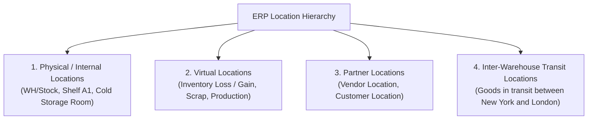
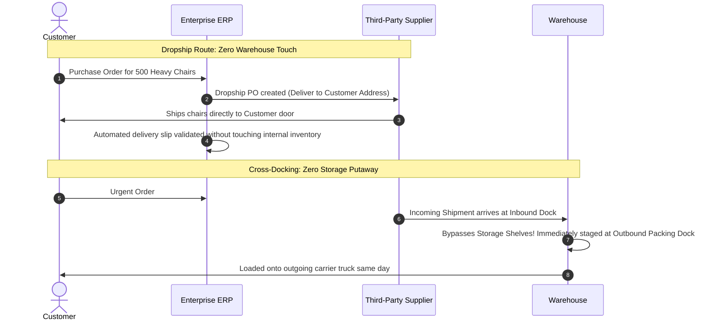
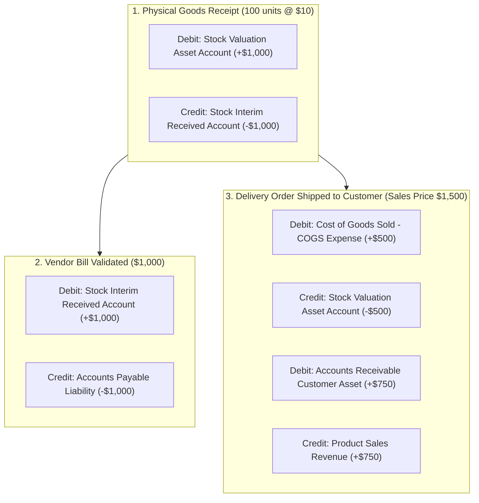

# Track 4: Techno-Functional Lead
## Chapter 4: Inventory, Warehouse Logistics & Inventory Valuation Costing

Inventory is often the largest current asset on an enterprise balance sheet. A Techno-Functional Lead must configure multi-step warehouse logistics, automated replenishment, cross-docking, and GAAP/IFRS-compliant perpetual inventory costing.

---

### 1. Warehouse Location Topologies

In modern ERPs, every physical, transit, and virtual point is modeled as a **Location**:



**Real-World Industry Examples:**
- **Amazon's Fulfillment Centers:** Amazon models dynamic bin locations. A bin (Physical Location) can hold multiple unrelated SKUs, and the ERP route-finding algorithm optimizes picker paths through these locations.
- **Virtual Scrap Locations:** Manufacturing plants use virtual locations to dump damaged goods. When a motor is broken during assembly, it is transferred to a Virtual Scrap Location, triggering an accounting write-off.

> 💡 **Interview Tip**
> Understand why Virtual Locations exist. In double-entry inventory, goods cannot just "disappear". An inventory loss is a transfer from a Physical Stock location to a Virtual Loss location.

> 📺 **Video References**
> - Warehouse Management Systems | Supply Chain | APICS CSCP Certification Videos
> - Logistics Networks | MIT OpenCourseWare: https://ocw.mit.edu/courses/15-763j-manufacturing-systems-analysis-spring-2004/

> 📖 **Must-Read Resources**
> - Odoo Inventory Documentation: https://www.odoo.com/documentation/17.0/applications/inventory_and_mrp.html
> - Amazon Science Blog (Fulfillment Routing): https://www.amazon.science/

---

### 2. Multi-Step Routing: Push vs Pull Rules


```mermaid
graph TD
    subgraph InboundRoutes[Inbound Goods Routing]
        In1[1-Step: Inbound -> Stock]
        In2[2-Step: Inbound -> Unload/Input -> Stock]
        In3[3-Step: Inbound -> Unload -> Quality Inspection (QA) -> Stock]
    end

    subgraph OutboundRoutes[Outbound Customer Delivery]
        Out1[1-Step: Direct Delivery from Stock]
        Out2[2-Step: Pick -> Ship]
        Out3[3-Step: Pick -> Pack -> Quality/Weigh -> Ship]
    end
```

- **Pull Rules (Demand-Driven / Just-in-Time)**: A requirement at a downstream location (e.g. Customer order) triggers a procurement request to pull goods from the upstream location (e.g. Packing $\to$ Picking $\to$ Stock $\to$ Vendor).
- **Push Rules (Supply-Driven)**: Goods arriving at a location automatically trigger a movement rule pushing them to the next destination (e.g. Incoming dock automatically pushes to Quality Control).

**Real-World Industry Examples:**
- **Walmart Cross-Docking:** Walmart pushes arriving pallets from the inbound dock directly to the outbound dock for retail stores, skipping putaway entirely.
- **Pharmaceutical Cold Chain:** Vaccine shipments utilize 3-step inbound routes where QA testing (temperature log validation) is mandatory before moving from the Input dock to Cold Storage stock.

> 💡 **Interview Tip**
> Master the difference between Push and Pull. Pull rules work backwards from demand. Push rules work forward from supply.

> 📺 **Video References**
> - Push vs Pull Supply Chains | Odoo Functional YouTube: https://www.youtube.com/@Odoo

> 📖 **Must-Read Resources**
> - APICS Dictionary: https://www.ascm.org

---

### 3. Special Supply Chain Routes: Dropship & Cross-Dock



**Real-World Industry Examples:**
- **Wayfair Dropshipping:** Wayfair holds very little physical inventory. Their ERP is deeply integrated with suppliers, instantly generating dropship POs when a customer places an order on their website.
- **Costco Cross-Docking:** Costco uses cross-docking at distribution centers to rapidly shift fresh produce from inbound trucks to outbound store trucks, minimizing spoilage.

> 💡 **Interview Tip**
> Point out that Dropshipping bypasses your inventory valuation completely, while Cross-docking still touches your inventory, just for a very brief duration (hours).

> 📺 **Video References**
> - System Design Interview | Dropshipping | ByteByteGo: https://www.youtube.com/@ByteByteGo

> 📖 **Must-Read Resources**
> - AWS Architecture - Supply Chain: https://aws.amazon.com/blogs/architecture/

---

### 4. Inventory Costing Methods & Perpetual Valuation

Choosing an inventory costing method directly affects corporate tax liability, gross margin reporting, and asset valuation.

| Costing Method | Mechanism | Impact in an Inflationary Environment | Best Suited For |
| :--- | :--- | :--- | :--- |
| **Standard Costing** | Fixed predetermined cost set manually by management (e.g. $10.00/unit). Variances hit PPV. | Simplifies cost accounting, but diverges from actual market costs. | Repetitive manufacturing, assembly plants. |
| **Average Costing (AVCO / Weighted Average)** | Unit cost recalculates with every incoming receipt: $\frac{\text{Total Current Value} + \text{Receipt Value}}{\text{Total Qty} + \text{Receipt Qty}}$ | Smooths out volatile price spikes; easy to manage. | Wholesale distribution, retail, FMCG. |
| **First-In, First-Out (FIFO)** | Oldest purchased stock lots are deemed consumed first. | **Highest Net Income**: Lower historical costs flow to COGS; ending inventory valued at current high prices. | Perishable goods, pharmaceuticals, electronics. |

**Real-World Industry Examples:**
- **Zara (FIFO):** Zara's fast fashion inventory turns over quickly, and they track exact batches using FIFO to accurately price seasonal trends.
- **Costco (AVCO):** Retailers dealing in bulk commodities like gasoline or generic dry goods use average costing to smooth out daily supplier price fluctuations.

> 💡 **Interview Tip**
> Be ready to explain *why* FIFO results in higher Net Income during inflation. (Older, cheaper goods hit Cost of Goods Sold, making profit margins look larger).

> 📺 **Video References**
> - Inventory Valuation FIFO LIFO Average | Odoo Functional YouTube: https://www.youtube.com/@Odoo

> 📖 **Must-Read Resources**
> - IFRS Foundation: https://www.ifrs.org
> - Deloitte IFRS insights: https://www.iasplus.com

---

### 5. Perpetual (Real-Time) Accounting Journal Entries

Under **Perpetual Inventory Valuation**, every physical warehouse move instantly creates financial double-entry journal entries in the General Ledger.

**Worked Accounting Journal Entry Examples (AVCO Costing):**
*Scenario: We purchase 100 units at $10. Later, we sell 50 units for $15.*


*Note: In Step 3, the COGS is $500 (50 units * $10 AVCO cost), while the Sales Revenue is $750 (50 units * $15 price).*

> [!NOTE]
> **The Stock Interim Clearing Account**: Notice how the `Stock Interim Received` account acts as an in-transit clearing balance between the warehouse receipt and the accounting vendor bill. When both are validated, the interim account balance nets to zero!

**Real-World Industry Examples:**
- **Apple's Perpetual Inventory:** Apple's ERP updates the GL asset accounts globally the exact second an iPhone is scanned out of a warehouse or sold at a retail store, providing real-time financial dashboards.

> 💡 **Interview Tip**
> The "Stock Interim" or "GR/IR" (Goods Receipt/Invoice Receipt in SAP) account is a classic interview topic. Explain that it exists to handle the timing difference between physical logistics and financial invoicing.

> 📺 **Video References**
> - Financial Accounting | MIT OpenCourseWare: https://ocw.mit.edu/courses/15-511-financial-accounting-summer-2004/

> 📖 **Must-Read Resources**
> - Odoo Inventory Valuation: https://www.odoo.com/documentation/17.0/applications/inventory_and_mrp/inventory.html
