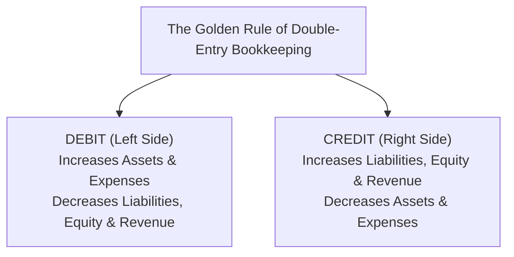
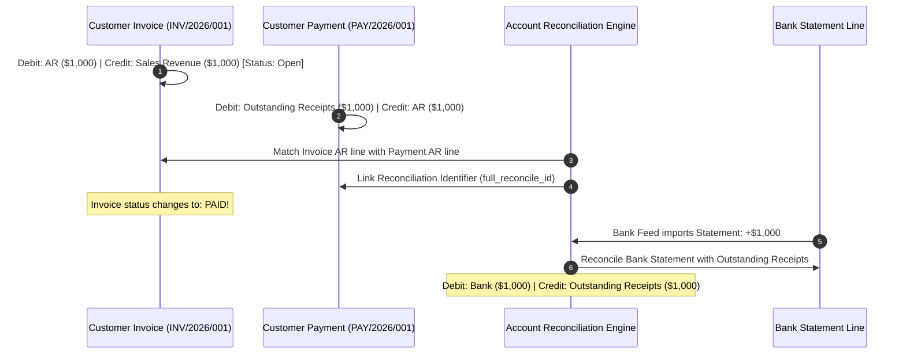
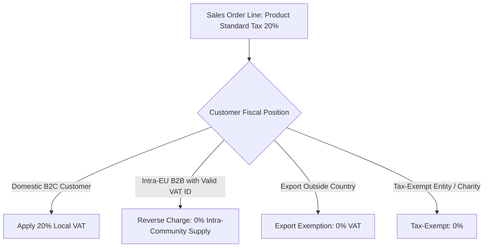
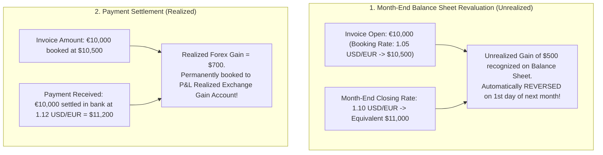

# Track 4: Techno-Functional Lead
## Chapter 5: Accounting, General Ledgers & Financial Governance

A Techno-Functional Lead must speak with authority to Chief Financial Officers, Controllers, and Head of Tax. Understanding the underlying mechanics of double-entry bookkeeping, Chart of Accounts (COA), foreign exchange revaluations, and fiscal closing procedures is mandatory.

---

### 1. The Universal Accounting Equation & Double-Entry Mechanics

Every transaction in an enterprise ERP must keep the fundamental accounting equation in exact mathematical balance:

$$\mathbf{\text{Assets}} = \mathbf{\text{Liabilities}} + \mathbf{\text{Equity}}$$

**Real-World Industry Examples:**
- **Netflix Content Amortization:** When Netflix produces a show, it capitalizes the cost as an Asset (Content Library). Over time, as users watch, they debit Amortization Expense and credit the Asset, precisely balancing the equation.
- **Stripe Ledger API:** Stripe built an entire engineering product around this equation to allow platforms to programmatically debit/credit immutable ledgers without data drift.

> 💡 **Interview Tip**
> Never say "Debit means minus" or "Credit means plus". Debit just means left side, Credit means right side. Debit increases Assets, but Credit increases Liabilities.

> 📺 **Video References**
> - Financial Accounting | MIT OpenCourseWare: https://ocw.mit.edu/courses/15-511-financial-accounting-summer-2004/
> - Double Entry Accounting | Odoo Functional YouTube: https://www.youtube.com/@Odoo

> 📖 **Must-Read Resources**
> - Stripe Engineering - Scaling Ledgers: https://stripe.com/blog/engineering
> - PostgreSQL Docs (Transactional integrity): https://www.postgresql.org/docs/

---

### 2. Standard Enterprise Chart of Accounts (COA) Architecture

Accounts are organized using standardized numerical ranges:

| Account Range | Classification | Normal Balance | Financial Statement | Example Accounts |
| :--- | :--- | :--- | :--- | :--- |
| **100000 – 199999** | **Assets** | **Debit** | Balance Sheet | Bank, Accounts Receivable, Inventory, Fixed Assets |
| **200000 – 299999** | **Liabilities** | **Credit** | Balance Sheet | Accounts Payable, Accrued Expenses, VAT Output Tax |
| **300000 – 399999** | **Equity** | **Credit** | Balance Sheet | Common Stock, Retained Earnings, Current Year Earnings |
| **400000 – 499999** | **Revenue** | **Credit** | Profit & Loss (P&L) | Product Sales, Service Revenue, Royalty Income |
| **500000 – 599999** | **COGS** | **Debit** | Profit & Loss (P&L) | Cost of Goods Sold, Freight Inbound, Direct Labor |
| **600000 – 699999** | **Expenses** | **Debit** | Profit & Loss (P&L) | Rent, Payroll, Marketing, Server Cloud Infrastructure |

**Real-World Industry Examples:**
- **Multinational COA Rollup:** Global enterprises like Siemens use a standardized Global COA for consolidated reporting to shareholders, while local subsidiaries map their local statutory COA (e.g., SKR04 in Germany, PCG in France) to the global accounts.

> 💡 **Interview Tip**
> Understand that the Chart of Accounts is the skeleton of the ERP. A messy COA leads to messy BI dashboards. Emphasize standardizing the COA before data migration.

> 📺 **Video References**
> - Chart of Accounts | Accounting for Beginners | NeetCode (Concepts): https://www.youtube.com/@NeetCode

> 📖 **Must-Read Resources**
> - IFRS Foundation: https://www.ifrs.org

---

### 3. Accounts Receivable (AR) / Accounts Payable (AP) & Payment Reconciliation

#### Partial Reconciliations & Write-offs:
If a customer owes $1,000 and pays $990 with a $10 wire transfer bank fee deduction:
- Techno-Functional Leads configure **Reconciliation Models** to automatically detect $10 deductions and book them to a `Bank Service Charges (Expense)` account while fully marking the invoice as paid.

**Worked Accounting Journal Entry:**
- Debit: Bank Account $990
- Debit: Bank Fees (Expense) $10
- Credit: Accounts Receivable $1,000

**Real-World Industry Examples:**
- **Uber Driver Payouts:** Millions of micro-transactions are reconciled automatically using reconciliation identifiers mapping the bank payout to the accrued driver liability account.

> 💡 **Interview Tip**
> Explain how clearing accounts (like "Outstanding Receipts") protect the GL. You don't debit the true "Bank" account until you actually parse the bank statement feed.

> 📺 **Video References**
> - Accounting & Finance for Tech Leads | Martin Kleppmann Cambridge: https://www.youtube.com/playlist?list=PLeKd45zvjcDFUEv_ohr_HdUFe97RIt8b

> 📖 **Must-Read Resources**
> - Uber Engineering - Financial Systems: https://www.uber.com/en-US/blog/engineering/

---

### 4. Fiscal Positions & Automated Tax Engines

In multi-country operations, the same product can have different tax treatments depending on the customer's jurisdiction.

**Real-World Industry Examples:**
- **Avalara / Stripe Tax Integration:** Because US Sales tax has 10,000+ local jurisdictions, ERPs rely on API calls to tax engines (like Avalara) during checkout to dynamically inject the correct tax rate based on the 9-digit zip code.
- **European VAT:** Companies operating in Europe use Fiscal Positions to automatically shift taxes to 0% for B2B cross-border EU sales via the Reverse Charge mechanism.

> 💡 **Interview Tip**
> Never hardcode taxes on the product or customer. Always use mapping rules (Fiscal Positions) so that a single product catalog can be sold globally without duplication.

> 📺 **Video References**
> - Tax Mapping and Fiscal Positions | Odoo Functional YouTube: https://www.youtube.com/@Odoo

> 📖 **Must-Read Resources**
> - Odoo Fiscal Positions Docs: https://www.odoo.com/documentation/17.0/applications/finance/accounting/taxes.html

---

### 5. Foreign Exchange (Forex): Realized vs Unrealized Gain/Loss

Operating across multiple currencies requires distinct treatment for **Realized** vs **Unrealized** exchange gains and losses.

**Worked Accounting Journal Entry (Realized Gain):**
*Scenario: We billed €10k at $10.5k. Customer pays €10k, but the bank deposits $11.2k due to favorable rates.*
- Debit: Bank Account $11,200
- Credit: Accounts Receivable $10,500
- Credit: Realized FX Gain (P&L) $700

**Real-World Industry Examples:**
- **Airbnb Multi-Currency:** Airbnb holds massive treasury float. They utilize automated ERP currency revaluation programs to mark-to-market their foreign bank balances at the end of each month, booking unrealized gains/losses to comply with FASB 52.

> 💡 **Interview Tip**
> Unrealized gains/losses are paper gains needed for month-end reporting. Realized gains/losses happen when cash actually changes hands.

> 📺 **Video References**
> - Foreign Currency Accounting | AICPA Webinars: https://www.youtube.com/@AICPA

> 📖 **Must-Read Resources**
> - FASB ASC 830: Foreign Currency Matters: https://www.fasb.org

---

### 6. Year-End Closing Procedures

At fiscal year-end:
1. **Accruals & Prepayments**: Post period-end adjusting entries (e.g. 1 month of unpaid December electricity bill accrued as an expense).
2. **Lock Dates**: Set **Accounting Lock Date** (Tax Lock Date & Management Lock Date) in ERP settings so no user can alter historical journals.
3. **Net Income Equity Roll-Forward**:
   - All temporary P&L accounts (Revenue & Expenses) net to zero.
   - The resulting Net Income/Loss transfers automatically into the **Retained Earnings (Equity)** account on the Balance Sheet.

**Real-World Industry Examples:**
- **SAP Month-End Close:** Large enterprises employ armies of accountants just to execute the Month-End and Year-End closing checklist in SAP, locking down AP/AR subledgers before closing the General Ledger.

> 💡 **Interview Tip**
> Explain that modern ERPs perform the Net Income roll-forward dynamically in their reporting engines, meaning you don't physically book a massive journal entry to zero out the P&L on Jan 1st anymore.

> 📺 **Video References**
> - Closing the Books | Financial Accounting | MIT OpenCourseWare: https://ocw.mit.edu/courses/15-511-financial-accounting-summer-2004/

> 📖 **Must-Read Resources**
> - PWC Accounting Guides: https://viewpoint.pwc.com/
