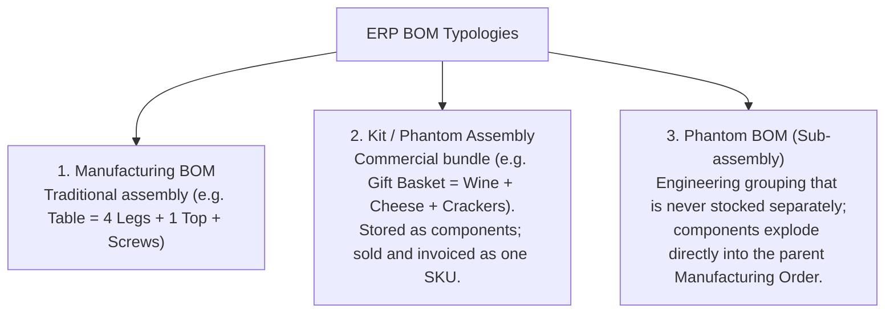
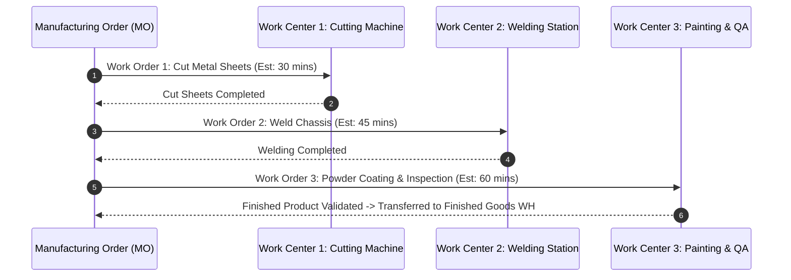

# Track 4: Techno-Functional Lead
## Chapter 6: Manufacturing (MRP), Routing & Supply Chain Planning

Modern industrial organizations rely on **Material Requirements Planning (MRP)** to balance customer demand against machine capacities, material lead times, and labor availability. A Techno-Functional Lead must architect Bill of Materials (BOM) explosions, work center scheduling, and subcontracting flows.

---

### 1. Bill of Materials (BOM) Architecture & Typologies

A Bill of Materials defines the ingredients, raw components, and packaging materials required to manufacture a unit of finished goods.



#### Multi-Level Recursive BOM Explosion:
To manufacture 1 unit of a High-End Drone (`Product A`):
- `Product A` requires:
  - `Frame (Sub-assembly B)` (requires Carbon Fiber + Screws)
  - `Motor (Sub-assembly C)` (requires Copper Wire + Magnets + Casing)
  - `Battery (Purchased Part D)`
- The MRP engine recursively traverses this hierarchy, generating **Child Manufacturing Orders** for sub-assemblies and **Purchase Orders** for raw materials scheduled by their respective lead times.

**Real-World Industry Examples:**
- **Boeing's 787 Dreamliner:** Boeing maintains extremely complex, multi-level BOMs consisting of millions of parts. The ERP explodes the top-level aircraft BOM into thousands of downstream POs for suppliers globally.
- **IKEA Kit BOMs:** When you buy a desk at IKEA, the POS registers a Kit BOM sale. The ERP doesn't hold stock of the "Desk" SKU; instead, it instantly deducts the flat-pack wood, screws, and manual from inventory.

> 💡 **Interview Tip**
> Be ready to explain a Phantom BOM. It's a structural BOM used for engineering convenience but ignored by warehouse stock checks (it blows through directly to the raw materials).

> 📺 **Video References**
> - Bill of Materials (BOM) Structures | APICS CSCP Certification Videos
> - MRP Operations | Odoo Functional YouTube: https://www.youtube.com/@Odoo

> 📖 **Must-Read Resources**
> - Odoo MRP Documentation: https://www.odoo.com/documentation/17.0/applications/inventory_and_mrp/manufacturing.html
> - APICS Dictionary: https://www.ascm.org

---

### 2. Work Centers, Operations & Overall Equipment Effectiveness (OEE)

Manufacturing routing describes the sequential operational steps required to produce a product.




#### Overall Equipment Effectiveness (OEE) Tracking:
OEE is the global manufacturing benchmark for production efficiency:
$$\mathbf{\text{OEE}} = \text{Availability} \times \text{Performance} \times \text{Quality}$$
- **Availability**: $\frac{\text{Actual Operating Time}}{\text{Planned Production Time}}$ (captures machine breakdowns and setup delays).
- **Performance**: $\frac{\text{Total Units Produced} \times \text{Ideal Cycle Time}}{\text{Operating Time}}$ (captures speed losses and minor stalls).
- **Quality**: $\frac{\text{Good Units Produced}}{\text{Total Units Produced}}$ (captures defective units and scrap).
- World-Class manufacturing OEE targets $\mathbf{\ge 85\%}$.

**Real-World Industry Examples:**
- **Tesla's Gigafactory:** Tesla tracks OEE at every work center robot. If a stamping press goes down for maintenance (Availability loss) or produces a cracked panel (Quality loss), the OEE drops, triggering alerts to plant managers.

> 💡 **Interview Tip**
> If you are asked to optimize a manufacturing line, start by calculating OEE. It pinpoints exactly whether you have a breakdown problem, a speed problem, or a scrap problem.

> 📺 **Video References**
> - Manufacturing Systems Analysis | MIT OpenCourseWare: https://ocw.mit.edu/courses/15-763j-manufacturing-systems-analysis-spring-2004/

> 📖 **Must-Read Resources**
> - AWS Architecture - Smart Factories / IoT: https://aws.amazon.com/blogs/architecture/

---

### 3. Production Planning: MPS vs MRP Scheduler

```mermaid
flowchart TD
    Demand["Demand Inputs: Confirmed Sales Orders + Sales Forecast"] --> MPS["Master Production Schedule (MPS)<br/>High-level monthly/weekly production targets"]
    MPS --> MRP["MRP Calculation Run"]
    
    MRP --> CheckStock{Stock Available?}
    CheckStock -->|Yes| Allocate[Reserve In-Stock Components]
    CheckStock -->|No| CheckType{Component Type?}
    
    CheckType -->|Make (Manufactured Sub-Assembly)| GenMO[Generate Draft Manufacturing Order]
    CheckType -->|Buy (Purchased Raw Material)| GenPO[Generate RFQ / Purchase Order]
```

#### Backward Scheduling via Lead Times:
If a customer requires delivery on **October 30th**:
$$\text{Customer Promised Date: Oct 30}$$
$$- \text{ Customer Delivery Shipping Lead Time (3 days)} \implies \text{MO Completion Date: Oct 27}$$
$$- \text{ Manufacturing Lead Time (5 days)} \implies \text{MO Start Date: Oct 22}$$
$$- \text{ Raw Material Vendor Purchase Lead Time (10 days)} \implies \mathbf{\text{PO Order Date: Oct 12}}$$

**Code Example (MRP Backward Scheduling Calculation)**

**Python 3 (Date calculation logic)**
```python
from datetime import timedelta, date

def calculate_mrp_dates(promised_date: date, shipping_lead: int, mfg_lead: int, vendor_lead: int):
    """
    Simulates a backward scheduling MRP pass to determine required dates.
    """
    mo_completion_date = promised_date - timedelta(days=shipping_lead)
    mo_start_date = mo_completion_date - timedelta(days=mfg_lead)
    po_order_date = mo_start_date - timedelta(days=vendor_lead)
    
    return {
        "mo_completion": mo_completion_date,
        "mo_start": mo_start_date,
        "po_order": po_order_date
    }

# Test Case Snippet:
# dates = calculate_mrp_dates(date(2026, 10, 30), 3, 5, 10)
# print(dates)
# Expected Output: {'mo_completion': datetime.date(2026, 10, 27), 'mo_start': datetime.date(2026, 10, 22), 'po_order': datetime.date(2026, 10, 12)}
```

**Real-World Industry Examples:**
- **Toyota's JIT (Just In Time):** Toyota pioneered this pull-based MRP strategy (Kanban). Parts arrive at the factory exactly on the day they are needed (Oct 22 in our example), preventing costly inventory warehousing.

> 💡 **Interview Tip**
> Understand the difference between MPS and MRP. MPS (Master Production Schedule) is the strategic, high-level plan (e.g., "Build 5,000 cars this month"). MRP is the tactical engine that figures out exactly how many tires and screws to order today to make the MPS happen.

> 📺 **Video References**
> - Supply Chain Management | MIT 6.824 (Distributed Systems application to SCM)
> - Kanban and JIT | APICS CSCP

> 📖 **Must-Read Resources**
> - High Scalability Blog (Supply Chain implementations): http://highscalability.com

---

### 4. Special Manufacturing Flows: Subcontracting & Disassembly

1. **Subcontracted Manufacturing**:
   - The company provides raw materials to a third-party subcontractor.
   - The ERP generates a delivery order shipping raw components to the subcontractor's location.
   - Upon receipt of the finished product, the system automatically consumes the raw materials from the subcontractor location and adds the finished goods to company stock while billing the subcontractor's labor fee.
2. **Unbuild Orders (Disassembly)**:
   - Reversing a finished good into its constituent components (e.g. stripping unsold computer units for reusable RAM and SSD components).
   - The cost of the finished product is proportionally credited back to component stock valuation accounts.

**Real-World Industry Examples:**
- **Foxconn Subcontracting:** Apple technically "subcontracts" to Foxconn in some models, supplying them with critical, proprietary components (like M-series chips) while Foxconn supplies the labor and generic materials.

> 💡 **Interview Tip**
> For subcontracting, mention that the raw goods sitting at the subcontractor's warehouse still legally belong on your balance sheet. The ERP must track them in a "Partner Subcontracting Location".

> 📺 **Video References**
> - Subcontracting in ERP | Odoo Functional YouTube: https://www.youtube.com/@Odoo

> 📖 **Must-Read Resources**
> - Odoo Manufacturing Docs (Subcontracting): https://www.odoo.com/documentation/17.0/applications/inventory_and_mrp/manufacturing/management/subcontracting.html
