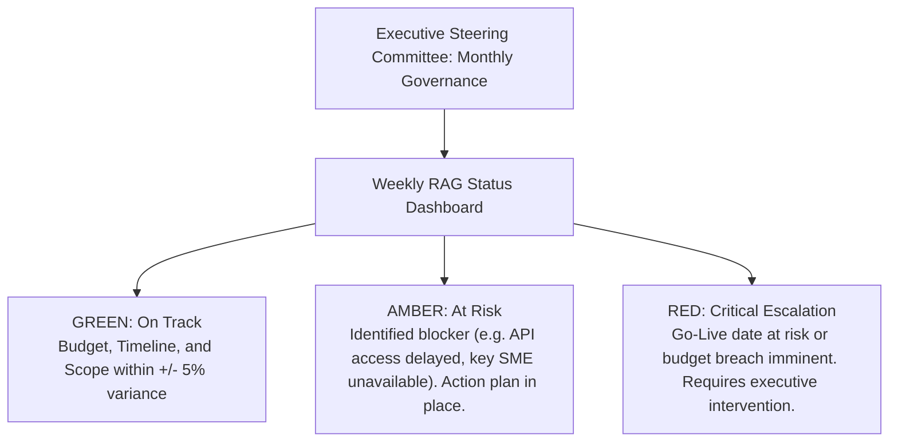
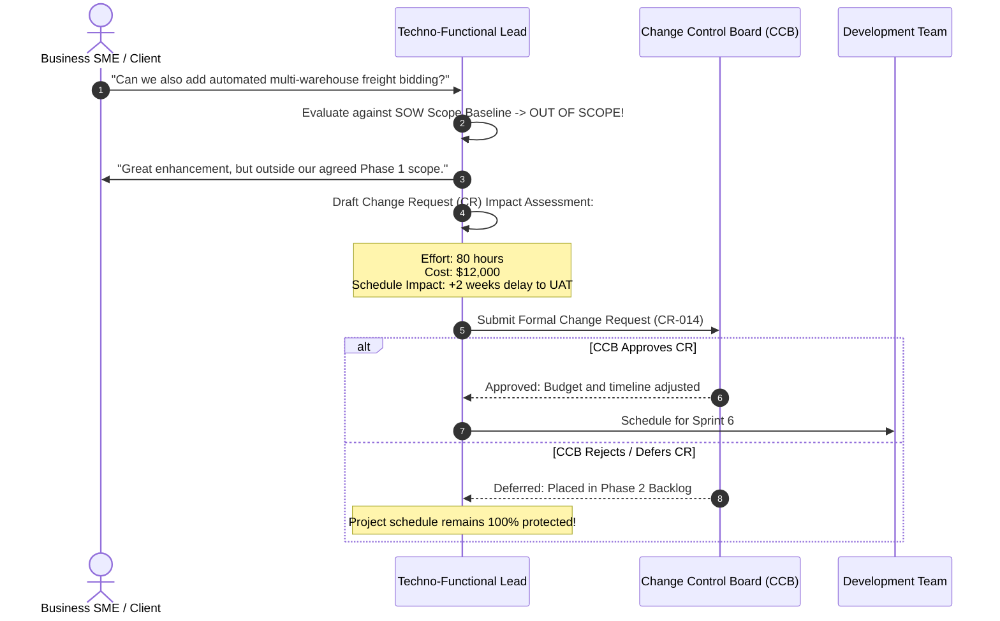
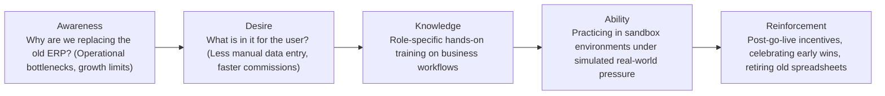

# Track 4: Techno-Functional Lead
## Chapter 7: Stakeholder Management, Scope Governance & Change Leadership

> 🧭 **Navigation**: [⬅️ Previous: 06: Manufacturing MRP & SCM](06-manufacturing-mrp-and-scm.md) | [🏠 Techno-Functional Track Index](README.md) | [➡️ Next: 08: Top 50+ Business Scenarios Q&A](08-top-50-techno-functional-questions.md)

---

Industry data reveals that over **70% of ERP transformations fail to achieve their projected ROI**—not due to software compilation bugs, but due to **uncontrolled scope creep, political misalignment, and human resistance to change**. A Techno-Functional Lead protects project scope, aligns executive leadership, and guides user adoption.

---

### 1. Executive Steering Committee & RAG Governance

The Techno-Functional Lead represents the project at the **Steering Committee** (CEO, CFO, COO, CIO):

#### Mediating Cross-Departmental Conflicts:
As a Lead, you will frequently mediate conflicting business incentives:
- **Sales vs Finance**: Sales wants relaxed credit checks and discretionary discounts to hit quarterly quotas; Finance demands automated credit blocks and strict margin limits.
  - *Lead Solution*: Implement automated tiered approval workflows: discounts under 10% auto-approved; 10%–20% require Sales Manager; above 20% require Finance Controller.
- **Operations vs CFO**: Operations wants large safety buffers to prevent stockouts; CFO wants lean inventory to minimize holding costs.
  - *Lead Solution*: Configure dynamic Min-Max replenishment rules driven by historical standard deviation of demand.

**Real-World Industry Examples:**
- **Nike's Oracle Rollout:** Nike's successful multi-year Oracle ERP rollout was attributed heavily to strict Steering Committee governance and resolving supply chain vs finance disputes early in the blueprint phase, preventing downstream chaos.
- **Revlon's ERP Failure (2018):** Revlon rushed their SAP rollout without proper executive conflict resolution, resulting in a disastrous go-live where the factory literally couldn't fulfill orders, tanking their stock price.

> 💡 **Interview Tip**
> Never say you side with Sales or Finance. Frame your answers around implementing data-driven workflows that satisfy both (e.g., empowering Sales while maintaining SOX compliance for Finance).

> 📺 **Video References**
> - Project Management Governance | NeetCode (Soft Skills / Behavioral): https://www.youtube.com/@NeetCode

> 📖 **Must-Read Resources**
> - Martin Fowler - Agile Project Governance: https://martinfowler.com

---

### 2. Controlling Scope Creep: The Change Control Board (CCB)

Scope creep is the gradual, unbudgeted expansion of project scope without adjustments to time, cost, or resources.

**Real-World Industry Examples:**
- **Government Tech Failures:** Public sector ERP projects frequently suffer massive budget overruns (e.g., UK NHS IT system) because they lack strict CCB discipline, allowing thousands of custom changes requested by different hospitals.
- **Consulting Firms (Deloitte, Accenture):** Techno-functional leads in big 4 consulting are trained to aggressively document everything out of scope. If the client wants a new API, the lead generates a formal Change Request (CR) with a price tag attached.

> 💡 **Interview Tip**
> The best phrase to use in an interview when asked about scope creep is: "I never say 'no' to the client. I say 'Yes, and here is the Change Request outlining the additional cost and timeline impact'."

> 📺 **Video References**
> - Managing Scope Creep | NeetCode: https://www.youtube.com/@NeetCode

> 📖 **Must-Read Resources**
> - High Scalability - Engineering Team Management: http://highscalability.com

---

### 3. Change Management: The ADKAR Framework for ERP Adoption

When employees are forced to abandon legacy spreadsheets or 15-year-old green-screen software, emotional resistance is intense. Leads apply the Prosci **ADKAR Model**:

**Real-World Industry Examples:**
- **National Grid US:** Used heavy ADKAR focus during their SAP transition. By training "Super Users" in each department (Knowledge/Ability) and making them internal champions (Desire), they reduced post-go-live support tickets by 40%.
- **Hershey's 1999 ERP Failure:** Hershey ignored ADKAR. They pushed the system live right before Halloween peak season without confirming user 'Ability'. Warehouse workers didn't know how to operate the new handheld scanners.

> 💡 **Interview Tip**
> Mention "Super Users". The best way to drive adoption is to train one influential employee in a department heavily so they can evangelize the system to their peers.

> 📺 **Video References**
> - Change Management and Leadership | Stanford CS25 (Broad leadership talks): https://www.youtube.com/playlist?list=PLoROMvodv4rNiJRchCzutFw5ItR_ZEDY

> 📖 **Must-Read Resources**
> - Prosci ADKAR Methodology: (General industry knowledge standard)

---

### 4. The Go / No-Go Decision Framework for Go-Live

One week before scheduled Go-Live, the Techno-Functional Lead convenes the Go/No-Go evaluation meeting:

| Criteria Category | Pass Threshold | Status |
| :--- | :--- | :--- |
| **UAT Business Sign-Off** | 100% of P1 (Critical) and P2 (Major) test cases passed and formally signed off by department heads. | Mandatory |
| **Defect Backlog** | **Zero open Blocker / Critical defects**; minor visual/cosmetic workarounds documented. | Mandatory |
| **Data Migration Dry-Run** | Trial Balance matches to the exact cent; stock valuation matches GL; customer balances validated. | Mandatory |
| **End-User Training** | At least 90% of operational staff completed hands-on simulation training. | Mandatory |
| **Rollback Plan** | Documented, tested snapshot backup and fallback operational procedures ready. | Mandatory |

**Real-World Industry Examples:**
- **Target Australia:** Had a disastrous go-live because leadership pushed a "Go" decision despite massive P1 UAT bugs. The system couldn't handle the data volume and crashed.
- **Lidl's €500M SAP Cancellation:** Lidl spent 7 years and €500M on a custom SAP ERP before calling a permanent "No-Go" and reverting to their legacy system because the custom system drifted too far from their operational reality. 

> 💡 **Interview Tip**
> Emphasize the "Rollback Plan". A mature leader always has a plan for what to do if the Go-Live weekend fails, ensuring the business can still operate on Monday morning on the legacy system if needed.

> 📺 **Video References**
> - System Migrations and Rollbacks | MIT 6.824 (Distributed Systems approach to safe rollbacks): https://www.youtube.com/playlist?list=PLrw6a1wE39_tb2fErI4-WkMbsvGQk9_UB

> 📖 **Must-Read Resources**
> - Meta Engineering - Zero Downtime Migrations: https://engineering.fb.com

---

> 🧭 **Navigation**: [⬅️ Previous: 06: Manufacturing MRP & SCM](06-manufacturing-mrp-and-scm.md) | [🏠 Techno-Functional Track Index](README.md) | [➡️ Next: 08: Top 50+ Business Scenarios Q&A](08-top-50-techno-functional-questions.md)
