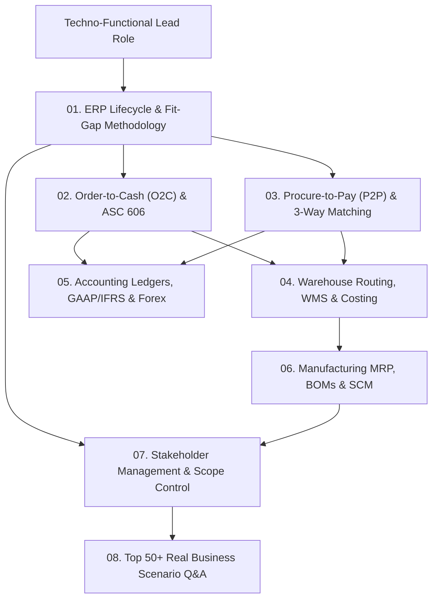

# 💼 Track 4: Techno-Functional Lead & Solution Architect
## Master Curriculum Roadmap & Enterprise ERP Blueprint

Welcome to the **Techno-Functional Lead Track**. Designed for Senior ERP Consultants, Solution Architects, and Techno-Functional Engineering Leads who bridge the gap between complex software engineering and high-stakes enterprise business domains.

---

## 🗺️ Visual Track Roadmap

---

## 📚 Sequential Learning Syllabus

| # | Chapter / Guide | Core Functional & Technical Domains | Enterprise Standard |
|---|---|---|---|
| **01** | [**Role & Methodology**](./01-role-and-methodology.md) | Fit-Gap Analysis, BRD to TSD Translation, Conference Room Pilots (CRP), Change Management (ADKAR) | Agile ERP Implementation |
| **02** | [**Order-to-Cash (O2C)**](./02-order-to-cash-and-crm.md) | Quotation to Cash lifecycle, Tiered Pricelists, Credit Limit validation, ASC 606 / IFRS 15 Revenue Recognition | FASB ASC 606 |
| **03** | [**Procure-to-Pay (P2P)**](./03-procure-to-pay-and-vendor.md) | Requisition to PO, 3-Way Invoice Matching, Multi-Tier Approval Hierarchies, Purchase Price Variance (PPV), Landed Costs | Enterprise Procurement |
| **04** | [**Inventory & Costing**](./04-inventory-warehouse-and-costing.md) | Multi-step routing (Pick/Pack/Ship), Dropshipping, Cross-docking, Standard vs FIFO vs AVCO, Perpetual Valuation | WMS & Logistics |
| **05** | [**Financial Ledgers & GL**](./05-accounting-and-financial-ledgers.md) | Chart of Accounts, Double-Entry journal mechanics, Unrealized vs Realized Forex, Fiscal Year-End closing | GAAP & IFRS Compliance |
| **06** | [**Manufacturing MRP & SCM**](./06-manufacturing-mrp-and-scm.md) | Multi-level Bills of Materials (BOM), Work Centers, Routing, Master Production Schedule (MPS), Lead Time Scheduling | JIT & Lean Manufacturing |
| **07** | [**Stakeholder & Scope Management**](./07-stakeholder-and-scope-management.md) | Scope baselining, Change Control Board (CCB), Scope creep mitigation, Go/No-Go release readiness | PMI PMBOK Standard |
| **08** | [**Top 50+ Real Business Scenarios**](./08-top-50-techno-functional-questions.md) | Hard-hitting business scenarios, accounting edge cases, vendor dispute management, audit trails | C-Suite & Lead Interviews |

---

## 🧭 Navigation
- ⬅️ **Previous Track**: [Track 3: Senior AI Role](../Senior%20AI%20Role/README.md)
- 🏠 **Root Index**: [Master Interview Guide](../README.md)
- ➡️ **Next Track**: [Track 5: Odoo Technical Lead](../Odoo%20Technical%20Lead/README.md)
