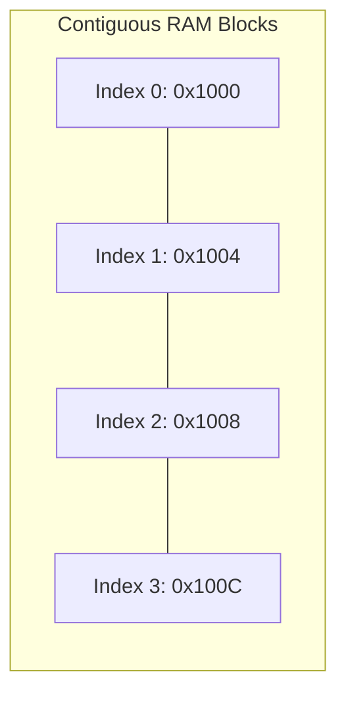
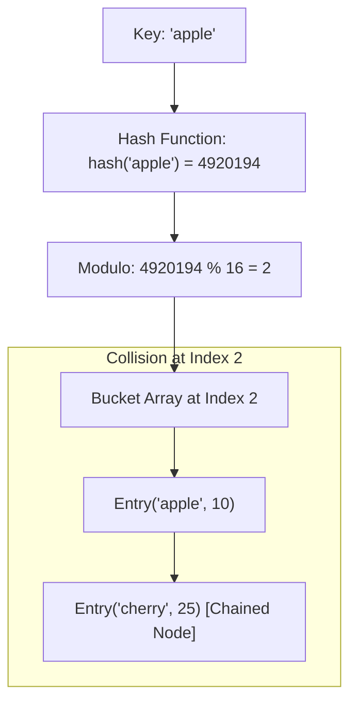

# DSA Track: Dual Python & Java
## Chapter 1: Arrays, Dynamic Sizing & Hash Table Internals

> 🧭 **Navigation**: ⇤ First Chapter | [🏠 DSA Track Index](README.md) | [➡️ Next: 02: Two Pointers & Sliding Window](02-two-pointers-and-sliding-window.md)

---

Arrays and Hash Maps are the foundational data structures of software engineering. Interviewers use them to test memory locality awareness, amortized complexity analysis, and hash collision mechanics.

---

### 1. Memory Physics: Contiguous Arrays & Amortized Resizing

An array is a contiguous block of physical memory. Accessing an element at index $i$ requires a single mathematical calculation:
$$\text{Memory Address} = \text{Base Address} + (i \times \text{Size of Element})$$
Because pointer arithmetic is instantaneous, array index access is strictly **$O(1)$**.

**Real-World Industry Examples**:
- **NumPy tensor operations**: Under the hood, NumPy arrays are contiguous C-arrays, allowing for blazing fast matrix multiplication using SIMD instructions.
- **Database page cache buffers**: PostgreSQL uses contiguous arrays in its `shared_buffers` for storing fixed-size memory pages efficiently.
- **Image pixel matrices**: Image processing applications treat images as 2D/3D contiguous arrays representing RGB channels, allowing fast spatial kernel convolutions.



#### Amortized $O(1)$ Resizing Mechanics:
When a dynamic array (Python `list`, Java `ArrayList`) reaches full capacity, appending an element requires:
1. Allocating a new memory block of size $k \times \text{Old Capacity}$.
   - **Java `ArrayList`**: Multiplies capacity by $1.5\times$ (`newCapacity = oldCapacity + (oldCapacity >> 1)`).
   - **Python `list`**: Over-allocates using the formula: `new_allocated = (size >> 3) + (size < 9 ? 3 : 6) + size`.
2. Copying all $N$ existing elements into the new block ($O(N)$ work).
3. Deallocating the old block.
- **Why Amortized $O(1)$?**: Although resizing takes $O(N)$, it happens exponentially infrequently. The cost of $N$ appends is $\approx 2N$ total operations, yielding an average cost of $\frac{2N}{N} = \mathbf{O(1)}$ per append.

> 💡 **Interview Tip**
> Whenever you append to an array in an interview, explicitly state that it's "amortized O(1)" time. Interviewers might ask what happens during array expansion; be prepared to discuss memory reallocation and copying.

> 📺 **Video References**
> - [MIT 6.006: Data Structures and Dynamic Arrays](https://www.youtube.com/watch?v=Zc54gFhdpLA&list=PLUl4u3cNGP61Oq3tWYp6V_F-5jb5L2iHb) by Prof. Erik Demaine
> - [NeetCode: Dynamic Arrays Explained](https://www.youtube.com/watch?v=qSnXpIJZXKc)

> 📖 **Must-Read Resources**
> - [Python Internal `list` Implementation](https://docs.python.org/3/c-api/list.html)
> - [PostgreSQL shared_buffers Documentation](https://www.postgresql.org/docs/current/runtime-config-resource.html)

---

### 2. Hash Table Internals: Buckets, Collisions & Load Factors

A Hash Table maps arbitrary keys to array indices using a hash function:
$$\text{Bucket Index} = \text{hash}(\text{key}) \pmod{\text{Bucket Array Length}}$$

**Real-World Industry Examples**:
- **Caching**: Memcached and Redis are massive distributed hash tables used by companies like Netflix for fast object lookups.
- **Search Indices**: Google uses hash maps internally to map words (tokens) to posting lists of documents containing the word.



#### Collision Resolution Strategies:
1. **Separate Chaining (Used in Java `HashMap`)**:
   - Each bucket contains a linked list of collided entries.
   - **Java 8 Optimization**: When a bucket's linked list length exceeds **8** and the table capacity $\ge 64$, Java converts the linked list into a **Red-Black Tree**, reducing worst-case lookup from $O(N)$ to **$O(\log N)$**.
2. **Open Addressing (Used in Python `dict`)**:
   - Collided elements are probed into alternative open slots in the main array.
   - Python uses a pseudo-random perturbation probing sequence: `i = (5*i + 1 + perturb) % capacity`.

#### Load Factor ($\alpha$):
$$\alpha = \frac{\text{Number of Stored Entries } (N)}{\text{Number of Buckets } (M)}$$
- In Java, default load factor $= \mathbf{0.75}$. When $\frac{N}{M} > 0.75$, the hash table automatically doubles its bucket array and rehashes all entries to keep lookup at $O(1)$.

> 💡 **Interview Tip**
> Understanding collision resolution is key for systems design and low-level engineering roles. Be sure to know the difference between chaining and open addressing, and mention Java 8's Red-Black tree optimization.

> 📺 **Video References**
> - [MIT 6.006: Hashing with Chaining](https://www.youtube.com/watch?v=0M_kIqhjlZU&list=PLUl4u3cNGP61Oq3tWYp6V_F-5jb5L2iHb)
> - [Gaurav Sen: Hash Tables and Consistent Hashing](https://www.youtube.com/watch?v=zaRkONvyGr8)

> 📖 **Must-Read Resources**
> - [Python `dict` implementation notes](https://github.com/python/cpython/blob/main/Objects/dictobject.c)
> - [High Scalability: How Discord Stores Billions of Messages](http://highscalability.com/blog/2017/7/19/how-discord-stores-billions-of-messages.html)

---

### 3. Core Problems & Dual Implementations

#### Problem 1: Two Sum (LeetCode 1)
Given an array of integers `nums` and an integer `target`, return indices of the two numbers such that they add up to `target`.

| Algorithm | Time Complexity | Space Complexity |
|-----------|----------------|------------------|
| Optimal | $O(N)$ | $O(N)$ |
| Brute Force | $O(N^2)$ | $O(1)$ |

**Python 3 Implementation**:
```python
def two_sum(nums: list[int], target: int) -> list[int]:
    """Return the indices of two numbers that add up to the target."""
    seen: dict[int, int] = {}  # num -> index
    for i, num in enumerate(nums):
        complement = target - num
        if complement in seen:
            return [seen[complement], i]
        seen[num] = i
    return []

# Test Case
if __name__ == "__main__":
    print(two_sum([2, 7, 11, 15], 9)) # Output: [0, 1]
```

**Java 17 Implementation**:
```java
import java.util.HashMap;
import java.util.Map;
import java.util.Arrays;

public class TwoSum {
    public int[] twoSum(int[] nums, int target) {
        Map<Integer, Integer> seen = new HashMap<>();
        for (int i = 0; i < nums.length; i++) {
            int complement = target - nums[i];
            if (seen.containsKey(complement)) {
                return new int[]{seen.get(complement), i};
            }
            seen.put(nums[i], i);
        }
        return new int[]{};
    }
    
    // Test Case
    public static void main(String[] args) {
        TwoSum ts = new TwoSum();
        System.out.println(Arrays.toString(ts.twoSum(new int[]{2, 7, 11, 15}, 9))); // Output: [0, 1]
    }
}
```

---

#### Problem 2: Group Anagrams (LeetCode 49)
Given an array of strings `strs`, group the anagrams together.

| Algorithm | Time Complexity | Space Complexity |
|-----------|----------------|------------------|
| Freq Count Key | $O(N \times K)$ | $O(N \times K)$ |
| Sorting Key | $O(N \times K \log K)$| $O(N \times K)$ |
*(Where N is number of strings, K is max length of a string)*

**Python 3 Implementation**:
```python
from collections import defaultdict

def group_anagrams(strs: list[str]) -> list[list[str]]:
    """Group together words that contain the same letters."""
    groups = defaultdict(list)
    for s in strs:
        # Build 26-element character count tuple as immutable hashable key
        count = [0] * 26
        for char in s:
            count[ord(char) - ord('a')] += 1
        groups[tuple(count)].append(s)
    return list(groups.values())

# Test Case
if __name__ == "__main__":
    print(group_anagrams(["eat","tea","tan","ate","nat","bat"]))
```

**Java 17 Implementation**:
```java
import java.util.*;

public class GroupAnagrams {
    public List<List<String>> groupAnagrams(String[] strs) {
        Map<String, List<String>> map = new HashMap<>();
        for (String s : strs) {
            int[] count = new int[26];
            for (char c : s.toCharArray()) {
                count[c - 'a']++;
            }
            // Generate unique delimiter-separated string representation as key
            StringBuilder keyBuilder = new StringBuilder();
            for (int i = 0; i < 26; i++) {
                keyBuilder.append('#').append(count[i]);
            }
            String key = keyBuilder.toString();
            map.computeIfAbsent(key, k -> new ArrayList<>()).add(s);
        }
        return new ArrayList<>(map.values());
    }
    
    public static void main(String[] args) {
        GroupAnagrams ga = new GroupAnagrams();
        System.out.println(ga.groupAnagrams(new String[]{"eat","tea","tan","ate","nat","bat"}));
    }
}
```

---

#### Problem 3: Top K Frequent Elements (LeetCode 347)
Given an integer array `nums` and an integer `k`, return the `k` most frequent elements. Must be better than $O(N \log N)$.

| Algorithm | Time Complexity | Space Complexity |
|-----------|----------------|------------------|
| Bucket Sort | $O(N)$ | $O(N)$ |
| Max Heap | $O(N \log K)$ | $O(N)$ |

**Python 3 Implementation**:
```python
from collections import Counter

def top_k_frequent(nums: list[int], k: int) -> list[int]:
    """Return the k numbers that appear most often."""
    count = Counter(nums)
    # Buckets where index = frequency, value = list of numbers with that frequency
    buckets = [[] for _ in range(len(nums) + 1)]
    for num, freq in count.items():
        buckets[freq].append(num)

    result = []
    # Traverse buckets in reverse (highest frequency first)
    for i in range(len(buckets) - 1, 0, -1):
        for num in buckets[i]:
            result.append(num)
            if len(result) == k:
                return result
    return result

# Test Case
if __name__ == "__main__":
    print(top_k_frequent([1,1,1,2,2,3], 2)) # Output: [1, 2]
```

**Java 17 Implementation**:
```java
import java.util.*;

public class TopKFrequent {
    public int[] topKFrequent(int[] nums, int k) {
        Map<Integer, Integer> countMap = new HashMap<>();
        for (int num : nums) {
            countMap.put(num, countMap.getOrDefault(num, 0) + 1);
        }

        // Array of lists where index is the frequency
        List<Integer>[] buckets = new List[nums.length + 1];
        for (var entry : countMap.entrySet()) {
            int freq = entry.getValue();
            if (buckets[freq] == null) {
                buckets[freq] = new ArrayList<>();
            }
            buckets[freq].add(entry.getKey());
        }

        int[] result = new int[k];
        int idx = 0;
        for (int i = buckets.length - 1; i >= 0 && idx < k; i--) {
            if (buckets[i] != null) {
                for (int num : buckets[i]) {
                    result[idx++] = num;
                    if (idx == k) return result;
                }
            }
        }
        return result;
    }
    
    public static void main(String[] args) {
        TopKFrequent tkf = new TopKFrequent();
        System.out.println(Arrays.toString(tkf.topKFrequent(new int[]{1,1,1,2,2,3}, 2)));
    }
}
```

---

> 🧭 **Navigation**: ⇤ First Chapter | [🏠 DSA Track Index](README.md) | [➡️ Next: 02: Two Pointers & Sliding Window](02-two-pointers-and-sliding-window.md)
