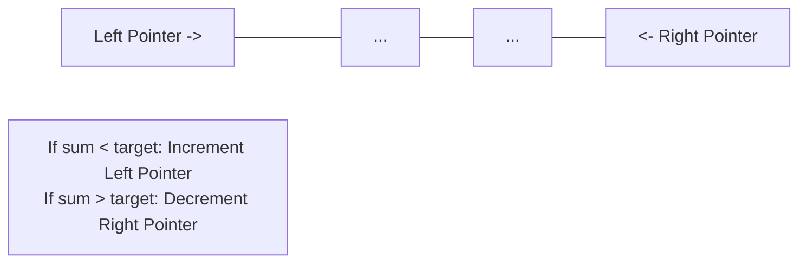
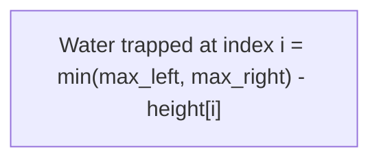

# DSA Track: Dual Python & Java
## Chapter 2: Two Pointers & The Sliding Window Pattern

> 🧭 **Navigation**: [⬅️ Previous: 01: Arrays & Hashing](01-arrays-and-hashing.md) | [🏠 DSA Track Index](README.md) | [➡️ Next: 03: Linked Lists](03-linked-lists.md)

---

The **Two Pointers** and **Sliding Window** patterns convert naive $O(N^2)$ brute-force nested loops into optimal $O(N)$ linear time algorithms by exploiting sorted properties or continuous contiguous subsegments.

---

### 1. Two Pointers: Opposing Ends & Inward Convergence

When an array is sorted, comparing elements at the opposite boundaries ($L=0$ and $R=N-1$) allows you to eliminate an entire row or column of search possibilities in $O(1)$ steps.

**Real-World Industry Examples**:
- **Palindrome Detection in DNA sequences**: Bioinformatics algorithms use two pointers to quickly verify inverted repeats or palindromic segments in DNA sequences.
- **DNS Packet Parsing**: Two pointers are often used to scan through network packet streams iteratively when validating formats or matching query/response pairs.



> 💡 **Interview Tip**
> Whenever an array is sorted, think "Two Pointers" or "Binary Search". Two pointers is the go-to for finding pairs/triplets that sum to a target.

> 📺 **Video References**
> - [NeetCode: Two Pointers Pattern Explained](https://www.youtube.com/watch?v=On03HWe2tZM)
> - [Striver A2Z: Two Pointers Overview](https://www.youtube.com/@takeUforward)

> 📖 **Must-Read Resources**
> - [Netflix Tech Blog: Optimizing Media Parsing](https://netflixtechblog.com/)
> - [High Scalability: How DNS Works](http://highscalability.com/)

---

### 2. The Sliding Window: Expansion & Contraction Template

The sliding window maintains a contiguous subarray $[L, R]$. The standard template operates in two phases:
1. **Expand**: Increment `R` to absorb elements until the target window condition is satisfied.
2. **Contract**: Increment `L` to shrink the window from the left while recording the minimum/maximum valid length, until the condition is violated.
- **Why $O(N)$?**: Each pointer moves strictly from index $0$ to $N$ at most once. Total pointer movements $= 2N \implies \mathbf{O(N)}$.

**Real-World Industry Examples**:
- **TCP Sliding Window Protocol**: Networks use sliding windows to control the flow of data packets over a TCP connection, keeping track of sent, acknowledged, and pending packets without waiting for individual ACKs.
- **Rate Limiting**: APIs (like AWS or Cloudflare) implement sliding window counters to limit the number of requests a user can make within a contiguous time frame.

> 💡 **Interview Tip**
> When asked to find a "longest/shortest substring" or "subarray" that satisfies a condition, it's almost always a Sliding Window problem. Memorize the two `while` loop template (outer for `R`, inner for `L`).

> 📺 **Video References**
> - [NeetCode: Sliding Window Pattern Explained](https://www.youtube.com/watch?v=MK-NZ4hN7rs)
> - [Gaurav Sen: Rate Limiting System Design](https://www.youtube.com/watch?v=FU4WlwfS3G0)

> 📖 **Must-Read Resources**
> - [Cloudflare Blog: How we built Rate Limiting](https://blog.cloudflare.com/counting-things-a-lot-of-different-things/)
> - [AWS Architecture: Implementing Sliding Window Rate Limiting](https://aws.amazon.com/blogs/architecture/)

---

### 3. Core Problems & Dual Implementations

#### Problem 1: 3Sum (LeetCode 15)
Given an integer array `nums`, return all the triplets `[nums[i], nums[j], nums[k]]` such that $i \ne j \ne k$ and $nums[i] + nums[j] + nums[k] == 0$. Solution set must not contain duplicate triplets.

| Algorithm | Time Complexity | Space Complexity |
|-----------|----------------|------------------|
| Two Pointers | $O(N^2)$ | $O(1)$ |
| Brute Force | $O(N^3)$ | $O(1)$ |

**Python 3 Implementation**:
```python
def three_sum(nums: list[int]) -> list[list[int]]:
    nums.sort()
    result = []

    for i in range(len(nums) - 2):
        # Skip duplicate values for the first element
        if i > 0 and nums[i] == nums[i - 1]:
            continue

        left, right = i + 1, len(nums) - 1
        while left < right:
            total = nums[i] + nums[left] + nums[right]
            if total < 0:
                left += 1
            elif total > 0:
                right -= 1
            else:
                result.append([nums[i], nums[left], nums[right]])
                left += 1
                right -= 1
                # Skip duplicates for left and right pointers
                while left < right and nums[left] == nums[left - 1]:
                    left += 1
                while left < right and nums[right] == nums[right + 1]:
                    right -= 1

    return result

if __name__ == "__main__":
    print(three_sum([-1,0,1,2,-1,-4])) # [[-1,-1,2],[-1,0,1]]
```

**Java 17 Implementation**:
```java
import java.util.*;

public class ThreeSum {
    public List<List<Integer>> threeSum(int[] nums) {
        Arrays.sort(nums);
        List<List<Integer>> result = new ArrayList<>();

        for (int i = 0; i < nums.length - 2; i++) {
            if (i > 0 && nums[i] == nums[i - 1]) continue;

            int left = i + 1;
            int right = nums.length - 1;

            while (left < right) {
                int sum = nums[i] + nums[left] + nums[right];
                if (sum < 0) {
                    left++;
                } else if (sum > 0) {
                    right--;
                } else {
                    result.add(Arrays.asList(nums[i], nums[left], nums[right]));
                    left++;
                    right--;
                    while (left < right && nums[left] == nums[left - 1]) left++;
                    while (left < right && nums[right] == nums[right + 1]) right--;
                }
            }
        }
        return result;
    }
    
    public static void main(String[] args) {
        ThreeSum ts = new ThreeSum();
        System.out.println(ts.threeSum(new int[]{-1,0,1,2,-1,-4}));
    }
}
```

---

#### Problem 2: Trapping Rain Water (LeetCode 42)
Given `n` non-negative integers representing an elevation map where the width of each bar is 1, compute how much water it can trap after raining.

| Algorithm | Time Complexity | Space Complexity |
|-----------|----------------|------------------|
| Two Pointers | $O(N)$ | $O(1)$ |
| DP Arrays | $O(N)$ | $O(N)$ |



**Python 3 Implementation**:
```python
def trap(height: list[int]) -> int:
    if not height:
        return 0

    left, right = 0, len(height) - 1
    left_max, right_max = height[left], height[right]
    trapped_water = 0

    while left < right:
        if left_max < right_max:
            left += 1
            left_max = max(left_max, height[left])
            trapped_water += left_max - height[left]
        else:
            right -= 1
            right_max = max(right_max, height[right])
            trapped_water += right_max - height[right]

    return trapped_water

if __name__ == "__main__":
    print(trap([0,1,0,2,1,0,1,3,2,1,2,1])) # 6
```

**Java 17 Implementation**:
```java
public class TrappingRainWater {
    public int trap(int[] height) {
        if (height == null || height.length == 0) return 0;

        int left = 0, right = height.length - 1;
        int leftMax = height[left], rightMax = height[right];
        int trappedWater = 0;

        while (left < right) {
            if (leftMax < rightMax) {
                left++;
                leftMax = Math.max(leftMax, height[left]);
                trappedWater += leftMax - height[left];
            } else {
                right--;
                rightMax = Math.max(rightMax, height[right]);
                trappedWater += rightMax - height[right];
            }
        }
        return trappedWater;
    }
    
    public static void main(String[] args) {
        TrappingRainWater trw = new TrappingRainWater();
        System.out.println(trw.trap(new int[]{0,1,0,2,1,0,1,3,2,1,2,1})); // 6
    }
}
```

---

#### Problem 3: Longest Substring Without Repeating Characters (LeetCode 3)
Given a string `s`, find the length of the longest substring without repeating characters.

| Algorithm | Time Complexity | Space Complexity |
|-----------|----------------|------------------|
| Sliding Window | $O(N)$ | $O(\min(N, M))$ |

**Python 3 Implementation**:
```python
def length_of_longest_substring(s: str) -> int:
    char_index_map = {}
    left = 0
    max_len = 0

    for right, char in enumerate(s):
        if char in char_index_map and char_index_map[char] >= left:
            left = char_index_map[char] + 1

        char_index_map[char] = right
        max_len = max(max_len, right - left + 1)

    return max_len

if __name__ == "__main__":
    print(length_of_longest_substring("abcabcbb")) # 3
```

**Java 17 Implementation**:
```java
import java.util.HashMap;
import java.util.Map;

public class LongestSubstringWithoutRepeating {
    public int lengthOfLongestSubstring(String s) {
        Map<Character, Integer> charIndexMap = new HashMap<>();
        int left = 0;
        int maxLen = 0;

        for (int right = 0; right < s.length(); right++) {
            char c = s.charAt(right);
            if (charIndexMap.containsKey(c) && charIndexMap.get(c) >= left) {
                left = charIndexMap.get(c) + 1;
            }
            charIndexMap.put(c, right);
            maxLen = Math.max(maxLen, right - left + 1);
        }
        return maxLen;
    }
    
    public static void main(String[] args) {
        LongestSubstringWithoutRepeating ls = new LongestSubstringWithoutRepeating();
        System.out.println(ls.lengthOfLongestSubstring("abcabcbb")); // 3
    }
}
```

---

> 🧭 **Navigation**: [⬅️ Previous: 01: Arrays & Hashing](01-arrays-and-hashing.md) | [🏠 DSA Track Index](README.md) | [➡️ Next: 03: Linked Lists](03-linked-lists.md)
