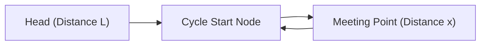

# DSA Track: Dual Python & Java
## Chapter 3: Linked Lists, Fast & Slow Pointers & In-Place Reversals

> 🧭 **Navigation**: [⬅️ Previous: 02: Two Pointers & Sliding Window](02-two-pointers-and-sliding-window.md) | [🏠 DSA Track Index](README.md) | [➡️ Next: 04: Stacks & Queues](04-stacks-and-queues.md)

---

Linked Lists evaluate pointer manipulation, reference passing, and edge-case handling without array-indexed random access.

---

### 1. Pointer Best Practice: The Dummy Head Pattern

When modifying a linked list where the head node itself might be deleted, moved, or prepended, create a **Sentinel / Dummy Head node**:
```python
dummy = ListNode(0)
dummy.next = head
# Now the real head can be modified without writing special-case code!
return dummy.next
```

**Real-World Industry Examples**:
- **Python CPython Internals**: Frame objects representing execution frames are chained in a linked list pattern so stack traces can be rebuilt quickly.
- **Browser History**: Chrome's back and forward buttons map perfectly to a doubly linked list architecture, allowing $O(1)$ traversals forward and backward.
- **OS Process Scheduling**: Operating systems like Linux maintain process task queues as circular doubly linked lists to rapidly iterate through active tasks in constant time.

> 💡 **Interview Tip**
> Whenever you have an operation that can modify the head of a linked list (like merging, removing elements, or reversing sub-lists), allocate a `dummy` node pointing to the head. It eliminates tedious `if head is None` edge cases.

> 📺 **Video References**
> - [NeetCode: Linked List Reversal & Pointers](https://www.youtube.com/watch?v=G0_I-ZF0S38)
> - [Abdul Bari: Linked List Data Structures](https://www.youtube.com/@abdul_bari)

> 📖 **Must-Read Resources**
> - [Linux Kernel Linked Lists (list.h)](https://www.kernel.org/doc/html/latest/core-api/kernel-api.html#list-management-functions)
> - [CPython Source Code: Frame Objects](https://github.com/python/cpython)

---

### 2. Floyd’s Cycle Detection (Tortoise & Hare)

To detect a cycle and find the exact cycle start node:
- **Phase 1**: Advance `slow` by 1 step and `fast` by 2 steps. If they meet, a cycle exists.
- **Phase 2**: Reset `slow` to the list `head`, keeping `fast` at the meeting point. Advance both 1 step at a time. The node where they collide is the **Cycle Start Node**.



#### Mathematical Proof:
- Distance traveled by slow: $D_{\text{slow}} = L + x$
- Distance traveled by fast: $D_{\text{fast}} = L + nC + x$ (where $C$ is cycle length)
- Since fast travels twice as fast:
  $$2(L + x) = L + nC + x \implies L + x = nC \implies \mathbf{L = nC - x}$$
Advancing one pointer from `Head` ($L$ steps) and one from `MeetPoint` ($nC - x$ steps) guarantees they collide exactly at the cycle entrance!

> 💡 **Interview Tip**
> If an interviewer asks you to find a duplicate number in an array in $O(1)$ space and $O(N)$ time without modifying the array, Floyd’s Cycle Detection is the key!

> 📺 **Video References**
> - [MIT 6.006: Pointer Magic](https://www.youtube.com/watch?v=Zc54gFhdpLA&list=PLUl4u3cNGP61Oq3tWYp6V_F-5jb5L2iHb)
> - [NeetCode: Find the Duplicate Number](https://www.youtube.com/watch?v=wjYnzkAhcNk)

> 📖 **Must-Read Resources**
> - [Floyd's Cycle-Finding Algorithm Wikipedia](https://en.wikipedia.org/wiki/Cycle_detection)

---

### 3. Core Problems & Dual Implementations

#### Node Definition
**Python 3**:
```python
class ListNode:
    """Store one value and a link to the next list node."""

    def __init__(self, val: int = 0, next: 'ListNode' = None):
        """Create a node with a value and an optional next node."""
        self.val = val
        self.next = next
```

**Java 17**:
```java
public class ListNode {
    public int val;
    public ListNode next;
    public ListNode() {}
    public ListNode(int val) { this.val = val; }
    public ListNode(int val, ListNode next) { this.val = val; this.next = next; }
}
```

---

#### Problem 1: Reverse Linked List (LeetCode 206)
Given the `head` of a singly linked list, reverse the list, and return the reversed list.

| Algorithm | Time Complexity | Space Complexity |
|-----------|----------------|------------------|
| Iterative | $O(N)$ | $O(1)$ |
| Recursive | $O(N)$ | $O(N)$ |

**Python 3 Implementation**:
```python
def reverse_list(head: ListNode) -> ListNode:
    """Reverse a linked list and return its new first node."""
    prev = None
    curr = head
    while curr:
        next_temp = curr.next
        curr.next = prev
        prev = curr
        curr = next_temp
    return prev

# Test case
if __name__ == "__main__":
    head = ListNode(1, ListNode(2, ListNode(3)))
    res = reverse_list(head)
    while res:
        print(res.val, end="->")
        res = res.next
    # Expected: 3->2->1->
```

**Java 17 Implementation**:
```java
public class ReverseLinkedList {
    public ListNode reverseList(ListNode head) {
        ListNode prev = null;
        ListNode curr = head;
        while (curr != null) {
            ListNode nextTemp = curr.next;
            curr.next = prev;
            prev = curr;
            curr = nextTemp;
        }
        return prev;
    }
    
    public static void main(String[] args) {
        ReverseLinkedList rl = new ReverseLinkedList();
        ListNode head = new ListNode(1, new ListNode(2, new ListNode(3)));
        ListNode res = rl.reverseList(head);
        while (res != null) {
            System.out.print(res.val + "->");
            res = res.next;
        }
        // Expected: 3->2->1->
    }
}
```

---

#### Problem 2: Reorder List (LeetCode 143)
You are given the head of a singly linked list $L_0 \to L_1 \to \dots \to L_{n-1} \to L_n$. Reorder it to: $L_0 \to L_n \to L_1 \to L_{n-1} \to L_2 \to L_{n-2} \dots$ in-place.

| Algorithm | Time Complexity | Space Complexity |
|-----------|----------------|------------------|
| Optimal | $O(N)$ | $O(1)$ |

**Python 3 Implementation**:
```python
def reorder_list(head: ListNode) -> None:
    """Reorder the list by alternating nodes from its start and end."""
    if not head or not head.next:
        return

    # Step 1: Find middle node
    slow, fast = head, head
    while fast and fast.next:
        slow = slow.next
        fast = fast.next.next

    # Step 2: Reverse second half
    prev = None
    curr = slow.next
    slow.next = None  # Split into two lists
    while curr:
        next_temp = curr.next
        curr.next = prev
        prev = curr
        curr = next_temp
    second_half = prev

    # Step 3: Merge two halves alternatively
    first_half = head
    while second_half:
        tmp1, tmp2 = first_half.next, second_half.next
        first_half.next = second_half
        second_half.next = tmp1
        first_half = tmp1
        second_half = tmp2
```

**Java 17 Implementation**:
```java
public class ReorderList {
    public void reorderList(ListNode head) {
        if (head == null || head.next == null) return;

        // 1. Find middle
        ListNode slow = head, fast = head;
        while (fast != null && fast.next != null) {
            slow = slow.next;
            fast = fast.next.next;
        }

        // 2. Reverse second half
        ListNode prev = null, curr = slow.next;
        slow.next = null; // Disconnect lists
        while (curr != null) {
            ListNode nextTemp = curr.next;
            curr.next = prev;
            prev = curr;
            curr = nextTemp;
        }
        ListNode second = prev;

        // 3. Merge alternatively
        ListNode first = head;
        while (second != null) {
            ListNode tmp1 = first.next;
            ListNode tmp2 = second.next;
            first.next = second;
            second.next = tmp1;
            first = tmp1;
            second = tmp2;
        }
    }
}
```

---

> 🧭 **Navigation**: [⬅️ Previous: 02: Two Pointers & Sliding Window](02-two-pointers-and-sliding-window.md) | [🏠 DSA Track Index](README.md) | [➡️ Next: 04: Stacks & Queues](04-stacks-and-queues.md)
