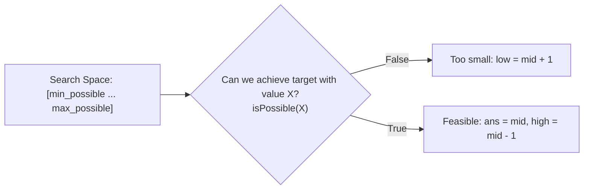

# DSA Track: Dual Python & Java
## Chapter 5: Binary Search & Search on Solution Space

> 🧭 **Navigation**: [⬅️ Previous: 04: Stacks & Queues](04-stacks-and-queues.md) | [🏠 DSA Track Index](README.md) | [➡️ Next: 06: Trees & Tries](06-trees-and-tries.md)

---

Binary Search is more than looking up numbers in a sorted array; it is a general algorithmic paradigm for searching any **Monotonic Search Space** in $O(\log N)$ time.

---

### 1. The Integer Overflow Bug & Standard Template

In languages with fixed-width 32-bit signed integers (like Java, C++, C#), calculating midpoint via:
```java
int mid = (low + high) / 2; // ❌ DANGEROUS!
```
can cause **integer overflow** when `low + high > 2,147,483,647`, wrapping into negative numbers and triggering an `ArrayIndexOutOfBoundsException`.
- **Always write**:
  $$\text{mid} = \text{low} + \frac{\text{high} - \text{low}}{2}$$

**Real-World Industry Examples**:
- **Git Bisect**: The `git bisect` command uses binary search over your commit history to find the exact commit that introduced a bug, dramatically reducing debugging time.
- **Database B-Tree Traversal**: PostgreSQL and MySQL use binary search within individual B-Tree nodes to quickly navigate to the correct child pointer for indexed lookups.
- **Core Library Functions**: Lower-level implementations like the Linux Kernel's `bsearch()` and Java's `Arrays.binarySearch()` power countless efficient lookups worldwide.

> 💡 **Interview Tip**
> Always write the overflow-safe formula `low + (high - low) / 2`. If an interviewer asks why, explicitly mentioning the 32-bit signed integer overflow limit (2.14B) demonstrates deep systems understanding.

> 📺 **Video References**
> - [Google Research: The Binary Search Bug](https://www.youtube.com/watch?v=21LOUXq4Fis)
> - [NeetCode: Binary Search Explained](https://www.youtube.com/watch?v=s4Dq7bcB3Y4)

> 📖 **Must-Read Resources**
> - [Google Research Blog: Extra, Extra - Read All About It: Nearly All Binary Searches and Mergesorts are Broken](https://research.google/blog/extra-extra-read-all-about-it-nearly-all-binary-searches-and-mergesorts-are-broken/)
> - [Java `Arrays.binarySearch` Source Code](https://github.com/openjdk/jdk/blob/master/src/java.base/share/classes/java/util/Arrays.java)

---

### 2. Binary Search on Solution Space (The Predicate Pattern)

Whenever an optimization problem asks for the **"minimum possible maximum"** or **"maximum possible minimum"**, frame it as a monotonic boolean function:



> 💡 **Interview Tip**
> "Binary search on solution space" is a very common hard-level interview topic (e.g., Koko Eating Bananas, Capacity to Ship Packages). The key is realizing that if you guess an answer `mid`, checking if `mid` is valid takes $O(N)$. Therefore, total time is $O(N \log M)$ where $M$ is the search space size.

> 📺 **Video References**
> - [Striver A2Z: Binary Search on Answers](https://www.youtube.com/@takeUforward)
> - [NeetCode: Koko Eating Bananas](https://www.youtube.com/watch?v=U2SozAs9RzA)

> 📖 **Must-Read Resources**
> - [TopCoder: Binary Search Tutorial](https://www.topcoder.com/thrive/articles/Binary%20Search)

---

### 3. Core Problems & Dual Implementations

#### Problem 1: Search in Rotated Sorted Array (LeetCode 33)
Given an integer array `nums` sorted in ascending order (with distinct values) and rotated at some unknown pivot, find the index of `target`. Must run in $O(\log N)$ time.

| Algorithm | Time Complexity | Space Complexity |
|-----------|----------------|------------------|
| Optimal | $O(\log N)$ | $O(1)$ |

- **Key Insight**: At least one half of the array (either `[low..mid]` or `[mid..high]`) is always strictly sorted!

**Python 3 Implementation**:
```python
def search_rotated(nums: list[int], target: int) -> int:
    """Find the target in a rotated sorted list, or return -1 if absent."""
    low, high = 0, len(nums) - 1

    while low <= high:
        mid = low + (high - low) // 2
        if nums[mid] == target:
            return mid

        # Case 1: Left half is sorted
        if nums[low] <= nums[mid]:
            if nums[low] <= target < nums[mid]:
                high = mid - 1
            else:
                low = mid + 1
        # Case 2: Right half is sorted
        else:
            if nums[mid] < target <= nums[high]:
                low = mid + 1
            else:
                high = mid - 1

    return -1

if __name__ == "__main__":
    print(search_rotated([4,5,6,7,0,1,2], 0)) # 4
```

**Java 17 Implementation**:
```java
public class SearchRotatedArray {
    public int search(int[] nums, int target) {
        int low = 0, high = nums.length - 1;

        while (low <= high) {
            int mid = low + (high - low) / 2;
            if (nums[mid] == target) return mid;

            // Left half sorted
            if (nums[low] <= nums[mid]) {
                if (nums[low] <= target && target < nums[mid]) {
                    high = mid - 1;
                } else {
                    low = mid + 1;
                }
            } 
            // Right half sorted
            else {
                if (nums[mid] < target && target <= nums[high]) {
                    low = mid + 1;
                } else {
                    high = mid - 1;
                }
            }
        }
        return -1;
    }
    
    public static void main(String[] args) {
        SearchRotatedArray sra = new SearchRotatedArray();
        System.out.println(sra.search(new int[]{4,5,6,7,0,1,2}, 0)); // 4
    }
}
```

---

#### Problem 2: Koko Eating Bananas (LeetCode 875)
There are `n` piles of bananas. Koko can decide her eating speed $k$ (bananas/hour). Return the minimum integer $k$ such that she can eat all bananas within $h$ hours.

| Algorithm | Time Complexity | Space Complexity |
|-----------|----------------|------------------|
| Solution Space BS | $O(N \log(\max(\text{piles})))$| $O(1)$ |

- **Search Space**: $k \in [1, \max(\text{piles})]$

**Python 3 Implementation**:
```python
import math

def min_eating_speed(piles: list[int], h: int) -> int:
    """Find the slowest eating speed that finishes all piles within h hours."""
    def can_finish(k: int) -> bool:
        """Check whether speed k is enough to finish before time runs out."""
        total_hours = sum(math.ceil(pile / k) for pile in piles)
        return total_hours <= h

    low, high = 1, max(piles)
    result = high

    while low <= high:
        mid = low + (high - low) // 2
        if can_finish(mid):
            result = mid
            high = mid - 1  # Try slower speed
        else:
            low = mid + 1   # Must eat faster

    return result

if __name__ == "__main__":
    print(min_eating_speed([3,6,7,11], 8)) # 4
```

**Java 17 Implementation**:
```java
public class KokoEatingBananas {
    public int minEatingSpeed(int[] piles, int h) {
        int low = 1, high = 0;
        for (int pile : piles) {
            high = Math.max(high, pile);
        }

        int result = high;
        while (low <= high) {
            int mid = low + (high - low) / 2;
            if (canFinish(piles, mid, h)) {
                result = mid;
                high = mid - 1;
            } else {
                low = mid + 1;
            }
        }
        return result;
    }

    private boolean canFinish(int[] piles, int k, int h) {
        long totalHours = 0;
        for (int pile : piles) {
            totalHours += (pile + k - 1) / k; // Integer ceiling division
        }
        return totalHours <= h;
    }
    
    public static void main(String[] args) {
        KokoEatingBananas keb = new KokoEatingBananas();
        System.out.println(keb.minEatingSpeed(new int[]{3,6,7,11}, 8)); // 4
    }
}
```

---

> 🧭 **Navigation**: [⬅️ Previous: 04: Stacks & Queues](04-stacks-and-queues.md) | [🏠 DSA Track Index](README.md) | [➡️ Next: 06: Trees & Tries](06-trees-and-tries.md)
