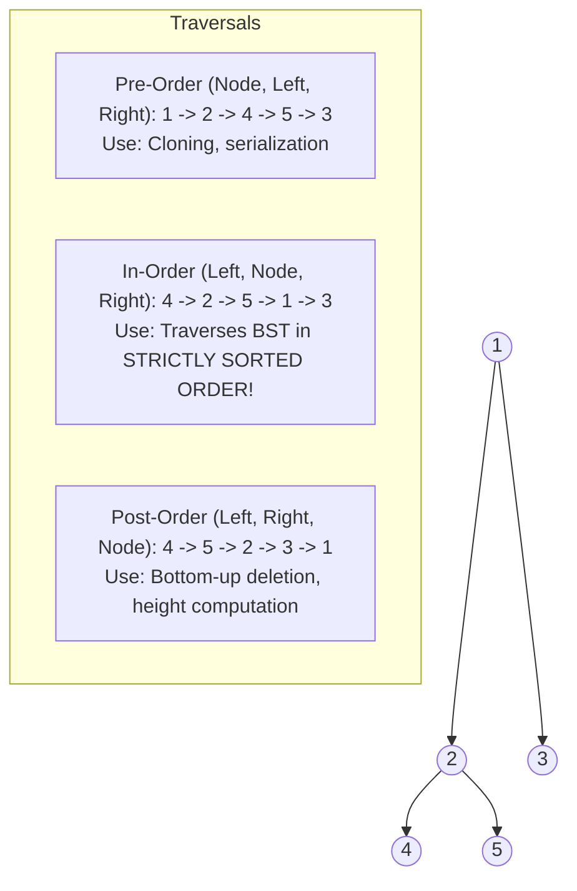
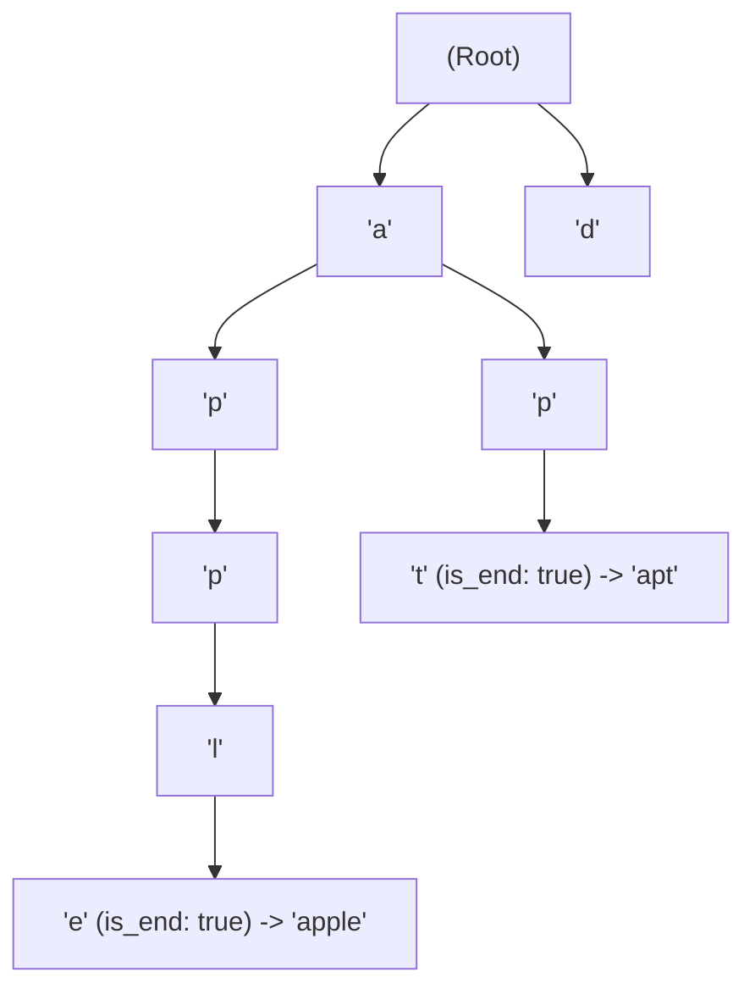

# DSA Track: Dual Python & Java
## Chapter 6: Trees, Binary Search Trees & Prefix Trees (Tries)

> 🧭 **Navigation**: [⬅️ Previous: 05: Binary Search](05-binary-search.md) | [🏠 DSA Track Index](README.md) | [➡️ Next: 07: Heaps & Priority Queues](07-heaps-and-priority-queues.md)

---

Trees model hierarchical relationships. Interviewers test recursive mental models, Depth-First Search (DFS) variants, Breadth-First Search (BFS) level-order queues, and Trie prefix graphs.

---

### 1. Tree Traversal Paradigms

Trees are used extensively to model hierarchical data.
**Real-World Industry Examples:**
- **DOM (Document Object Model):** Browsers parse HTML into a tree structure.
- **Linux VFS Filesystem:** Directory structures are hierarchical trees.
- **Database B+Trees:** MySQL and PostgreSQL use B+Trees for efficient indexing.
- **XML/JSON Parsers:** Data is represented internally as trees.



> 💡 **Interview Tip**
> Interviewers love asking tree traversal questions because they naturally test your recursion skills. Remember that In-Order traversal of a Binary Search Tree (BST) always yields a sorted sequence. If a problem asks you to validate a BST or find a specific element, an In-Order approach is often the easiest path!

> 📺 **Video References**
> - [NeetCode - Trees Playlist](https://www.youtube.com/@NeetCode) by NeetCode
> - [MIT 6.006: Lecture 5 - Binary Search Trees, BST Sort](https://www.youtube.com/playlist?list=PLUl4u3cNGP61Oq3tWYp6V_F-5jb5L2iHb) by MIT OpenCourseWare

> 📖 **Must-Read Resources**
> - [Visualgo: Binary Search Tree Visualization](https://visualgo.net/en/bst)
> - [PostgreSQL Docs: B-Tree Indexes](https://www.postgresql.org/docs/)

---

### 2. The Trie (Prefix Tree) Data Structure

A Trie is an $M$-ary tree where each node represents a character. It enables prefix matching and autocomplete in $O(L)$ time (independent of dictionary size $N$).

**Real-World Industry Examples:**
- **Google Search Autocomplete:** Efficiently finding the most likely search queries matching a prefix.
- **Smartphone Keyboard Autocomplete (SwiftKey):** Suggesting words as you type.
- **IP Routing Tables:** Linux routing daemons use variations of tries (radix trees) for fast prefix lookups.
- **Spell Checkers:** Checking if a word exists in a given language dictionary.



> 💡 **Interview Tip**
> Whenever a problem involves string prefixes or searching for words from a dictionary (like Boggle or word search), a Trie is almost always the optimal data structure. Pay attention to the `is_end_of_word` flag, which is crucial for distinguishing between valid words and mere prefixes.

> 📺 **Video References**
> - [NeetCode - Tries Playlist](https://www.youtube.com/@NeetCode) by NeetCode
> - [MIT 6.006: Lecture 9 - Rolling Hashes, Amortized Analysis (Tries context)](https://www.youtube.com/playlist?list=PLUl4u3cNGP61Oq3tWYp6V_F-5jb5L2iHb) by MIT OpenCourseWare

> 📖 **Must-Read Resources**
> - [LeetCode: Implement Trie (Prefix Tree)](https://leetcode.com/problems/implement-trie-prefix-tree/)
> - [Cloudflare Blog: Data Structures in IP Routing](https://blog.cloudflare.com)

---

### 3. Core Problems & Dual Implementations

#### Node Definitions:
**Python 3**:
```python
class TreeNode:
    def __init__(self, val: int = 0, left=None, right=None):
        self.val = val
        self.left = left
        self.right = right
```

**Java 17**:
```java
public class TreeNode {
    public int val;
    public TreeNode left;
    public TreeNode right;
    public TreeNode() {}
    public TreeNode(int val) { this.val = val; }
    public TreeNode(int val, TreeNode left, TreeNode right) {
        this.val = val; this.left = left; this.right = right;
    }
}
```

---

#### Problem 1: Lowest Common Ancestor of a Binary Tree (LeetCode 236)
Given a binary tree, find the lowest common ancestor (LCA) of two given nodes `p` and `q`.

**Complexity Comparison:**
| Approach | Time Complexity | Space Complexity |
| :--- | :--- | :--- |
| DFS (Recursive) | $O(N)$ | $O(H)$ (call stack height) |

**Python 3 Implementation**:
```python
class TreeNode:
    def __init__(self, val=0, left=None, right=None):
        self.val = val
        self.left = left
        self.right = right

def lowest_common_ancestor(root: TreeNode, p: TreeNode, q: TreeNode) -> TreeNode:
    # Base case: if we hit a null node, or find p or q, return the current node
    if not root or root == p or root == q:
        return root

    # Search in left and right subtrees
    left = lowest_common_ancestor(root.left, p, q)
    right = lowest_common_ancestor(root.right, p, q)

    # If both left and right are non-null, p and q are in different subtrees.
    # Therefore, the current node is the Lowest Common Ancestor.
    if left and right:
        return root
    
    # If only one subtree returns a non-null node, propagate it upwards
    return left if left else right

# Test Cases
if __name__ == "__main__":
    node_6 = TreeNode(6)
    node_2 = TreeNode(2)
    node_5 = TreeNode(5, node_6, node_2)
    node_0 = TreeNode(0)
    node_8 = TreeNode(8)
    node_1 = TreeNode(1, node_0, node_8)
    root = TreeNode(3, node_5, node_1)

    lca = lowest_common_ancestor(root, node_5, node_1)
    print(f"LCA of 5 and 1: {lca.val}")  # Expected: 3
```

**Java 17 Implementation**:
```java
public class LowestCommonAncestor {
    static class TreeNode {
        int val;
        TreeNode left;
        TreeNode right;
        TreeNode(int x) { val = x; }
    }

    public TreeNode lowestCommonAncestor(TreeNode root, TreeNode p, TreeNode q) {
        // Base case: if we hit a null node, or find p or q, return the current node
        if (root == null || root == p || root == q) {
            return root;
        }

        // Search in left and right subtrees
        TreeNode left = lowestCommonAncestor(root.left, p, q);
        TreeNode right = lowestCommonAncestor(root.right, p, q);

        // If both left and right are non-null, p and q are in different subtrees.
        // Therefore, the current node is the Lowest Common Ancestor.
        if (left != null && right != null) {
            return root;
        }
        
        // If only one subtree returns a non-null node, propagate it upwards
        return (left != null) ? left : right;
    }

    // Test Cases
    public static void main(String[] args) {
        TreeNode node_6 = new TreeNode(6);
        TreeNode node_2 = new TreeNode(2);
        TreeNode node_5 = new TreeNode(5);
        node_5.left = node_6; node_5.right = node_2;
        
        TreeNode node_0 = new TreeNode(0);
        TreeNode node_8 = new TreeNode(8);
        TreeNode node_1 = new TreeNode(1);
        node_1.left = node_0; node_1.right = node_8;
        
        TreeNode root = new TreeNode(3);
        root.left = node_5; root.right = node_1;

        LowestCommonAncestor lcaObj = new LowestCommonAncestor();
        TreeNode lca = lcaObj.lowestCommonAncestor(root, node_5, node_1);
        System.out.println("LCA of 5 and 1: " + lca.val); // Expected: 3
    }
}
```

---

#### Problem 2: Binary Tree Maximum Path Sum (LeetCode 124)
A path in a binary tree is a sequence of nodes where each pair of adjacent nodes has an edge. Return the maximum path sum of any non-empty path.

**Complexity Comparison:**
| Approach | Time Complexity | Space Complexity |
| :--- | :--- | :--- |
| DFS (Post-order) | $O(N)$ | $O(H)$ |

**Python 3 Implementation**:
```python
def max_path_sum(root: TreeNode) -> int:
    max_sum = float('-inf')

    def dfs(node: TreeNode) -> int:
        nonlocal max_sum
        if not node:
            return 0

        # Ignore negative path contributions by taking max with 0
        left_gain = max(dfs(node.left), 0)
        right_gain = max(dfs(node.right), 0)

        # Price of the new path where 'node' is the highest turning point
        price_newpath = node.val + left_gain + right_gain
        max_sum = max(max_sum, price_newpath)

        # Return max contribution to parent caller (can only pick one branch)
        return node.val + max(left_gain, right_gain)

    dfs(root)
    return max_sum

# Test Cases
if __name__ == "__main__":
    node_15 = TreeNode(15)
    node_7 = TreeNode(7)
    node_20 = TreeNode(20, node_15, node_7)
    node_9 = TreeNode(9)
    root = TreeNode(-10, node_9, node_20)

    print(f"Max Path Sum: {max_path_sum(root)}")  # Expected: 42 (15 + 20 + 7)
```

**Java 17 Implementation**:
```java
public class BinaryTreeMaxPathSum {
    static class TreeNode {
        int val;
        TreeNode left;
        TreeNode right;
        TreeNode(int x) { val = x; }
    }

    private int maxSum = Integer.MIN_VALUE;

    public int maxPathSum(TreeNode root) {
        dfs(root);
        return maxSum;
    }

    private int dfs(TreeNode node) {
        if (node == null) return 0;

        // Ignore negative path contributions by taking max with 0
        int leftGain = Math.max(dfs(node.left), 0);
        int rightGain = Math.max(dfs(node.right), 0);

        // Price of the new path where 'node' is the highest turning point
        int currentPathSum = node.val + leftGain + rightGain;
        maxSum = Math.max(maxSum, currentPathSum);

        // Return max contribution to parent caller (can only pick one branch)
        return node.val + Math.max(leftGain, rightGain);
    }

    // Test Cases
    public static void main(String[] args) {
        TreeNode node_15 = new TreeNode(15);
        TreeNode node_7 = new TreeNode(7);
        TreeNode node_20 = new TreeNode(20);
        node_20.left = node_15; node_20.right = node_7;
        
        TreeNode node_9 = new TreeNode(9);
        TreeNode root = new TreeNode(-10);
        root.left = node_9; root.right = node_20;

        BinaryTreeMaxPathSum solution = new BinaryTreeMaxPathSum();
        System.out.println("Max Path Sum: " + solution.maxPathSum(root)); // Expected: 42
    }
}
```

---

#### Problem 3: Implement Trie (Prefix Tree) (LeetCode 208)
Implement a Trie with `insert`, `search`, and `startsWith` methods.

**Complexity Comparison:**
| Operation | Time Complexity | Space Complexity |
| :--- | :--- | :--- |
| `insert` | $O(L)$ (L = word length) | $O(L)$ per word |
| `search` | $O(L)$ | $O(1)$ |
| `startsWith` | $O(L)$ | $O(1)$ |

**Python 3 Implementation**:
```python
class TrieNode:
    def __init__(self):
        self.children = {}
        self.is_end_of_word = False

class Trie:
    def __init__(self):
        self.root = TrieNode()

    def insert(self, word: str) -> None:
        # Traverse the trie, adding nodes for each character if they don't exist
        curr = self.root
        for char in word:
            if char not in curr.children:
                curr.children[char] = TrieNode()
            curr = curr.children[char]
        # Mark the end of the word
        curr.is_end_of_word = True

    def search(self, word: str) -> bool:
        # Traverse the trie to check if the exact word exists
        curr = self.root
        for char in word:
            if char not in curr.children:
                return False
            curr = curr.children[char]
        return curr.is_end_of_word

    def startsWith(self, prefix: str) -> bool:
        # Traverse the trie to check if any word starts with the given prefix
        curr = self.root
        for char in prefix:
            if char not in curr.children:
                return False
            curr = curr.children[char]
        return True

# Test Cases
if __name__ == "__main__":
    trie = Trie()
    trie.insert("apple")
    print(f"Search 'apple': {trie.search('apple')}")        # Expected: True
    print(f"Search 'app': {trie.search('app')}")            # Expected: False
    print(f"Starts with 'app': {trie.startsWith('app')}")   # Expected: True
    trie.insert("app")
    print(f"Search 'app' after insert: {trie.search('app')}") # Expected: True
```

**Java 17 Implementation**:
```java
public class Trie {
    private static class TrieNode {
        // Use an array of 26 size for lowercase English letters
        TrieNode[] children = new TrieNode[26];
        boolean isEndOfWord = false;
    }

    private final TrieNode root;

    public Trie() {
        root = new TrieNode();
    }

    public void insert(String word) {
        TrieNode curr = root;
        for (char c : word.toCharArray()) {
            int idx = c - 'a';
            // Create a new node if path doesn't exist
            if (curr.children[idx] == null) {
                curr.children[idx] = new TrieNode();
            }
            curr = curr.children[idx];
        }
        // Mark the end of a valid word
        curr.isEndOfWord = true;
    }

    public boolean search(String word) {
        TrieNode node = findPrefixNode(word);
        return node != null && node.isEndOfWord;
    }

    public boolean startsWith(String prefix) {
        return findPrefixNode(prefix) != null;
    }

    private TrieNode findPrefixNode(String prefix) {
        TrieNode curr = root;
        for (char c : prefix.toCharArray()) {
            int idx = c - 'a';
            // If prefix path breaks, it doesn't exist
            if (curr.children[idx] == null) return null;
            curr = curr.children[idx];
        }
        return curr;
    }

    // Test Cases
    public static void main(String[] args) {
        Trie trie = new Trie();
        trie.insert("apple");
        System.out.println("Search 'apple': " + trie.search("apple"));       // Expected: true
        System.out.println("Search 'app': " + trie.search("app"));           // Expected: false
        System.out.println("Starts with 'app': " + trie.startsWith("app"));  // Expected: true
        trie.insert("app");
        System.out.println("Search 'app' after insert: " + trie.search("app")); // Expected: true
    }
}
```

> 📺 **Video References**
> - [NeetCode - Trees & Tries](https://www.youtube.com/@NeetCode)
> - [Stanford CS25: Advanced Tree Data Structures](https://www.youtube.com/playlist?list=PLoROMvodv4rNiJRchCzutFw5ItR_ZEDY)

> 📖 **Must-Read Resources**
> - [LeetCode Trees Questions](https://leetcode.com/tag/tree/)
> - [Python Docs: Data Structures](https://docs.python.org/3/tutorial/datastructures.html)

---

> 🧭 **Navigation**: [⬅️ Previous: 05: Binary Search](05-binary-search.md) | [🏠 DSA Track Index](README.md) | [➡️ Next: 07: Heaps & Priority Queues](07-heaps-and-priority-queues.md)
