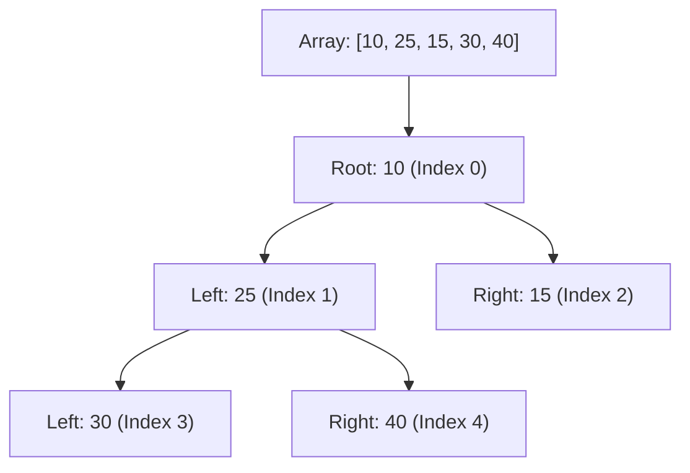
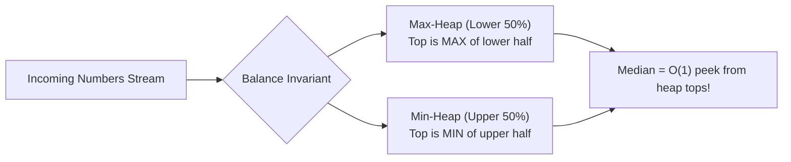

# DSA Track: Dual Python & Java
## Chapter 7: Heaps, Priority Queues & The Two-Heaps Pattern

A **Priority Queue** provides $O(1)$ access to the minimum (or maximum) element while allowing $O(\log N)$ insertions and deletions. Under the hood, it is implemented as a **Binary Heap**.

---

### 1. Binary Heap Array Mathematics & $O(N)$ Heapify

A binary heap is stored in a simple 1D array without pointers:
- **Left Child Index**: $2i + 1$
- **Right Child Index**: $2i + 2$
- **Parent Index**: $\lfloor (i - 1) / 2 \rfloor$

**Real-World Industry Examples:**
- **OS Process Scheduler:** Linux Completely Fair Scheduler (CFS) uses Red-Black trees but heaps are fundamental in simpler priority scheduling algorithms.
- **Dijkstra in Google Maps:** Shortest path algorithms use Min-Heaps to process closest nodes first.
- **Streaming Median in Real-time Analytics:** Processing huge data streams on the fly to get quick metrics.
- **Event Priority Queues:** Used heavily in game engines to process events based on priority.



#### Why `heapify` is $O(N)$ Linear Time:
Building a heap from an unsorted array via bottom-up sift-downs takes linear time because the vast majority of nodes reside near the leaves (height $0$ and $1$) and perform at most $1$ or $2$ swaps:
$$\sum_{h=0}^{\log N} \frac{N}{2^{h+1}} \cdot O(h) = O\left(N \sum_{h=0}^\infty \frac{h}{2^h}\right) = \mathbf{O(N)}$$

> 💡 **Interview Tip**
> The `heapify` operation is $O(N)$, not $O(N \log N)$. Interviewers often ask about this to see if you understand the mathematical proof. Use `heapify` whenever you have a complete unsorted array upfront instead of inserting elements one by one.

> 📺 **Video References**
> - [Abdul Bari - Heap Sort / Heapify](https://www.youtube.com/@abdul_bari)
> - [NeetCode - Heaps Playlist](https://www.youtube.com/@NeetCode)

> 📖 **Must-Read Resources**
> - [Visualgo: Heap Visualization](https://visualgo.net/en/heap)
> - [Python heapq Documentation](https://docs.python.org/3/library/heapq.html)

---

### 2. The Two-Heaps Pattern (Streaming Median)

To dynamically calculate the median of a continuous stream of incoming numbers:
1. Divide numbers into two halves:
   - **Max-Heap (`small`)**: Stores the lower half of numbers.
   - **Min-Heap (`large`)**: Stores the upper half of numbers.
2. Invariant: `small` holds either the same number of elements as `large`, or exactly 1 more element.
3. Median is instantly accessible in **$O(1)$**:
   - If odd count: `small.top()`
   - If even count: $\frac{\text{small.top()} + \text{large.top()}}{2}$



> 💡 **Interview Tip**
> The Two-Heaps pattern is the ultimate solution for "running median" or "K-th element in a stream" problems. The trick is maintaining the size balance invariant between the Max-Heap and Min-Heap.

> 📺 **Video References**
> - [NeetCode - Find Median from Data Stream](https://www.youtube.com/@NeetCode)
> - [MIT 6.006 - Heaps and Priority Queues](https://www.youtube.com/playlist?list=PLUl4u3cNGP61Oq3tWYp6V_F-5jb5L2iHb)

> 📖 **Must-Read Resources**
> - [LeetCode: Find Median from Data Stream](https://leetcode.com/problems/find-median-from-data-stream/)
> - [OpenJDK PriorityQueue Docs](https://openjdk.org/groups/core-libs/)

---

### 3. Core Problems & Dual Implementations

#### Problem 1: Find Median from Data Stream (LeetCode 295)
Design a data structure that supports adding numbers from a data stream and finding the median.

**Complexity Comparison:**
| Approach | `addNum` Time | `findMedian` Time | Space Complexity |
| :--- | :--- | :--- | :--- |
| Two Heaps | $O(\log N)$ | $O(1)$ | $O(N)$ |
| Sorted Array Insertion | $O(N)$ | $O(1)$ | $O(N)$ |

**Python 3 Implementation**:
```python
import heapq

class MedianFinder:
    def __init__(self):
        # Python heapq is min-heap; negate values to simulate max-heap
        self.small = []  # max-heap (lower half)
        self.large = []  # min-heap (upper half)

    def addNum(self, num: int) -> None:
        # Push to small (max-heap) first
        # We push negative to simulate max-heap behavior
        heapq.heappush(self.small, -num)

        # Invariant 1: Every element in small <= every element in large
        if self.small and self.large and (-self.small[0] > self.large[0]):
            val = -heapq.heappop(self.small)
            heapq.heappush(self.large, val)

        # Invariant 2: Size balance (small can have at most 1 more than large)
        if len(self.small) > len(self.large) + 1:
            val = -heapq.heappop(self.small)
            heapq.heappush(self.large, val)
        if len(self.large) > len(self.small):
            val = heapq.heappop(self.large)
            heapq.heappush(self.small, -val)

    def findMedian(self) -> float:
        if len(self.small) > len(self.large):
            return float(-self.small[0])
        return (-self.small[0] + self.large[0]) / 2.0

# Test Cases
if __name__ == "__main__":
    mf = MedianFinder()
    mf.addNum(1)
    mf.addNum(2)
    print(f"Median of [1, 2]: {mf.findMedian()}") # Expected: 1.5
    mf.addNum(3)
    print(f"Median of [1, 2, 3]: {mf.findMedian()}") # Expected: 2.0
```

**Java 17 Implementation**:
```java
import java.util.Collections;
import java.util.PriorityQueue;

public class MedianFinder {
    private final PriorityQueue<Integer> small; // Max-heap (lower half)
    private final PriorityQueue<Integer> large; // Min-heap (upper half)

    public MedianFinder() {
        small = new PriorityQueue<>(Collections.reverseOrder());
        large = new PriorityQueue<>();
    }

    public void addNum(int num) {
        small.offer(num);

        // Ensure small <= large
        if (!small.isEmpty() && !large.isEmpty() && small.peek() > large.peek()) {
            large.offer(small.poll());
        }

        // Balance sizes
        if (small.size() > large.size() + 1) {
            large.offer(small.poll());
        } else if (large.size() > small.size()) {
            small.offer(large.poll());
        }
    }

    public double findMedian() {
        if (small.size() > large.size()) {
            return small.peek();
        }
        return (small.peek() + large.peek()) / 2.0;
    }

    // Test Cases
    public static void main(String[] args) {
        MedianFinder mf = new MedianFinder();
        mf.addNum(1);
        mf.addNum(2);
        System.out.println("Median of [1, 2]: " + mf.findMedian()); // Expected: 1.5
        mf.addNum(3);
        System.out.println("Median of [1, 2, 3]: " + mf.findMedian()); // Expected: 2.0
    }
}
```

---

#### Problem 2: Merge K Sorted Lists (LeetCode 23)
You are given an array of $k$ linked-lists `lists`, each sorted in ascending order. Merge all the linked-lists into one sorted linked-list and return it.

**Complexity Comparison:**
| Approach | Time Complexity | Space Complexity |
| :--- | :--- | :--- |
| Min-Heap | $O(N \log K)$ | $O(K)$ |
| Divide and Conquer | $O(N \log K)$ | $O(\log K)$ |

**Python 3 Implementation**:
```python
import heapq

class ListNode:
    def __init__(self, val=0, next=None):
        self.val = val
        self.next = next

def merge_k_lists(lists: list[ListNode]) -> ListNode:
    dummy = ListNode(0)
    curr = dummy
    heap = []

    for i, node in enumerate(lists):
        if node:
            # Tuple: (value, unique_list_index, node_reference)
            heapq.heappush(heap, (node.val, i, node))

    while heap:
        val, i, node = heapq.heappop(heap)
        curr.next = node
        curr = curr.next
        if node.next:
            heapq.heappush(heap, (node.next.val, i, node.next))

    return dummy.next

# Test Cases
if __name__ == "__main__":
    l1 = ListNode(1, ListNode(4, ListNode(5)))
    l2 = ListNode(1, ListNode(3, ListNode(4)))
    l3 = ListNode(2, ListNode(6))
    
    merged = merge_k_lists([l1, l2, l3])
    res = []
    while merged:
        res.append(merged.val)
        merged = merged.next
    print(f"Merged List: {res}") # Expected: [1, 1, 2, 3, 4, 4, 5, 6]
```

**Java 17 Implementation**:
```java
import java.util.Comparator;
import java.util.PriorityQueue;

public class MergeKSortedLists {
    static class ListNode {
        int val;
        ListNode next;
        ListNode(int x) { val = x; }
        ListNode(int x, ListNode next) { this.val = x; this.next = next; }
    }

    public ListNode mergeKLists(ListNode[] lists) {
        if (lists == null || lists.length == 0) return null;

        PriorityQueue<ListNode> pq = new PriorityQueue<>(Comparator.comparingInt(a -> a.val));

        for (ListNode node : lists) {
            if (node != null) {
                pq.offer(node);
            }
        }

        ListNode dummy = new ListNode(0);
        ListNode curr = dummy;

        while (!pq.isEmpty()) {
            ListNode node = pq.poll();
            curr.next = node;
            curr = curr.next;
            if (node.next != null) {
                pq.offer(node.next);
            }
        }

        return dummy.next;
    }

    // Test Cases
    public static void main(String[] args) {
        ListNode l1 = new ListNode(1, new ListNode(4, new ListNode(5)));
        ListNode l2 = new ListNode(1, new ListNode(3, new ListNode(4)));
        ListNode l3 = new ListNode(2, new ListNode(6));

        MergeKSortedLists solution = new MergeKSortedLists();
        ListNode merged = solution.mergeKLists(new ListNode[]{l1, l2, l3});
        
        System.out.print("Merged List: ");
        while (merged != null) {
            System.out.print(merged.val + " "); // Expected: 1 1 2 3 4 4 5 6
            merged = merged.next;
        }
        System.out.println();
    }
}
```
