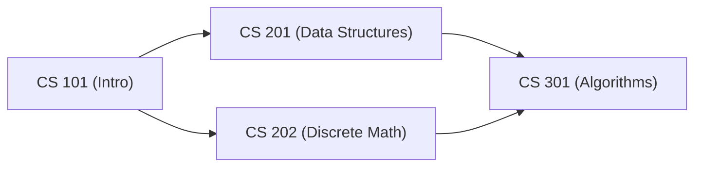
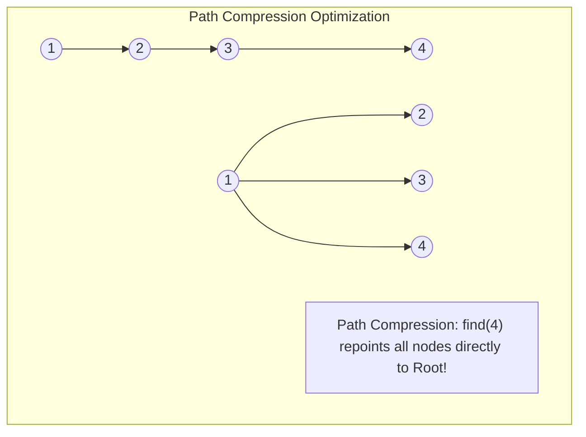

# DSA Track: Dual Python & Java
## Chapter 8: Graphs, Topological Sort, Dijkstra & Disjoint Set Union (DSU)

> 🧭 **Navigation**: [⬅️ Previous: 07: Heaps & Priority Queues](07-heaps-and-priority-queues.md) | [🏠 DSA Track Index](README.md) | [➡️ Next: 09: Dynamic Programming](09-dynamic-programming.md)

---

Graph theory is central to modeling distributed networks, dependency build systems, social graphs, and routing networks.

---

### 1. Topological Sorting: Kahn’s Algorithm vs DFS

A **Topological Sort** of a Directed Acyclic Graph (DAG) is a linear ordering of vertices such that for every directed edge $u \to v$, vertex $u$ comes before $v$.

**Real-World Industry Examples:**
- **Facebook Friend Recommendations:** Uses massive social graphs to find degrees of separation and mutual friends.
- **Google PageRank:** Uses directed graphs of web links to rank search results.
- **Uber Driver-Rider Matching:** Modeling physical road networks as graphs for bipartite matching.
- **LinkedIn Degree-of-Separation:** Finding shortest paths between connections.



#### Kahn’s Algorithm (Indegrees + Queue):
1. Compute the **indegree** (number of incoming edges) for every vertex.
2. Push all vertices with $\text{indegree} == 0$ into a queue.
3. While queue is not empty:
   - Pop node $u$, append to sorted result.
   - For each neighbor $v$ of $u$: decrement $\text{indegree}[v]$.
   - If $\text{indegree}[v] == 0$, push $v$ into queue.
4. If processed count $< |V|$, a **cycle exists**!

> 💡 **Interview Tip**
> Whenever a problem mentions "dependencies", "prerequisites", or "scheduling", think Topological Sort. Kahn's Algorithm is usually preferred over DFS because it easily detects cycles.

> 📺 **Video References**
> - [William Fiset - Graph Theory Playlist](https://www.youtube.com/playlist?list=PLDV1Zeh2NRsDGO4--qE8yH72HFL1Km93P)
> - [NeetCode - Graphs](https://www.youtube.com/@NeetCode)

> 📖 **Must-Read Resources**
> - [Visualgo: Graph Traversals](https://visualgo.net/en/graphds)
> - [Uber Engineering Blog: Graph Processing](https://www.uber.com/en-US/blog/engineering/)

---

### 2. Disjoint Set Union (DSU) & Near-$O(1)$ Operations

DSU (Union-Find) maintains disjoint sets under two operations: `find(x)` and `union(x, y)`.



By combining **Path Compression** with **Union by Rank**:
- Amortized complexity per operation is strictly **$O(\alpha(N))$**, where $\alpha$ is the **Inverse Ackermann Function**. For all practical universe values ($N \le 10^{80}$), $\alpha(N) \le 4$, making operations effectively **$O(1)$ constant time**!

> 💡 **Interview Tip**
> DSU is incredibly powerful for finding cycles in undirected graphs and computing Connected Components. Always implement both Path Compression and Union by Rank for optimal performance.

> 📺 **Video References**
> - [William Fiset - Union Find](https://www.youtube.com/playlist?list=PLDV1Zeh2NRsDGO4--qE8yH72HFL1Km93P)
> - [MIT 6.006 - Disjoint Sets](https://www.youtube.com/playlist?list=PLUl4u3cNGP61Oq3tWYp6V_F-5jb5L2iHb)

> 📖 **Must-Read Resources**
> - [LeetCode: Redundant Connection](https://leetcode.com/problems/redundant-connection/)
> - [Wikipedia: Disjoint-set data structure](https://en.wikipedia.org/wiki/Disjoint-set_data_structure)

---

### 3. Core Problems & Dual Implementations

#### Problem 1: Course Schedule II (LeetCode 210)
There are a total of `numCourses` you have to take, labeled from `0` to `numCourses - 1`. You are given `prerequisites[i] = [a, b]` where course `b` must be taken before course `a`. Return the ordering of courses you should take to finish all courses.

**Complexity Comparison:**
| Approach | Time Complexity | Space Complexity |
| :--- | :--- | :--- |
| Kahn's Algorithm (BFS) | $O(V + E)$ | $O(V + E)$ |

**Python 3 Implementation**:
```python
from collections import deque, defaultdict

def find_order(num_courses: int, prerequisites: list[list[int]]) -> list[int]:
    adj = defaultdict(list)
    indegree = [0] * num_courses

    # Build graph and indegrees
    for dest, src in prerequisites:
        adj[src].append(dest)
        indegree[dest] += 1

    # Start with nodes having 0 indegree (no prerequisites)
    queue = deque([i for i in range(num_courses) if indegree[i] == 0])
    order = []

    while queue:
        curr = queue.popleft()
        order.append(curr)
        for neighbor in adj[curr]:
            indegree[neighbor] -= 1
            if indegree[neighbor] == 0:
                queue.append(neighbor)

    # If order length == num_courses, we successfully scheduled all. Else, cycle exists.
    return order if len(order) == num_courses else []

# Test Cases
if __name__ == "__main__":
    print(find_order(4, [[1,0],[2,0],[3,1],[3,2]])) # Expected: [0, 1, 2, 3] or [0, 2, 1, 3]
```

**Java 17 Implementation**:
```java
import java.util.*;

public class CourseScheduleII {
    public int[] findOrder(int numCourses, int[][] prerequisites) {
        List<List<Integer>> adj = new ArrayList<>();
        for (int i = 0; i < numCourses; i++) adj.add(new ArrayList<>());
        int[] indegree = new int[numCourses];

        // Build graph and indegrees
        for (int[] pre : prerequisites) {
            int dest = pre[0], src = pre[1];
            adj.get(src).add(dest);
            indegree[dest]++;
        }

        // Start with nodes having 0 indegree
        Queue<Integer> queue = new ArrayDeque<>();
        for (int i = 0; i < numCourses; i++) {
            if (indegree[i] == 0) queue.offer(i);
        }

        int[] order = new int[numCourses];
        int idx = 0;

        while (!queue.isEmpty()) {
            int curr = queue.poll();
            order[idx++] = curr;
            for (int neighbor : adj.get(curr)) {
                indegree[neighbor]--;
                if (indegree[neighbor] == 0) {
                    queue.offer(neighbor);
                }
            }
        }

        return idx == numCourses ? order : new int[]{};
    }

    // Test Cases
    public static void main(String[] args) {
        CourseScheduleII solution = new CourseScheduleII();
        int[] result = solution.findOrder(4, new int[][]{{1,0},{2,0},{3,1},{3,2}});
        System.out.println("Course Order: " + Arrays.toString(result)); // Expected: [0, 1, 2, 3] or [0, 2, 1, 3]
    }
}
```

---

#### Problem 2: Network Delay Time (Dijkstra’s Algorithm - LeetCode 743)
You are given a network of `n` nodes labeled `1` to `n`. You are given `times[i] = [u, v, w]`. We will send a signal from a given node `k`. Return the minimum time it takes for all nodes to receive the signal.

**Complexity Comparison:**
| Approach | Time Complexity | Space Complexity |
| :--- | :--- | :--- |
| Dijkstra with Min-Heap | $O(E \log V)$ | $O(V + E)$ |

**Python 3 Implementation**:
```python
import heapq
from collections import defaultdict

def network_delay_time(times: list[list[int]], n: int, k: int) -> int:
    adj = defaultdict(list)
    for u, v, w in times:
        adj[u].append((v, w))

    # Min-heap to process closest nodes first: (cost, node)
    min_heap = [(0, k)]
    shortest_dist = {}

    while min_heap:
        cost, u = heapq.heappop(min_heap)
        
        # If already visited, skip (we only care about the first time we pop a node, which is the shortest)
        if u in shortest_dist:
            continue
        shortest_dist[u] = cost

        for v, weight in adj[u]:
            if v not in shortest_dist:
                heapq.heappush(min_heap, (cost + weight, v))

    return max(shortest_dist.values()) if len(shortest_dist) == n else -1

# Test Cases
if __name__ == "__main__":
    print(network_delay_time([[2,1,1],[2,3,1],[3,4,1]], 4, 2)) # Expected: 2
```

**Java 17 Implementation**:
```java
import java.util.*;

public class NetworkDelayTime {
    public int networkDelayTime(int[][] times, int n, int k) {
        Map<Integer, List<int[]>> adj = new HashMap<>();
        for (int[] time : times) {
            adj.computeIfAbsent(time[0], x -> new ArrayList<>()).add(new int[]{time[1], time[2]});
        }

        // Min-heap: [cost, node]
        PriorityQueue<int[]> pq = new PriorityQueue<>(Comparator.comparingInt(a -> a[0])); 
        pq.offer(new int[]{0, k});

        Map<Integer, Integer> shortestDist = new HashMap<>();

        while (!pq.isEmpty()) {
            int[] curr = pq.poll();
            int cost = curr[0], u = curr[1];

            if (shortestDist.containsKey(u)) continue;
            shortestDist.put(u, cost);

            if (adj.containsKey(u)) {
                for (int[] edge : adj.get(u)) {
                    int v = edge[0], weight = edge[1];
                    if (!shortestDist.containsKey(v)) {
                        pq.offer(new int[]{cost + weight, v});
                    }
                }
            }
        }

        if (shortestDist.size() != n) return -1;
        int maxDelay = 0;
        for (int d : shortestDist.values()) maxDelay = Math.max(maxDelay, d);
        return maxDelay;
    }

    // Test Cases
    public static void main(String[] args) {
        NetworkDelayTime solution = new NetworkDelayTime();
        System.out.println(solution.networkDelayTime(new int[][]{{2,1,1},{2,3,1},{3,4,1}}, 4, 2)); // Expected: 2
    }
}
```

---

#### Problem 3: Redundant Connection (Union-Find - LeetCode 684)
Return an edge that can be removed so that the resulting graph is a tree of `n` nodes.

**Complexity Comparison:**
| Approach | Time Complexity | Space Complexity |
| :--- | :--- | :--- |
| DSU with Path Compression | $O(N \cdot \alpha(N)) \approx O(N)$ | $O(N)$ |

**Python 3 Implementation**:
```python
class DSU:
    def __init__(self, size: int):
        self.parent = list(range(size + 1))
        self.rank = [1] * (size + 1)

    def find(self, x: int) -> int:
        if self.parent[x] != x:
            # Path compression: repoint directly to the root
            self.parent[x] = self.find(self.parent[x])
        return self.parent[x]

    def union(self, x: int, y: int) -> bool:
        root_x, root_y = self.find(x), self.find(y)
        if root_x == root_y:
            return False  # Cycle detected!

        # Union by rank: attach smaller tree under larger tree
        if self.rank[root_x] < self.rank[root_y]:
            self.parent[root_x] = root_y
        elif self.rank[root_x] > self.rank[root_y]:
            self.parent[root_y] = root_x
        else:
            self.parent[root_y] = root_x
            self.rank[root_x] += 1
        return True

def find_redundant_connection(edges: list[list[int]]) -> list[int]:
    dsu = DSU(len(edges))
    for u, v in edges:
        if not dsu.union(u, v):
            return [u, v]
    return []

# Test Cases
if __name__ == "__main__":
    print(find_redundant_connection([[1,2],[1,3],[2,3]])) # Expected: [2, 3]
```

**Java 17 Implementation**:
```java
import java.util.*;

public class RedundantConnection {
    static class DSU {
        int[] parent, rank;

        public DSU(int n) {
            parent = new int[n + 1];
            rank = new int[n + 1];
            for (int i = 0; i <= n; i++) {
                parent[i] = i;
                rank[i] = 1;
            }
        }

        public int find(int x) {
            if (parent[x] != x) {
                // Path compression
                parent[x] = find(parent[x]); 
            }
            return parent[x];
        }

        public boolean union(int x, int y) {
            int rootX = find(x), rootY = find(y);
            if (rootX == rootY) return false;

            // Union by rank
            if (rank[rootX] < rank[rootY]) {
                parent[rootX] = rootY;
            } else if (rank[rootX] > rank[rootY]) {
                parent[rootY] = rootX;
            } else {
                parent[rootY] = rootX;
                rank[rootX]++;
            }
            return true;
        }
    }

    public int[] findRedundantConnection(int[][] edges) {
        DSU dsu = new DSU(edges.length);
        for (int[] edge : edges) {
            if (!dsu.union(edge[0], edge[1])) {
                return edge;
            }
        }
        return new int[]{};
    }

    // Test Cases
    public static void main(String[] args) {
        RedundantConnection solution = new RedundantConnection();
        int[] result = solution.findRedundantConnection(new int[][]{{1,2},{1,3},{2,3}});
        System.out.println(Arrays.toString(result)); // Expected: [2, 3]
    }
}
```

---

> 🧭 **Navigation**: [⬅️ Previous: 07: Heaps & Priority Queues](07-heaps-and-priority-queues.md) | [🏠 DSA Track Index](README.md) | [➡️ Next: 09: Dynamic Programming](09-dynamic-programming.md)
