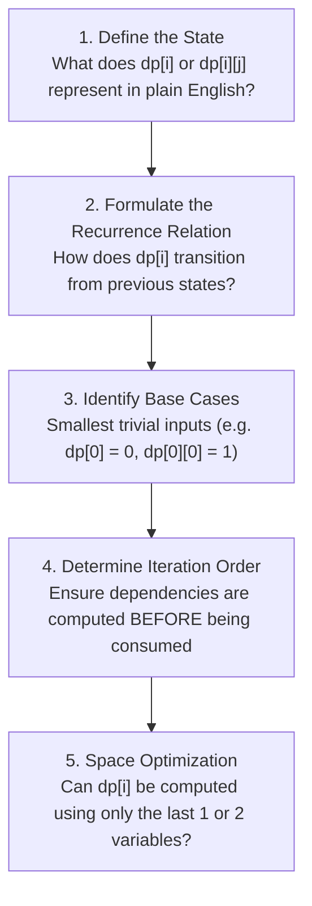

# DSA Track: Dual Python & Java
## Chapter 9: Dynamic Programming (1D, 2D & State Optimization)

Dynamic Programming (DP) is the algorithmic strategy of breaking a complex problem into smaller overlapping subproblems, solving each subproblem once, and storing its solution.

---

### 1. The 5-Step Dynamic Programming Framework

**Real-World Industry Examples:**
- **Git Diff Algorithm:** Uses Myers diff algorithm, heavily based on Longest Common Subsequence DP principles.
- **Spell Correction:** Elasticsearch and other search engines use Levenshtein distance (Edit Distance) for spell corrections.
- **Sequence Alignment in Genomics:** BLAST algorithm and Needleman-Wunsch algorithm use DP for DNA sequencing.
- **Financial Options Pricing:** Black-Scholes discretization uses DP principles.



> 💡 **Interview Tip**
> Always start by defining the state `dp[i]` in plain English. If you can clearly state "dp[i] represents the maximum profit up to day i", formulating the recurrence relation becomes much easier!

> 📺 **Video References**
> - [Striver A2Z - Dynamic Programming Playlist](https://www.youtube.com/@takeUforward)
> - [NeetCode - Dynamic Programming](https://www.youtube.com/@NeetCode)

> 📖 **Must-Read Resources**
> - [LeetCode DP Study Plan](https://leetcode.com/study-plan/dynamic-programming/)
> - [Wikipedia: Levenshtein Distance](https://en.wikipedia.org/wiki/Levenshtein_distance)

---

### 2. 1D vs 2D Patterns

- **1D DP (Linear Sequences)**: Decisions made sequentially (e.g. House Robber: rob house $i$ or skip).
- **2D DP (Grids & Two Strings)**: Transitions involve two indices (e.g. `dp[i][j]` comparing prefix $i$ of String 1 with prefix $j$ of String 2).
- **The Knapsack Backwards Iteration Trick**: When optimizing a 2D Knapsack table into a 1D array, loop through capacity in **reverse** ($W \to \text{weight}$) to prevent using the same item multiple times!

> 💡 **Interview Tip**
> Space optimization is a bonus in interviews. Write the $O(N)$ space solution first. Then, if you notice your recurrence relation only relies on $dp[i-1]$ and $dp[i-2]$, optimize it to $O(1)$ space using two variables.

---

### 3. Core Problems & Dual Implementations

#### Problem 1: Coin Change (LeetCode 322)
Given an integer array `coins` and an integer `amount`, return the fewest number of coins needed to make up that amount. If impossible, return `-1`.

**Complexity Comparison:**
| Approach | Time Complexity | Space Complexity |
| :--- | :--- | :--- |
| Bottom-Up DP | $O(N \times \text{amount})$ | $O(\text{amount})$ |

**Python 3 Implementation**:
```python
def coin_change(coins: list[int], amount: int) -> int:
    dp = [float('inf')] * (amount + 1)
    dp[0] = 0

    for a in range(1, amount + 1):
        for c in coins:
            if a - c >= 0:
                dp[a] = min(dp[a], 1 + dp[a - c])

    return dp[amount] if dp[amount] != float('inf') else -1

# Test Cases
if __name__ == "__main__":
    print(coin_change([1, 2, 5], 11)) # Expected: 3 (5+5+1)
```

**Java 17 Implementation**:
```java
import java.util.Arrays;

public class CoinChange {
    public int coinChange(int[] coins, int amount) {
        int[] dp = new int[amount + 1];
        Arrays.fill(dp, amount + 1); // Sentinel max value
        dp[0] = 0;

        for (int a = 1; a <= amount; a++) {
            for (int c : coins) {
                if (a - c >= 0) {
                    dp[a] = Math.min(dp[a], 1 + dp[a - c]);
                }
            }
        }

        return dp[amount] > amount ? -1 : dp[amount];
    }

    // Test Cases
    public static void main(String[] args) {
        CoinChange solution = new CoinChange();
        System.out.println(solution.coinChange(new int[]{1, 2, 5}, 11)); // Expected: 3
    }
}
```

---

#### Problem 2: Longest Increasing Subsequence (LeetCode 300)
Given an integer array `nums`, return the length of the longest strictly increasing subsequence.

**Complexity Comparison:**
| Approach | Time Complexity | Space Complexity |
| :--- | :--- | :--- |
| Standard DP | $O(N^2)$ | $O(N)$ |
| Patience Sort (Binary Search) | $O(N \log N)$ | $O(N)$ |

**Python 3 Implementation**:
```python
from bisect import bisect_left

def length_of_lis(nums: list[int]) -> int:
    tails = []  # tails[i] stores smallest tail of all increasing subsequences of length i+1

    for x in nums:
        idx = bisect_left(tails, x)
        if idx == len(tails):
            tails.append(x)
        else:
            tails[idx] = x  # Replace with smaller tail

    return len(tails)

# Test Cases
if __name__ == "__main__":
    print(length_of_lis([10,9,2,5,3,7,101,18])) # Expected: 4
```

**Java 17 Implementation**:
```java
import java.util.ArrayList;
import java.util.Collections;
import java.util.List;

public class LongestIncreasingSubsequence {
    public int lengthOfLIS(int[] nums) {
        List<Integer> tails = new ArrayList<>();

        for (int x : nums) {
            int idx = Collections.binarySearch(tails, x);
            if (idx < 0) {
                idx = -(idx + 1); // Insertion point
            }
            if (idx == tails.size()) {
                tails.add(x);
            } else {
                tails.set(idx, x);
            }
        }

        return tails.size();
    }

    // Test Cases
    public static void main(String[] args) {
        LongestIncreasingSubsequence solution = new LongestIncreasingSubsequence();
        System.out.println(solution.lengthOfLIS(new int[]{10,9,2,5,3,7,101,18})); // Expected: 4
    }
}
```

---

#### Problem 3: Edit Distance (LeetCode 72)
Given two strings `word1` and `word2`, return the minimum number of operations (insert, delete, replace) required to convert `word1` to `word2`.

**Complexity Comparison:**
| Approach | Time Complexity | Space Complexity |
| :--- | :--- | :--- |
| 2D DP | $O(M \times N)$ | $O(M \times N)$ |

**Python 3 Implementation**:
```python
def min_distance(word1: str, word2: str) -> int:
    m, n = len(word1), len(word2)
    dp = [[0] * (n + 1) for _ in range(m + 1)]

    for i in range(m + 1):
        dp[i][0] = i
    for j in range(n + 1):
        dp[0][j] = j

    for i in range(1, m + 1):
        for j in range(1, n + 1):
            if word1[i - 1] == word2[j - 1]:
                dp[i][j] = dp[i - 1][j - 1]
            else:
                dp[i][j] = 1 + min(
                    dp[i - 1][j],      # Deletion
                    dp[i][j - 1],      # Insertion
                    dp[i - 1][j - 1]   # Replacement
                )

    return dp[m][n]

# Test Cases
if __name__ == "__main__":
    print(min_distance("horse", "ros")) # Expected: 3
```

**Java 17 Implementation**:
```java
public class EditDistance {
    public int minDistance(String word1, String word2) {
        int m = word1.length(), n = word2.length();
        int[][] dp = new int[m + 1][n + 1];

        for (int i = 0; i <= m; i++) dp[i][0] = i;
        for (int j = 0; j <= n; j++) dp[0][j] = j;

        for (int i = 1; i <= m; i++) {
            for (int j = 1; j <= n; j++) {
                if (word1.charAt(i - 1) == word2.charAt(j - 1)) {
                    dp[i][j] = dp[i - 1][j - 1];
                } else {
                    dp[i][j] = 1 + Math.min(
                        dp[i - 1][j], // Delete
                        Math.min(dp[i][j - 1], dp[i - 1][j - 1]) // Insert, Replace
                    );
                }
            }
        }

        return dp[m][n];
    }

    // Test Cases
    public static void main(String[] args) {
        EditDistance solution = new EditDistance();
        System.out.println(solution.minDistance("horse", "ros")); // Expected: 3
    }
}
```
