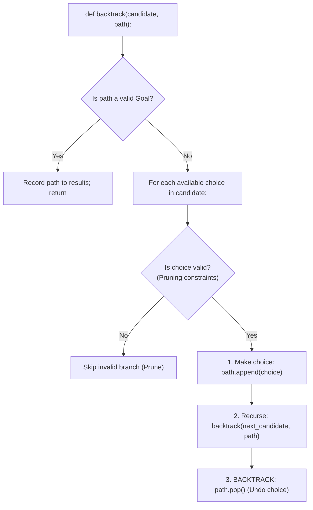

# DSA Track: Dual Python & Java
## Chapter 10: Backtracking & Greedy Algorithms

> 🧭 **Navigation**: [⬅️ Previous: 09: Dynamic Programming](09-dynamic-programming.md) | [🏠 DSA Track Index](README.md) | [➡️ Next: 11: Top 50 LeetCode Patterns](11-top-50-dsa-interview-problems.md)

---

Backtracking systematically searches state-space trees by trying choices and pruning invalid paths, whereas Greedy algorithms make the locally optimal choice at every step without ever looking back.

---

### 1. The Standard Backtracking Template

**Real-World Industry Examples:**
- **Compiler Constraint Solving:** CSP solvers use backtracking to enforce typing constraints.
- **Sudoku Apps:** Constraint propagation and backtracking generate and solve puzzles.
- **Routing Constraint Solvers:** Google's OR-Tools uses backtracking and branch-and-bound for vehicle routing.
- **SAT Solvers:** SAT solvers use DPLL algorithms, which are heavily based on backtracking.



> 💡 **Interview Tip**
> The essence of backtracking is "choose, explore, unchoose". Always remember the `path.pop()` step (the "unchoose"). Without it, you are just accumulating garbage in your path array. Also, if a problem asks for "all possible combinations" or "all permutations", it is almost always a backtracking problem.

> 📺 **Video References**
> - [NeetCode - Backtracking](https://www.youtube.com/@NeetCode)
> - [MIT 6.006 - Backtracking](https://www.youtube.com/playlist?list=PLUl4u3cNGP61Oq3tWYp6V_F-5jb5L2iHb)

> 📖 **Must-Read Resources**
> - [LeetCode: Combination Sum](https://leetcode.com/problems/combination-sum/)
> - [Google OR-Tools: Constraint Programming](https://developers.google.com/optimization/cp)

---

### 2. Core Problems & Dual Implementations

#### Problem 1: Combination Sum (LeetCode 39)
Given an array of distinct integers `candidates` and a target integer `target`, return a list of all unique combinations where the chosen numbers sum to `target`. The same number may be chosen unlimited times.

**Complexity Comparison:**
| Approach | Time Complexity | Space Complexity |
| :--- | :--- | :--- |
| Backtracking | $O(2^T)$ where $T$ is target value | $O(T)$ (call stack) |

**Python 3 Implementation**:
```python
def combination_sum(candidates: list[int], target: int) -> list[list[int]]:
    """Return combinations that add to target; each candidate can be reused."""
    result = []

    def backtrack(start_idx: int, current_path: list[int], remaining: int):
        """Try choices from start_idx until this path reaches or passes target."""
        if remaining == 0:
            result.append(list(current_path))
            return
        if remaining < 0:
            return

        for i in range(start_idx, len(candidates)):
            current_path.append(candidates[i])
            # Pass i (not i + 1) because the same element can be reused
            backtrack(i, current_path, remaining - candidates[i])
            current_path.pop()  # Backtrack undo

    backtrack(0, [], target)
    return result

# Test Cases
if __name__ == "__main__":
    print(combination_sum([2,3,6,7], 7)) # Expected: [[2,2,3],[7]]
```

**Java 17 Implementation**:
```java
import java.util.ArrayList;
import java.util.List;

public class CombinationSum {
    public List<List<Integer>> combinationSum(int[] candidates, int target) {
        List<List<Integer>> result = new ArrayList<>();
        backtrack(0, candidates, target, new ArrayList<>(), result);
        return result;
    }

    private void backtrack(int start, int[] candidates, int remain, List<Integer> path, List<List<Integer>> result) {
        if (remain == 0) {
            result.add(new ArrayList<>(path));
            return;
        }
        if (remain < 0) return;

        for (int i = start; i < candidates.length; i++) {
            path.add(candidates[i]);
            backtrack(i, candidates, remain - candidates[i], path, result);
            path.remove(path.size() - 1); // Undo choice
        }
    }

    // Test Cases
    public static void main(String[] args) {
        CombinationSum solution = new CombinationSum();
        System.out.println(solution.combinationSum(new int[]{2,3,6,7}, 7)); // Expected: [[2,2,3],[7]]
    }
}
```

---

#### Problem 2: N-Queens (LeetCode 51)
The $n$-queens puzzle is the problem of placing $n$ queens on an $n \times n$ chessboard such that no two queens attack each other.

**Complexity Comparison:**
| Approach | Time Complexity | Space Complexity |
| :--- | :--- | :--- |
| Backtracking with Hash Sets | $O(N!)$ | $O(N)$ |

**Python 3 Implementation**:
```python
def solve_n_queens(n: int) -> list[list[str]]:
    """Return every board arrangement where no queen can attack another."""
    cols = set()
    pos_diag = set()  # (r + c)
    neg_diag = set()  # (r - c)

    board = [["."] * n for _ in range(n)]
    result = []

    def backtrack(r: int):
        """Try each safe column for the queen in row r."""
        if r == n:
            result.append(["".join(row) for row in board])
            return

        for c in range(n):
            if c in cols or (r + c) in pos_diag or (r - c) in neg_diag:
                continue

            # Place queen
            cols.add(c)
            pos_diag.add(r + c)
            neg_diag.add(r - c)
            board[r][c] = "Q"

            backtrack(r + 1)

            # Backtrack
            cols.remove(c)
            pos_diag.remove(r + c)
            neg_diag.remove(r - c)
            board[r][c] = "."

    backtrack(0)
    return result

# Test Cases
if __name__ == "__main__":
    res = solve_n_queens(4)
    for solution in res:
        for row in solution:
            print(row)
        print()
```

**Java 17 Implementation**:
```java
import java.util.*;

public class NQueens {
    private final Set<Integer> cols = new HashSet<>();
    private final Set<Integer> posDiag = new HashSet<>(); // r + c
    private final Set<Integer> negDiag = new HashSet<>(); // r - c

    public List<List<String>> solveNQueens(int n) {
        char[][] board = new char[n][n];
        for (char[] row : board) Arrays.fill(row, '.');
        List<List<String>> result = new ArrayList<>();
        backtrack(0, n, board, result);
        return result;
    }

    private void backtrack(int r, int n, char[][] board, List<List<String>> result) {
        if (r == n) {
            List<String> solution = new ArrayList<>();
            for (char[] row : board) solution.add(new String(row));
            result.add(solution);
            return;
        }

        for (int c = 0; c < n; c++) {
            if (cols.contains(c) || posDiag.contains(r + c) || negDiag.contains(r - c)) {
                continue;
            }

            cols.add(c);
            posDiag.add(r + c);
            negDiag.add(r - c);
            board[r][c] = 'Q';

            backtrack(r + 1, n, board, result);

            cols.remove(c);
            posDiag.remove(r + c);
            negDiag.remove(r - c);
            board[r][c] = '.';
        }
    }

    // Test Cases
    public static void main(String[] args) {
        NQueens solution = new NQueens();
        List<List<String>> res = solution.solveNQueens(4);
        for (List<String> b : res) {
            for (String row : b) System.out.println(row);
            System.out.println();
        }
    }
}
```

---

#### Problem 3: Jump Game (Greedy - LeetCode 55)
You are given an integer array `nums`. You are initially positioned at index `0`. Each element represents your maximum jump length. Return `true` if you can reach the last index.

**Complexity Comparison:**
| Approach | Time Complexity | Space Complexity |
| :--- | :--- | :--- |
| Greedy | $O(N)$ | $O(1)$ |

**Python 3 Implementation**:
```python
def can_jump(nums: list[int]) -> bool:
    """Return whether jumps can take you from the first index to the last."""
    max_reachable = 0
    for i, jump in enumerate(nums):
        if i > max_reachable:
            return False
        max_reachable = max(max_reachable, i + jump)
        if max_reachable >= len(nums) - 1:
            return True
    return True

# Test Cases
if __name__ == "__main__":
    print(can_jump([2,3,1,1,4])) # Expected: True
    print(can_jump([3,2,1,0,4])) # Expected: False
```

**Java 17 Implementation**:
```java
public class JumpGame {
    public boolean canJump(int[] nums) {
        int maxReachable = 0;
        for (int i = 0; i < nums.length; i++) {
            if (i > maxReachable) return false;
            maxReachable = Math.max(maxReachable, i + nums[i]);
            if (maxReachable >= nums.length - 1) return true;
        }
        return true;
    }

    // Test Cases
    public static void main(String[] args) {
        JumpGame solution = new JumpGame();
        System.out.println(solution.canJump(new int[]{2,3,1,1,4})); // Expected: true
        System.out.println(solution.canJump(new int[]{3,2,1,0,4})); // Expected: false
    }
}
```

---

> 🧭 **Navigation**: [⬅️ Previous: 09: Dynamic Programming](09-dynamic-programming.md) | [🏠 DSA Track Index](README.md) | [➡️ Next: 11: Top 50 LeetCode Patterns](11-top-50-dsa-interview-problems.md)
