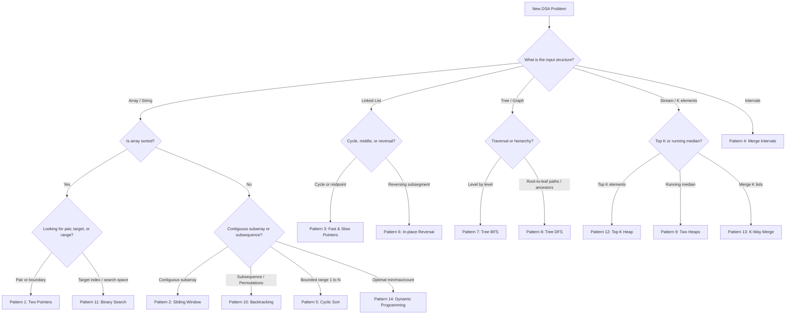

# DSA Track: Dual Python & Java
## Chapter 11: Top 50 DSA Interview Problems & The 14 Algorithmic Patterns

This master reference catalogs the **Top 50 must-solve algorithmic problems** grouped by the **14 Core Algorithmic Patterns**. Memorizing individual problems fails; recognizing the underlying pattern succeeds.

---

### 🗺️ The 14 Algorithmic Patterns Matrix

**Real-World Industry Applications of these Patterns:**
- **Two Pointers:** Two-way data sync, finding boundaries in log files.
- **Sliding Window:** Rate limiting (e.g., token bucket algorithms in NGINX), real-time moving averages.
- **Fast & Slow Pointers:** Cycle detection in distributed deadlocks.
- **Merge Intervals:** Calendar scheduling (Google Calendar), CPU task scheduling.
- **Tree BFS:** Web crawlers, broadcasting in networks.
- **Top 'K' Elements:** Recommender systems, finding top trends.

| # | Pattern | When to Use | Classic Problems | Primary Complexity |
| :- | :--- | :--- | :--- | :--- |
| **1** | **Two Pointers** | Sorted array; finding pairs, triplets, or palindrome boundaries | Two Sum II, 3Sum, Container With Most Water | $O(N)$ time, $O(1)$ space |
| **2** | **Sliding Window** | Contiguous subarrays/substrings satisfying sum or uniqueness | Longest Substring Without Repeating, Min Window Substring | $O(N)$ time, $O(K)$ space |
| **3** | **Fast & Slow Pointers** | Cyclic structures, finding middle of linked list or cycle start | LinkedList Cycle II, Middle of LinkedList, Happy Number | $O(N)$ time, $O(1)$ space |
| **4** | **Merge Intervals** | Overlapping time intervals, calendar scheduling | Merge Intervals, Insert Interval, Non-overlapping Intervals | $O(N \log N)$ time, $O(N)$ space |
| **5** | **Cyclic Sort** | Arrays containing numbers in a bounded range $1 \to N$ | Find Missing Number, First Missing Positive | $O(N)$ time, $O(1)$ space |
| **6** | **In-place Reversal** | Reversing sublists of linked lists without extra allocation | Reverse LinkedList II, Reverse Nodes in k-Group | $O(N)$ time, $O(1)$ space |
| **7** | **Tree BFS** | Level-by-level traversal, minimum depth, zigzag order | Level Order Traversal, Right View of Binary Tree | $O(N)$ time, $O(W)$ space |
| **8** | **Tree DFS** | Path sums, ancestor relationships, tree validation | Max Path Sum, Diameter of Binary Tree, Serialize Tree | $O(N)$ time, $O(H)$ space |
| **9** | **Two Heaps** | Continuous dynamic calculation of median from a stream | Find Median from Data Stream, IPO Capital Maximization | $O(\log N)$ insert, $O(1)$ peek |
| **10** | **Subsets / Backtracking** | Generating all permutations, combinations, or decision trees | Subsets, Permutations, Combination Sum, Word Search | $O(2^N)$ or $O(N!)$ |
| **11** | **Modified Binary Search**| Searching rotated arrays, matrixes, or unknown ranges | Search in Rotated Array, Find Peak Element | $O(\log N)$ time, $O(1)$ space |
| **12** | **Top 'K' Elements** | Finding K largest, most frequent, or closest elements | Kth Largest Element, Top K Frequent, K Closest Points | $O(N \log K)$ with Min-Heap |
| **13** | **K-way Merge** | Merging $K$ sorted lists, matrices, or data streams | Merge K Sorted Lists, Kth Smallest Element in Sorted Matrix | $O(N \log K)$ with Min-Heap |
| **14** | **Dynamic Programming** | Overlapping subproblems, optimization (min/max/ways) | Coin Change, LIS, Longest Common Subsequence, Edit Distance | $O(N)$ to $O(N^2)$ |

> 💡 **Interview Tip**
> If you are stuck on a problem, try running through this list of 14 patterns in your head. Ask yourself: "Is it a sliding window? Can I use a monotonic stack? What if I sort it and use two pointers?"

> 📺 **Video References**
> - [NeetCode 150 List](https://www.youtube.com/@NeetCode)
> - [Gaurav Sen - System Design & DSA](https://www.youtube.com/@GauravSensei)

> 📖 **Must-Read Resources**
> - [LeetCode Patterns List](https://leetcode.com/discuss/general-discussion/460599/blind-75-leetcode-questions)
> - [Algorithm Visualizer](https://algorithm-visualizer.org/)

---

### 📋 The Top 50 LeetCode Problem Cheat Sheet

| # | Problem Name | Pattern | Difficulty | Time Complexity | Space Complexity | Core Intuition |
| :--- | :--- | :--- | :--- | :--- | :--- | :--- |
| **1** | [Two Sum](https://leetcode.com/problems/two-sum/) | Hashing | Easy | $O(N)$ | $O(N)$ | Store complement in hash map |
| **2** | [Group Anagrams](https://leetcode.com/problems/group-anagrams/) | Hashing | Medium | $O(N \cdot K)$ | $O(N \cdot K)$ | 26-char frequency tuple as map key |
| **3** | [Top K Frequent Elements](https://leetcode.com/problems/top-k-frequent-elements/) | Bucket Sort | Medium | $O(N)$ | $O(N)$ | Frequencies as array indices |
| **4** | [Longest Consecutive Sequence](https://leetcode.com/problems/longest-consecutive-sequence/) | Hash Set | Medium | $O(N)$ | $O(N)$ | Only start count if `num - 1` not in set |
| **5** | [Valid Palindrome](https://leetcode.com/problems/valid-palindrome/) | Two Pointers | Easy | $O(N)$ | $O(1)$ | Left/right inward pointer convergence |
| **6** | [3Sum](https://leetcode.com/problems/3sum/) | Two Pointers | Medium | $O(N^2)$ | $O(1)$ | Sort array; fix first element, two pointers |
| **7** | [Container With Most Water](https://leetcode.com/problems/container-with-most-water/) | Two Pointers | Medium | $O(N)$ | $O(1)$ | Always advance the shorter wall inward |
| **8** | [Trapping Rain Water](https://leetcode.com/problems/trapping-rain-water/) | Two Pointers | Hard | $O(N)$ | $O(1)$ | Maintain `left_max` and `right_max` |
| **9** | [Longest Substring Without Repeating Characters](https://leetcode.com/problems/longest-substring-without-repeating-characters/) | Sliding Window | Medium | $O(N)$ | $O(M)$ | Window expansion with last seen index |
| **10**| [Minimum Window Substring](https://leetcode.com/problems/minimum-window-substring/) | Sliding Window | Hard | $O(N)$ | $O(M)$ | Expand right until valid; contract left |
| **11**| [Valid Parentheses](https://leetcode.com/problems/valid-parentheses/) | Stack | Easy | $O(N)$ | $O(N)$ | Push opening bracket; pop & match closing |
| **12**| [Min Stack](https://leetcode.com/problems/min-stack/) | Stack | Medium | $O(1)$ | $O(N)$ | Pair stack with running minimum stack |
| **13**| [Daily Temperatures](https://leetcode.com/problems/daily-temperatures/) | Monotonic Stack | Medium | $O(N)$ | $O(N)$ | Monotonic decreasing stack of indices |
| **14**| [Largest Rectangle in Histogram](https://leetcode.com/problems/largest-rectangle-in-histogram/) | Monotonic Stack | Hard | $O(N)$ | $O(N)$ | Monotonic increasing stack; pop on shorter |
| **15**| [Sliding Window Maximum](https://leetcode.com/problems/sliding-window-maximum/) | Monotonic Queue | Hard | $O(N)$ | $O(K)$ | Deque maintaining decreasing order |
| **16**| [Search in Rotated Sorted Array](https://leetcode.com/problems/search-in-rotated-sorted-array/) | Binary Search | Medium | $O(\log N)$ | $O(1)$ | One half is always sorted; check boundary |
| **17**| [Find Minimum in Rotated Sorted Array](https://leetcode.com/problems/find-minimum-in-rotated-sorted-array/) | Binary Search | Medium | $O(\log N)$ | $O(1)$ | Compare `mid` with `high` |
| **18**| [Koko Eating Bananas](https://leetcode.com/problems/koko-eating-bananas/) | BS on Solution | Medium | $O(N \log M)$ | $O(1)$ | Monotonic search on eating speed $k$ |
| **19**| [Median of Two Sorted Arrays](https://leetcode.com/problems/median-of-two-sorted-arrays/) | Binary Search | Hard | $O(\log(\min(M, N)))$ | $O(1)$ | Binary search on partition line of smaller array |
| **20**| [Reverse Linked List](https://leetcode.com/problems/reverse-linked-list/) | Linked List | Easy | $O(N)$ | $O(1)$ | 3-pointer swap (`prev`, `curr`, `next`) |
| **21**| [Merge Two Sorted Lists](https://leetcode.com/problems/merge-two-sorted-lists/) | Linked List | Easy | $O(N + M)$ | $O(1)$ | Dummy head node; stitch smaller next |
| **22**| [Reorder List](https://leetcode.com/problems/reorder-list/) | Linked List | Medium | $O(N)$ | $O(1)$ | Find middle $\to$ reverse second half $\to$ merge |
| **23**| [Remove Nth Node From End](https://leetcode.com/problems/remove-nth-node-from-end-of-list/) | Fast & Slow | Medium | $O(N)$ | $O(1)$ | Fast pointer advances $N$ steps ahead |
| **24**| [Linked List Cycle II](https://leetcode.com/problems/linked-list-cycle-ii/) | Fast & Slow | Medium | $O(N)$ | $O(1)$ | Meeting point collision; restart from head |
| **25**| [LRU Cache](https://leetcode.com/problems/lru-cache/) | Hash + Doubly LL | Medium | $O(1)$ | $O(C)$ | Hash map to node + Doubly linked list |
| **26**| [Invert Binary Tree](https://leetcode.com/problems/invert-binary-tree/) | Tree DFS | Easy | $O(N)$ | $O(H)$ | Recursively swap left and right pointers |
| **27**| [Maximum Depth of Binary Tree](https://leetcode.com/problems/maximum-depth-of-binary-tree/) | Tree DFS | Easy | $O(N)$ | $O(H)$ | $1 + \max(\text{left}, \text{right})$ |
| **28**| [Diameter of Binary Tree](https://leetcode.com/problems/diameter-of-binary-tree/) | Tree DFS | Easy | $O(N)$ | $O(H)$ | Update global max with `left_h + right_h` |
| **29**| [Lowest Common Ancestor of BST](https://leetcode.com/problems/lowest-common-ancestor-of-a-binary-search-tree/) | Tree BST | Medium | $O(H)$ | $O(1)$ | Split point where $p \le \text{root} \le q$ |
| **30**| [Lowest Common Ancestor of BT](https://leetcode.com/problems/lowest-common-ancestor-of-a-binary-tree/) | Tree DFS | Medium | $O(N)$ | $O(H)$ | Both branches return non-null $\implies$ LCA |
| **31**| [Binary Tree Level Order Traversal](https://leetcode.com/problems/binary-tree-level-order-traversal/) | Tree BFS | Medium | $O(N)$ | $O(W)$ | Queue processing size of each level |
| **32**| [Validate Binary Search Tree](https://leetcode.com/problems/validate-binary-search-tree/) | Tree DFS | Medium | $O(N)$ | $O(H)$ | Propagate valid range $(\text{low}, \text{high})$ |
| **33**| [Binary Tree Maximum Path Sum](https://leetcode.com/problems/binary-tree-maximum-path-sum/) | Tree DFS | Hard | $O(N)$ | $O(H)$ | Max path using node as turning apex |
| **34**| [Implement Trie (Prefix Tree)](https://leetcode.com/problems/implement-trie-prefix-tree/) | Trie | Medium | $O(L)$ | $O(N \cdot L)$ | 26-child array / hash map with boolean end |
| **35**| [Kth Largest Element in an Array](https://leetcode.com/problems/kth-largest-element-in-an-array/) | Min-Heap | Medium | $O(N \log K)$ | $O(K)$ | Min-heap of size $K$; pop smaller elements |
| **36**| [Find Median from Data Stream](https://leetcode.com/problems/find-median-from-data-stream/) | Two Heaps | Hard | $O(\log N)$ | $O(N)$ | Max-heap (lower half) + Min-heap (upper half) |
| **37**| [Merge K Sorted Lists](https://leetcode.com/problems/merge-k-sorted-lists/) | Min-Heap | Hard | $O(N \log K)$ | $O(K)$ | Min-heap holding current heads of $K$ lists |
| **38**| [Number of Islands](https://leetcode.com/problems/number-of-islands/) | Graph BFS/DFS | Medium | $O(M \cdot N)$ | $O(M \cdot N)$ | Sink connected '1's into '0's |
| **39**| [Clone Graph](https://leetcode.com/problems/clone-graph/) | Graph DFS | Medium | $O(V + E)$ | $O(V)$ | Hash map mapping old node $\to$ new node |
| **40**| [Course Schedule](https://leetcode.com/problems/course-schedule/) | Graph Cycle | Medium | $O(V + E)$ | $O(V + E)$ | 3-state DFS or Kahn's indegree algorithm |
| **41**| [Network Delay Time](https://leetcode.com/problems/network-delay-time/) | Dijkstra | Medium | $O(E \log V)$ | $O(V + E)$ | Min-heap prioritizing shortest distance |
| **42**| [Redundant Connection](https://leetcode.com/problems/redundant-connection/) | Union-Find | Medium | $O(N)$ | $O(N)$ | Union by rank with path compression |
| **43**| [Subsets](https://leetcode.com/problems/subsets/) | Backtracking | Medium | $O(2^N)$ | $O(N)$ | Decision tree: include or exclude element |
| **44**| [Combination Sum](https://leetcode.com/problems/combination-sum/) | Backtracking | Medium | $O(2^T)$ | $O(T)$ | Branch with element reuse until target hits 0 |
| **45**| [N-Queens](https://leetcode.com/problems/n-queens/) | Backtracking | Hard | $O(N!)$ | $O(N)$ | Track cols, pos diagonals, neg diagonals |
| **46**| [Climbing Stairs](https://leetcode.com/problems/climbing-stairs/) | 1D DP | Easy | $O(N)$ | $O(1)$ | Fibonacci base: $dp[i] = dp[i-1] + dp[i-2]$ |
| **47**| [Coin Change](https://leetcode.com/problems/coin-change/) | 1D DP | Medium | $O(N \cdot A)$ | $O(A)$ | $dp[a] = \min(dp[a], 1 + dp[a - c])$ |
| **48**| [Longest Increasing Subsequence](https://leetcode.com/problems/longest-increasing-subsequence/) | DP + Binary Search | Medium | $O(N \log N)$ | $O(N)$ | Patience sorting / `bisect_left` tails array |
| **49**| [Longest Common Subsequence](https://leetcode.com/problems/longest-common-subsequence/) | 2D DP | Medium | $O(M \cdot N)$ | $O(M \cdot N)$ | Diagonal if match; max(left, top) if mismatch |
| **50**| [Edit Distance](https://leetcode.com/problems/edit-distance/) | 2D DP | Hard | $O(M \cdot N)$ | $O(M \cdot N)$ | $1 + \min(\text{insert}, \text{delete}, \text{replace})$ |
