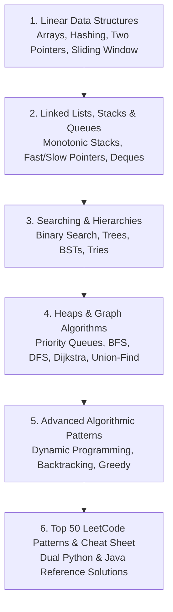
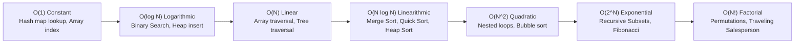

# 🧩 Data Structures & Algorithms (DSA) Master Track
### Dual-Language Implementation: Python 3 & Java 17+

Welcome to the **Comprehensive DSA Track** engineered for technical interviews at FAANG, top-tier product companies, and enterprise architecture teams. 

This curriculum follows the gold standard of modern algorithmic pedagogy (similar to NeetCode 150, Striver's SDE Sheet, and MIT 6.006), featuring **14 Core Algorithmic Patterns** with dual **Python** and **Java** reference implementations, time/space complexity analysis, and standard course best practices.

---

## 🗺️ Master Algorithmic Curriculum

---

## 📚 Chapter Directory

1. **[01-arrays-and-hashing.md](file:///D:/Projects/interview-material/dsa/01-arrays-and-hashing.md)**
   - Dynamic Arrays internals (Amortized $O(1)$ resizing, geometric doubling in Python `list` vs Java `ArrayList`)
   - Hash Maps internals (Bucketing, hash collision resolution: Chaining vs Open Addressing, load factors)
   - Problems: Two Sum, Group Anagrams, Top K Frequent Elements, Longest Consecutive Sequence.

2. **[02-two-pointers-and-sliding-window.md](file:///D:/Projects/interview-material/dsa/02-two-pointers-and-sliding-window.md)**
   - Two Pointers: Opposite Ends, Same Direction (Fast/Slow), Two Arrays
   - Sliding Window: Fixed Size vs Dynamic Expanding/Shrinking Window
   - Problems: 3Sum, Container With Most Water, Trapping Rain Water, Minimum Window Substring, Longest Substring Without Repeating Characters.

3. **[03-linked-lists.md](file:///D:/Projects/interview-material/dsa/03-linked-lists.md)**
   - Singly, Doubly, and Circular Linked Lists
   - Fast & Slow Pointer Strategy (Floyd’s Cycle-Finding Algorithm)
   - In-place Pointer Reversals (Dummy head patterns)
   - Problems: Reverse Linked List, Merge Two Sorted Lists, Reorder List, Remove Nth Node From End, LRU Cache.

4. **[04-stacks-and-queues.md](file:///D:/Projects/interview-material/dsa/04-stacks-and-queues.md)**
   - Stack LIFO vs Queue FIFO mechanics (Deque, Ring Buffers)
   - Monotonic Stack Pattern (Increasing vs Decreasing order)
   - Monotonic Queue for sliding window extrema
   - Problems: Valid Parentheses, Min Stack, Daily Temperatures, Largest Rectangle in Histogram, Sliding Window Maximum.

5. **[05-binary-search.md](file:///D:/Projects/interview-material/dsa/05-binary-search.md)**
   - Binary Search on Sorted Arrays (Boundary conditions, avoiding integer overflow: `low + (high - low) / 2`)
   - Binary Search on Solution Space (Monotonic predicate functions: `isPossible(x)`)
   - Problems: Search in Rotated Sorted Array, Find Minimum in Rotated Sorted Array, Koko Eating Bananas, Median of Two Sorted Arrays.

6. **[06-trees-and-tries.md](file:///D:/Projects/interview-material/dsa/06-trees-and-tries.md)**
   - Tree Traversals: Recursive vs Iterative DFS (Pre-order, In-order, Post-order) and BFS Level-order
   - Binary Search Trees (BST properties, validation, balance factors in AVL/Red-Black)
   - Trie (Prefix Tree) for efficient string searching and autocomplete
   - Problems: Maximum Depth, Invert Binary Tree, Lowest Common Ancestor (LCA), Binary Tree Maximum Path Sum, Implement Trie.

7. **[07-heaps-and-priority-queues.md](file:///D:/Projects/interview-material/dsa/07-heaps-and-priority-queues.md)**
   - Binary Heap internals: Array representation, Sift-Up ($O(\log N)$) and Sift-Down ($O(\log N)$), `heapify` in $O(N)$
   - Two Heaps Pattern (Min-Heap + Max-Heap for streaming medians)
   - Problems: Kth Largest Element in an Array, Find Median from Data Stream, Merge K Sorted Lists, Task Scheduler.

8. **[08-graphs-and-union-find.md](file:///D:/Projects/interview-material/dsa/08-graphs-and-union-find.md)**
   - Graph representations: Adjacency Matrix vs Adjacency List
   - Traversal & Cycle Detection: BFS, DFS (Directed vs Undirected)
   - Topological Sort: Kahn’s Algorithm (Indegrees) vs DFS Post-Order
   - Shortest Path: Dijkstra’s Algorithm ($O((V + E) \log V)$), Bellman-Ford
   - Disjoint Set Union (DSU / Union-Find) with Path Compression and Union by Rank
   - Problems: Number of Islands, Course Schedule I & II, Clone Graph, Network Delay Time, Redundant Connection.

9. **[09-dynamic-programming.md](file:///D:/Projects/interview-material/dsa/09-dynamic-programming.md)**
   - The DP Framework: Optimal Substructure + Overlapping Subproblems
   - Top-Down with Memoization vs Bottom-Up Tabulation (Space optimization)
   - 1D DP: Climbing Stairs, House Robber, Coin Change, Longest Increasing Subsequence (LIS)
   - 2D / Grid DP: Unique Paths, 0/1 Knapsack, Longest Common Subsequence (LCS), Edit Distance.

10. **[10-backtracking-and-greedy.md](file:///D:/Projects/interview-material/dsa/10-backtracking-and-greedy.md)**
    - Backtracking State-Space Trees: Choice, Constraints, Goal
    - Greedy Algorithm Proofs: Greedy Choice Property + Optimal Substructure
    - Problems: Subsets, Permutations, Combination Sum, N-Queens, Jump Game, Gas Station, Meeting Rooms.

11. **[11-top-50-dsa-interview-problems.md](file:///D:/Projects/interview-material/dsa/11-top-50-dsa-interview-problems.md)**
    - The Top 50 LeetCode interview questions curated across all 14 patterns with time/space complexities and key takeaways in Python and Java.

---

## ⚡ Big-O Time & Space Complexity Reference

