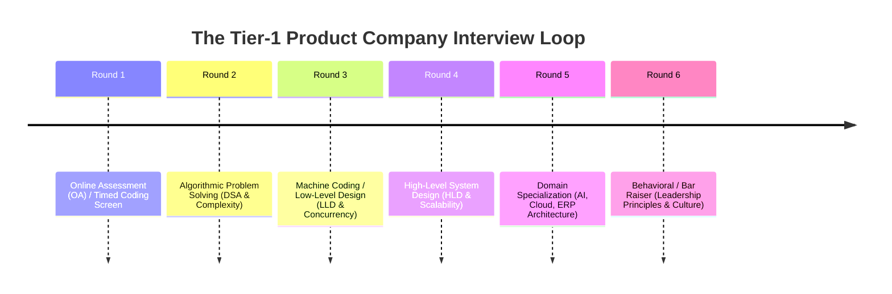
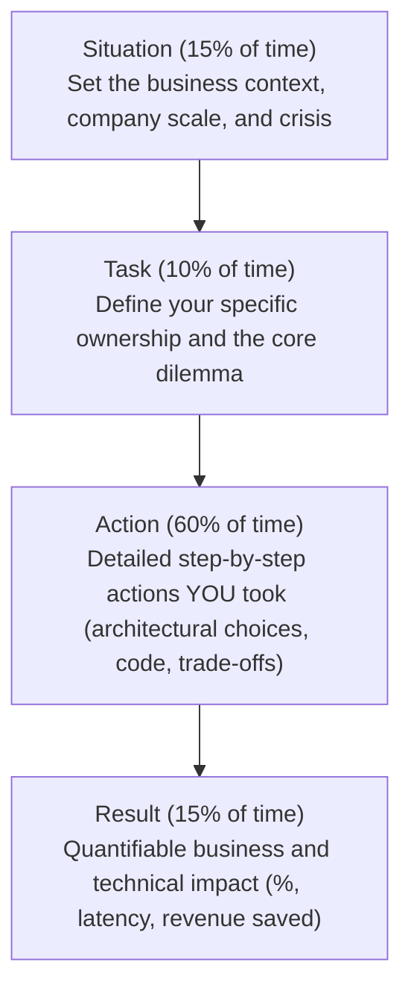

# 🏢 Product-Based Company (PBC) Interview Playbook & Master Question Bank
### FAANG • Tier-1 Product Companies • Unicorns • Enterprise Platforms

This playbook analyzes how top-tier product companies (Google, Meta, Amazon, Microsoft, Uber, Stripe, Atlassian, Apple) evaluate Senior Engineers, Technical Leads, and Solution Architects across every interview round.

---

## 🧭 The 6-Round PBC Interview Loop

---

## 🎯 Company-Specific Hiring Evaluation Focus

### 1. Google
- **Focus**: Algorithmic correctness, optimal mathematical bounds, clean modular code, handling unseen edge cases.
- **Style**: Often gives minimal problem descriptions and expects the candidate to ask clarifying questions to discover hidden assumptions.
- **Googliness**: Humility, collaborative thinking, intellectual curiosity, bias for action without ego.

### 2. Meta (Facebook)
- **Focus**: Raw coding velocity and execution speed.
- **Requirement**: Expects you to solve **two LeetCode Medium/Hard problems completely within 45 minutes**, including optimal code and manual dry-runs.
- **System Design**: Heavy focus on high-concurrency feeds, real-time messaging, caching layers, and database sharding.

### 3. Amazon
- **Focus**: The **16 Leadership Principles (LPs)** + Practical software engineering.
- **The Bar Raiser Round**: An independent interviewer outside the hiring team with veto power.
- **Evaluation**: Every technical round is split: 20 minutes on behavioral LP questions using the **STAR Method**, and 25–30 minutes on Coding/System Design.

### 4. Uber / Swiggy / Stripe / Atlassian
- **Focus**: **Machine Coding / Low-Level Design (LLD)**.
- **Requirement**: Build a fully functional, object-oriented, thread-safe application (e.g. Splitwise, Movie Ticket Booking, Rate Limiter, In-Memory DB) in 90 minutes. Code must be extensible, follow SOLID principles, and compile with clean unit tests.

---

## 💼 Behavioral & Leadership: The STAR Method Master Matrix

Senior and Lead candidates fail the "Bar Raiser" when they speak in vague generalities ("We delivered the project"). You must frame every answer using the **STAR Method** (Situation, Task, Action, Result):

### Top 10 Senior Leadership Behavioral Questions & Ideal Answers

#### 1. "Tell me about a time you had a fundamental technical disagreement with a colleague or manager. How did you resolve it?"
- **Bad Answer**: "I argued my point until they agreed because I had more experience."
- **High-Scoring STAR Response**:
  - *Situation*: During an enterprise ERP payment redesign, our team debated whether to use synchronous HTTP redirects or asynchronous webhooks to confirm $5M/month in transactions. The product manager wanted synchronous redirects for faster UI feedback.
  - *Task*: As Technical Lead, I needed to protect transaction consistency and prevent customer balance discrepancies without alienating the product team.
  - *Action*: Rather than debating opinions, I built a quick prototype demonstrating that 4% of mobile checkouts failed due to network drops when users closed tabs before redirection completed. I proposed a hybrid model: immediate optimistic UI feedback backed by asynchronous webhook reconciliation with HMAC cryptographic signatures and idempotency keys.
  - *Result*: The team unanimously adopted the webhook architecture. In production, payment reconciliation discrepancies dropped to 0%, saving estimated $200k in monthly chargeback investigations.

#### 2. "Describe a major production outage you led the resolution for. What was the root cause?"
- **High-Scoring STAR Response**:
  - *Situation*: During Black Friday peak, our core PostgreSQL database CPU spiked to 100%, causing transaction deadlocks and HTTP 504 timeouts across checkout.
  - *Task*: Restore service immediately while identifying root cause under extreme time pressure.
  - *Action*: I triaged active connections via `pg_stat_activity` and identified circular row locking between concurrent inventory reservations. I initiated immediate mitigation: temporarily increased worker pool timeouts and routed non-critical analytics reads to read replicas. Within 25 minutes, I pushed a hotfix enforcing **deterministic lock ordering** (`records.sorted(key=lambda r: r.id)`), eliminating the circular wait condition.
  - *Result*: Database CPU normalized from 100% to 32%. I authored a blameless post-mortem, added pre-commit linters for query locks, and implemented integration tests simulating concurrent multi-row updates.

#### 3. "How do you manage technical debt when product managers pressure for rapid feature delivery?"
- **High-Scoring STAR Response**:
  - *Approach*: Never present technical debt as "clean code for developers"; frame it in business terms: **developer velocity, regression risk, and infrastructure cost**.
  - *Action*: Negotiate a recurring **20% engineering allocation rule**: in every 2-week sprint, 80% is dedicated to business deliverables, and 20% is strictly reserved for architectural improvements, index optimizations, and refactoring. Track technical debt as formal Jira tickets with estimated business ROI.

---

## 📚 Master Question Bank Categorized by Round

### Category A: Algorithmic Problem Solving (DSA)
1. **Arrays & Strings**:
   - Trapping Rain Water (Two pointers, $O(N)$ time, $O(1)$ space).
   - Minimum Window Substring (Sliding window with frequency maps).
   - Product of Array Except Self ($O(1)$ extra space prefix/postfix).
   - Longest Consecutive Sequence (HashSet $O(N)$).
2. **Linked Lists**:
   - Reverse Nodes in k-Group.
   - LRU Cache (Hash Map + Doubly Linked List).
   - Merge K Sorted Lists (Min-Heap $O(N \log K)$).
3. **Stacks & Queues**:
   - Largest Rectangle in Histogram (Monotonic stack).
   - Sliding Window Maximum (Monotonic queue with deque).
4. **Trees & Graphs**:
   - Binary Tree Maximum Path Sum (DFS with bottom-up gain).
   - Lowest Common Ancestor.
   - Word Ladder (Bidirectional BFS).
   - Course Schedule II (Topological sort via Kahn's algorithm).
   - Alien Dictionary (Topological sort from word comparison).
5. **Dynamic Programming**:
   - Coin Change 1 & 2 (Unbounded knapsack).
   - Longest Increasing Subsequence ($O(N \log N)$ patience sort).
   - Edit Distance (2D DP).
   - Regular Expression Matching (2D DP with `.` and `*`).

---

### Category B: Low-Level Design (LLD & Machine Coding)
1. **Splitwise Expense Sharing System**:
   - Model Users, Expenses, Splits (Equal, Exact, Percent).
   - Thread-safe balance sheets and **Min-Cash-Flow debt simplification**.
2. **Movie Ticket Booking System (BookMyShow)**:
   - Theater, Screen, Show, Seat modeling.
   - Concurrency lock with 10-minute TTL to prevent double-booking.
3. **In-Memory Transactional Key-Value Store**:
   - `get`, `set`, `delete` with nested `BEGIN`, `COMMIT`, `ROLLBACK`.
4. **Distributed Rate Limiter**:
   - Token Bucket and Sliding Window Counter using atomic Redis Lua scripts.
5. **Parking Lot System**:
   - Multi-floor vehicle assignment with strategy pricing and spot locking.
6. **Elevator System**:
   - Multi-car elevator bank with LOOK/SCAN scheduling algorithm.

---

### Category C: High-Level System Design (HLD)
1. **Scalable Ride-Sharing Service (Uber / Lyft)**:
   - Geospatial indexing: QuadTree vs Geohash vs **Uber H3 hexagonal grid**.
   - 250,000 writes/sec location streaming via WebSockets and Kafka.
2. **E-Commerce Marketplace (Amazon / Flipkart)**:
   - Product catalog search sync with Debezium CDC and Elasticsearch.
   - Cart persistence and **Saga checkout orchestrator** for inventory and payments.
3. **Real-Time News Feed (Twitter / X)**:
   - Fanout-on-write vs Fanout-on-read hybrid model for celebrity accounts.
4. **Scalable Notification Service**:
   - Multi-channel push/SMS/email, priority queues, template rendering, and deduplication.
5. **Enterprise RAG Platform at Scale**:
   - Multi-tenant vector filtering, GPU embedding batching, hybrid search, and Cross-Encoder re-ranking.
6. **Resilient LLM Gateway / Proxy**:
   - Multi-provider dynamic failover, semantic caching with Redis, and token budget caps.

---

## 🏆 Final Preparation Checklist for the Candidate

- [ ] Can you implement **LRU Cache** from scratch in under 15 minutes?
- [ ] Can you write **Binary Search** without integer overflow and with correct boundary conditions?
- [ ] Can you explain **CAP vs PACELC** and why "CA" is not a valid distributed systems choice?
- [ ] Can you calculate the exact **KV cache GPU VRAM** required for 1,000 concurrent users on a 70B model?
- [ ] Can you describe the **Transactional Outbox Pattern** and explain how it solves the dual-write problem?
- [ ] Can you execute an **Odoo N+1 query diagnosis** and explain how `read_group` fixes it?
- [ ] Can you walk a CFO through **ASC 606 Revenue Recognition** and perpetual inventory journal entries?
- [ ] Do you have 4 concrete, quantified **STAR stories** prepared for leadership, conflict, and production outages?
