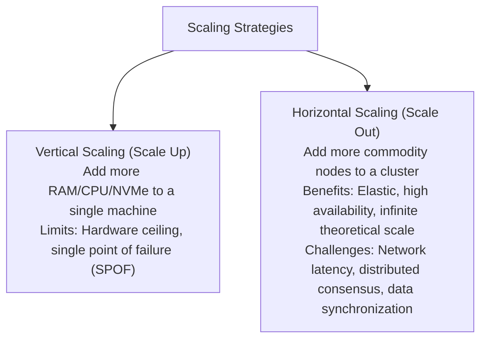
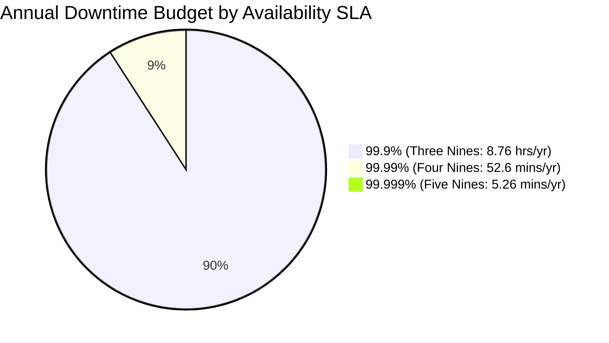
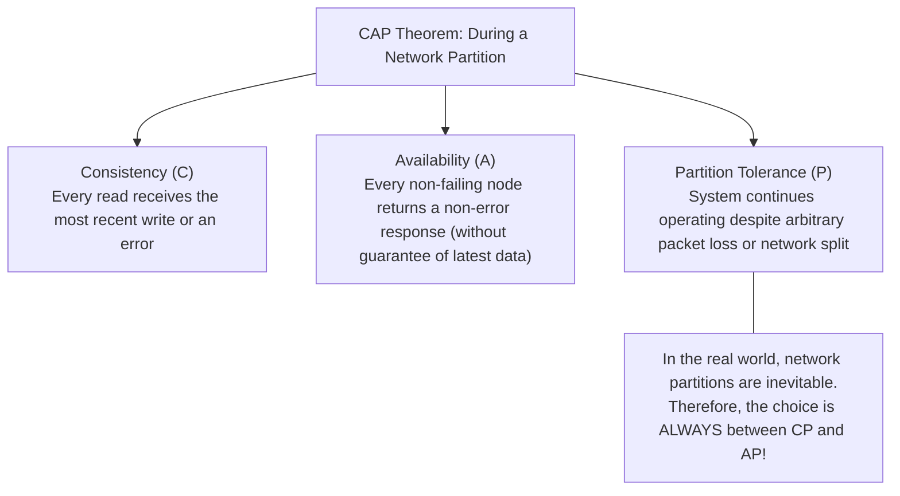
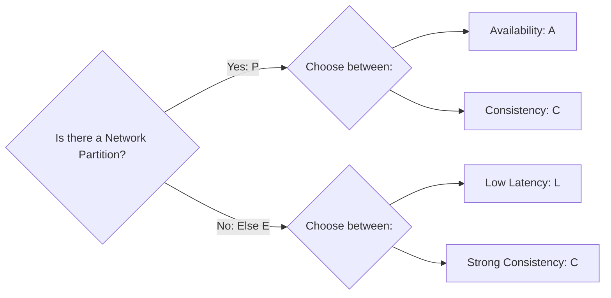
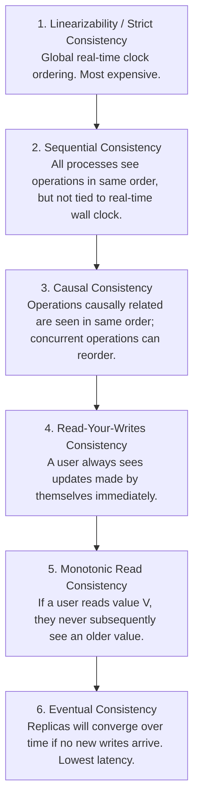

# Track 3: System Design
## Chapter 1: Fundamentals of Scalability, CAP/PACELC & Consistency Models

> 🧭 **Navigation**: ⇤ First Chapter | [🏠 System Design Track Index](README.md) | [➡️ Next: 02: Networking, Proxies & Gateways](02-networking-and-proxies.md)

---

Every scalable architecture begins with trade-offs. There is no such thing as a "perfect" distributed system; every architectural decision trades latency, consistency, availability, or operational complexity.

---

### 1. Scaling Paradigms: Vertical vs Horizontal



| Dimension | Vertical Scaling (Scale Up) | Horizontal Scaling (Scale Out) |
| :--- | :--- | :--- |
| **Complexity** | Zero application changes | Requires load balancers, stateless servers, distributed data stores |
| **Hardware Limits** | Hard limit (e.g. 128 cores, 4TB RAM) | Virtually unlimited |
| **Fault Tolerance** | Single Point of Failure (SPOF) | Built-in redundancy (node loss does not kill system) |
| **Cost Curve** | Exponential (specialized enterprise hardware) | Linear (commodity cloud instances) |

**Real-World Industry Examples**:
- **StackOverflow**: Historically scaled vertically, running on just 9 massive bare-metal SQL Server machines to handle billions of monthly page views, minimizing distributed caching complexity.
- **Netflix**: Scaled horizontally across tens of thousands of AWS EC2 instances. If a zone fails, traffic routes to another zone transparently.
- **WhatsApp**: Achieved extreme vertical scaling on Erlang nodes, maintaining millions of concurrent WebSocket connections on a single server before scaling horizontally.

> 💡 **Interview Tip**
> If an interviewer asks to build a system for an internal tool with 1,000 DAU, don't default to a complex microservices architecture. Suggest a monolithic architecture with vertical scaling first (like an AWS RDS Postgres instance with increasing instance sizes). Only introduce horizontal scaling when data volume or throughput truly necessitates it.

> 📺 **Video References**
> - ByteByteGo: Scale from Zero to Millions of Users - https://www.youtube.com/@ByteByteGo
> - Gaurav Sen: System Design Basics: Horizontal vs Vertical Scaling - https://www.youtube.com/@GauravSensei

> 📖 **Must-Read Resources**
> - AWS Architecture Blog: Scaling Up to Your First 10 Million Users - https://aws.amazon.com/blogs/architecture/
> - High Scalability: The WhatsApp Architecture - http://highscalability.com

---

### 2. High Availability & The Mathematics of "Nines"

Availability is the percentage of time a system remains operational and responsive to client requests over a given period.

$$\text{Availability} = \frac{\text{Total Uptime}}{\text{Total Uptime} + \text{Downtime}}$$



#### Downtime Budget Reference Table:
| Availability SLA | Downtime per Day | Typical System Class |
| :--- | :--- | :--- |
| **99.9% (Three Nines)**| 86.4 seconds | Standard SaaS web services |
| **99.99% (Four Nines)**| 8.64 seconds | Tier-1 eCommerce, payment gateways |
| **99.999% (Five Nines)**| 864 milliseconds| Global telecoms, core banking ledgers |

**Capacity Estimation Example**:
If you are designing a payment gateway handling 1,000 TPS, an SLA of 99.99% means only ~52.6 minutes of downtime per year. During that downtime, 1,000 * 60 * 52.6 = 3,156,000 transactions could be lost. This dictates an Active-Active multi-region deployment.

**Real-World Industry Examples**:
- **AWS S3**: Designed to provide 99.999999999% (11 nines) of durability and 99.99% availability.
- **Google Search**: Utilizes global load balancing to achieve effectively 100% perceived uptime for end-users, routing traffic around failing data centers in milliseconds.
- **Uber**: Implements graceful degradation. If the precise ETA routing service goes down, it falls back to a simpler heuristic, keeping the app available for booking rides even if sub-systems fail.

> 💡 **Interview Tip**
> Always clarify the availability requirements with your interviewer. Do not over-engineer for 5 nines if the product only needs 3 nines. Discuss "Graceful Degradation"—how your system behaves when components fail.

> 📺 **Video References**
> - GOTO Conferences: LMAX Architecture - How to handle 100K TPS
> - ByteByteGo: High Availability and Disaster Recovery - https://www.youtube.com/@ByteByteGo

> 📖 **Must-Read Resources**
> - Netflix Tech Blog: Fault Tolerance in a High Volume, Distributed System - https://netflixtechblog.com
> - The System Design Primer: Availability in Distributed Systems - https://github.com/donnemartin/system-design-primer

---

### 3. The CAP Theorem & Why 2 of 3 is a Misnomer

Formulated by Eric Brewer and mathematically proven by Gilbert and Lynch, the **CAP Theorem** states that in any asynchronous network subject to partitions, a distributed data store can guarantee at most two out of three properties:



> [!IMPORTANT]
> **The Senior Interview Truth About CAP**:
> You cannot "choose CA". Network cables break, switches fail, and cloud availability zones experience latency spikes. Network partitions (P) are a physical reality. Therefore, distributed system design is strictly: **When a partition occurs, do you choose Consistency (CP) or Availability (AP)?**

1. **CP Systems (Consistency + Partition Tolerance)**:
   - Refuses writes and reads rather than serving potentially stale or conflicting data during a partition.
   - Use cases: Banking account balances, inventory reservation, leader election.
2. **AP Systems (Availability + Partition Tolerance)**:
   - Replicas accept reads and writes even when isolated. Resolves conflicts asynchronously once the network heals.
   - Use cases: Social media feeds, product reviews, shopping cart additions.

**Real-World Industry Examples**:
- **Amazon DynamoDB**: Originally designed as an AP system (as described in the Dynamo paper) to ensure users could always add items to their shopping carts, prioritizing availability.
- **Google Spanner**: Functionally a CP system that provides high availability (often colloquially called "CA") by using TrueTime GPS atomic clocks to tightly synchronize commit timestamps globally.
- **Cassandra**: A classic AP system where tunable consistency allows clients to specify quorum reads/writes, often used for massive log ingestion and user activity tracking.

> 💡 **Interview Tip**
> When discussing CAP, immediately mention that network partitions are unavoidable. Frame your design decisions around what happens to the user experience during a partition. Does the user see stale data (AP) or an error/loading screen (CP)?

> 📺 **Video References**
> - MIT 6.824: Distributed Systems - Lecture 1 - https://www.youtube.com/playlist?list=PLrw6a1wE39_tb2fErI4-WkMbsvGQk9_UB
> - Martin Kleppmann: Distributed Systems - https://www.youtube.com/playlist?list=PLeKd45zvjcDFUEv_ohr_HdUFe97RIt8b

> 📖 **Must-Read Resources**
> - Original Dynamo Paper (2007) - https://www.allthingsdistributed.com/files/amazon-dynamo-sosp2007.pdf
> - Cloudflare Blog: How we handle state - https://blog.cloudflare.com

---

### 4. The PACELC Theorem: The Complete Picture

The CAP theorem only describes behavior *during a partition*. But partitions are rare (e.g. 0.01% of the time). How does a system behave during normal operations?

The **PACELC Theorem** (Daniel Abadi) extends CAP:

$$\text{If } \mathbf{P} \text{ (Partition): Choose } \mathbf{A} \text{ or } \mathbf{C} \quad \mathbf{E} \text{ (Else): Choose } \mathbf{L} \text{ (Latency) or } \mathbf{C} \text{ (Consistency)}$$



- **PA/EL**: When partitioned, prioritize **Availability**; Else, prioritize **Latency** (e.g. **DynamoDB, Cassandra**).
- **PC/EC**: When partitioned, prioritize **Consistency**; Else, prioritize **Consistency** (e.g. **Bigtable, MongoDB, Spanner**).

**Real-World Industry Examples**:
- **MongoDB**: Is a PC/EC system. It prioritizes consistency over availability during partitions (majority voting required for primary election), and during normal operations, it reads from the primary to ensure strong consistency by default.
- **Cassandra**: Is a PA/EL system. It accepts writes locally (fast latency, E->L) and remains available during partitions (P->A), heavily leaning on eventual consistency.
- **VoltDB**: Is a PC/EC system designed for strict ACID transactions in distributed environments.

> 💡 **Interview Tip**
> Bringing up PACELC when an interviewer asks about CAP is a massive positive signal. It shows you understand that systems spend 99.99% of their time *not* partitioned, and you must make a conscious trade-off between Latency and Consistency during normal operations.

> 📺 **Video References**
> - Odoo YouTube: System Architecture Deep Dives - https://www.youtube.com/@Odoo
> - ByteByteGo: CAP Theorem and PACELC - https://www.youtube.com/@ByteByteGo

> 📖 **Must-Read Resources**
> - Abadi's original PACELC blog post - http://dbmsmusings.blogspot.com/2010/04/problems-with-cap-and-yahoos-little.html
> - Uber Engineering: Designing Schema-less Datastore - https://www.uber.com/en-US/blog/engineering/

---

### 5. ACID vs BASE

| Property | ACID (Traditional RDBMS) | BASE (Distributed NoSQL) |
| :--- | :--- | :--- |
| **Core Philosophy** | Pessimistic, strict guarantees | Optimistic, high throughput & availability |
| **A** | **Atomicity**: All statements succeed or all rollback | **Basically Available**: System remains available despite node failures |
| **C / S** | **Consistency**: Moves DB from one valid state to another | **Soft State**: System state may drift over time without inputs |
| **I** | **Isolation**: Concurrent transactions do not cross-contaminate | - |
| **D / E** | **Durability**: Committed data survives system crashes | **Eventual Consistency**: Given no updates, all replicas converge |

**Real-World Industry Examples**:
- **Stripe**: Relies strictly on ACID properties using PostgreSQL and custom distributed locks to process billions of dollars without financial anomalies.
- **Twitter/X**: Uses BASE semantics for their timeline cache (Memcached/Redis). It is perfectly fine if a tweet appears a few seconds late on a follower's timeline.
- **Uber**: Uses BASE for location updates (H3 spatial indexes). The exact GPS coordinate can be eventually consistent; strict ACID is unnecessary for high-frequency telematics.

> 💡 **Interview Tip**
> For financial systems, billing, or inventory management, always choose an ACID database. For social media feeds, analytics logs, or metrics ingestion, propose a BASE datastore.

> 📺 **Video References**
> - Stanford CS25: Database architectures - https://www.youtube.com/playlist?list=PLoROMvodv4rNiJRchCzutFw5ItR_ZEDY
> - ByteByteGo: ACID Transactions Explained - https://www.youtube.com/@ByteByteGo

> 📖 **Must-Read Resources**
> - PostgreSQL Docs: Transaction Isolation - https://www.postgresql.org/docs/
> - Martin Fowler Blog: Eventual Consistency - https://martinfowler.com

---

### 6. Distributed Consistency Models Spectrum

Consistency is not binary; it exists along a spectrum from strongest to weakest:



**Real-World Industry Examples**:
- **Facebook/Meta**: Implemented Read-Your-Writes consistency across global datacenters. When you post a status update, your subsequent reads are routed to the master datacenter for a short window to prevent you from seeing your own profile without the new post.
- **Google Spanner**: Provides Linearizable consistency globally, allowing distributed SQL queries that are mathematically proven to reflect true real-time transaction ordering.
- **Amazon S3**: Originally eventual consistency, but transitioned in 2020 to provide strong read-after-write consistency for all PUT and DELETE requests, greatly simplifying data lake pipelines.

#### Expanded Code Example: Read-Your-Writes Implementation Pattern

```python
# Python 3: Client-side routing logic for Read-Your-Writes
import time
from datetime import datetime

class DataRouter:
    def __init__(self, primary_db, replica_db, lag_buffer_sec=2.0):
        self.primary_db = primary_db
        self.replica_db = replica_db
        self.lag_buffer_sec = lag_buffer_sec
        
    def write_user_profile(self, user_id, data, session):
        # 1. Write to Primary
        self.primary_db.write(user_id, data)
        # 2. Record the write timestamp in user's session
        session['last_write_ts'] = time.time()
        return True

    def read_user_profile(self, user_id, session):
        last_write_ts = session.get('last_write_ts', 0)
        current_time = time.time()
        
        # 3. Check if we are within the replication lag window
        if (current_time - last_write_ts) < self.lag_buffer_sec:
            print("Routing to PRIMARY to ensure Read-Your-Writes")
            return self.primary_db.read(user_id)
        else:
            print("Routing to REPLICA for cheap reads")
            return self.replica_db.read(user_id)

# Test case
session = {}
router = DataRouter(primary_db="DB_PRIMARY", replica_db="DB_REPLICA")
router.write_user_profile("user_123", {"name": "Alice"}, session)
router.read_user_profile("user_123", session) # Routes to Primary
time.sleep(2.1)
router.read_user_profile("user_123", session) # Routes to Replica
```

```java
// Java 17: Implementation of Read-Your-Writes routing
import java.time.Instant;
import java.util.Map;
import java.util.HashMap;

public class DataRouter {
    private final Database primaryDb;
    private final Database replicaDb;
    private final long lagBufferMillis;

    public DataRouter(Database primaryDb, Database replicaDb, long lagBufferMillis) {
        this.primaryDb = primaryDb;
        this.replicaDb = replicaDb;
        this.lagBufferMillis = lagBufferMillis;
    }

    public void writeUserProfile(String userId, String data, Map<String, Long> session) {
        primaryDb.write(userId, data);
        session.put("last_write_ts", Instant.now().toEpochMilli());
    }

    public String readUserProfile(String userId, Map<String, Long> session) {
        Long lastWriteTs = session.getOrDefault("last_write_ts", 0L);
        long currentTime = Instant.now().toEpochMilli();

        if ((currentTime - lastWriteTs) < lagBufferMillis) {
            System.out.println("Routing to PRIMARY for Read-Your-Writes");
            return primaryDb.read(userId);
        } else {
            System.out.println("Routing to REPLICA for cheap reads");
            return replicaDb.read(userId);
        }
    }
    
    // Test case
    public static void main(String[] args) throws InterruptedException {
        Map<String, Long> session = new HashMap<>();
        DataRouter router = new DataRouter(new Database("Primary"), new Database("Replica"), 2000);
        
        router.writeUserProfile("user_123", "Alice Data", session);
        router.readUserProfile("user_123", session); // Hits Primary
        
        Thread.sleep(2100);
        
        router.readUserProfile("user_123", session); // Hits Replica
    }
}

class Database {
    private String name;
    public Database(String name) { this.name = name; }
    public void write(String id, String data) { /* write logic */ }
    public String read(String id) { return "data from " + name; }
}
```

> 💡 **Interview Tip**
> Understanding Read-Your-Writes is a critical practical skill. It comes up continuously in interviews like "Design Instagram" (user posts a photo) or "Design Twitter" (user tweets). Show that you know how to handle the replication lag without overwhelming the master database.

> 📺 **Video References**
> - MIT 6.824: Consistency Models - https://www.youtube.com/playlist?list=PLrw6a1wE39_tb2fErI4-WkMbsvGQk9_UB
> - Martin Kleppmann: Data-Intensive Applications - https://www.youtube.com/playlist?list=PLeKd45zvjcDFUEv_ohr_HdUFe97RIt8b

> 📖 **Must-Read Resources**
> - Meta Engineering: Scaling Facebook - https://engineering.fb.com
> - Jepsen: Consistency Models - https://jepsen.io/consistency

---

> 🧭 **Navigation**: ⇤ First Chapter | [🏠 System Design Track Index](README.md) | [➡️ Next: 02: Networking, Proxies & Gateways](02-networking-and-proxies.md)
