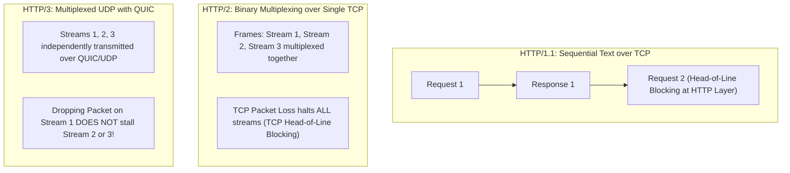
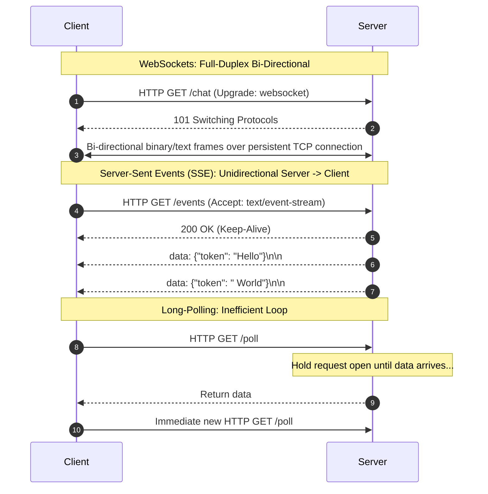
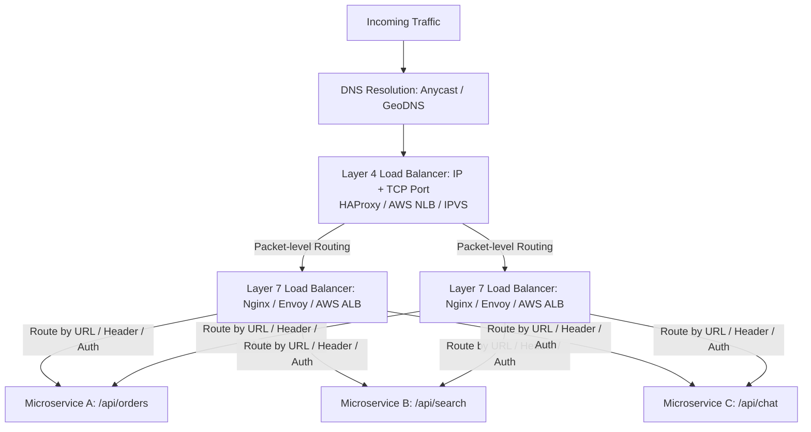
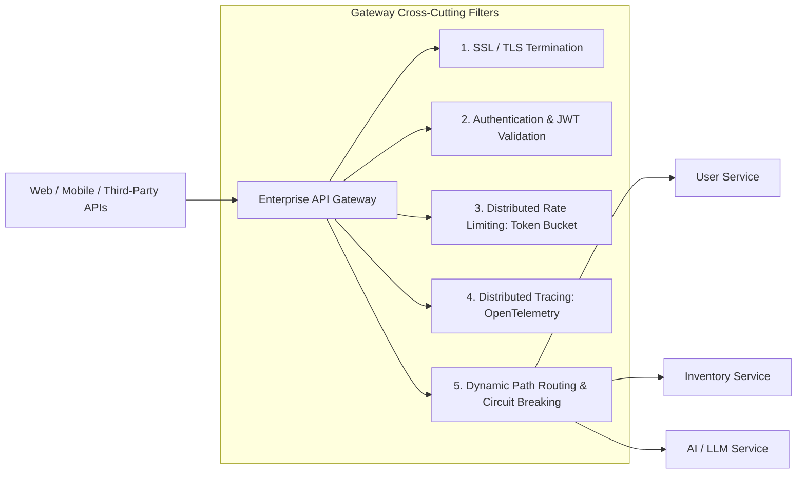

# Track 3: System Design
## Chapter 2: Networking Protocols, Load Balancers & Reverse Proxies

System architects must master how bytes travel across wires. In system design interviews, explaining how protocols negotiate connections, handle head-of-line blocking, and balance traffic is essential for designing resilient gateways.

---

### 1. Protocol Evolution: HTTP/1.1 vs HTTP/2 vs HTTP/3 (QUIC)

| Feature | HTTP/1.1 | HTTP/2 | HTTP/3 (QUIC) |
| :--- | :--- | :--- | :--- |
| **Transport** | TCP | TCP | **QUIC (over UDP)** |
| **Data Format** | Plain Text | Binary Framing | Binary Framing |
| **Multiplexing** | No (requires multiple TCP connections) | **Yes** (single TCP connection) | **Yes** (independent UDP streams) |
| **Head-of-Line Blocking**| Severe (at HTTP application layer) | Solved at HTTP layer, **present at TCP layer** | **Completely Eliminated** |
| **Header Compression** | None | HPACK | QPACK |
| **Connection Setup** | TCP 3-way handshake + TLS (2-3 RTT) | TCP + TLS 1.3 (1-2 RTT) | **0-RTT or 1-RTT connection handshake** |
| **Connection Migration**| Connection breaks on IP change (Wi-Fi $\to$ 5G) | Connection breaks | **Survives IP changes** via Connection IDs |

**Real-World Industry Examples**:
- **Uber**: Relies heavily on QUIC (HTTP/3) for its rider app to maintain persistent connections when users switch between Wi-Fi and 5G cellular networks as they walk out of a building.
- **YouTube/Google**: Pioneered QUIC to reduce buffering latency for video streaming, cutting rebuffering rates significantly over poor connections.
- **Cloudflare**: Deploys HTTP/3 extensively at the edge, offering it to millions of websites to dramatically improve time-to-first-byte (TTFB).

> 💡 **Interview Tip**
> When asked to design an application heavily used on mobile networks (like Uber, WhatsApp, or Instagram), explicitly mention HTTP/3 (QUIC) for connection migration capabilities during network handovers.

> 📺 **Video References**
> - ByteByteGo: HTTP/1 to HTTP/3 - https://www.youtube.com/@ByteByteGo
> - Stanford CS25: Networking layers - https://www.youtube.com/playlist?list=PLoROMvodv4rNiJRchCzutFw5ItR_ZEDY

> 📖 **Must-Read Resources**
> - Cloudflare Blog: HTTP/3 is here - https://blog.cloudflare.com
> - Uber Engineering: HTTP/3 & QUIC - https://www.uber.com/en-US/blog/engineering/

---

### 2. Real-Time Streaming: WebSockets vs SSE vs Long-Polling

#### Decision Matrix for Interviews:
- **Use WebSockets**: Low-latency, full-duplex, bidirectional communication (e.g. real-time collaborative whiteboards, multiplayer gaming, financial trading terminals).
- **Use SSE (Server-Sent Events)**: Server-to-client unidirectional streaming (e.g. **LLM token streaming, notifications, live sports scores, stock ticker displays**). SSE runs over standard HTTP, natively supports auto-reconnection, and easily navigates enterprise firewalls.

**Real-World Industry Examples**:
- **Discord / Slack**: Uses WebSockets to maintain persistent bidirectional communication for massive chat rooms.
- **OpenAI ChatGPT**: Uses SSE (Server-Sent Events) for streaming LLM tokens back to the client progressively.
- **Robinhood**: Utilizes WebSockets for sub-second, real-time stock ticker updates to avoid the overhead of opening thousands of HTTP connections.

> 💡 **Interview Tip**
> The standard trap is to say "WebSockets" for everything real-time. Stand out by correctly identifying when unidirectional data is enough (like a live news feed or LLM output) and recommending SSE, which is much simpler to load balance and scale.

> 📺 **Video References**
> - ByteByteGo: Polling, SSE, WebSockets - https://www.youtube.com/@ByteByteGo
> - Gaurav Sen: WebSockets in System Design - https://www.youtube.com/@GauravSensei

> 📖 **Must-Read Resources**
> - OpenAI Research Blog: Streaming responses - https://openai.com/research/
> - High Scalability: Discord Architecture - http://highscalability.com

---

### 3. Communication Styles: gRPC vs REST

| Dimension | REST (Representational State Transfer) | gRPC (Google Remote Procedure Call) |
| :--- | :--- | :--- |
| **Underlying Protocol**| Typically HTTP/1.1 (JSON payloads) | **HTTP/2** (Strict Protobuf binary) |
| **Data Serialization** | Human-readable JSON (high bandwidth overhead) | **Protocol Buffers** ($7\times$ to $10\times$ smaller & faster parsing) |
| **Contract Definition**| OpenAPI / Swagger (optional, often desynchronizes) | **`.proto` IDL file** (strictly enforced, generates client/server stubs) |
| **Streaming Support** | Difficult (request/response paradigm) | **Native**: Unary, Client, Server, Bi-directional streaming |
| **Primary Domain** | External public client APIs (browser to gateway) | **Internal East-West microservices communication** |

**Real-World Industry Examples**:
- **Netflix**: Uses gRPC extensively for internal east-west microservices communication, dramatically reducing CPU serialization overhead compared to their previous JSON/REST architecture.
- **Stripe**: Provides REST over HTTP for public APIs (external clients), recognizing that gRPC is often too complex or restrictive for external developers writing simple integrations.
- **Lyft**: Migrated its Envoy proxy control plane to gRPC to efficiently stream massive routing configuration updates in real-time.

> 💡 **Interview Tip**
> Never say "I will use gRPC everywhere." The golden standard is REST (or GraphQL) for external client-facing APIs (North-South traffic) and gRPC for high-throughput internal microservice-to-microservice communication (East-West traffic).

> 📺 **Video References**
> - GOTO Conferences: REST vs gRPC vs GraphQL
> - ByteByteGo: API Paradigms - https://www.youtube.com/@ByteByteGo

> 📖 **Must-Read Resources**
> - AWS Architecture Blog: Choosing the Right API - https://aws.amazon.com/blogs/architecture/
> - Uber Engineering: Migrating to gRPC - https://www.uber.com/en-US/blog/engineering/

---

### 4. Load Balancing Architecture: Layer 4 vs Layer 7

**Layer 4 (Transport Layer):**
- Routes traffic based on IP address and TCP/UDP port without decrypting or inspecting packet payloads.
- **Advantage**: Blazing fast, minimal CPU overhead, handles millions of connections per second.

**Layer 7 (Application Layer):**
- Terminates TLS/SSL, parses HTTP headers, inspects cookies, URL paths, and JSON bodies.
- **Advantage**: Rich routing, cookie-based session affinity, rate limiting, and security inspection.

**Real-World Industry Examples**:
- **Cloudflare**: Utilizes massive anycast Layer 4 load balancing at the edge to route over 100M+ requests/day to the nearest PoP (Point of Presence).
- **GitHub**: Uses HAProxy as a highly tuned Layer 4 load balancer in front of a tier of application servers to handle enormous Git SSH and HTTPS traffic without inspecting every byte at the edge.
- **AWS**: Offers ALB (Layer 7) for typical web services where path-based routing is needed, and NLB (Layer 4) for extreme high-throughput, low-latency requirements like financial trading platforms.

> 💡 **Interview Tip**
> When dealing with millions of concurrent connections (like a massive multiplayer game or IoT ingestion layer), propose a Layer 4 load balancer like AWS NLB, as Layer 7 will bottleneck on CPU TLS termination.

> 📺 **Video References**
> - NeetCode: Load Balancing Explained - https://www.youtube.com/@NeetCode
> - ByteByteGo: Layer 4 vs Layer 7 Load Balancing - https://www.youtube.com/@ByteByteGo

> 📖 **Must-Read Resources**
> - Cloudflare Blog: How we built our L4 load balancer - https://blog.cloudflare.com
> - AWS Architecture: ALB vs NLB - https://aws.amazon.com/blogs/architecture/

---

### 5. Load Balancing Algorithms

1. **Round Robin & Weighted Round Robin**: Distributes requests sequentially across servers. Weighted variant assigns higher request proportions to high-spec instances.
2. **Least Connections**: Dispatches incoming requests to whichever server currently maintains the fewest active connections. Ideal for requests with variable execution times (e.g. long report generation).
3. **Consistent Hashing**: Hashes an attribute (e.g. `client_ip` or `user_id`) to map requests to the same server. Crucial for stateful caches and WebSocket session managers.

**Real-World Industry Examples**:
- **Discord**: Uses Consistent Hashing in its Elixir GenServer clusters to guarantee that all chat traffic for a specific Guild (Server) goes to the exact same backend node, allowing memory caching of the chat state.
- **Amazon Dynamo**: The seminal architecture for Consistent Hashing, distributing partitions effectively without completely reshaping the cluster when nodes fail.

> 💡 **Interview Tip**
> When asked how to load balance stateful servers (like game servers or live-stream transcoders), "Consistent Hashing" is the magic keyword to prevent data trashing across nodes.

> 📺 **Video References**
> - Gaurav Sen: Consistent Hashing - https://www.youtube.com/@GauravSensei
> - ByteByteGo: Load Balancing Algorithms - https://www.youtube.com/@ByteByteGo

> 📖 **Must-Read Resources**
> - Original Dynamo Paper (2007) - https://www.allthingsdistributed.com/files/amazon-dynamo-sosp2007.pdf
> - High Scalability: Load balancing strategies - http://highscalability.com

---

### 6. API Gateway Architecture & Responsibilities

In modern microservices and distributed systems, an **API Gateway** acts as the single reverse proxy entry point for all client traffic, decoupling internal service topologies from public clients.

**Real-World Industry Examples**:
- **Netflix Zuul**: Originally built and open-sourced by Netflix as a dynamic routing and filtering API Gateway to protect thousands of backend microservices.
- **Airbnb**: Uses a massive Envoy-based API gateway layer to handle global authentication, rate limiting, and observability across all incoming traffic.
- **Kong API Gateway**: Used widely by enterprise companies to inject custom Lua or Go plugins for strict security filtering before traffic ever hits internal infrastructure.

> 💡 **Interview Tip**
> Don't let your microservices implement authentication or rate limiting individually. Always propose centralizing these "cross-cutting concerns" at the API Gateway. It shows architectural maturity.

> 📺 **Video References**
> - ByteByteGo: API Gateway Pattern - https://www.youtube.com/@ByteByteGo
> - Martin Fowler Lectures: Microservice Gateways

> 📖 **Must-Read Resources**
> - Netflix Tech Blog: Announcing Zuul - https://netflixtechblog.com
> - Uber Engineering: Edge Gateway - https://www.uber.com/en-US/blog/engineering/
