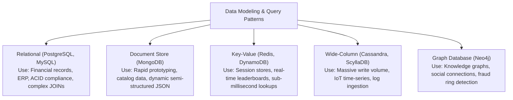
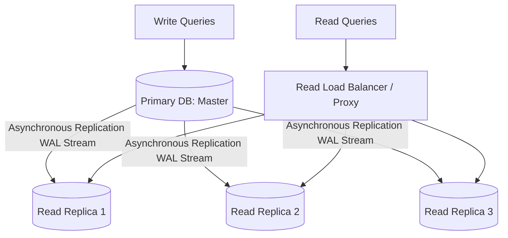
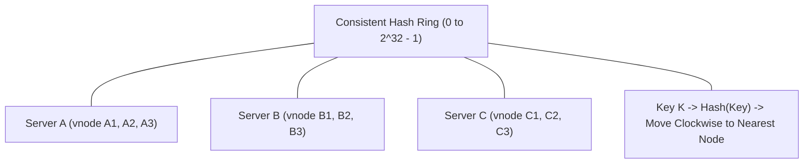
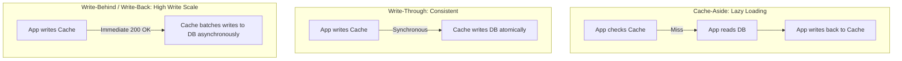
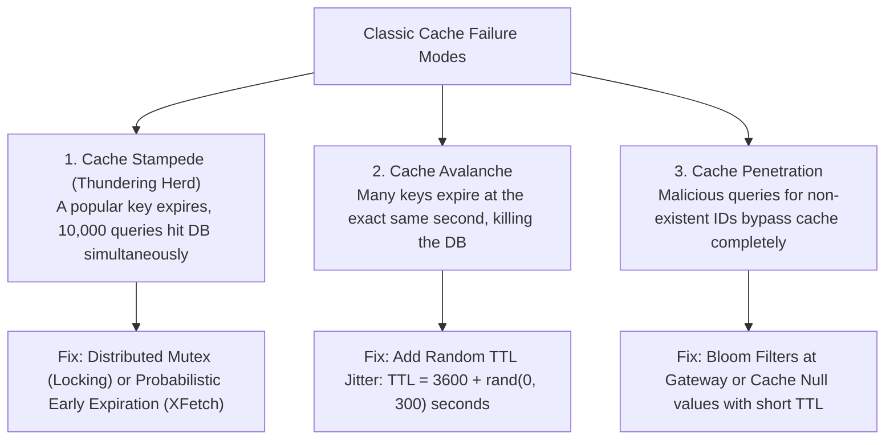

# Track 3: System Design
## Chapter 3: Database Scaling, Consistent Hashing & Distributed Caching

At enterprise scale, the database and caching tier is where 80% of distributed systems fail under load. Interviewers will test your ability to partition data horizontally, eliminate single points of failure, and prevent catastrophic cache collapses.

---

### 1. Database Selection Matrix



**Real-World Industry Examples**:
- **Notion**: Migrated massively from monolithic databases to highly-sharded **PostgreSQL** architectures to support their structured nested block data efficiently with ACID transactions.
- **Discord**: Originally scaled on MongoDB, migrated to **Cassandra**, and eventually migrated completely to **ScyllaDB** (a C++ wide-column store) to handle trillions of chat messages with sub-millisecond latency.
- **Slack**: Handled hyper-growth by migrating to **Vitess**, a massive sharding middleware layer for MySQL, to scale relationally horizontally.

> 💡 **Interview Tip**
> When asked to select a database, state the query pattern first (e.g., "Since we are doing heavy time-series writes with no complex joins..."). Never pick a NoSQL DB just to sound scalable if the data is inherently relational (like banking).

> 📺 **Video References**
> - Stanford CS25: Database architectures - https://www.youtube.com/playlist?list=PLoROMvodv4rNiJRchCzutFw5ItR_ZEDY
> - ByteByteGo: Database selection - https://www.youtube.com/@ByteByteGo

> 📖 **Must-Read Resources**
> - Notion Engineering: Sharding Postgres - https://www.notion.so/blog/sharding-postgres-at-notion
> - Discord Engineering: How Discord Stores Trillions of Messages - https://discord.com/blog/how-discord-stores-trillions-of-messages

---

### 2. Scaling Relational Databases: Replication vs Sharding



#### Sharding (Horizontal Partitioning):
When a single database node runs out of disk storage or write throughput ceiling ($> 50,000$ writes/sec), the dataset must be split across independent database instances (shards).

| Sharding Strategy | Mechanism | Advantage | Critical Risk |
| :--- | :--- | :--- | :--- |
| **Range-Based** | Split by range (e.g. A-D, E-H, or Dates) | Trivial range queries | **Severe Hotspotting** (e.g. all writes today hit the "Today" shard) |
| **Hash-Based** | $hash(\text{shard\_key}) \pmod N$ | Uniform data distribution | Adding a node requires reshuffling almost all data |
| **Directory-Based**| Central lookup table maps keys to shards | Highly flexible | Lookup service becomes a bottleneck and SPOF |

**Capacity Estimation Example**:
If you are designing Twitter, and 500 million tweets are generated daily at 1KB each (500GB/day). In 5 years, that's $500 \times 365 \times 5 \approx 900$ TB. No single Postgres node can hold this. You MUST shard (e.g., hash-based sharding by `user_id`).

**Real-World Industry Examples**:
- **Instagram**: Implemented a custom logical sharding strategy in PostgreSQL, embedding the shard ID into their massive 64-bit ID generation scheme (Snowflake-like) to instantly know which database shard holds a specific photo.
- **Pinterest**: Split their massive graph of pins and boards across thousands of MySQL shards utilizing a directory-based approach and ZooKeeper for configuration.
- **YouTube**: Vitess was originally created inside YouTube to shard their massive MySQL deployment effortlessly before open-sourcing it.

> 💡 **Interview Tip**
> Sharding is an extreme measure. Always mention that before sharding, you would exhaust Read Replicas (if read-heavy), caching, and vertical scaling. Mentioning the complexity of cross-shard JOINs proves you've dealt with sharding pain.

> 📺 **Video References**
> - ByteByteGo: Database Sharding - https://www.youtube.com/@ByteByteGo
> - MIT 6.824: Fault-Tolerant Virtual Machines - https://www.youtube.com/playlist?list=PLrw6a1wE39_tb2fErI4-WkMbsvGQk9_UB

> 📖 **Must-Read Resources**
> - Meta Engineering: Sharding & IDs at Instagram - https://engineering.fb.com
> - Pinterest Engineering: Sharding MySQL - https://medium.com/pinterest-engineering

---

### 3. Consistent Hashing Deep Dive

In naive modulo hashing ($\text{Node} = hash(key) \pmod N$), adding or removing a node changes $N \to N+1$. This invalidates up to **99% of cached keys**, triggering a catastrophic database stampede.

**Consistent Hashing** resolves this by mapping both nodes and keys onto a circular **Hash Ring** ($0$ to $2^{32}-1$).



#### Why Virtual Nodes (Vnodes) are Essential:
Without virtual nodes, servers hash to unevenly spaced points on the ring, causing severe **data skew** (one server holds 60% of traffic).
- By assigning **100–256 virtual nodes** per physical machine distributed pseudo-randomly across the ring, load distribution variance drops to $< 3\%$.

**Real-World Industry Examples**:
- **Amazon Dynamo**: The Dynamo paper introduced Consistent Hashing to industry, allowing Amazon's shopping cart infrastructure to scale elastically without massive data reshuffling.
- **Vimeo**: Uses consistent hashing on their CDN load balancers to route requests for the same video segment to the same caching edge node, massively improving cache hit rates.

#### Expanded Code Example: Consistent Hashing Implementation

```python
# Python 3: Basic Consistent Hashing with Virtual Nodes
import hashlib
import bisect

class ConsistentHashRing:
    def __init__(self, num_vnodes=100):
        self.num_vnodes = num_vnodes
        self.ring = []
        self.node_map = {}

    def _hash(self, key):
        # Use MD5 or SHA for distribution, return an integer
        return int(hashlib.md5(key.encode('utf-8')).hexdigest(), 16)

    def add_node(self, node_name):
        for i in range(self.num_vnodes):
            vnode_key = f"{node_name}:vnode:{i}"
            h = self._hash(vnode_key)
            bisect.insort(self.ring, h)
            self.node_map[h] = node_name

    def remove_node(self, node_name):
        # Removing a node just involves removing its vnodes
        for i in range(self.num_vnodes):
            vnode_key = f"{node_name}:vnode:{i}"
            h = self._hash(vnode_key)
            self.ring.remove(h)
            del self.node_map[h]

    def get_node(self, key):
        if not self.ring:
            return None
        h = self._hash(key)
        idx = bisect.bisect(self.ring, h)
        # Wrap around the ring
        if idx == len(self.ring):
            idx = 0
        return self.node_map[self.ring[idx]]

# Test case
ring = ConsistentHashRing(num_vnodes=3)
ring.add_node("Server_A")
ring.add_node("Server_B")
ring.add_node("Server_C")

print(f"Key 'user_123' mapped to: {ring.get_node('user_123')}")
print(f"Key 'user_456' mapped to: {ring.get_node('user_456')}")
```

```java
// Java 17: Consistent Hashing
import java.security.MessageDigest;
import java.security.NoSuchAlgorithmException;
import java.util.SortedMap;
import java.util.TreeMap;

public class ConsistentHashRing {
    private final int numberOfReplicas;
    private final SortedMap<Long, String> circle = new TreeMap<>();

    public ConsistentHashRing(int numberOfReplicas) {
        this.numberOfReplicas = numberOfReplicas;
    }

    private long hash(String key) {
        try {
            MessageDigest md = MessageDigest.getInstance("MD5");
            byte[] digest = md.digest(key.getBytes());
            long h = 0;
            for (int i = 0; i < 4; i++) {
                h <<= 8;
                h |= ((int) digest[i]) & 0xFF;
            }
            return h;
        } catch (NoSuchAlgorithmException e) {
            throw new RuntimeException(e);
        }
    }

    public void add(String node) {
        for (int i = 0; i < numberOfReplicas; i++) {
            circle.put(hash(node + "VN" + i), node);
        }
    }

    public void remove(String node) {
        for (int i = 0; i < numberOfReplicas; i++) {
            circle.remove(hash(node + "VN" + i));
        }
    }

    public String get(String key) {
        if (circle.isEmpty()) return null;
        long hash = hash(key);
        if (!circle.containsKey(hash)) {
            SortedMap<Long, String> tailMap = circle.tailMap(hash);
            hash = tailMap.isEmpty() ? circle.firstKey() : tailMap.firstKey();
        }
        return circle.get(hash);
    }
    
    public static void main(String[] args) {
        ConsistentHashRing ring = new ConsistentHashRing(100);
        ring.add("Server_A");
        ring.add("Server_B");
        ring.add("Server_C");
        System.out.println("Key user_123 goes to: " + ring.get("user_123"));
    }
}
```

> 💡 **Interview Tip**
> Write out or draw the circle when explaining Consistent Hashing. Clarify that finding the node involves a binary search ($O(\log N)$) through the sorted list of virtual node hashes.

> 📺 **Video References**
> - Gaurav Sen: Consistent Hashing - https://www.youtube.com/@GauravSensei
> - ByteByteGo: Consistent Hashing Explained - https://www.youtube.com/@ByteByteGo

> 📖 **Must-Read Resources**
> - Dynamo Paper - https://www.allthingsdistributed.com/files/amazon-dynamo-sosp2007.pdf
> - High Scalability: Consistent Hashing - http://highscalability.com

---

### 4. Distributed Caching Strategies



| Strategy | Read Latency | Write Latency | Data Consistency | Risk |
| :--- | :--- | :--- | :--- | :--- |
| **Cache-Aside** | Low (on hit) | Normal | Eventual (stale data if DB updated out-of-band) | Cache miss storm on startup |
| **Write-Through**| Fast | Slower (2 writes) | **Strong** | High write latency penalty |
| **Write-Behind** | Fast | **Ultra-Fast** | Eventual | **Data loss** if cache crashes before flush |
| **Refresh-Ahead**| Ultra-Fast | Normal | Near Real-time | Complexity in predicting access patterns |

**Real-World Industry Examples**:
- **Twitter**: Uses vast Memcached clusters as Cache-Aside to store user timelines. If the cache misses, it painstakingly reconstructs the timeline from the social graph DB.
- **DoorDash**: Heavily leverages Redis with a Write-Behind pattern for location tracking, accepting massive write loads to cache and batching them periodically into their permanent data lake.
- **Airbnb**: Implements sophisticated cache-aside patterns combined with CDC (Change Data Capture) via Debezium to invalidate cache keys the millisecond the primary MySQL database is updated.

> 💡 **Interview Tip**
> Most systems use Cache-Aside. Mentioning Write-Behind for write-heavy metrics or high-frequency analytics (like video view counts) shows advanced expertise.

> 📺 **Video References**
> - ByteByteGo: Caching Strategies - https://www.youtube.com/@ByteByteGo
> - NeetCode: Caching in System Design - https://www.youtube.com/@NeetCode

> 📖 **Must-Read Resources**
> - AWS Architecture: Caching Best Practices - https://aws.amazon.com/blogs/architecture/
> - Medium (Airbnb Eng): Scaling Caching - https://medium.com/airbnb-engineering

---

### 5. The 3 Classic Cache Failure Modes & Production Solutions



**Real-World Industry Examples**:
- **Facebook**: Mitigates Cache Stampedes (Thundering Herd) in Memcached by using "Leases". The first client to miss the cache gets a lease to query the DB; all other clients wait or receive stale data.
- **Cloudflare**: Prevents Cache Avalanche by injecting "Jitter" into edge cache TTLs, ensuring global data center refreshes are smoothed out over time instead of all spiking the origin server simultaneously.

> 💡 **Interview Tip**
> When asked "What happens if Justin Bieber tweets?", the interviewer wants to hear about Cache Stampede. Explain how a distributed lock prevents thousands of threads from fetching his profile from the DB when the cache key expires.

> 📺 **Video References**
> - ByteByteGo: Cache Stampede - https://www.youtube.com/@ByteByteGo

> 📖 **Must-Read Resources**
> - Facebook Engineering: Scaling Memcache - https://engineering.fb.com
> - Redis Documentation - https://redis.io/docs/

---

### 6. Redis Internals: Why Single-Threaded is Fast

Interviewers frequently ask: *"How can Redis achieve 100,000+ QPS while being single-threaded?"*

1. **In-Memory Operations**: All data resides in RAM. Reading a memory address takes ~100 nanoseconds (compared to 10 milliseconds for disk reads).
2. **I/O Multiplexing (`epoll` / `kqueue`)**: Uses non-blocking socket operations to monitor thousands of client connections concurrently on a single thread.
3. **No Context Switching or Locking Overheads**: Being single-threaded eliminates thread synchronization locks (mutexes, spinlocks), race conditions, and CPU context-switch churn.

**Real-World Industry Examples**:
- **GitHub**: Leverages Redis extensively as a fast, atomic job queue (using Resque) because Redis's single-threaded nature guarantees atomic `LPOP`/`RPUSH` queue operations without distributed locking overhead.

#### Redis Persistence Options:
- **RDB (Redis Database Snapshots)**: Compact point-in-time binary snapshots written to disk via background `bgsave` (`fork()`). Fast restarts, but risk of losing minutes of data if crashed.
- **AOF (Append Only File)**: Logs every write command sequentially. Configured with `appendfsync everysec` for maximum durability with minimal performance penalty.

> 💡 **Interview Tip**
> Knowing why Redis is fast is great, but knowing when to use Redis is better. Use Redis for structured data (Sets, Sorted Sets for Leaderboards, Hashes) and Memcached if you just need pure string caching with multithreaded vertical scale.

> 📺 **Video References**
> - ByteByteGo: Redis Architecture - https://www.youtube.com/@ByteByteGo

> 📖 **Must-Read Resources**
> - Redis Docs: Persistence - https://redis.io/docs/management/persistence/
