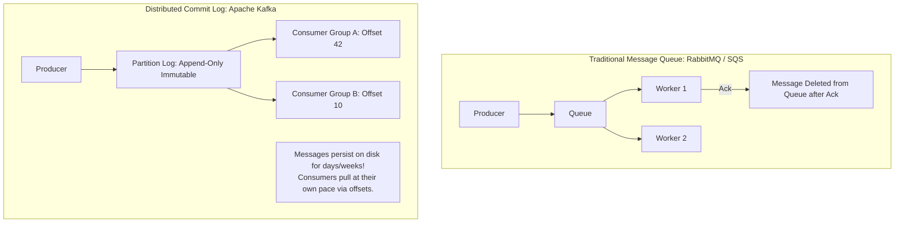
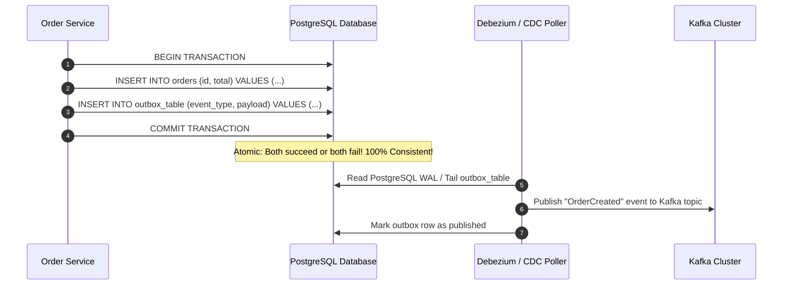
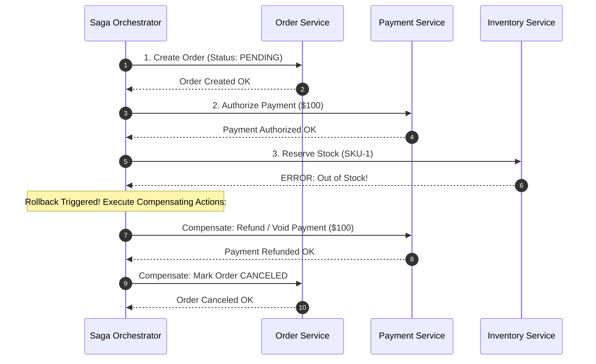
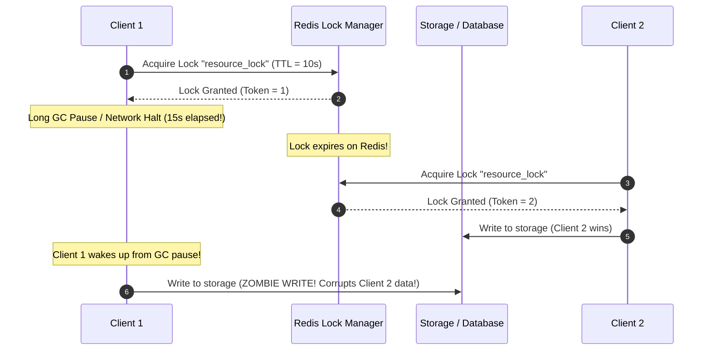
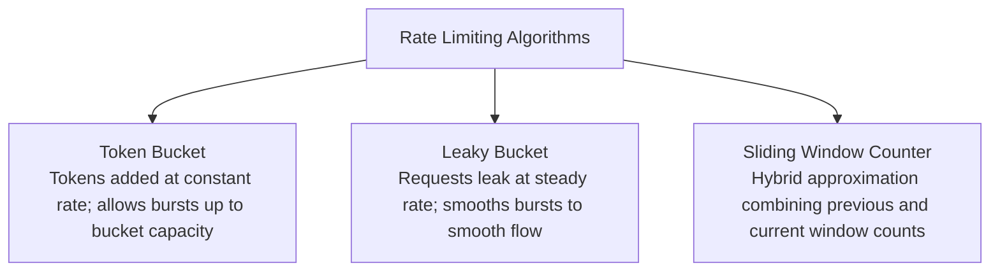

# Track 3: System Design
## Chapter 4: Distributed Patterns, Event Streaming & Concurrency Control

> 🧭 **Navigation**: [⬅️ Previous: 03: Databases & Caching](03-databases-and-caching.md) | [🏠 System Design Track Index](README.md) | [➡️ Next: 05: Classic Case Studies](05-classic-case-studies.md)

---

In microservices and decoupled architectures, systems fail independently. A Senior Systems Architect must know how to maintain data integrity across distributed boundaries, handle message ordering, prevent race conditions, and throttle abusive workloads.

---

### 1. Message Queues vs Distributed Event Logs (Kafka)



| Dimension | Message Queue (RabbitMQ / SQS) | Event Stream (Apache Kafka) |
| :--- | :--- | :--- |
| **Model** | Push-based to workers | **Pull-based** by consumers |
| **Message Lifetime**| Deleted immediately upon ACK | **Persistent & Replayable** for configured retention time (e.g. 7 days) |
| **Ordering** | In-order within a queue; lost across concurrent workers | **Strictly preserved within each partition** |
| **Throughput** | 10k–50k msg/sec | **1,000,000+ msg/sec** (sequential disk I/O + page cache + zero-copy sendfile) |
| **Use Cases** | Task distribution, asynchronous jobs | Event-driven microservices, real-time analytics, event sourcing |

**Real-World Industry Examples**:
- **LinkedIn**: The birthplace of Kafka. Jay Kreps and team built Kafka to replace disjointed data integration pipelines, now handling over 7 trillion messages per day.
- **Uber**: Uses Kafka as the central nervous system for everything from driver location updates to billing, processing over a trillion messages daily.
- **Cloudflare**: Replaced millions of discrete log files by streaming edge network logs into massive Kafka clusters, allowing sub-second real-time dashboards for customers.

#### Kafka Partitioning & Ordering Guarantee:
- Kafka guarantees strict total ordering **only within a single partition**.
- If message ordering is business-critical (e.g. `OrderCreated` must precede `OrderPaid`), set the message **Key** to `order_id`. Kafka hashes the key to route all events for that specific order into the exact same partition!

> 💡 **Interview Tip**
> Never say you will use RabbitMQ or SQS for real-time analytics or log aggregation, and never use Kafka for simple long-running task distribution like rendering a video. Choose the right tool. Mentioning partition keys for ordering is a massive green flag.

> 📺 **Video References**
> - ByteByteGo: Kafka vs RabbitMQ - https://www.youtube.com/@ByteByteGo
> - Gaurav Sen: Apache Kafka System Design - https://www.youtube.com/@GauravSensei

> 📖 **Must-Read Resources**
> - LinkedIn Engineering: The Log - https://engineering.linkedin.com/distributed-systems/log-what-every-software-engineer-should-know-about-real-time-datas-unifying
> - Uber Engineering: Scaling Kafka - https://www.uber.com/en-US/blog/engineering/

---

### 2. The Dual-Write Problem & The Transactional Outbox Pattern

A classic distributed systems trap occurs when a service must mutate a database **and** publish a message to a queue:
```python
# ❌ ANTI-PATTERN: Dual-Write Failure
db.save_order(order)          # Step 1: Succeeds
kafka.publish("OrderCreated") # Step 2: Fails (Network timeout / Kafka down!)
# Result: Order exists in DB, but downstream billing & shipping services NEVER receive the event!
```

#### The Transactional Outbox Solution:
Instead of publishing directly to Kafka, write the event into an `outbox` table within the **exact same ACID transaction** as the business entity!



**Real-World Industry Examples**:
- **Shopify**: Uses the Transactional Outbox pattern heavily in their Ruby on Rails monolith to safely broadcast checkout events to downstream microservices.
- **Monzo Bank**: Deploys this pattern extensively in their microservices architecture using Cassandra and Kafka to ensure no financial transaction events are ever lost.

> 💡 **Interview Tip**
> The dual-write problem is an instant interview killer if missed. If you mention updating a DB and sending a Kafka message in the same function, immediately clarify that you are using a Transactional Outbox or CDC (Change Data Capture) via Debezium.

> 📺 **Video References**
> - ByteByteGo: Transactional Outbox Pattern - https://www.youtube.com/@ByteByteGo
> - Martin Kleppmann: Microservices and Kafka - https://www.youtube.com/playlist?list=PLeKd45zvjcDFUEv_ohr_HdUFe97RIt8b

> 📖 **Must-Read Resources**
> - Microservices.io: Transactional Outbox - https://microservices.io/patterns/data/transactional-outbox.html
> - Debezium Documentation - https://debezium.io/documentation/

---

### 3. Distributed Transactions: Saga Pattern vs 2PC

The traditional **Two-Phase Commit (2PC)** protocol uses a coordinator to prepare and commit across databases. In modern microservices, 2PC is an anti-pattern:
- It holds row locks open across network hops.
- High latency; if the coordinator crashes, nodes remain locked indefinitely.

#### The Saga Pattern:
A Saga breaks a distributed transaction into a sequence of local transactions. Each step executes in its local database; if any step fails, the Saga executes **Compensating Transactions** to undo preceding steps in reverse order.



**Real-World Industry Examples**:
- **Uber Eats**: Employs orchestration-based Sagas to coordinate complex order flows across Restaurant, Driver, and Payment services. If a restaurant rejects the order, compensations automatically void the user's payment.
- **Amazon (Retail)**: Highly choreographed Saga patterns run in the background. If you buy an item but it goes out of stock in the warehouse physically before shipping, the compensation workflow automatically emails you and issues a refund days later.

> 💡 **Interview Tip**
> Distinguish between Orchestration (central controller) and Choreography (event-driven). For complex workflows (like payments), advocate for Orchestration because it centralizes state tracking and makes debugging easier.

> 📺 **Video References**
> - AWS Architecture: Saga Pattern - https://www.youtube.com/@aws
> - ByteByteGo: Distributed Transactions - https://www.youtube.com/@ByteByteGo

> 📖 **Must-Read Resources**
> - AWS Prescriptive Guidance: Saga Pattern - https://docs.aws.amazon.com/prescriptive-guidance/latest/patterns/saga.html
> - Uber Engineering: Distributed Tracing - https://www.uber.com/en-US/blog/engineering/

---

### 4. Distributed Locking & Fencing Tokens

Using Redis (`SET NX PX`) for distributed locks is common, but has a fatal flaw: **The GC Pause / Network Delay Problem**.



#### The Production Fix: Fencing Tokens (Martin Kleppmann)
- The lock service issues a strictly monotonically increasing counter (token) with each lock acquisition.
- When writing to storage, the database verifies:
  `UPDATE table SET val = ... WHERE token > last_processed_token;`
- Because Client 1's token is $1$ and Client 2's token is $2$, Client 1's zombie write is rejected by the database!

**Real-World Industry Examples**:
- **ZooKeeper**: Natively supports fencing concepts using its `zxid` (ZooKeeper Transaction Id) ensuring strict ordering of distributed state changes.
- **Google Chubby**: Used internally at Google as a distributed lock service; it employs sequencer tokens to validate that delayed network packets do not overwrite newer locks.

> 💡 **Interview Tip**
> If an interviewer asks "How do you guarantee a cron job only runs once across 5 servers?", start with Redis SETNX. When they ask "What if the worker hangs?", explain TTL. When they push on "What if it hangs past the TTL?", drop the Fencing Token knowledge.

> 📺 **Video References**
> - Martin Kleppmann: Distributed Locking - https://www.youtube.com/playlist?list=PLeKd45zvjcDFUEv_ohr_HdUFe97RIt8b

> 📖 **Must-Read Resources**
> - Martin Kleppmann's Blog: How to do distributed locking - https://martin.kleppmann.com/2016/02/08/how-to-do-distributed-locking.html
> - Redis Redlock documentation - https://redis.io/docs/manual/patterns/distributed-locks/

---

### 5. Distributed Rate Limiting: Sliding Window Counter

Rate limiting protects APIs from denial-of-service, brute force, and cascading failures.



**Real-World Industry Examples**:
- **Airbnb**: Built Airlock, a highly scalable token-bucket rate limiter to protect infrastructure against massive scraping bots while ensuring human users aren't incorrectly throttled.
- **Stripe**: Uses highly tuned Redis-based token bucket implementations per API key to guarantee their tier-based billing constraints without penalizing bursting legitimate traffic.
- **Cloudflare**: Employs sliding window rate limiters at the edge written in Rust, preventing massive Layer 7 DDoS attacks before they reach backend origins.

#### Expanded Code Example: Redis Lua Script for Sliding Window Rate Limiter

Why Lua? Redis executes Lua scripts **atomically**, eliminating race conditions between the read and increment operations!

```lua
-- Redis Sliding Window Counter Lua Script
-- KEYS[1]: rate_limit_key (e.g. rate:user_123)
-- ARGV[1]: max_requests (e.g. 100)
-- ARGV[2]: window_seconds (e.g. 60)
-- ARGV[3]: current_timestamp (e.g. 1629837201.123)

local key = KEYS[1]
local max_requests = tonumber(ARGV[1])
local window = tonumber(ARGV[2])
local now = tonumber(ARGV[3])
local clear_before = now - window

-- 1. Remove old requests outside current sliding window
redis.call('ZREMRANGEBYSCORE', key, 0, clear_before)

-- 2. Count requests in current window
local current_requests = redis.call('ZCARD', key)

if current_requests < max_requests then
    -- 3. Add current request timestamp
    redis.call('ZADD', key, now, now)
    redis.call('EXPIRE', key, window)
    return 1 -- Allowed
else
    return 0 -- Rejected (HTTP 429 Too Many Requests)
end
```

```python
# Python 3: Calling the Redis Lua Rate Limiter
import time
import redis

r = redis.Redis(host='localhost', port=6379, db=0)

lua_script = """
local key = KEYS[1]
local max_requests = tonumber(ARGV[1])
local window = tonumber(ARGV[2])
local now = tonumber(ARGV[3])
local clear_before = now - window
redis.call('ZREMRANGEBYSCORE', key, 0, clear_before)
local current_requests = redis.call('ZCARD', key)
if current_requests < max_requests then
    redis.call('ZADD', key, now, now)
    redis.call('EXPIRE', key, window)
    return 1
else
    return 0
end
"""

rate_limiter = r.register_script(lua_script)

def allow_request(user_id, max_req=5, window_sec=60):
    now = time.time()
    allowed = rate_limiter(keys=[f"rate:{user_id}"], args=[max_req, window_sec, now])
    return bool(allowed)

# Test case
for i in range(6):
    print(f"Request {i+1}: {'Allowed' if allow_request('user_123') else 'Rate Limited'}")
```

```java
// Java 17: Calling the Redis Lua Rate Limiter using Jedis
import redis.clients.jedis.Jedis;
import java.util.Collections;
import java.util.Arrays;

public class RateLimiter {
    private static final String LUA_SCRIPT =
        "local key = KEYS[1]\n" +
        "local max_requests = tonumber(ARGV[1])\n" +
        "local window = tonumber(ARGV[2])\n" +
        "local now = tonumber(ARGV[3])\n" +
        "local clear_before = now - window\n" +
        "redis.call('ZREMRANGEBYSCORE', key, 0, clear_before)\n" +
        "local current_requests = redis.call('ZCARD', key)\n" +
        "if current_requests < max_requests then\n" +
        "    redis.call('ZADD', key, now, now)\n" +
        "    redis.call('EXPIRE', key, window)\n" +
        "    return 1\n" +
        "else\n" +
        "    return 0\n" +
        "end";

    public static boolean allowRequest(Jedis jedis, String userId, int maxReq, int windowSec) {
        long now = System.currentTimeMillis() / 1000;
        Object result = jedis.eval(LUA_SCRIPT,
                Collections.singletonList("rate:" + userId),
                Arrays.asList(String.valueOf(maxReq), String.valueOf(windowSec), String.valueOf(now))
        );
        return (Long) result == 1L;
    }

    public static void main(String[] args) {
        try (Jedis jedis = new Jedis("localhost", 6379)) {
            for (int i = 0; i < 6; i++) {
                boolean allowed = allowRequest(jedis, "user_123", 5, 60);
                System.out.println("Request " + (i + 1) + ": " + (allowed ? "Allowed" : "Rate Limited"));
            }
        }
    }
}
```

> 💡 **Interview Tip**
> Knowing the difference between Token Bucket (good for bursting) and Leaky Bucket (good for strict downstream limits) is vital. Mentioning atomic Lua scripts in Redis shows senior-level production experience.

> 📺 **Video References**
> - ByteByteGo: Rate Limiting - https://www.youtube.com/@ByteByteGo

> 📖 **Must-Read Resources**
> - Stripe Engineering: Rate Limiters - https://stripe.com/blog/rate-limiters
> - Medium (Airbnb Eng): Scaling Caching and Rate Limiting - https://medium.com/airbnb-engineering

---

> 🧭 **Navigation**: [⬅️ Previous: 03: Databases & Caching](03-databases-and-caching.md) | [🏠 System Design Track Index](README.md) | [➡️ Next: 05: Classic Case Studies](05-classic-case-studies.md)
