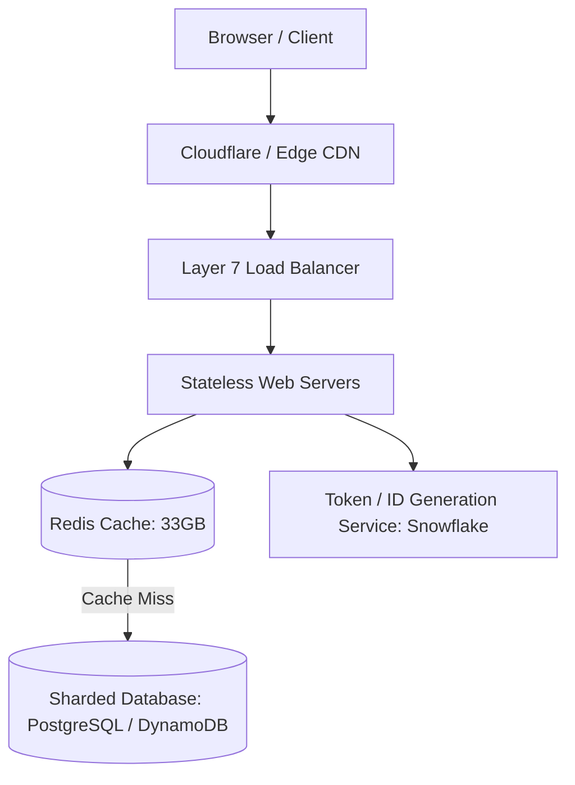
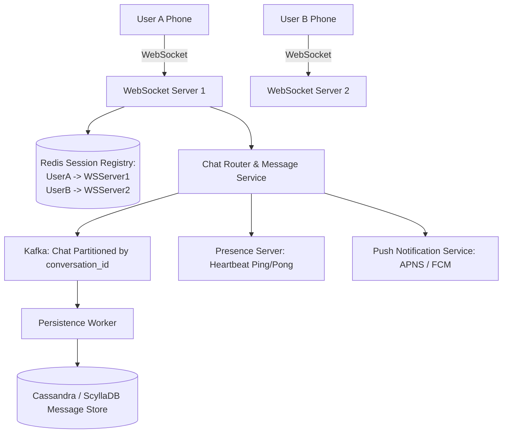
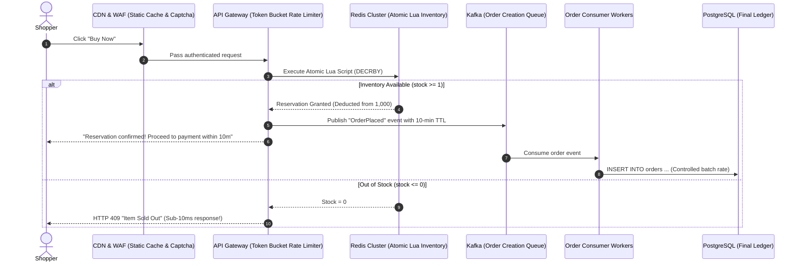
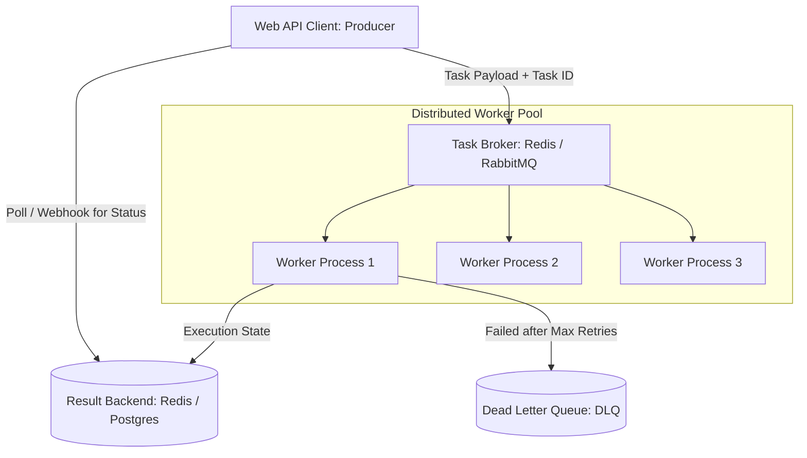

# Track 3: System Design
## Chapter 5: Classic System Design Case Studies

> 🧭 **Navigation**: [⬅️ Previous: 04: Distributed Patterns](04-distributed-patterns.md) | [🏠 System Design Track Index](README.md) | [➡️ Next: 06: AI & Data System Design](06-ai-system-design.md)

---

This chapter walks through four classic, highly tested system design interview scenarios, illustrating how to apply distributed systems principles end-to-end.

---

### Case 1: Design a Scalable URL Shortener (TinyURL)

#### 1. Requirements & Back-of-the-Envelope Estimation:
- **Scale**: 100 million new URLs created per month ($~40 \text{ writes/sec}$).
- **Read-to-Write Ratio**: $100:1 \implies 10 \text{ billion redirects/month } (\approx 4,000 \text{ reads/sec})$. Peak read QPS $\approx 8,000$.
- **Storage**: 5 years retention $= 100\text{M} \times 12 \times 5 = 6 \text{ billion URLs}$.
  - $6\text{B} \times 500 \text{ bytes per URL record} \approx \mathbf{3 \text{ TB storage}}$ (easily manageable on a partitioned relational or NoSQL database).
- **Caching (80/20 Rule)**: 20% of hot URLs generate 80% of read traffic.
  - Daily read volume $= \frac{10\text{B}}{30} \approx 330\text{M reads/day}$.
  - Memory to cache 20% of daily URLs $= 0.20 \times 330\text{M} \times 500 \text{ bytes} \approx \mathbf{33 \text{ GB RAM}}$ (fits inside a single Redis cluster node!).



**Real-World Industry Examples**:
- **Bitly**: Uses a heavily sharded MySQL backend and massive Memcached tiers to serve tens of billions of redirects, maintaining extensive read-replicas across geographical regions to ensure low latency.
- **Twitter (t.co)**: Uses customized hash generation and relies heavily on cache-aside patterns. By storing malicious URL filters at the cache tier, they prevent phishing attacks in real-time.

#### 2. Short URL ID Generation & Encoding:
- Characters available: `[0-9, a-z, A-Z]` $= 62$ characters (**Base62**).
- A 7-character string in Base62 can represent:
  $$62^7 = 3.52 \text{ trillion unique URLs}$$
- **Generation Strategy**: Use **Twitter Snowflake** or a **Distributed Range Allocator** (e.g. Server 1 issues IDs $1 \to 1,000,000$; Server 2 issues $1,000,001 \to 2,000,000$). Convert the unique 64-bit integer into a 7-character Base62 string. This avoids hash collisions entirely!

#### 3. Redirection Status Code Trade-off:
- **HTTP 301 (Moved Permanently)**: Browser caches the redirect locally. Subsequent clicks never hit our server.
  - *Advantage*: Minimum server load.
  - *Disadvantage*: We cannot track click analytics or user locations.
- **HTTP 302 (Found / Temporary Redirect)**: Browser always hits our server first before redirecting.
  - *Decision*: **Use HTTP 302** if monetization, analytics, or click counts are required; use **301** for pure performance.

> 💡 **Interview Tip**
> The crux of this interview is ID generation. Do not just say "I will hash the URL with MD5". Explain the collision problem of hashing, and propose a pre-generated ID system (Token Generation Service) or a Range Allocator for collision-free Base62 IDs.

> 📺 **Video References**
> - ByteByteGo: Design a URL Shortener - https://www.youtube.com/@ByteByteGo
> - Gaurav Sen: URL Shortener System Design - https://www.youtube.com/@GauravSensei

> 📖 **Must-Read Resources**
> - Bitly Engineering Blog: Designing a highly scalable URL Shortener - https://engineering.bitly.com/

---

### Case 2: Design a Real-Time Chat System (WhatsApp / Slack)



#### Key Architecture Components:
1. **WebSocket Gateway**: Maintains persistent full-duplex TCP connections with active users.
2. **Session Registry (Redis)**: Tracks which WebSocket server node currently holds the socket for each connected `user_id`.
3. **Message Ordering**: Inside a chat conversation, messages must appear sequentially. Messages are assigned an auto-incrementing conversation sequence number and partitioned in Kafka by `conversation_id`.
4. **Offline Delivery**: If User B is offline (no entry in Session Registry), the Chat Service routes the message to the **Push Notification Service (APNs/FCM)** to wake up the recipient's device.

**Real-World Industry Examples**:
- **Discord**: Routes billions of real-time messages using an Elixir/Erlang based WebSocket cluster and stores the data persistently in ScyllaDB.
- **WhatsApp**: Built natively on Erlang/OTP, which inherently solves massive concurrency for WebSocket connection handling without threading overhead, storing metadata in Mnesia/PostgreSQL.
- **Slack**: Extensively uses WebSockets for presence and messaging, migrating from a massive monolithic PHP app to a multi-tiered Java/Go architecture with vitess for DB sharding.

> 💡 **Interview Tip**
> Clarify the scope: Are you building 1-on-1 chat or group chat? Group chats (like Slack/Discord) multiply the write amplification. If a message is sent to a 100-person channel, it triggers 1 write to the DB but 100 reads/pushes to the WebSocket servers.

> 📺 **Video References**
> - ByteByteGo: Design a Chat App - https://www.youtube.com/@ByteByteGo
> - GOTO Conferences: Scaling Slack - https://www.youtube.com/user/GotoConferences

> 📖 **Must-Read Resources**
> - Discord Engineering: How Discord Stores Trillions of Messages - https://discord.com/blog/how-discord-stores-trillions-of-messages
> - WhatsApp Engineering: Architecture - http://highscalability.com

---

### Case 3: High-Concurrency Flash Sale / Inventory Reservation

- **The Problem**: 500,000 concurrent users attempt to buy 1,000 limited-edition items at 12:00:00 PM.
- **Why Traditional RDBMS Fails**: If 500,000 requests execute `SELECT stock FROM inventory WHERE id=1 FOR UPDATE`, database connection pools exhaust in seconds, CPU spikes to 100%, and the database crashes from catastrophic lock contention.



**Real-World Industry Examples**:
- **Ticketmaster**: Mitigates heavy database locking during Taylor Swift ticket drops by caching inventory segments in Redis and using strict API Gateway rate limiters combined with Captchas to block scraping bots.
- **Alibaba (Singles Day)**: Alibaba handles astronomical TPS ($>500k$ orders/sec) by moving inventory deduction into memory (Tair/Redis) and aggressively batching the actual MySQL ledger updates asynchronously.

#### Expanded Code Example: The Atomic Redis Lua Script

```lua
-- Atomic stock deduction in Redis
local stock_key = KEYS[1]
local user_id = ARGV[1]
local current_stock = tonumber(redis.call('GET', stock_key) or 0)

if current_stock > 0 then
    redis.call('DECR', stock_key)
    redis.call('SADD', stock_key .. ':reserved_users', user_id)
    return 1 -- Success
else
    return 0 -- Sold out
end
```

```python
# Python 3: Flash Sale Execution
import redis

r = redis.Redis()
script = """
local stock_key = KEYS[1]
local user_id = ARGV[1]
if tonumber(redis.call('GET', stock_key) or 0) > 0 then
    redis.call('DECR', stock_key)
    redis.call('SADD', stock_key .. ':reserved', user_id)
    return 1
else return 0 end
"""
reserve = r.register_script(script)

def buy_item(user_id, item_id="item:101"):
    res = reserve(keys=[item_id], args=[user_id])
    if res == 1:
        print(f"User {user_id} successfully reserved {item_id}!")
    else:
        print(f"User {user_id} failed: Out of Stock")

# Initialize stock
r.set("item:101", 2)
buy_item("u1") # Success
buy_item("u2") # Success
buy_item("u3") # Fails
```

```java
// Java 17: Flash Sale using Jedis
import redis.clients.jedis.Jedis;
import java.util.Collections;

public class FlashSale {
    private static final String LUA = 
        "local k=KEYS[1] local u=ARGV[1] " +
        "if tonumber(redis.call('GET',k) or 0)>0 then " +
        "redis.call('DECR',k) redis.call('SADD',k..':reserved',u) return 1 " +
        "else return 0 end";

    public static void buyItem(Jedis jedis, String item, String user) {
        Object res = jedis.eval(LUA, Collections.singletonList(item), Collections.singletonList(user));
        if ((Long) res == 1L) {
            System.out.println("User " + user + " reserved " + item);
        } else {
            System.out.println("User " + user + " failed: Out of Stock");
        }
    }

    public static void main(String[] args) {
        try (Jedis jedis = new Jedis("localhost")) {
            jedis.set("item:101", "2");
            buyItem(jedis, "item:101", "u1");
            buyItem(jedis, "item:101", "u2");
            buyItem(jedis, "item:101", "u3");
        }
    }
}
```

> 💡 **Interview Tip**
> Never solve a flash sale by scaling up the database. Relational databases physically cannot handle 500,000 concurrent row locks. Always push the inventory check to a fast, atomic in-memory cache (Redis Lua) and use queues (Kafka) to process the database writes slowly in the background.

> 📺 **Video References**
> - ByteByteGo: Design a Ticketmaster System - https://www.youtube.com/@ByteByteGo

> 📖 **Must-Read Resources**
> - High Scalability: Alibaba Singles Day Architecture - http://highscalability.com

---

### Case 4: Distributed Asynchronous Task Queue (Celery / BullMQ)

In enterprise software, long-running operations (exporting 100,000 accounting records, video rendering, sending bulk emails) must execute asynchronously outside the HTTP request/response cycle.



**Real-World Industry Examples**:
- **Netflix**: Uses massive distributed task queues backed by Kafka and Cassandra (via Conductor) to coordinate the distributed encoding of thousands of terabytes of video files asynchronously.
- **Stripe**: Utilizes heavily monitored asynchronous queues to dispatch millions of webhooks. If a customer's endpoint is down, exponential backoff retries the task, eventually pushing it to a DLQ.

#### Critical Resilience Mechanisms:
1. **Visibility Timeout & Acknowledgments**: A worker fetches a task and is granted a visibility lease (e.g. 60 seconds). If the worker crashes mid-task, the message becomes visible to other workers automatically after timeout expiration.
2. **Delayed & Scheduled Jobs**: Backed by **Redis Sorted Sets (ZSET)** using the scheduled execution Unix timestamp as the score. A poller queries `ZRANGEBYSCORE 0 current_timestamp` to promote ready tasks to the active queue.
3. **Dead Letter Queue (DLQ)**: Tasks that fail repeatedly with unhandled exceptions after $N$ exponential backoff retries are moved to a DLQ for developer investigation without blocking the primary pipeline.

> 💡 **Interview Tip**
> The keyword here is "Idempotency". A task might be executed twice if a worker crashes before ACKing but after doing the work. Ensure that your task handler is idempotent (e.g., uses a unique idempotency key when charging a credit card).

> 📺 **Video References**
> - NeetCode: Asynchronous Processing and Job Queues - https://www.youtube.com/@NeetCode

> 📖 **Must-Read Resources**
> - Netflix Tech Blog: Netflix Conductor - https://netflixtechblog.com
> - Stripe Blog: Designing Robust Webhooks - https://stripe.com/blog/webhooks

---

> 🧭 **Navigation**: [⬅️ Previous: 04: Distributed Patterns](04-distributed-patterns.md) | [🏠 System Design Track Index](README.md) | [➡️ Next: 06: AI & Data System Design](06-ai-system-design.md)
