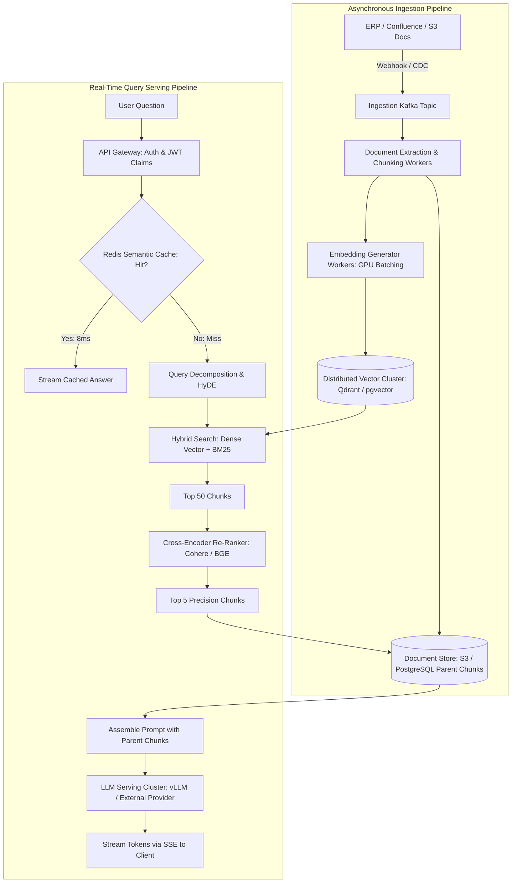
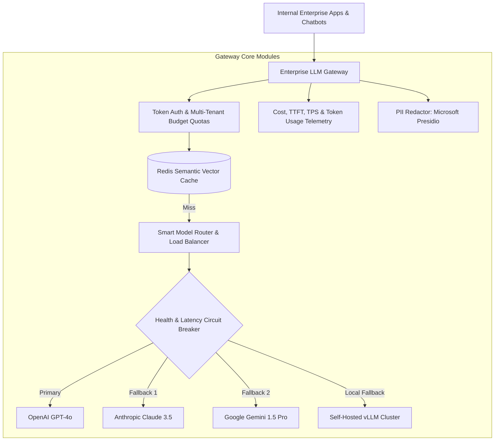

# Track 3: System Design
## Chapter 6: AI Systems Design: Scalable RAG, Recommendation Engines & LLM Gateways

> 🧭 **Navigation**: [⬅️ Previous: 05: Classic Case Studies](05-classic-case-studies.md) | [🏠 System Design Track Index](README.md) | [➡️ Next: 07: Interview Framework & Rubrics](07-interview-framework-and-rubrics.md)

---

As AI transitions from standalone prototypes to core enterprise infrastructure, system design interviews increasingly feature AI-native architectures. You must be prepared to scale embedding pipelines, vector search clusters, feature stores, and resilient model proxies.

---

### Design 1: Enterprise RAG Platform at Scale

#### 1. System Requirements:
- **Scale**: Ingest and index 50 million enterprise documents (PDFs, Notion, Confluence, ERP records).
- **Traffic**: 5,000 search/chat queries per second at peak.
- **Latency**: End-to-end response P95 latency $< 800\text{ms}$ (Time-to-First-Token $< 350\text{ms}$).
- **Data Freshness**: Newly updated documents in ERP must be indexed and searchable within $< 60\text{ seconds}$.
- **Security**: Strict multi-tenant data isolation; users must never retrieve documents they lack permission to view.



**Real-World Industry Examples**:
- **Notion AI**: Implements massive multi-tenant RAG by strictly appending tenant IDs and permission metadata directly onto vector payloads in Pinecone/Qdrant, filtering vectors pre-search to guarantee security.
- **Glean**: The enterprise AI search company aggregates data across dozens of SaaS tools into a massive centralized vector+BM25 index, heavily utilizing query rewriting and semantic caching.
- **OpenAI (ChatGPT Enterprise)**: Uses sophisticated parent-child chunking. When finding a highly relevant small snippet in a vector DB, it retrieves the surrounding context from object storage to feed the LLM a coherent document.

#### Key Architecture Trade-offs:
1. **Multi-Tenancy Enforcement at Retrieval Time**:
   - Rather than relying on LLM self-moderation, pass user authorization group tokens (e.g. `user.role_ids`) directly into the vector database filter clause:
     `filter: { tenant_id: "acme", allowed_roles: { $in: ["finance_manager"] } }`.
2. **GPU Batching for Embeddings**:
   - Embedding documents one-by-one results in massive GPU memory-transfer overhead. The Ingestion Worker batches text chunks into groups of 128 tokens, achieving $15\times$ higher embedding throughput.
3. **Decoupled Parent-Child Storage**:
   - Vector indexes store only child vectors (150 tokens) to minimize expensive vector memory footprints. Full parent documents reside in inexpensive blob storage (S3 / PostgreSQL), retrieved only for the final top 5 candidates.

> 💡 **Interview Tip**
> Never design RAG relying solely on Vector Search (Dense Retrieval). Always propose **Hybrid Search** (Dense + Sparse BM25 Keyword Search) followed by a **Cross-Encoder Re-Ranker**. This demonstrates you know how to overcome the "lost in the middle" and precision problems of pure vector search.

> 📺 **Video References**
> - Andrej Karpathy: State of GPT & RAG - https://www.youtube.com/@AndrejKarpathy
> - ByteByteGo: Vector Databases & RAG - https://www.youtube.com/@ByteByteGo

> 📖 **Must-Read Resources**
> - Pinecone Documentation: Hybrid Search - https://docs.pinecone.io/
> - LangChain Blog: Advanced RAG strategies - https://blog.langchain.dev

---

### Design 2: Real-Time Multimodal Recommendation Engine

- **Scale**: 100 million active users, 10 million catalog products, sub-50ms recommendation latency.

```mermaid
flowchart TD
    UserClient[User App: Viewing Product] --> EdgeGateway[Edge API Gateway]
    
    subgraph Stage1[Stage 1: Fast Candidate Retrieval (10M -> 500 items in 15ms)]
        EdgeGateway --> ANNService[Vector ANN Search: HNSW Index]
        ANNService --> UserProfile[(User Profile & Behavior Embeddings)]
        ANNService --> ItemVectors[(Multimodal Item Embeddings: CLIP / ONNX)]
    end

    subgraph Stage2[Stage 2: Heavy Neural Ranking (500 -> 20 items in 25ms)]
        ANNService --> RankerService[Ranking Service: Deep Cross-Network / GBDTs]
        RankerService --> FeatureStore[(Online Feature Store: Redis / Feast)]
        FeatureStore -->|Real-time user features: last 5 clicks, cart items| RankerService
    end

    subgraph Stage3[Stage 3: Business Logic & Diversity (20 -> 10 items)]
        RankerService --> FilterLayer[Deduplication, Out-of-Stock Filter, Sponsored Rules]
    end

    FilterLayer --> UserClient
```

**Real-World Industry Examples**:
- **TikTok**: Utilizes massive real-time feature stores. The second you watch a video to completion, streaming architectures update your user embedding, shifting your entire For-You Page within seconds.
- **Netflix**: Separates Candidate Retrieval (finding 500 potential movies fast using matrix factorization/vectors) from Ranking (scoring those 500 movies with massive deep neural networks).
- **Pinterest**: Generates visual embeddings (multimodal) for every image pinned, allowing "visually similar" recommendations using highly optimized HNSW graph searches in memory.

#### Continuous Learning Loop:
- User clicks and purchases stream to Kafka in real-time.
- Apache Flink consumes the stream and updates user real-time rolling counters (`clicks_last_10m`, `preferred_category`) in **Redis (Online Feature Store)** within 200ms.
- Every night, an offline pipeline re-trains ranking models in PyTorch using data from the data lake (Snowflake / BigQuery).

> 💡 **Interview Tip**
> The Two-Tower Model or Candidate Generation $\to$ Ranking pipeline is the gold standard for Recommendation System design. Do not try to rank 10 million items simultaneously; filter to 500 cheaply, then rank heavily.

> 📺 **Video References**
> - Stanford CS25: Recommender Systems - https://www.youtube.com/playlist?list=PLoROMvodv4rNiJRchCzutFw5ItR_ZEDY

> 📖 **Must-Read Resources**
> - Netflix Tech Blog: Machine Learning for Personalization - https://netflixtechblog.com
> - Pinterest Engineering: Pixie Random Walk Recommender - https://medium.com/pinterest-engineering

---

### Design 3: Resilient Enterprise LLM Gateway / Proxy

Enterprises consuming multiple foundation models (OpenAI, Anthropic, Gemini, Groq, local open-source models) require a centralized proxy to prevent provider lock-in, manage budgets, and ensure 99.99% uptime.



**Real-World Industry Examples**:
- **Cloudflare (AI Gateway)**: Launched globally to intercept LLM calls, cache semantic hits at the edge, and enforce strict rate limits before requests ever reach expensive OpenAI endpoints.
- **Uber**: Employs rigorous internal gateways to route prompt templates to the most cost-effective model, seamlessly falling back to Llama-3 clusters internally if external APIs degrade.

#### Core Capabilities:
1. **Dynamic Circuit Breaker & Failover**:
   - If an external provider returns HTTP 429 (Rate Limit Exceeded) or 503, or if TTFT exceeds a 2.5-second threshold, the gateway automatically retries and routes the inflight request to a backup provider within 50ms without failing the user request.
2. **Streaming Protocol Normalization**:
   - Different providers have slightly different streaming SSE response formats. The Gateway normalizes provider responses into a unified enterprise SSE payload format (`{token: "...", finish_reason: "..."}`).
3. **Hard Budget Caps**:
   - Tracks monthly spend per departmental API key using Redis counters; gracefully rejects or downgrades non-critical traffic to cheap models when budget ceilings are approached.

> 💡 **Interview Tip**
> When asked to design an LLM architecture for a bank or healthcare company, emphasize the **PII Filter** (Data Loss Prevention) intercepting prompts *before* they leave the company network to hit OpenAI. This shows extreme enterprise maturity.

> 📺 **Video References**
> - ByteByteGo: AI System Design & LLM Gateways - https://www.youtube.com/@ByteByteGo

> 📖 **Must-Read Resources**
> - Cloudflare Blog: Announcing AI Gateway - https://blog.cloudflare.com
> - OpenAI API Documentation: Production Best Practices - https://platform.openai.com/docs/guides/production-best-practices

---

> 🧭 **Navigation**: [⬅️ Previous: 05: Classic Case Studies](05-classic-case-studies.md) | [🏠 System Design Track Index](README.md) | [➡️ Next: 07: Interview Framework & Rubrics](07-interview-framework-and-rubrics.md)
