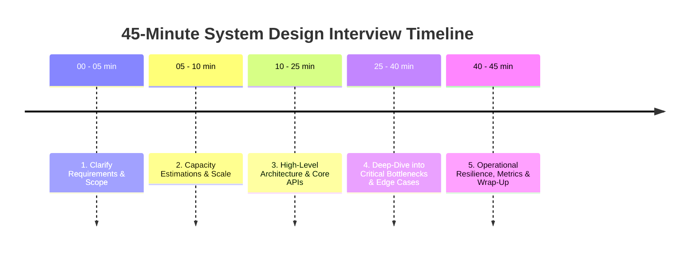
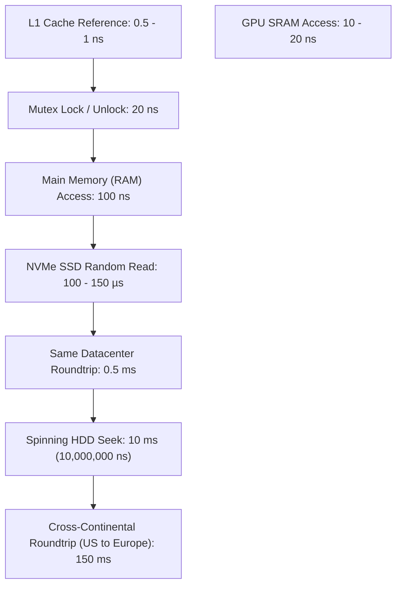
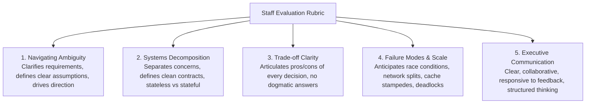

# Track 3: System Design
## Chapter 7: The 45-Minute Interview Execution Framework & Cheat Sheets

> 🧭 **Navigation**: [⬅️ Previous: 06: AI & Data System Design](06-ai-system-design.md) | [🏠 System Design Track Index](README.md) | [➡️ Next: HLD 01: Framework & Components](hld/01-hld-framework-and-components.md)

---

Succeeding in a system design interview is as much about communication structure and driving the discussion as it is about technical knowledge. Interviewers evaluate whether you can lead an ambiguous technical initiative from vague requirements to an architected, resilient production system.

---

### 1. The 45-Minute Interview Battle Plan

#### Step 1: Clarify Scope & Requirements (5 Minutes)
- **Never jump immediately into drawing architecture diagrams!**
- Ask targeted clarifying questions to establish bounds:
  - *Functional Requirements*: What are the top 2–3 actions the user can perform? (e.g. "Create shortened URL" and "Redirect to original URL"). Explicitly push edge cases out of initial scope ("We will omit custom analytics dashboards for now").
  - *Non-Functional Requirements*:
    - Latency targets (e.g. redirect $< 15\text{ms}$).
    - Availability target (e.g. 99.99% availability).
    - Consistency requirements (Strong consistency vs Eventual consistency).
    - Scale: How many Daily Active Users (DAU) or total writes/reads per day?

**Real-World Industry Examples**:
- **Meta (Facebook) Engineering**: Internally, engineers write "1-Pagers" before any design doc. This 1-pager explicitly lists Non-Goals (what the system will NOT do) to prevent scope creep, just like Step 1 in an interview.

#### Step 2: Back-of-the-Envelope Capacity Estimation (5 Minutes)
- Keep math rounded and simple. Interviewers test your intuition, not decimal precision.
- **Traffic Estimations**:
  - Convert Daily Requests into Average QPS:
    $$\text{Average QPS} = \frac{\text{Daily Requests}}{86,400} \approx \frac{\text{Daily Requests}}{100,000}$$
  - Rule of thumb: $\mathbf{\text{Peak QPS}} \approx 2 \times \text{to } 3 \times \mathbf{\text{Average QPS}}$.
- **Storage Estimations**:
  - $\text{Total Storage} = \text{Daily Writes} \times \text{Bytes per record} \times \text{Retention Period (days)}$.
- **Memory / Cache Estimations (80/20 Rule)**:
  - Cache 20% of daily read volume in Redis:
    $$\text{Cache RAM} = 0.20 \times \text{Daily Reads} \times \text{Payload Size}$$

#### Step 3: High-Level Architecture & Core APIs (15 Minutes)
- Define clean HTTP / gRPC contracts:
  - `POST /api/v1/resource` (payload, headers, status codes).
  - `GET /api/v1/resource/{id}`.
- Sketch the end-to-end data flow:
  `Client -> CDN -> Load Balancer -> Stateless App Services -> Cache -> Database`.
- Clearly explain data storage choice (Relational vs NoSQL vs Object Storage).

#### Step 4: Deep Dive into Critical Bottlenecks (15 Minutes)
- Proactively lead the interviewer into complex distributed challenges:
  - *"How does the system behave if the primary database fails?"*
  - *"How do we handle hot keys / celebrity users (e.g. Elon Musk tweeting)?"*
  - *"How do we guarantee idempotency during network retries?"*
  - *"How do we prevent split-brain during network partitions?"*

#### Step 5: Wrap-up & Observability (5 Minutes)
- Summarize the design against the initial non-functional goals.
- Mention key operational metrics to monitor:
  - P50, P95, P99 request latencies.
  - Error rates (HTTP 5xx spikes).
  - Cache hit rates and database replication lag.

> 💡 **Interview Tip**
> If you finish the architecture and the interviewer goes quiet, don't wait for them. Say: "I see a potential bottleneck in the database write throughput if we hit our Peak QPS. Let me explain how I would implement sharding or a write-behind cache to solve it." Drive the interview!

> 📺 **Video References**
> - ByteByteGo: System Design Interview Framework - https://www.youtube.com/@ByteByteGo
> - Gaurav Sen: System Design Interview Strategy - https://www.youtube.com/@GauravSensei

> 📖 **Must-Read Resources**
> - Alex Xu (ByteByteGo Blog): A Framework for System Design Interviews - https://blog.bytebytego.com
> - The System Design Primer: How to approach a system design interview - https://github.com/donnemartin/system-design-primer

---

### 2. Cheat Sheet: Numbers Every Systems Engineer Must Know

#### Latency Numbers by Order of Magnitude:

| Operation | Real-World Latency | Intuitive Analogy (Scaled to 1 second) |
| :--- | :--- | :--- |
| **L1 CPU Cache Reference** | 1 ns | 1 second |
| **L2 CPU Cache Reference** | 4 ns | 4 seconds |
| **Main Memory (RAM) Access** | 100 ns | 1.5 minutes |
| **Read 1 MB sequentially from RAM** | 250 µs | 3 days |
| **Read 1 MB sequentially from NVMe SSD**| 1 ms | 12 days |
| **Same Datacenter Roundtrip** | 0.5 ms | 6 days |
| **Spinning Disk (HDD) Seek** | 10 ms | 4 months! |
| **Read 1 MB sequentially from HDD** | 20 ms | 8 months! |
| **Cross-Continental Roundtrip (US to EU)** | 150 ms | 5 years! |

#### Storage & Scale Conversion Multipliers:
- $1 \text{ Byte} = 8 \text{ bits}$
- $2^{10} = 1,024 \approx \mathbf{1 \text{ KB (Thousand)}}$
- $2^{20} = 1,048,576 \approx \mathbf{1 \text{ MB (Million)}}$
- $2^{30} = 1,073,741,824 \approx \mathbf{1 \text{ GB (Billion)}}$
- $2^{40} \approx \mathbf{1 \text{ TB (Trillion)}}$
- $2^{50} \approx \mathbf{1 \text{ PB (Quadrillion)}}$

#### Quick Traffic Reference:
- **1 Million requests / day** $\approx 12\text{ QPS}$ (Average) $\implies \approx 25\text{ QPS}$ (Peak)
- **10 Million requests / day** $\approx 116\text{ QPS}$ (Average) $\implies \approx 250\text{ QPS}$ (Peak)
- **100 Million requests / day** $\approx 1,160\text{ QPS}$ (Average) $\implies \approx 2,500\text{ QPS}$ (Peak)
- **1 Billion requests / day** $\approx 11,600\text{ QPS}$ (Average) $\implies \approx 25,000\text{ QPS}$ (Peak)

**Real-World Industry Examples**:
- **Jeff Dean (Google)**: Originally compiled the "Latency Numbers Every Programmer Should Know" in a Stanford talk, which became the industry standard baseline for all back-of-the-envelope calculations at Google.

> 📺 **Video References**
> - MIT 6.006: Performance Engineering - https://www.youtube.com/playlist?list=PLUl4u3cNGP61Oq3tWYp6V_F-5jb5L2iHb

> 📖 **Must-Read Resources**
> - Jeff Dean's Original Latency Numbers - http://highscalability.com/numbers-everyone-should-know

---

### 3. Senior / Staff Candidate Evaluation Rubric

Top-tier tech companies evaluate candidates across 5 explicit signals:

**Real-World Industry Examples**:
- **Amazon (AWS)**: Evaluates heavily on "Trade-off Clarity". If you propose DynamoDB, they expect you to immediately volunteer the downsides (lack of complex joins, eventual consistency caveats) without being prompted.
- **Netflix**: Evaluates heavily on "Failure Modes" (Chaos Engineering mindset). You must proactively explain what happens when the network fails or a region goes down.

> 💡 **Interview Tip**
> Seniority is not just knowing more technologies; it's understanding the exact limits of those technologies. A junior engineer says "Kafka is fast". A senior engineer says "Kafka can achieve 1M TPS via sequential I/O and zero-copy, but it introduces operational overhead via ZooKeeper/KRaft and requires careful partition key design to maintain ordering."

---

> 🧭 **Navigation**: [⬅️ Previous: 06: AI & Data System Design](06-ai-system-design.md) | [🏠 System Design Track Index](README.md) | [➡️ Next: HLD 01: Framework & Components](hld/01-hld-framework-and-components.md)
