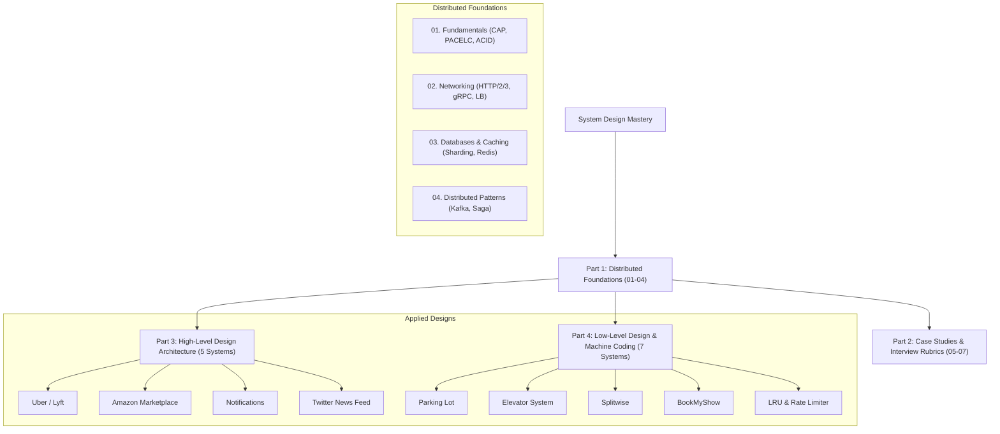

# 🏗️ Track 2: Distributed System Design (HLD & LLD)
## Master Curriculum Roadmap & Preparation Blueprint

Welcome to the **Distributed System Design Track**. In Senior, Lead, and Staff engineering interviews, System Design carries the highest weighting. This track equips you with core architectural primitives, distributed systems theory, networking protocols, database scaling strategies, end-to-end High-Level Design (HLD), and object-oriented Low-Level Design (LLD).

---

## 🗺️ Visual Track Roadmap

---

## 📚 Complete Syllabus Directory

### 🏛️ Part 1: Core Theory & Fundamentals
| # | Chapter | Key Architectural Topics | Real-World Context |
|---|---|---|---|
| **01** | [**Fundamentals**](./01-system-design-fundamentals.md) | Scalability, CAP vs PACELC, ACID vs BASE, Availability math (99.999%) | AWS DynamoDB, Google Spanner |
| **02** | [**Networking & Proxies**](./02-networking-and-proxies.md) | HTTP/2 vs HTTP/3 (QUIC), gRPC, WebSockets, L4 vs L7 Load Balancers | Cloudflare Edge, Netflix Zuul |
| **03** | [**Databases & Caching**](./03-databases-and-caching.md) | Sharding, Consistent Hashing (VNodes), Redis Caching, Cache Stampede | Discord ScyllaDB, Notion PostgreSQL |
| **04** | [**Distributed Patterns**](./04-distributed-patterns.md) | Kafka (Partitions, Offsets), Saga Orchestration/Choreography, Outbox, Redlock | Uber Kafka Pipeline, Stripe Idempotency |
| **05** | [**Classic Case Studies**](./05-classic-case-studies.md) | TinyURL Shortener, WhatsApp Chat, Flash Sale E-Commerce | Real FAANG system designs |
| **06** | [**AI System Design**](./06-ai-system-design.md) | Large-Scale Enterprise RAG, Recommendation Systems, LLM Gateway | Notion AI, TikTok RecSys |
| **07** | [**45-Min Interview Rubric**](./07-interview-framework-and-rubrics.md) | Estimation math, latency numbers, 4-step interview timing formula | FAANG scoring rubrics |

### 🌐 Part 2: High-Level Design (HLD) Case Studies
| # | Case Study | Key Components |
|---|---|---|
| **HLD 01** | [**HLD Framework & Components**](./hld/01-hld-framework-and-components.md) | Core system components, architectural patterns, sizing cheat sheets |
| **HLD 02** | [**Uber / Lyft Ride-Sharing**](./hld/02-ride-sharing-uber-lyft.md) | Geospatial indexing with Uber H3 hexagons, driver matching, surge pricing |
| **HLD 03** | [**Amazon E-Commerce Marketplace**](./hld/03-ecommerce-marketplace-amazon.md) | Order processing, Saga orchestration, inventory reservations, payment flows |
| **HLD 04** | [**Scalable Notification System**](./hld/04-scalable-notification-system.md) | Multi-channel priority queues, push notification rate-limiting, deduplication |
| **HLD 05** | [**Twitter / X News Feed**](./hld/05-twitter-news-feed-system.md) | Fanout-on-write vs Fanout-on-read, timeline caching, celebrity problem |

### 💻 Part 3: Low-Level Design (LLD / Machine Coding)
| # | Design Problem | Key Patterns & Implementations (Python & Java) |
|---|---|---|
| **LLD 01** | [**Principles & Design Patterns**](./lld/01-lld-principles-and-design-patterns.md) | SOLID principles, Factory, Strategy, Observer, Decorator |
| **LLD 02** | [**Parking Lot System**](./lld/02-parking-lot-system.md) | Multi-floor spot assignment, vehicle types, Strategy fee calculation |
| **LLD 03** | [**Elevator System**](./lld/03-elevator-system.md) | LOOK / SCAN scheduling algorithms, state pattern, dispatch controller |
| **LLD 04** | [**LRU Cache & Rate Limiter**](./lld/04-lru-cache-and-rate-limiter.md) | HashMap + Doubly Linked List O(1), Token Bucket rate limiter |
| **LLD 05** | [**Splitwise Expense Sharing**](./lld/05-splitwise-expense-sharing.md) | Expense split strategies (Equal, Exact, %), Min Cash Flow heap algorithm |
| **LLD 06** | [**BookMyShow Movie Booking**](./lld/06-movie-ticket-booking-bookmyshow.md) | Seat status state machine, concurrency locks, payment timeout handling |
| **LLD 07** | [**In-Memory Key-Value Store**](./lld/07-in-memory-key-value-store.md) | Nested transaction stack, BEGIN / COMMIT / ROLLBACK deltas |

---

## 🧭 Navigation
- ⬅️ **Previous Track**: [Track 1: Data Structures & Algorithms](../dsa/README.md)
- 🏠 **Root Index**: [Master Interview Guide](../README.md)
- ➡️ **Next Track**: [Track 3: Senior AI Role](../Senior%20AI%20Role/README.md)
