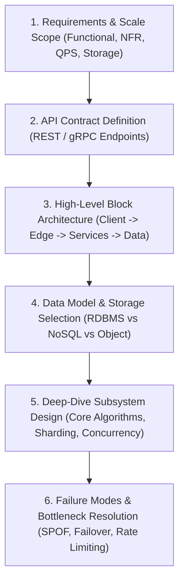
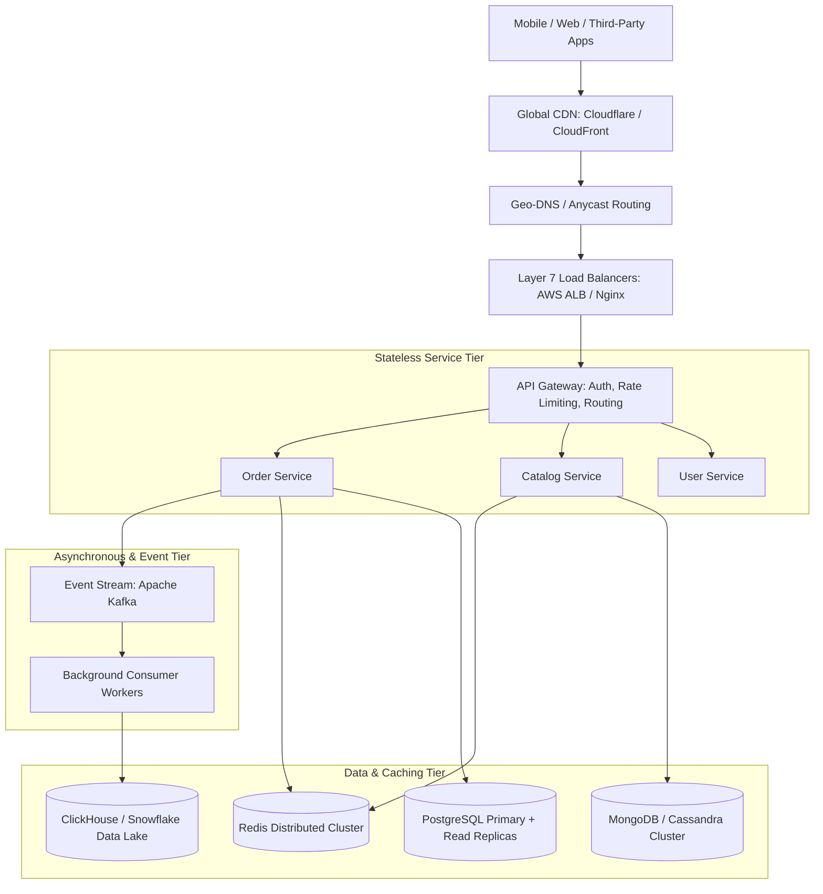

# Track 3: System Design — High-Level Design (HLD)
## Chapter 1: High-Level Design Framework & Component Architecture

> 🧭 **Navigation**: [⬅️ Previous: 07: Interview Framework & Rubrics](../07-interview-framework-and-rubrics.md) | [🏠 System Design Track Index](../README.md) | [➡️ Next: HLD 02: Uber / Lyft](02-ride-sharing-uber-lyft.md)

---

High-Level Design (HLD) interviews assess your ability to architect end-to-end distributed systems. The goal is not writing code, but mapping business requirements to scalable, decoupled components, establishing data boundaries, and guaranteeing high availability.

---

### 1. The 6-Step HLD Architecture Framework



**Real-World Industry Examples**:
- **AWS Well-Architected Framework**: Amazon mandates a very similar multi-pillar review for all production services, verifying operational excellence, security, reliability, performance efficiency, and cost optimization before launch.

> 💡 **Interview Tip**
> Stick to the framework linearly. If you jump from API design straight into explaining how a cache stampede works before defining your database schema, you will lose the interviewer's context and get penalized for lack of structure.

> 📺 **Video References**
> - ByteByteGo: How to approach a system design interview - https://www.youtube.com/@ByteByteGo
> - Gaurav Sen: System Design Framework - https://www.youtube.com/@GauravSensei

> 📖 **Must-Read Resources**
> - AWS Architecture Center: Well-Architected - https://aws.amazon.com/architecture/well-architected/
> - Alex Xu Blog - https://blog.bytebytego.com

---

### 2. High-Level Component Topology

Every enterprise HLD follows a layered component topology:



**Real-World Industry Examples**:
- **Airbnb**: Follows this exact topology strictly. Their edge tier handles all CDN/WAF routing, funneling into an API Gateway layer (Envoy) which routes to thousands of stateless Ruby/Java microservices, heavily backed by Redis and MySQL sharded clusters.
- **Netflix**: Uses Open Connect (Custom CDN) -> AWS ELB -> Zuul API Gateway -> Stateless microservices -> EVCache (Memcached) -> Cassandra data tier.

> 💡 **Interview Tip**
> Draw the topology top-to-bottom or left-to-right clearly on the whiteboard. Group components logically. Explicitly label the "Stateless Tier" and "Stateful Data Tier" to show you understand that scaling web servers is vastly different from scaling databases.

> 📺 **Video References**
> - InfoQ / QCon: Microservices architectures - https://www.youtube.com/@qcon
> - Stanford CS25: Distributed systems topologies - https://www.youtube.com/playlist?list=PLoROMvodv4rNiJRchCzutFw5ItR_ZEDY

> 📖 **Must-Read Resources**
> - Airbnb Engineering: Architecture - https://medium.com/airbnb-engineering
> - Netflix Tech Blog: Edge Architecture - https://netflixtechblog.com

---

### 3. Key Architectural Decision Matrix for HLD

| Decision Dimension | Option A | Option B | Interview Selection Criteria |
| :--- | :--- | :--- | :--- |
| **Service Architecture**| Monolithic Architecture | Microservices Architecture | Default to modular monolith for small teams; microservices when teams/domains scale independently. |
| **Communication** | Synchronous REST / gRPC | Asynchronous Messaging (Kafka) | Synchronous for immediate read queries; Asynchronous for mutations, side-effects, and notifications. |
| **Data Consistency** | Strong Consistency (ACID) | Eventual Consistency (BASE) | Strong consistency for financial ledgers/inventory; Eventual for feeds, analytics, and social graphs. |
| **Caching Layer** | Local In-Memory Cache | Distributed Redis Cluster | Local cache for immutable static configurations; Redis for shared, high-scale session and entity state. |

**Real-World Industry Examples**:
- **Amazon Prime Video**: Recently published a famous blog post detailing how they migrated a serverless microservices architecture *back* to a monolith to save 90% on costs for an internal video monitoring tool. Use this example to show you aren't dogmatic about microservices!
- **Uber**: Migrated from a monolithic Node.js backend to thousands of Go microservices, and later grouped them into "Macroservices" (Domain-Oriented Microservices) to reduce complexity.

#### Expanded Code Example: Graceful Degradation in Microservices

```python
# Python 3: Circuit Breaker implementation for Synchronous Calls
import time

class CircuitBreaker:
    def __init__(self, failure_threshold=3, recovery_timeout=10):
        self.failure_threshold = failure_threshold
        self.recovery_timeout = recovery_timeout
        self.failures = 0
        self.last_failure_time = None
        self.state = "CLOSED" # CLOSED, OPEN, HALF_OPEN

    def call(self, func, *args, fallback_func=None):
        if self.state == "OPEN":
            if time.time() - self.last_failure_time > self.recovery_timeout:
                self.state = "HALF_OPEN"
            else:
                return fallback_func() if fallback_func else "Service Unavailable"

        try:
            result = func(*args)
            if self.state == "HALF_OPEN":
                self.state = "CLOSED"
                self.failures = 0
            return result
        except Exception as e:
            self.failures += 1
            self.last_failure_time = time.time()
            if self.failures >= self.failure_threshold:
                self.state = "OPEN"
            return fallback_func() if fallback_func else "Service Unavailable"

# Test Case
def unreliable_service():
    raise Exception("Timeout!")

def fallback():
    return "Cached / Fallback Data"

cb = CircuitBreaker()
for _ in range(4):
    print(cb.call(unreliable_service, fallback_func=fallback))
```

```java
// Java 17: Fallback logic outline (using a conceptual Circuit Breaker)
import java.util.concurrent.Callable;

public class CircuitBreakerDemo {
    private int failures = 0;
    private final int threshold = 3;
    private boolean open = false;

    public String execute(Callable<String> apiCall, Callable<String> fallback) {
        if (open) {
            try { return fallback.call(); } catch(Exception e) { return "Error"; }
        }
        try {
            String res = apiCall.call();
            failures = 0;
            return res;
        } catch (Exception e) {
            failures++;
            if (failures >= threshold) open = true;
            try { return fallback.call(); } catch(Exception ex) { return "Error"; }
        }
    }
    
    public static void main(String[] args) {
        CircuitBreakerDemo cb = new CircuitBreakerDemo();
        for (int i = 0; i < 4; i++) {
            System.out.println(cb.execute(
                () -> { throw new RuntimeException("Fail"); }, 
                () -> "Fallback Data"
            ));
        }
    }
}
```

> 💡 **Interview Tip**
> Whenever you have two microservices communicating synchronously (e.g. A calls B over HTTP), explicitly mention "Circuit Breakers" and "Retries with Exponential Backoff". Interviewers look for this to prove you understand that networks are unreliable.

> 📺 **Video References**
> - Martin Fowler: Microservices - https://www.youtube.com/playlist?list=PLPjA74v77oO2Vl5fCMyO8h-YqU4m8mK7A

> 📖 **Must-Read Resources**
> - Amazon Prime Video Blog: Monolith migration - https://www.primevideotech.com/video-streaming/scaling-up-the-audio-video-monitoring-service-and-reducing-costs-by-90
> - Martin Fowler: Circuit Breaker - https://martinfowler.com/bliki/CircuitBreaker.html

---

> 🧭 **Navigation**: [⬅️ Previous: 07: Interview Framework & Rubrics](../07-interview-framework-and-rubrics.md) | [🏠 System Design Track Index](../README.md) | [➡️ Next: HLD 02: Uber / Lyft](02-ride-sharing-uber-lyft.md)
