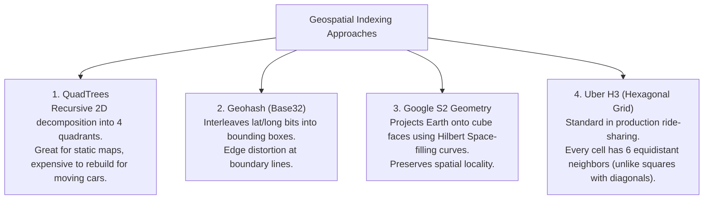
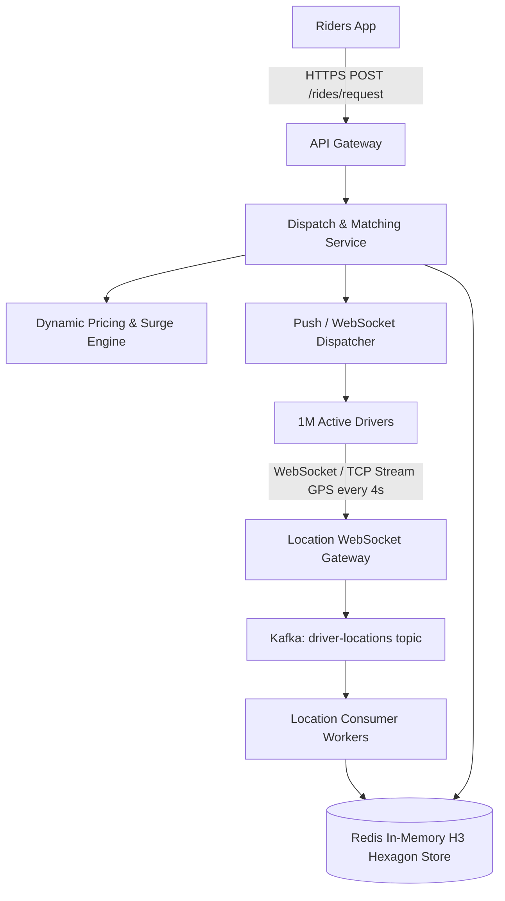

# Track 3: System Design — High-Level Design (HLD)
## Chapter 2: HLD Case Study: Real-Time Ride-Sharing Service (Uber / Lyft)

> 🧭 **Navigation**: [⬅️ Previous: HLD 01: Framework & Components](01-hld-framework-and-components.md) | [🏠 System Design Track Index](../README.md) | [➡️ Next: HLD 03: Amazon Marketplace](03-ecommerce-marketplace-amazon.md)

---

Designing a ride-sharing service evaluates geospatial data modeling, handling massive ingestion streams (1M+ concurrent GPS broadcasts), real-time matching algorithms, and dynamic surge pricing.

---

### 1. Requirements & Scale Estimations

#### Scale:
- **Active Users**: 100M riders, 1M active drivers.
- **Location Broadcast Frequency**: Drivers stream latitude/longitude every **4 seconds**.
- **Ingestion Write QPS**:
  $$\text{Location Updates QPS} = \frac{1,000,000 \text{ drivers}}{4 \text{ seconds}} = \mathbf{250,000 \text{ writes/sec}}$$
- **Peak Write QPS**: $250,000 \times 2 \approx \mathbf{500,000 \text{ writes/sec}}$.

**Real-World Industry Examples**:
- **Uber**: Handles hundreds of thousands of concurrent driver GPS pings globally. They utilize highly optimized Kafka pipelines and append-only datastores to ingest these telematics without dropping packets.

> 💡 **Interview Tip**
> Always calculate the ingestion QPS for IoT/telemetry heavy systems first. $250,000$ writes/sec immediately rules out a standard relational DB (PostgreSQL/MySQL maxes out around 10k-50k writes/sec per node). You must propose an in-memory datastore (Redis) or a massive wide-column store (Cassandra) for this ingestion.

> 📺 **Video References**
> - ByteByteGo: Design Uber - https://www.youtube.com/@ByteByteGo
> - Gaurav Sen: System Design Uber - https://www.youtube.com/@GauravSensei

> 📖 **Must-Read Resources**
> - Uber Engineering: Geospatial Indexing - https://www.uber.com/en-US/blog/engineering/

---

### 2. The Core Geospatial Dilemma: How to Index Moving Drivers

Traditional relational databases cannot execute $250,000$ spatial queries per second (`SELECT * FROM drivers WHERE distance(lat, lon, user_lat, user_lon) < 5km`).



#### Why Hexagonal Hierarchical Indexing (Uber H3) Wins:
- In square grids (Geohash), orthogonal neighbors are at distance $D$, while diagonal neighbors are at distance $D\sqrt{2}$ (the "boundary problem").
- In a **Hexagonal Grid (H3)**, all $6$ adjacent neighbor cells are at the **exact same distance** $D$. Finding all drivers within a radius simply requires traversing neighboring rings of hexagon cells!

**Real-World Industry Examples**:
- **Uber H3**: Uber open-sourced their H3 library, which splits the Earth into hexagonal grids. A driver's lat/long is mapped to a 64-bit integer representing the cell ID.
- **Tinder**: Uses geospatial indexing (like Geohash or Elasticsearch geospatial queries) to find users near you, but since users don't move at 60mph, they can afford slower indexing mechanisms compared to ride-sharing.

> 💡 **Interview Tip**
> Mentioning Uber H3 is a guaranteed way to score maximum points on this question. Explain *why* hexagons are better than squares (equidistant neighbors make radius searches $O(1)$ ring traversals).

> 📺 **Video References**
> - Uber Engineering Talks: H3 Geospatial Indexing - https://www.youtube.com/@Uber

> 📖 **Must-Read Resources**
> - Uber H3 Open Source Docs - https://h3geo.org/
> - High Scalability: Architecture of Uber - http://highscalability.com

---

### 3. End-to-End High-Level Architecture



**Real-World Industry Examples**:
- **Lyft**: Uses a very similar pipeline utilizing Amazon Kinesis/Kafka to stream locations into a highly available Redis cluster for fast retrieval during the matching phase.
- **Grab (Southeast Asia)**: Built enormous real-time data pipelines to ingest driver locations, utilizing Redis for hot data and streaming historical tracks to data lakes for machine learning analysis on optimal routes.

> 💡 **Interview Tip**
> Drivers are moving, which means their connections are unstable. Specify that you would use **HTTP/3 (QUIC)** for the driver app to handle network migrations (cellular tower handoffs) without dropping the WebSocket/TCP connection!

---

### 4. Step-by-Step Ride Matching Workflow

1. **Driver Ingestion**:
   - Drivers maintain persistent WebSocket connections.
   - Every 4 seconds, the driver phone sends: `{"driver_id": "D101", "lat": 37.7749, "lon": -122.4194, "status": "AVAILABLE"}`.
   - Gateway publishes to **Kafka**. Kafka partition key is `driver_id`.
   - Consumer workers compute the **H3 Hexagon Cell ID** (e.g. `resolution 8` $\approx 460$ meters diameter) and store it in an in-memory **Redis Hash / Geospatial index**.
2. **Rider Request & Search**:
   - Rider requests a trip at coordinate $(lat, lon)$.
   - Dispatch service computes the Rider's current H3 cell ID.
   - Queries Redis for all available drivers within the current cell + adjacent 1-ring and 2-ring hexagons ($1 + 6 + 12 = 19$ cells total).
   - Redis returns candidate driver IDs in $< 5\text{ms}$.
3. **Driver Assignment (Batch Matching)**:
   - Instead of greedy assignment (first driver gets the ride), dispatch collects ride requests over a 5-second window and executes the **Hungarian Algorithm** (minimum-weight bipartite matching) to minimize overall passenger wait time and driver deadhead distance.
4. **Surge Pricing**:
   - Compares the ratio of active ride requests (Demand) to available drivers (Supply) in each H3 hexagon over the past 5 minutes. If $\frac{\text{Demand}}{\text{Supply}} > 1.5$, surge multiplier automatically increases.

#### Expanded Code Example: H3 Neighbor Traversal Concept

```python
# Python 3: Conceptual representation of finding available drivers in rings
import h3

def find_drivers_nearby(rider_lat, rider_lon, ring_size=2):
    # 1. Get Rider's Hexagon ID (Resolution 8)
    rider_hex = h3.latlng_to_cell(rider_lat, rider_lon, 8)
    
    # 2. Get neighbor hexagons up to 'ring_size'
    # k_ring returns the center cell + all neighbors within k rings
    nearby_hexes = h3.k_ring(rider_hex, ring_size)
    
    available_drivers = []
    # 3. Query Redis for drivers in these hexes
    # e.g. SMEMBERS hex:{hex_id}:drivers
    for hex_id in nearby_hexes:
        drivers = query_redis_for_hex(hex_id)
        available_drivers.extend(drivers)
        
    return available_drivers

def query_redis_for_hex(hex_id):
    # Mocking redis return
    return ["driver_1", "driver_2"] if hex_id.endswith("1") else []
```

```java
// Java 17: Conceptual H3 usage
// Note: Requires H3-Java library
public class RideMatcher {
    public List<String> findDriversNearby(double lat, double lon, int rings) {
        // H3Core h3 = H3Core.newInstance();
        // long riderHex = h3.geoToH3(lat, lon, 8);
        // List<Long> nearbyHexes = h3.kRing(riderHex, rings);
        
        List<String> availableDrivers = new ArrayList<>();
        // for (Long hexId : nearbyHexes) {
        //     availableDrivers.addAll(queryRedis(hexId));
        // }
        availableDrivers.add("driver_A"); // Mock
        return availableDrivers;
    }
}
```

> 📺 **Video References**
> - MIT 6.006: Bipartite Matching algorithms - https://www.youtube.com/playlist?list=PLUl4u3cNGP61Oq3tWYp6V_F-5jb5L2iHb

> 📖 **Must-Read Resources**
> - Uber Engineering: Matching Algorithms - https://www.uber.com/en-US/blog/engineering/

---

> 🧭 **Navigation**: [⬅️ Previous: HLD 01: Framework & Components](01-hld-framework-and-components.md) | [🏠 System Design Track Index](../README.md) | [➡️ Next: HLD 03: Amazon Marketplace](03-ecommerce-marketplace-amazon.md)
