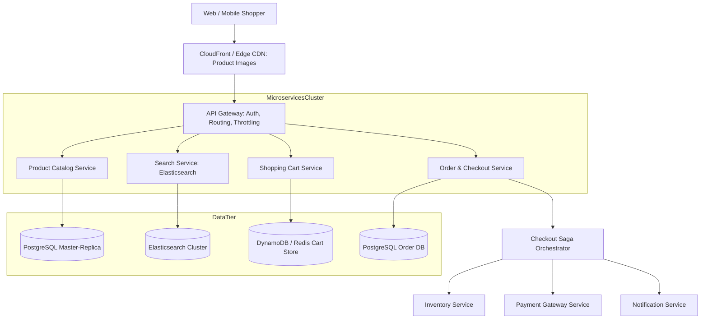
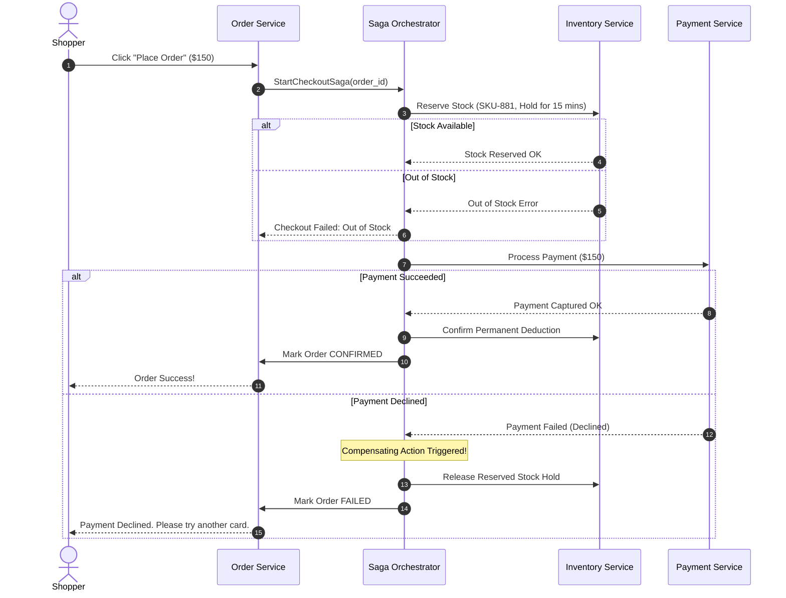

# Track 3: System Design — High-Level Design (HLD)
## Chapter 3: HLD Case Study: Scalable E-Commerce Marketplace (Amazon / Flipkart)

Designing an enterprise e-commerce platform evaluates domain separation, search scalability, cart persistence across sessions, and resilient distributed order checkouts using the Saga Pattern.

---

### 1. Functional & Non-Functional Requirements

#### Functional Requirements:
1. **Catalog & Search**: Browse 100M+ products; full-text search with filtering by category, brand, and price.
2. **Shopping Cart**: Real-time addition, modification, and persistence across devices and anonymous-to-authenticated transitions.
3. **Checkout & Order Processing**: Atomic inventory reservation, payment authorization, order confirmation.
4. **Order History & Tracking**: Real-time shipment status tracking.

#### Non-Functional Requirements:
- **Availability**: High availability (99.99%) for catalog browsing and cart (AP model).
- **Consistency**: **Strict Consistency (ACID)** for payment and inventory ledger to prevent overselling.
- **Latency**: Product page load $< 100\text{ms}$; Search $< 150\text{ms}$.

**Real-World Industry Examples**:
- **Amazon**: The catalog browsing and shopping cart are historically AP systems (from the Dynamo paper—"always writable"). The checkout pipeline is strictly CP (strongly consistent) to ensure billing accuracy.
- **Flipkart**: Rebuilt their entire monolith into thousands of microservices, splitting the "Browse" flow (high QPS, eventual consistency) completely away from the "Order" flow (lower QPS, strict consistency).

> 💡 **Interview Tip**
> Explicitly split your design in two: The **Shopping Phase** (Search, Catalog, Cart) which must be highly available and heavily cached, and the **Checkout Phase** (Inventory, Payment, Order) which must be strongly consistent and transactional.

> 📺 **Video References**
> - ByteByteGo: Design Amazon / E-Commerce - https://www.youtube.com/@ByteByteGo
> - Gaurav Sen: E-Commerce System Design - https://www.youtube.com/@GauravSensei

> 📖 **Must-Read Resources**
> - Amazon Builder's Library - https://aws.amazon.com/builders-library/
> - High Scalability: Amazon Architecture - http://highscalability.com

---

### 2. High-Level Architecture Topology



**Real-World Industry Examples**:
- **Shopify**: Uses massive Edge CDNs (Cloudflare) to cache product images and descriptions so requests don't even hit their datacenters. Their primary datastores are highly sharded MySQL instances.
- **Etsy**: Utilizes extensive caching and isolated microservices to handle holiday traffic spikes, with a strong emphasis on isolating the Search cluster (Elasticsearch/Solr) from the transactional databases.

---

### 3. Subsystem Deep-Dives

#### 1. Search & Catalog Ingestion:
- Product updates in the primary PostgreSQL database stream via **Change Data Capture (CDC / Debezium)** into Kafka.
- Ingestion workers consume the stream and update the **Elasticsearch cluster** asynchronously within $< 1$ second, keeping heavy search load completely isolated from the transactional database.

#### 2. The Resilient Checkout Saga Orchestrator:
Payment and inventory span different microservices with independent databases. We cannot use distributed 2-Phase Commit (2PC). We execute an **Orchestrated Saga**:



#### Expanded Code Example: Idempotent Payment Processing

When retrying payments over flaky networks, idempotency keys prevent double-charging a customer.

```python
# Python 3: Idempotent Payment Handler using Redis
import redis

r = redis.Redis()

def charge_credit_card(user_id, amount, idempotency_key):
    # 1. Check if we already processed this exact request
    if r.get(f"payment_intent:{idempotency_key}"):
        return {"status": "already_processed", "message": "Payment already succeeded"}

    # 2. Call external Stripe/Braintree API
    # stripe.Charge.create(...)
    success = True # Mocking API response
    
    if success:
        # 3. Store idempotency key to prevent double charge (TTL 24 hours)
        r.setex(f"payment_intent:{idempotency_key}", 86400, "success")
        return {"status": "success"}
    else:
        return {"status": "failed"}

# Test Case
print(charge_credit_card("u123", 150.00, "idem_abc123")) # Success
print(charge_credit_card("u123", 150.00, "idem_abc123")) # already_processed
```

```java
// Java 17: Conceptual Idempotency Check
import java.util.Map;
import java.util.HashMap;

public class PaymentService {
    // Mocking a cache
    private Map<String, Boolean> idempotencyCache = new HashMap<>();

    public String chargeCreditCard(String userId, double amount, String idempotencyKey) {
        if (idempotencyCache.containsKey(idempotencyKey)) {
            return "Already Processed";
        }
        
        // External API Call here...
        boolean success = true;
        
        if (success) {
            idempotencyCache.put(idempotencyKey, true);
            return "Success";
        }
        return "Failed";
    }
}
```

> 💡 **Interview Tip**
> The biggest trap in E-Commerce interviews is not mentioning **Idempotency**. If a user's mobile app loses connection right after hitting "Pay", the app will retry. The payment gateway MUST use an `Idempotency-Key` header so the backend knows not to charge the card twice.

> 📺 **Video References**
> - AWS Architecture: Saga Pattern - https://www.youtube.com/@aws
> - Martin Kleppmann: Microservices and Kafka - https://www.youtube.com/playlist?list=PLeKd45zvjcDFUEv_ohr_HdUFe97RIt8b

> 📖 **Must-Read Resources**
> - Stripe Engineering: Idempotency Keys - https://stripe.com/blog/idempotency
> - Microservices.io: Saga Pattern - https://microservices.io/patterns/data/saga.html
