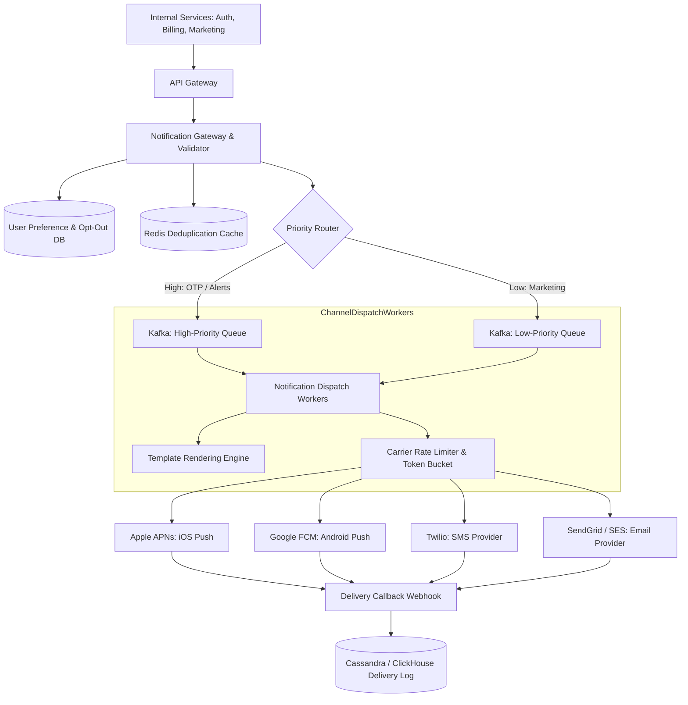

# Track 3: System Design — High-Level Design (HLD)
## Chapter 4: HLD Case Study: Scalable Multi-Channel Notification Service

A centralized notification system sends billions of notifications daily across **Push (APNs/FCM)**, **SMS**, **Email**, and **In-App** channels while enforcing priority queues, deduplication, user preferences, and carrier rate limits.

---

### 1. Requirements & Scale

#### Scale:
- **Daily Volume**: 1 billion notifications per day ($\approx 12,000 \text{ notifications/sec}$).
- **Peak Volume**: $30,000 \text{ notifications/sec}$.

#### Functional Requirements:
1. **Multi-Channel Dispatch**: Push (iOS APNs, Android FCM), SMS (Twilio, Sinch), Email (SendGrid, AWS SES), and In-App inbox.
2. **Priority Tiers**:
   - **Critical / Transactional (High Priority)**: One-Time Passwords (OTPs), fraud alerts, payment confirmations (must deliver in $< 5\text{ seconds}$).
   - **Promotional (Low Priority)**: Marketing newsletters, discount banners (can buffer for minutes/hours).
3. **Deduplication**: Prevents sending duplicate emails/SMS if the upstream service retries.
4. **User Preference Compliance**: Enforces opt-outs, category preferences, and "Do Not Disturb" quiet hours.

> 💡 **Interview Tip**
> Interviewers often look for how you handle rate limiting by external providers (like Twilio or APNs) and what happens when those providers go down. Discussing circuit breakers, dead letter queues (DLQs), and fallback mechanisms will set you apart.

---

### 2. High-Level Architecture Topology

---

### 3. Critical Subsystems Design & Real-World Context

#### 1. Real-World Architectures
- **Airbnb's Notification Service**: Airbnb built a massively scalable system using Kafka to decouple notification production from consumption. They process over 2 billion notifications per day, handling complex user preferences across multiple channels.
- **Firebase Cloud Messaging (FCM)**: Google's FCM routes messages to billions of active Android devices globally, acting as the de-facto push layer, maintaining persistent connections with devices.
- **Slack's Push Architecture**: Slack uses a complex tiering system for push notifications, aggressively collapsing multiple unread messages into a single push payload to avoid overwhelming users' lock screens.

#### 2. Deduplication (Idempotency Filter)
- Before dispatching a notification, compute a cryptographic hash of:
  $$\text{Dedupe Key} = \text{MD5}(\text{user\_id} + \text{event\_type} + \text{payload\_content})$$
- Check Redis with `SET dedupe_key "1" EX 300 NX` (5-minute TTL).
- If key already exists, discard the duplicate immediately.

#### 3. Template Rendering
- Templates are stored in a distributed key-value store with versioning (e.g. `otp_email_v3`).
- Compiles placeholders dynamically based on user locale:
  `Hello {{ name }}, your verification code is {{ code }}.`

#### 4. Third-Party Provider Failover & Circuit Breakers
- External providers (like Twilio or SendGrid) experience periodic outages.
- The dispatch worker wraps provider calls in a **Circuit Breaker**:
  - If Twilio returns 5xx errors for $> 5\%$ of requests over 1 minute, the circuit trips to `OPEN`.
  - Traffic automatically routes to secondary provider (e.g. Sinch or AWS SNS) with zero manual intervention.

---

> 📺 **Video References**
> - ByteByteGo: Design a Notification System (https://www.youtube.com/watch?v=bBTPZ9NdSk8)
> - Gaurav Sen: System Design: Notification Service (https://www.youtube.com/c/GauravSensei)

> 📖 **Must-Read Resources**
> - Medium (Airbnb Engineering): Notification at Airbnb (https://medium.com/airbnb-engineering)
> - Uber Engineering: Designing an Extensible and Scalable Notification System (https://www.uber.com/en-US/blog/engineering/)
> - Firebase Documentation (https://firebase.google.com/docs/cloud-messaging)
