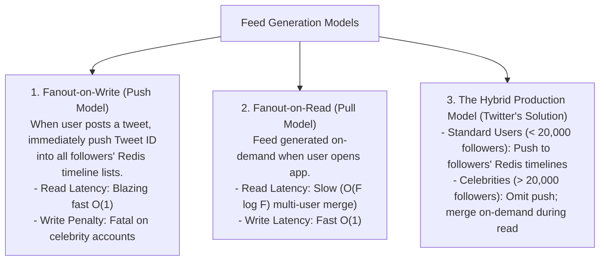
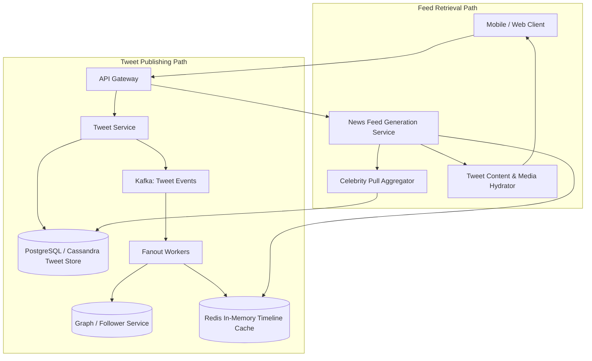

# Track 3: System Design — High-Level Design (HLD)
## Chapter 5: HLD Case Study: Scalable News Feed System (Twitter / X)

Designing a global real-time news feed system evaluates write vs read amplification, fanout architectures, Redis timeline caching, and handling the **"Celebrity Problem"**.

---

### 1. Requirements & Scale Estimations

#### Scale:
- **Active Users**: 300 million Daily Active Users (DAU).
- **Tweet Volume**: 500 million tweets published per day ($\approx 6,000 \text{ writes/sec}$, peak $12,000 \text{ writes/sec}$).
- **Feed Reads**: 30 billion feed queries per day ($\approx 350,000 \text{ reads/sec}$).
- **Read-to-Write Ratio**: $60:1$ (Massively read-heavy).

> 💡 **Interview Tip**
> The most critical point in a news feed interview is how you address the asymmetry of the "Celebrity Problem" (Justin Bieber effect). Do not start with a hybrid approach right away; explain the naive approaches (Fanout-on-Write and Fanout-on-Read), detail why they fail at scale, and THEN introduce the hybrid model as the logical solution.

---

### 2. Real-World Production Context

- **Twitter's Fanout Architecture**: In an iconic 2013 architecture breakdown, Twitter explained how they use a dedicated "Timeline Service" powered by Redis clusters to maintain materialized views of feeds for fast O(1) retrieval.
- **Instagram's Migration**: Instagram originally built its feed generation in PHP using PostgreSQL. As they hit scale, they aggressively sharded and later migrated parts of their infrastructure to Python, focusing heavily on read-time materialization and async task queues.
- **TikTok's Recommendation Engine**: Unlike Twitter's reverse-chronological graph feed, TikTok uses ML-heavy "For You" feeds. The infrastructure involves heavy streaming pipelines (Flink/Kafka) to update feature stores in real-time, matching content embeddings with user embeddings.

---

### 3. The Core Architecture Dilemma: Fanout-on-Write vs Fanout-on-Read

#### Why Pure Push Fails on Celebrities:
If a celebrity with 100 million followers tweets:
- A single write triggers **100,000,000 concurrent Redis list insertions**!
- This causes massive write queue saturation and latency spikes for all other users.

---

### 4. End-to-End Hybrid Architecture

#### Step-by-Step Execution:
1. **User Tweets**:
   - Stored in primary database.
   - Dispatched to **Kafka** with `user_id` and `tweet_id`.
2. **Fanout Worker**:
   - Queries `Follower Service` for the author's followers.
   - If author is **standard user**: Executes `LPUSH user:<follower_id>:timeline tweet_id` in Redis (capped at 800 recent tweet IDs).
   - If author is **celebrity**: Skips push fanout entirely!
3. **User Reads Feed**:
   - Feed service fetches top 800 tweet IDs from the user's personal Redis timeline.
   - Fetches recent tweets from all celebrities the user follows.
   - Merges and sorts candidates chronologically in memory ($< 10\text{ms}$).
   - Hydrates tweet IDs with user profile, text, and media URLs from cache.

---

> 📺 **Video References**
> - ByteByteGo: Design a News Feed System (https://www.youtube.com/@ByteByteGo)
> - Gaurav Sen: Design Instagram (https://www.youtube.com/@GauravSensei)

> 📖 **Must-Read Resources**
> - The System Design Primer: https://github.com/donnemartin/system-design-primer
> - InfoQ: Twitter's Architecture (Timeline Fanout) (https://www.infoq.com)
> - Meta Engineering Blog: News Feed Architecture (https://engineering.fb.com)
